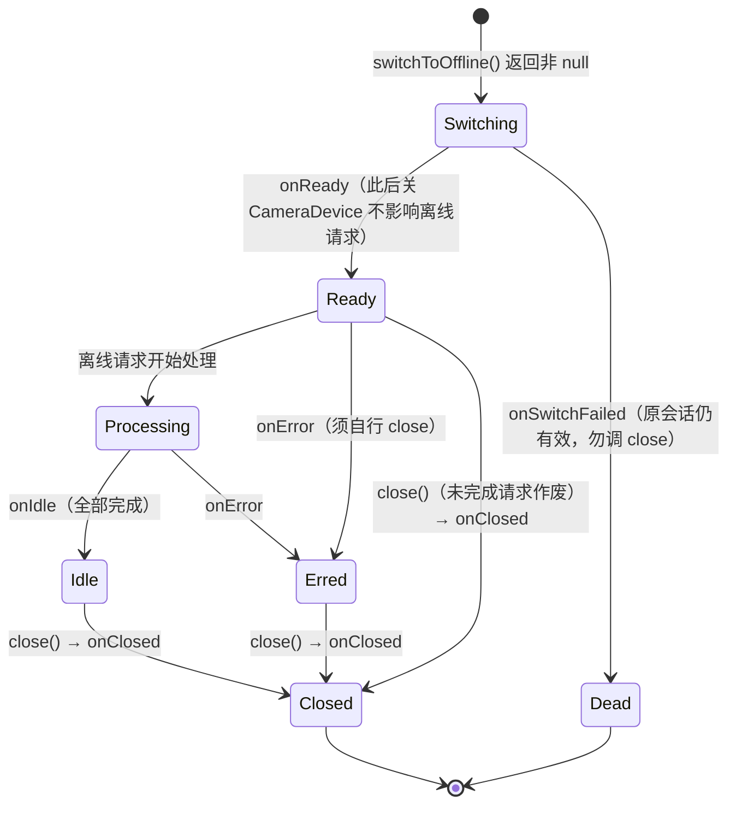
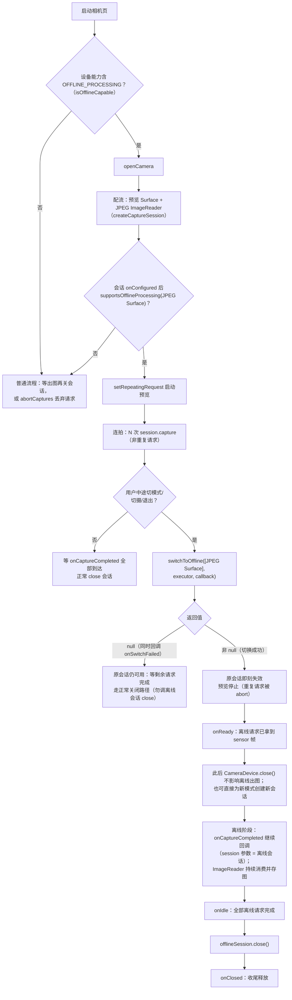
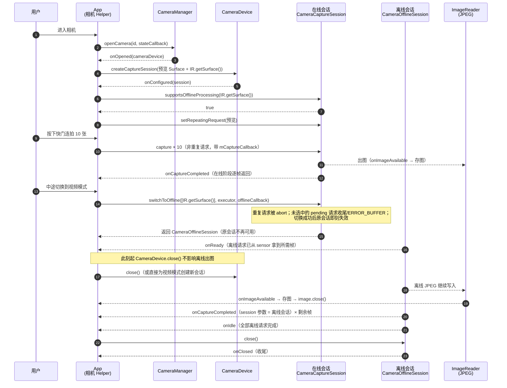
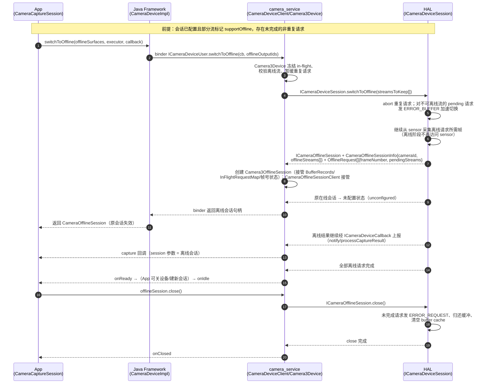

# Android Camera OfflineSession 离线会话文档（官方源码级解析）

> 本文档是相机学习系列的**专题文档**：把"离线会话（Offline Session）"这一机制从 **App 公开 API → Camera Service / Framework 原生层 → HAL AIDL 协议**三层完整讲清。所有关键语义均取自官方源码注释与官方 API 参考页，逐条给出出处链接（见附录 A）。
>
> 整理日期：2026-10-25。本篇内容几乎全部为 **A 层**（AOSP 源码 / developer.android.com 官方参考）；个别工程实践建议（场景选用、CameraX 现状）以 B/C 层标注。
> 版本事实：App 层 API 于 **API 30（Android 11）**引入；HAL 侧接口最初定义于 **HIDL camera device 3.6**（与 Android 11 同期），现行 AOSP 主线以 **AIDL camera HAL** 的同名接口为准。

## 文档结构

| 章节 | 内容 | 适合 |
|---|---|---|
| 第 1 章 问题定义 | 离线会话解决什么问题、三条核心思想、能力前提 | 建立概念 |
| 第 2 章 版本与能力地图 | 各层接口/类的引入版本与源码位置总表 | 版本对齐、查源码 |
| 第 3 章 App 层 API | switchToOffline / supportsOfflineProcessing / CameraOfflineSession / 回调语义 / 状态机 / 完整 App 使用流程图 · 时序图 · Java 示例 | App 开发 |
| 第 4 章 切换时序 | 一次成功切换的 App→框架→Service→HAL 全链路时序图 | 理解全链路 |
| 第 5 章 Framework 原生层 | CameraDeviceClient / Camera3OfflineSession / CameraOfflineSessionClient / HIDL/AIDL 派生类 | 系统向 |
| 第 6 章 HAL AIDL 协议 | switchToOffline、ICameraOfflineSession、三个 parcelable、HalStream.supportOffline 逐条解析 | HAL/系统向 |
| 第 7 章 约束与边界清单 | 全部官方规则汇总速查表 | 面试/排障 |
| 第 8 章 场景与对比 | 典型场景、与 abortCaptures/ZSL/CameraX/iOS 机制对比 | 方案选型 |
| 第 9 章 面试要点速记 | 10 条一句话结论 | 面试冲刺 |

## 与其它文档的关系

- 会话/请求/结果的基本语义见《Android_Camera_学习文档》与《Android_Camera_接口文档》；
- CameraService 与 Camera3Device 的源码背景见《Android_Camera_源码链路文档》第 3~4 章（本篇第 5 章是其在"离线会话"上的延伸）；
- HAL AIDL 接口总览见《Android_Camera_系统面试题》Q46，本篇是其中 `ICameraOfflineSession` 一行的展开；
- 拍照算法集成中"离线会话"作为四条路线之一见《Android_Camera_算法集成文档》3.5 节；
- 关相机/切会话的延迟收益属于性能话题，指标体系见《Android_Camera_性能分析文档》第 5 章。

## 建议阅读路径

1. 第 1~2 章建立概念与版本地图（10 分钟）；
2. App 开发者精读第 3 章（API 语义 + 状态机 + 示例），浏览第 7 章约束表；
3. 系统向读者精读第 5~6 章（Framework 移交内容 + HAL 协议原文语义）；
4. 面试前过第 9 章，配合《Android_Camera_系统面试题》Q12 自测。

---

## 第 1 章 问题定义与核心思想

### 1.1 没有离线会话时的矛盾

Camera2 的请求是异步流水线：按下快门后，请求进入 in-flight 队列，等 sensor 出帧、ISP 处理、回调返回。此时如果用户**切换模式/切换摄像头/直接退出相机**，App 只有两种坏选择：

| 选择 | 代价 |
|---|---|
| `abortCaptures()` 后重建会话 | 未完成的拍照请求被丢弃（结果回调收 ERROR），连拍照片丢失 |
| 等所有 in-flight 请求完成再关设备 | 新会话建立被阻塞（设备还被占着），切摄/退出的可感知延迟增大 |

### 1.2 离线会话的三条核心思想（A 层）

对照官方 `CameraCaptureSession#switchToOffline` 与 `ICameraDeviceSession#switchToOffline` 的源码注释：

1. **会话关闭 ≠ 请求作废**：切换成功时，**非重复（non-repeating）**的 pending 请求连同它们的输出缓冲，从在线会话剥离出来，交给离线会话继续处理——即使随后 `CameraDevice.close()`，这些请求也必须正常完成并回调结果；
2. **离线会话不再碰 sensor**：HAL 在 `switchToOffline()` 调用**期间**就必须把离线请求需要的帧全部从 sensor 采集到手，之后离线处理只依赖已采集的缓冲；
3. **在线设备立刻可复用**：切换返回后，原 `ICameraDeviceSession` 回到未配置状态，camera service 把设备让给新的 client（新 App 会话/新摄像头），离线处理在后台继续。

一句话：**把"等出图"从关键路径上摘掉**——用户切走的是"在线相机"，出图照常发生。

### 1.3 能力前提（A 层）

- 设备必须在 `android.request.availableCapabilities` 中上报 `OFFLINE_PROCESSING` 能力（Java 常量 `CameraMetadata.REQUEST_AVAILABLE_CAPABILITIES_OFFLINE_PROCESSING`，值 **15 / 0xf**，API 30 加入）；
- 能力描述（官方 CameraMetadata 页）：App 通过 `CameraCaptureSession#switchToOffline` 指定要离线保留的流；相机停止当前重复请求、准备离线请求并返回离线会话对象；**调用返回后原会话即处于 closed 状态（等价于已调用 close()）**；所有 in-flight 请求继续后台处理，App 可以立即关闭相机或创建新会话而不丢失这些请求的输出图像与采集结果。

---

## 第 2 章 版本与能力地图

### 2.1 三层接口总表（A 层）

| 层 | 接口 / 类 | 引入版本 | 源码位置 |
|---|---|---|---|
| App（Java 公开 API） | `CameraCaptureSession.switchToOffline(...)` | **API 30（Android 11）** | `frameworks/base/.../camera2/CameraCaptureSession.java` |
| App（Java 公开 API） | `CameraCaptureSession.supportsOfflineProcessing(Surface)` | API 30 | 同上 |
| App（Java 公开 API） | `CameraOfflineSession`（继承 `CameraCaptureSession`） | API 30 | `frameworks/base/.../camera2/CameraOfflineSession.java` |
| App（Java 公开 API） | `CameraOfflineSession.CameraOfflineSessionCallback` | API 30 | 同上 |
| 元数据能力 | `REQUEST_AVAILABLE_CAPABILITIES_OFFLINE_PROCESSING`（值 15） | API 30 | `CameraMetadata.java` / metadata_definitions.xml |
| Binder（framework↔service） | `ICameraDeviceUser.switchToOffline(in ICameraDeviceCallbacks, in int[] offlineOutputIds) → ICameraOfflineSession` | Android 11 | `frameworks/av/camera/aidl/android/hardware/camera2/ICameraDeviceUser.aidl` |
| Camera Service | `CameraDeviceClient::switchToOffline` / `endConfigure` 输出 `offlineStreamIds` | Android 11 | `frameworks/av/.../api2/CameraDeviceClient.h/.cpp` |
| Camera Service | `CameraOfflineSessionClient`（独立 client） | Android 11 | `frameworks/av/.../api2/CameraOfflineSessionClient.h/.cpp` |
| Camera Service device 层 | `Camera3Device` → `Camera3OfflineSession` | Android 11 | `frameworks/av/.../device3/Camera3OfflineSession.h/.cpp` |
| 同上（HAL 适配派生） | `HidlCamera3OfflineSession` / `AidlCamera3OfflineSession` | Android 11 | `frameworks/av/.../device3/`、公共基类 `common/CameraOfflineSessionBase.h` |
| HAL（HIDL，历史） | `ICameraDeviceSession@3.6` 的 `switchToOffline` + `ICameraOfflineSession@3.6` | Android 11（device@3.6） | `hardware/interfaces/camera/device/3.6/` |
| HAL（AIDL，现行） | `ICameraDeviceSession.switchToOffline`、`ICameraOfflineSession` 等 | 现行主线 | `hardware/interfaces/camera/device/aidl/.../device/` |

> 版本考证：`CameraOfflineSession.java` 与 `Camera3OfflineSession.h` 的文件版权标注均为 **2019**（Android 11/R 开发周期），官方 API 差异报告（api_diff 29→30）确认全部 App 层 API 于 API 30 加入。AIDL 版 `switchToOffline` 的注释中仍引用 HIDL 时代的 `configureStreams_3_6` 命名，可佐证接口文本沿自 device@3.6。`Camera3OfflineSession.h` 直接 include `device@3.6` 头文件。

### 2.2 一图定位（各层文件地图）

```text
App 进程
├─ CameraCaptureSession.switchToOffline() / supportsOfflineProcessing()   ← 公开 API（API 30）
│    └─ CameraOfflineSession（离线会话对象，只可 getDevice()/close()）
│    └─ CameraOfflineSessionCallback（onReady/onSwitchFailed/onIdle/onError/onClosed）
└─ CameraDeviceImpl ──binder──▶ ICameraDeviceUser.switchToOffline()
                                      │
camera_service 进程                    ▼
├─ CameraDeviceClient::switchToOffline()        ← binder 入口（api2/）
│    └─ Camera3Device：冻结 in-flight、选定离线流
│         └─ Camera3OfflineSession              ← device3/，接管请求/缓冲/帧号状态
│              ├─ HidlCamera3OfflineSession（device@3.6+）
│              └─ AidlCamera3OfflineSession（AIDL HAL）
└─ CameraOfflineSessionClient                   ← 独立 client，离线期间持有会话
                                      │
HAL 进程                               ▼
├─ ICameraDeviceSession.switchToOffline(streamsToKeep) → ICameraOfflineSession
├─ CameraOfflineSessionInfo / OfflineStream / OfflineRequest（离线集合描述）
└─ HalStream.supportOffline（配流时上报流级离线支持）
```

---

## 第 3 章 App 层 API（API 30+）

### 3.1 `switchToOffline`：发起切换（A 层）

```java
@Nullable
public CameraOfflineSession switchToOffline(
        @NonNull Collection<Surface> offlineSurfaces,      // 要离线保留的输出 Surface
        @NonNull @CallbackExecutor Executor executor,      // 回调执行线程
        @NonNull CameraOfflineSessionCallback listener)    // 离线会话回调
        throws CameraAccessException
```

官方 Javadoc 语义逐条（出处：`CameraCaptureSession.java` / [API 参考](https://developer.android.com/reference/android/hardware/camera2/CameraCaptureSession#switchToOffline(java.util.Collection<android.view.Surface>,%20java.util.concurrent.Executor,%20android.hardware.camera2.CameraOfflineSession.CameraOfflineSessionCallback))）：

1. **能力前提**：设备 `REQUEST_AVAILABLE_CAPABILITIES` 需含 `OFFLINE_PROCESSING`；
2. **用途**：在不丢失进行中请求输出的前提下，降低**关闭相机/重建会话**的延迟；
3. **成功切换即关闭当前会话**：`switchToOffline` 返回后，原捕获会话失效；此后所有 capture 回调里的 session 参数都是返回的 `CameraOfflineSession` 对象；
4. **切换可能耗时数百毫秒**：实现必须 abort 所有活动的重复请求以及未被指定离线的 pending 请求；且切换会被阻塞到**所有进入离线会话的请求都从相机 sensor 拿到初始输入帧**为止。`switchToOffline()` 本身不阻塞，只触发切换序列，完成经 `onReady` 通知；
5. **"自由关设备"仅限 ready 之后**：`CameraDevice.close()` 允许在离线处理进行中调用，但只有离线会话进入 ready 状态（收到 `onReady`）后关设备才**不影响**离线请求——它们必须照常完成；
6. **offlineSurfaces 的限制**：必须是用本会话已注册的输入/输出 Surface；**共享 Surface**（`OutputConfiguration.enableSurfaceSharing`）与 **Surface 组成员**不可离线。哪些 Surface 支持离线先用 `supportsOfflineProcessing()` 查询；
7. **异常**：
   - `IllegalArgumentException`：Surface 未注册为会话输入/输出、是共享 Surface、或属于 Surface 组——**此时当前会话保持有效且继续活动**；
   - `CameraAccessException`：设备已断连或致命错误；
8. **返回值**：成功返回离线会话对象；失败返回 `null`（同时回调 `onSwitchFailed`）。

### 3.2 `supportsOfflineProcessing`：查询流级支持（A 层）

```java
public boolean supportsOfflineProcessing(@NonNull Surface surface)
```

- 查询给定 Surface 是否支持离线模式；入参须是**创建本会话时注册的输入/输出 Surface**（含 `getInputSurface()` 返回的 reprocess 输入面）；
- `IllegalArgumentException`：Surface 未注册；
- `UnsupportedOperationException`：在 `CameraConstrainedHighSpeedCaptureSession`（受限高速摄像会话）或 `CameraOfflineSession` 上调用；
- 数据来源：会话配置时 `endConfigure()` 从 HAL 的 `HalStreamConfiguration`（每条流的 `supportOffline` 标志）汇总返回给框架的 `offlineStreamIds`（见第 5.1 节）。

### 3.3 `CameraOfflineSession`：离线会话对象（A 层）

```java
public abstract class CameraOfflineSession extends CameraCaptureSession {
    public abstract @NonNull CameraDevice getDevice();
    @Override public abstract void close();
}
```

官方类注释语义：

- 一次**成功**的离线切换产出一个离线会话；离线会话允许 App 选定一组支持离线模式的已注册 Surface——切换成功后，这些 Surface 上所有**非重复**的 pending 请求将继续被相机栈处理，**即使 App 随后关闭对应相机设备**；
- 离线会话实例会在切换完成后**替换原会话出现在所有 capture 回调的 session 参数**里；
- 离线请求的处理只有在离线会话进入 ready 状态（`onReady`）后才开始；
- **离线会话不接受任何新的 capture 请求**：它虽然继承自 `CameraCaptureSession`（因此"看得见"各种 capture 方法），但除 `close()` 外其余方法全部抛 `UnsupportedOperationException`；
- `close()`：中止所有未完成的离线请求并尽快关闭连接；**只能在收到 `onReady` 之后调用**，否则抛 `IllegalStateException`；幂等；调用后除最终的 `onClosed` 外不再有任何回调，剩余离线请求全部作废。

### 3.4 回调 `CameraOfflineSessionCallback`（A 层）

常量：`STATUS_INTERNAL_ERROR = 0` —— 意外致命的相机内部错误；进行中的离线请求被丢弃，已注册的 capture 回调可能不再触发。

| 回调 | 触发时机 | 关键语义（官方注释） |
|---|---|---|
| `onReady(session)` | 切换序列完成 | 离线会话进入 ready；**此后 `CameraDevice.close()` 不影响离线请求的处理**，它们必须照常完成 |
| `onSwitchFailed(session)` | 切换失败 | 两种原因：切换序列中相机内部出错，或相机实现找不到可迁移到离线模式的 pending 请求。**无需再调用 `close()`**；不会再有后续离线会话通知（也不会有 `onClosed`） |
| `onIdle(session)` | 全部离线请求处理完 | 所有进行中的离线请求都已收尾，可安全关闭离线会话 |
| `onError(session, status)` | 内部错误 | **只会发给已达 ready 状态的会话**；客户端必须自行调用 `close()` 释放资源；错误场景下**不会**自动触发 `onClosed` |
| `onClosed(session)` | 会话已关闭 | `close()` 之后回调。若此前没有 `onIdle`，进行中的离线请求被丢弃、后续结果回调不再触发。**切换失败（onSwitchFailed）时不会有 onClosed** |

### 3.5 离线会话状态机



### 3.6 完整使用流程图（App 视角）

一个 Camera App 使用离线会话的完整决策流程（含能力不支持与切换失败两条降级路径）：



### 3.7 App 级时序图

以"连拍 10 张中途切到视频模式"为例，App 侧各对象间的时序（系统内部链路见第 4 章全链路时序图）：



### 3.8 完整 Java 示例：连拍中途切模式（B 层，基于 A 层 API 语义编写）

**连拍的两种形态与离线会话的兼容性（设计理由）**：Camera2 的连拍有两种下发形态，它们与离线会话的兼容性截然不同——

| 连拍形态 | 下发方式 | 请求类型 | 离线会话兼容性 |
|---|---|---|---|
| 定长连拍（一次快门拍 N 张：HDR+/夜景堆栈、连拍合影） | 循环 `session.capture()` × N | **非重复请求** | ✅ 未完成的请求会被迁移，切模式不丢照片 |
| 持续连拍（长按快门扫射） | `setRepeatingRequest()` | **重复请求** | ❌ 切换序列中被 abort，剩余帧全部丢弃 |

依据是第 7 章约束表第 1 条（官方语义）：`switchToOffline` 只迁移**非重复**的 pending 请求，所有活动的重复请求在切换序列中被 abort。因此"连拍中途切走、剩余照片后台出图"这一体验，只有把连拍实现为**有限个独立 `capture()` 请求**才成立。这也决定了 3.8 示例中 `startBurst()` 的写法：循环下发 N 个非重复请求，而不是用重复请求模板。补充两点：N 个请求受 in-flight 上限约束会自动排队（不会压垮 HAL）；真实连拍通常还会先收敛/锁定 AE，避免逐帧触发 precapture，示例为聚焦离线链路将这些省略。

场景：连拍 10 张 JPEG 期间用户切到视频模式——用离线会话让剩余照片后台出图，同时立刻释放在线会话/为新模式建新会话。示例覆盖"打开相机 → 配流 → 预览 → 连拍 → 切离线 → 离线回调 → 出图消费 → 资源收尾"完整链路；省略的工程细节（摄像头选择、尺寸选择、旋转角度、存图实现）可参考仓库 `demo/Camera2Demo`。

```java
import android.content.Context;
import android.graphics.ImageFormat;
import android.hardware.camera2.CameraAccessException;
import android.hardware.camera2.CameraCaptureSession;
import android.hardware.camera2.CameraCharacteristics;
import android.hardware.camera2.CameraDevice;
import android.hardware.camera2.CameraManager;
import android.hardware.camera2.CameraMetadata;
import android.hardware.camera2.CameraOfflineSession;
import android.hardware.camera2.CaptureFailure;
import android.hardware.camera2.CaptureRequest;
import android.hardware.camera2.CaptureResult;
import android.hardware.camera2.TotalCaptureResult;
import android.hardware.camera2.params.OutputConfiguration;
import android.hardware.camera2.params.SessionConfiguration;
import android.media.Image;
import android.media.ImageReader;
import android.os.Build;
import android.os.Handler;
import android.os.HandlerThread;
import android.view.Surface;

import java.util.Arrays;
import java.util.List;
import java.util.concurrent.Executor;
import java.util.concurrent.atomic.AtomicBoolean;
import java.util.concurrent.atomic.AtomicInteger;

/**
 * 离线会话完整示例：连拍中途切模式，剩余照片后台出图（minSdk 30）。
 *
 * 完整流程：能力检查 → 打开相机 → 配流（预览 + JPEG）→ 查流级离线支持 → 预览
 *          → 连拍 N 张 → switchToOffline → 关设备/建新会话 → 离线结果继续回调
 *          → onIdle → 关闭离线会话。
 *
 * 对应 3.6 流程图与 3.7 时序图。为聚焦离线会话主链路，省略摄像头/尺寸选择、
 * 旋转角度计算与存图实现（完整工程版见仓库 demo/Camera2Demo）。
 */
public class OfflineBurstCamera {

    private static final int BURST_COUNT = 10;      // 连拍张数

    private final CameraManager mCameraManager;
    private final Executor mCallbackExecutor;       // 相机回调执行器（后台线程）

    private String mCameraId;
    private CameraCharacteristics mCharacteristics;
    private HandlerThread mCameraThread;
    private Handler mCameraHandler;

    private CameraDevice mCameraDevice;
    private CameraCaptureSession mSession;           // 在线会话（切换成功后失效）
    private CameraOfflineSession mOfflineSession;    // 离线会话（切换成功后有效）

    private Surface mPreviewSurface;                 // 预览输出（TextureView，不参与离线）
    private ImageReader mImageReader;                // JPEG 输出（离线期间继续出图）
    private Surface mJpegSurface;
    @SuppressWarnings("unused")
    private android.util.Size mPreviewSize, mPictureSize;  // 由 StreamConfigurationMap 选择，从略

    private final AtomicInteger mPendingShots = new AtomicInteger();  // 未完成拍照计数
    private final AtomicBoolean mOfflineReady = new AtomicBoolean();  // onReady 门闩

    public OfflineBurstCamera(Context context) throws CameraAccessException {
        mCameraManager = (CameraManager) context.getSystemService(Context.CAMERA_SERVICE);
        mCameraId = "0";                              // 实际应遍历选择后置主摄（从略）
        mCharacteristics = mCameraManager.getCameraCharacteristics(mCameraId);
        // 相机后台线程：请求下发与全部回调都在它上面执行，避免占用主线程
        mCameraThread = new HandlerThread("OfflineBurstCamera");
        mCameraThread.start();
        mCameraHandler = new Handler(mCameraThread.getLooper());
        mCallbackExecutor = command -> mCameraHandler.post(command);
    }

    // ------------------------------------------------------------------
    // 第 1 步：设备级能力检查——不支持就整体走普通流程
    // ------------------------------------------------------------------

    /** 设备能力是否含 OFFLINE_PROCESSING（API 30 起）。 */
    public boolean isOfflineCapable() {
        if (Build.VERSION.SDK_INT < Build.VERSION_CODES.R) {
            return false;                             // App 层 API 自 API 30 引入
        }
        int[] caps = mCharacteristics.get(
                CameraCharacteristics.REQUEST_AVAILABLE_CAPABILITIES);
        if (caps == null) {
            return false;
        }
        for (int c : caps) {
            if (c == CameraMetadata.REQUEST_AVAILABLE_CAPABILITIES_OFFLINE_PROCESSING) {
                return true;
            }
        }
        return false;
    }

    // ------------------------------------------------------------------
    // 第 2 步：打开相机
    // ------------------------------------------------------------------

    public void openCamera() throws CameraAccessException {
        mCameraManager.openCamera(mCameraId, mDeviceStateCallback, mCameraHandler);
    }

    private final CameraDevice.StateCallback mDeviceStateCallback =
            new CameraDevice.StateCallback() {
        @Override public void onOpened(CameraDevice camera) {
            mCameraDevice = camera;
            createSession();
        }
        @Override public void onDisconnected(CameraDevice camera) {
            camera.close();
            mCameraDevice = null;
        }
        @Override public void onError(CameraDevice camera, int error) {
            camera.close();
            mCameraDevice = null;
        }
    };

    // ------------------------------------------------------------------
    // 第 3 步：配置会话——预览流 + JPEG 流（后者是离线候选）
    // ------------------------------------------------------------------

    private void createSession() {
        try {
            // JPEG 输出：maxImages 给足连拍余量，消费端必须及时 image.close()
            mImageReader = ImageReader.newInstance(
                    mPictureSize.getWidth(), mPictureSize.getHeight(),
                    ImageFormat.JPEG, BURST_COUNT + 2);
            mImageReader.setOnImageAvailableListener(
                    mImageAvailableListener, mCameraHandler);
            mJpegSurface = mImageReader.getSurface();

            SessionConfiguration config = new SessionConfiguration(
                    SessionConfiguration.SESSION_REGULAR,
                    Arrays.asList(
                            new OutputConfiguration(mPreviewSurface),  // 预览（不迁移）
                            new OutputConfiguration(mJpegSurface)),    // 拍照（离线候选）
                    mCallbackExecutor,
                    mSessionStateCallback);
            mCameraDevice.createCaptureSession(config);
        } catch (CameraAccessException e) {
            // 配流失败处理（重试/上报，从略）
        }
    }

    private final CameraCaptureSession.StateCallback mSessionStateCallback =
            new CameraCaptureSession.StateCallback() {
        @Override public void onConfigured(CameraCaptureSession session) {
            mSession = session;
            startPreviewAndCheckOffline();
        }
        @Override public void onConfigureFailed(CameraCaptureSession session) {
            // 组合不被支持：换尺寸/换流组合重试（从略）
        }
        @Override public void onClosed(CameraCaptureSession session) {
            // 切换成功后原会话到达的终态（等价于被 close）
        }
    };

    // ------------------------------------------------------------------
    // 第 4 步：流级离线支持查询 + 启动预览
    // ------------------------------------------------------------------

    private void startPreviewAndCheckOffline() {
        try {
            // 流级开关：只有返回 true 的 Surface 才允许放进 switchToOffline 列表
            boolean jpegOfflineOk = mSession.supportsOfflineProcessing(mJpegSurface);
            // ……据 jpegOfflineOk 决定是否启用"边拍边切"体验（false 则走降级路径）

            CaptureRequest.Builder preview =
                    mCameraDevice.createCaptureRequest(CameraDevice.TEMPLATE_PREVIEW);
            preview.addTarget(mPreviewSurface);
            mSession.setRepeatingRequest(preview.build(), null, mCameraHandler);
        } catch (CameraAccessException e) {
            // 从略
        }
    }

    // ------------------------------------------------------------------
    // 第 5 步：连拍——N 个非重复请求（离线会话只迁移这类请求）
    // ------------------------------------------------------------------

    public void startBurst() throws CameraAccessException {
        mPendingShots.set(BURST_COUNT);
        for (int i = 0; i < BURST_COUNT; i++) {
            CaptureRequest.Builder still =
                    mCameraDevice.createCaptureRequest(CameraDevice.TEMPLATE_STILL_CAPTURE);
            still.addTarget(mJpegSurface);
            // 生产代码还需设置 JPEG_ORIENTATION / AF 触发等（见 Camera2Demo）
            mSession.capture(still.build(), mCaptureCallback, mCameraHandler);
        }
    }

    /**
     * 拍照结果回调：在线/离线两个阶段共用。
     * 切换成功后它的 session 参数会变成 CameraOfflineSession（官方语义，
     * 见 3.3 节），回调本身不需要换监听器。
     */
    private final CameraCaptureSession.CaptureCallback mCaptureCallback =
            new CameraCaptureSession.CaptureCallback() {
        @Override public void onCaptureCompleted(CameraCaptureSession session,
                CaptureRequest request, TotalCaptureResult result) {
            mPendingShots.decrementAndGet();
        }
        @Override public void onCaptureFailed(CameraCaptureSession session,
                CaptureRequest request, CaptureFailure failure) {
            mPendingShots.decrementAndGet();
        }
    };

    // ------------------------------------------------------------------
    // 第 6 步：用户中途切模式——发起离线切换
    // ------------------------------------------------------------------

    public void onUserSwitchMode() {
        CameraOfflineSession offline;
        try {
            offline = mSession.switchToOffline(
                    List.of(mJpegSurface),            // 只离线保留 JPEG 流（预览不迁移）
                    mCallbackExecutor,
                    mOfflineCallback);
        } catch (IllegalArgumentException e) {
            // Surface 未注册 / 共享 Surface / Surface 组成员：原会话仍有效，直接返回
            return;
        } catch (CameraAccessException e) {
            // 设备断连等致命错误：走整体释放路径
            return;
        }
        if (offline != null) {
            // 切换成功：原会话自此失效，此后回调的 session 参数都是离线会话
            mSession = null;
            mOfflineSession = offline;
            // 此处可立即为视频模式创建新会话（受 6.5 节"保证流组合"约束）
        }
        // 返回 null = 切换失败（onSwitchFailed 也会回调）：原会话保持可用，
        // 继续用 mSession 等剩余请求完成即可
    }

    /** 离线会话回调：状态机见 3.5 节，语义见 3.4 节表格。 */
    private final CameraOfflineSession.CameraOfflineSessionCallback mOfflineCallback =
            new CameraOfflineSession.CameraOfflineSessionCallback() {
        @Override public void onReady(CameraOfflineSession session) {
            // ready 之后关设备不再影响离线出图（ready 之前不保证）
            mOfflineReady.set(true);
            if (mCameraDevice != null) {
                mCameraDevice.close();   // 演示：直接关设备；生产可为新模式建新会话
            }
        }
        @Override public void onSwitchFailed(CameraOfflineSession session) {
            // 切换失败：无需（也不能）close 这个离线会话，也不会再收到 onClosed；
            // 降级路径 = 继续用原会话等完剩余请求
        }
        @Override public void onIdle(CameraOfflineSession session) {
            // 全部离线请求完成：安全收尾
            session.close();
        }
        @Override public void onError(CameraOfflineSession session, int error) {
            // 内部错误：不会自动 onClosed，必须自行 close 释放
            session.close();
        }
        @Override public void onClosed(CameraOfflineSession session) {
            mOfflineSession = null;
            // 收尾 ImageReader / 相机线程（同 release() 后半段）
        }
    };

    // ------------------------------------------------------------------
    // 第 7 步：出图消费——离线期间必须持续运行，不能随"切模式"停掉
    // ------------------------------------------------------------------

    private final ImageReader.OnImageAvailableListener mImageAvailableListener =
            reader -> {
        // 关键：离线切换后 JPEG 缓冲仍会继续写入该 Surface。消费线程若随切模式
        // 一起停止，缓冲会堆积并卡住离线出图（HAL 侧归还缓冲依赖消费端 close）
        try (Image image = reader.acquireLatestImage()) {
            if (image != null) {
                byte[] jpeg = imageToJpegBytes(image);       // 拷贝字节后尽快归还
                saveJpegToMediaStore(jpeg);                  // 落盘实现见 Camera2Demo
            }
        }
    };

    // ------------------------------------------------------------------
    // 第 8 步：资源释放（页面退出兜底）
    // ------------------------------------------------------------------

    public void release() {
        if (mSession != null) {
            mSession.close();                    // 正常关闭在线会话
            mSession = null;
        }
        if (mOfflineSession != null && mOfflineReady.get()) {
            mOfflineSession.close();             // onReady 之前调用会抛 IllegalStateException
        }
        if (mCameraDevice != null) {
            mCameraDevice.close();
            mCameraDevice = null;
        }
        if (mImageReader != null) {
            mImageReader.close();
            mImageReader = null;
        }
        if (mCameraThread != null) {
            mCameraThread.quitSafely();
            mCameraThread = null;
        }
    }

    // ------- 省略的辅助方法：选摄像头/选尺寸/字节拷贝/存图（见 Camera2Demo） -------
    private byte[] imageToJpegBytes(Image image) { return new byte[0]; }
    private void saveJpegToMediaStore(byte[] jpeg) { }
}
```

要点提醒（对应 3.1~3.4 的官方语义）：

- 切换前先用 `mSession.supportsOfflineProcessing(mJpegSurface)` 确认流级支持；
- **重复请求（预览）不会被迁移**，只迁移非重复的 pending 请求（连拍/单拍）；
- `onReady` 前不要 `CameraDevice.close()`（否则不保证离线请求完成）；`onReady` 前也不要对离线会话调 `close()`（抛 `IllegalStateException`）；
- 切换失败的正常降级路径是"继续用原会话等完"，而不是重试切换；
- **出图消费不能停**：切模式后 `ImageReader` 的消费与 `image.close()` 必须继续，否则离线缓冲堆积、离线出图被卡住；
- 切换后新建的在线会话受 6.5 节"保证流组合"约束（在线帧率允许降到 50%），新模式的流配置要按此预算设计。

---

## 第 4 章 切换时序（全链路）



时序中的关键对应关系（编号对应上图）：

- **步骤 5~7（HAL 侧三件事）**是离线会话的核心契约：abort 不迁移的请求、把 ERROR_BUFFER 发给不可离线流以加速、**在 switchToOffline 返回前从 sensor 拿全离线请求需要的帧**；
- **步骤 9（原会话未配置）**是"在线设备立刻可复用"的 HAL 侧保证：返回后 `ICameraDeviceSession` 处于 unconfigured 状态（等价刚 `makeDefault` 过），可被下一个 `configureStreams` 重新启用；
- **步骤 12（结果照常上报）**：离线结果仍走原来的 `ICameraDeviceCallback` 通道（`notify` + `processCaptureResult`/FMQ），App 侧感知只是"回调里的 session 变成了离线会话"。

---

## 第 5 章 Framework 原生层（camera_service）

### 5.1 CameraDeviceClient：binder 入口与流级支持上报（A 层）

`frameworks/av/services/camera/libcameraservice/api2/CameraDeviceClient.h`：

```cpp
// binder 入口：frameworks/base 经 ICameraDeviceUser 调入
virtual binder::Status switchToOffline(
        const sp<hardware::camera2::ICameraDeviceCallbacks>& cameraCb,
        const std::vector<int>& offlineOutputIds,                 // 离线保留的流 ID 列表
        /*out*/ sp<hardware::camera2::ICameraOfflineSession>* session) override;

// 会话配置完成时顺带返回：哪些流支持离线（来自 HalStreamConfiguration）
virtual binder::Status endConfigure(..., /*out*/ std::vector<int>* offlineStreamIds, ...) override;
```

- `offlineOutputIds` 就是 Java 层 `offlineSurfaces` 解析出的流 ID；binder AIDL 原文注释："Offline processing main entry point……The ID of streams that needs to be preserved in offline session"；
- `endConfigure` 输出的 `offlineStreamIds` 是 `supportsOfflineProcessing(Surface)` 的数据源。AIDL 原文注释：返回 "a list of stream ids that can be used in offline mode via switchToOffline"——即配流时 HAL 对每条流返回 `HalStream.supportOffline`，service 汇总上报框架。

### 5.2 Camera3OfflineSession：离线会话的 device 层实现（A 层）

`frameworks/av/services/camera/libcameraservice/device3/Camera3OfflineSession.h` 定义了离线会话的设备层状态机与接管内容：

- **状态**：`UNINITIALIZED → ACTIVE → ERROR / CLOSED`（成员 `StatusT mStatus`）；
- **由 `Camera3Device` 创建并移交**，接管五类状态（构造入参）：
  1. `inputStream`：reprocess 输入流（如有）；
  2. `offlineStreamSet`：离线保留的流集合；
  3. `BufferRecords`：缓冲区记录（从在线会话**整体 move** 过来，保证缓冲归属不丢）；
  4. `InFlightRequestMap`：未完成请求映射（离线部分的 in-flight 表）；
  5. `Camera3OfflineStates`：离线会话状态——常规帧/reprocess 帧/ZSL 帧的**帧号追踪**、partial 结果配置、vendor tag ID、tag 监控，以及三个请求/结果映射器（`DistortionMapper`、`ZoomRatioMapper`、`RotateAndCropMapper`，用于对 HAL 版本差异做结果元数据补偿）；
- **结果消费**：实现 `FrameProducer` 接口（`waitForNextFrame`/`getNextResult`），由 HAL 回调线程喂结果；
- **缓冲申请窗口**：`mAllowRequestBuffer`（HAL 通过 `requestStreamBuffers` 申请缓冲的许可）在全部离线请求处理完或 `disconnect()` 前保持可用；
- 提供 `disconnect()`（断开 HAL 离线会话）与 `dump()`（状态导出，便于 dumpsys 排障）。

### 5.3 两个 HAL 适配派生类（A 层）

`device3/` 目录下按 HAL 类型分派：

| 派生类 | 对接的 HAL 接口 | 说明 |
|---|---|---|
| `HidlCamera3OfflineSession` | HIDL `device@3.6` 的 `ICameraDeviceSession`/`ICameraOfflineSession` | 离线会话的最初形态（Android 11） |
| `AidlCamera3OfflineSession` | AIDL `android.hardware.camera.device.ICameraDeviceSession`/`ICameraOfflineSession` | 现行主线 |

两者共享公共基类 `common/CameraOfflineSessionBase.h`，差异只在 HAL 调用约定与 parcelable 转换。

### 5.4 CameraOfflineSessionClient：service 侧的独立 client（A 层）

`api2/CameraOfflineSessionClient.h/.cpp` 是 camera service 里专门持有离线会话的 `BasicClient`：

- 切换成功后，原 `CameraDeviceClient` 退场，离线会话由 `CameraOfflineSessionClient` 作为**独立 client** 继续持有——这就是"在线设备立刻让给新 client"在 service 层的实现载体；
- 它向 App 侧回传的 binder 对象即 `hardware::camera2::ICameraOfflineSession`，App 层包装成 `CameraOfflineSession`；
- 生命周期与 App 的 `close()` 调用、`onClosed` 通知对齐。

---

## 第 6 章 HAL AIDL 协议详解

本章逐条给出 `hardware/interfaces/camera/device/aidl/android/hardware/camera/device/` 下的接口语义（A 层，源码注释的中文转述；原文链接见附录 A）。

### 6.1 `ICameraDeviceSession.switchToOffline`

```aidl
ICameraOfflineSession switchToOffline(in int[] streamsToKeep)
        generates (in CameraOfflineSessionInfo sessionInfo,
                   in OfflineRequest[] offlineRequests);
```

源码注释要点：

1. `streamsToKeep`：由 camera service 生成的流 ID 列表——**有 pending 请求且可离线处理**的流；无任何流支持离线时允许传空列表（此时等价"普通关闭"路径）；
2. 若 HAL 无法对列表中任何一条流支持离线，`switchToOffline` 返回错误；HAL **不必**为所有流开启离线（返回的 `offlineStreams` 可以是子集）；
3. **离线会话包含**本会话期间框架已提交、在 HAL 中 pending 的全部请求；离线处理必须**与父会话/父设备状态无关地**交付结果——即使父 `ICameraDeviceSession`/`ICameraDevice` 之后被断开或关闭，离线结果照常返回；
4. **不得访问 sensor**：HAL 必须在 `switchToOffline()` 调用期间把离线请求需要的帧全部从 sensor 采集完成，使离线处理不再依赖 sensor（这是新 client 能立即打开传感器的前提）；
5. **对下一个在线会话的让步**：切换后新在线会话必须按元数据文档的"离线期间保证流组合"（见 6.5）快速达到正常工作；若新会话需要的组合超出保证范围，HAL 应对**不可离线流**上的请求发 `ERROR_BUFFER`（而非完整处理）以加速 `switchToOffline`——用错误缓冲换取切换速度；
6. **返回后原会话进入未配置状态**：`switchToOffline` 返回时，`ICameraDeviceSession` 必须处于 unconfigured 状态（等价于刚调用过 `makeDefault()`），本次会话生命周期结束。

### 6.2 `ICameraOfflineSession`（三个方法）

| 方法 | 语义 |
|---|---|
| `close()` | HAL 不得再访问 sensor。对未完成的离线请求，HAL **必须全部发 `ERROR_REQUEST`**，并把缓冲经 `processCaptureResult` 或 `returnStreamBuffers` 归还；**close() 返回前必须清空（erase）所有 buffer cache**——保证 App 侧不会泄漏缓冲 |
| `getCaptureResultMetadataQueue()` | 返回结果元数据 FMQ 描述符（`MQDescriptor<int8_t, SynchronizedReadWrite>`）；离线结果元数据可走 FMQ 而非 parcelable，降低 binder 开销 |
| `setCallback(ICameraDeviceCallback cb)` | 注册离线会话回调。**约束**：HAL 必须把 `switchToOffline` 之后产生的回调先缓存，直到 `setCallback` 被调用才投递；该方法**至多调用一次** |

### 6.3 三个 parcelable：离线集合的自描述

**`CameraOfflineSessionInfo`**：

| 字段 | 语义 |
|---|---|
| `String cameraId` | 切换时**处于活动状态**的相机 ID（要求切换期间相机保持 active） |
| `OfflineStream[] offlineStreams` | 进入离线模式的流列表 |

**`OfflineStream`**（离线流的完整描述，字段与配流时的流一致）：

| 字段 | 语义 |
|---|---|
| `int id` | 流 ID（必须是原活动会话中的流） |
| `StreamType streamType` / `int width` / `int height` | 流类型与尺寸 |
| `Format format` / `int dataSpace` | 像素格式与色彩空间 |
| `long producerUsage` / `long consumerUsage` | 生产/消费 usage |

**`OfflineRequest`**：

| 字段 | 语义 |
|---|---|
| `int frameNumber` | 帧号——必须与 camera service 提交过的某个 in-flight 请求帧号一致 |
| `int[] pendingStreams` | 该请求还有 pending 缓冲的流 ID 列表；**必须**落在 `CameraOfflineSessionInfo.offlineStreams` 内 |

> `pendingStreams` 的设计意图（源码注释）：camera service 用它核对自己记录的 pending 缓冲与 HAL 上报是否一致，**保证切换过程中不泄漏缓冲**。

### 6.4 `HalStream.supportOffline`：流级离线支持的上报（A 层）

配流时 HAL 在 `HalStreamConfiguration`（`configureStreams` 的输出）里对每条流返回 `supportOffline` 布尔标志。HAL 实现的强制性规则：

| 设备类型 | 强制为 true 的流 |
|---|---|
| 无 `OFFLINE_PROCESSING` 能力的设备 | 无（恒为 false） |
| 向后兼容设备（有该能力） | 任何输入流 + 任何可作为该输入流输出的输出流；任何带 `CPU_READ` usage 的 `YUV420_888` 或 `JPEG` 流 |
| 仅深度相机（有该能力） | 任何 `DEPTH16` 输出流 |
| 其余流 | HAL 自行决定；**不建议**对被 HWC/视频编码器持续消费的流上报 true（会被持续瞄准，导致切换延迟变长） |

### 6.5 离线期间的"保证流组合"与性能让步（A 层）

`REQUEST_AVAILABLE_CAPABILITIES_OFFLINE_PROCESSING` 能力描述中给出了离线处理期间对**新在线会话**的组合保证：

| 会话 | 保证的组合 |
|---|---|
| 离线会话（1 个） | 1 路 `YUV`（任意尺寸）**或** 1 路 `JPEG`（任意尺寸） |
| 新在线会话（1 个） | 预览 `PRIV`（≤1920）+ `YUV`（≤1920）+ `JPEG`（任意尺寸），可选一对 reprocess（`YUV` 输入 + 同尺寸 `YUV` 输出） |
| 性能让步 | 离线处理期间，在线会话的出帧率允许降到常规帧率的 **50%** |

工程含义（B 层）：离线会话是**为后台出图设计的资源让步机制**，不是无限并发的免费午餐——同一时刻的离线出图吞吐（一路 YUV/JPEG）和在线会话的组合上限都被协议显式约束。

---

## 第 7 章 约束与边界清单（速查表）

| # | 规则 | 所属层 | 出处 |
|---|---|---|---|
| 1 | 只有**非重复**的 pending 请求会被迁移；重复请求（预览）在切换中被 abort | App/HAL | `CameraOfflineSession.java` / `switchToOffline` 注释 |
| 2 | 成功切换后原会话立即失效（等价已 close），capture 回调的 session 参数换成离线会话 | App | 同上 |
| 3 | 共享 Surface（`enableSurfaceSharing`）与 Surface 组成员不可离线；未注册 Surface 抛 IAE 且**原会话仍有效** | App | `CameraCaptureSession.java` |
| 4 | `onReady` 之前 `CameraDevice.close()` 不保证离线请求完成；`onReady` 之后保证不受影响 | App | `CameraOfflineSessionCallback.onReady` 注释 |
| 5 | 离线会话除 `close()` 外所有方法抛 `UnsupportedOperationException`；不接受新请求 | App | `CameraOfflineSession.java` |
| 6 | `close()` 只能在 `onReady` 后调用，否则 `IllegalStateException`；幂等 | App | 同上 |
| 7 | `onSwitchFailed` 后不要调 `close()`，也不会有 `onClosed`；降级路径是继续用原会话 | App | 回调注释 |
| 8 | `onError` 只发给已达 ready 的会话；出错后必须自行 `close()`，没有自动 `onClosed` | App | 回调注释 |
| 9 | `onClosed` 前若无 `onIdle`，进行中的离线请求被丢弃 | App | 回调注释 |
| 10 | 切换期间 HAL 必须从 sensor 采集完离线请求所需帧；**离线阶段不得访问 sensor** | HAL | `switchToOffline` AIDL 注释 |
| 11 | HAL 应对不可离线流的 pending 请求发 `ERROR_BUFFER` 加速切换 | HAL | 同上 |
| 12 | `switchToOffline` 返回后原 `ICameraDeviceSession` 处于 unconfigured 状态 | HAL | 同上 |
| 13 | `ICameraOfflineSession.close()`：未完成请求发 `ERROR_REQUEST`、归还全部缓冲、清空 buffer cache 后才返回 | HAL | `ICameraOfflineSession.aidl` |
| 14 | HAL 缓存 `switchToOffline` 之后的回调直到 `setCallback` 被调；`setCallback` 至多一次 | HAL | 同上 |
| 15 | 离线结果必须与父会话/父设备状态无关地交付（父会话关闭也照常回调） | HAL | `switchToOffline` AIDL 注释 |
| 16 | 离线期间新在线会话受"保证流组合"约束；在线帧率允许降至常规的 50% | 元数据 | `REQUEST_AVAILABLE_CAPABILITIES_OFFLINE_PROCESSING` 描述 |
| 17 | 受限高速会话（CHS）不支持 `supportsOfflineProcessing`（抛 UOE） | App | `CameraCaptureSession.java` |

---

## 第 8 章 场景与对比

### 8.1 典型场景

| 场景 | 用法 | 收益 |
|---|---|---|
| 连拍中途切模式/退出 | `switchToOffline(jpegSurface)` 后立刻建新会话/关设备 | 剩余照片后台出图，不阻塞模式切换动画 |
| 多摄接力（广角→长焦） | 把旧摄像头的拍照流切离线，随即打开新摄像头 | 切换可感知延迟不叠加"等出图" |
| 快速释放相机给新 client | 离线会话由 `CameraOfflineSessionClient` 独立持有，原设备立即让出 | 分身/多 App 抢占相机时旧 App 的照片不丢 |
| 深度/计算摄影后处理 | reprocess 输入流同样可离线（`supportsOfflineProcessing` 支持查询输入面） | ZSL reprocess 任务后台化 |

（场景行为为 B 层工程归纳；每条用到的 API 语义均为 A 层。）

### 8.2 与邻近机制对比

| 机制 | 请求是否保留 | 是否释放设备 | 典型用途 | 与离线会话的关系 |
|---|---|---|---|---|
| `abortCaptures()` | 丢弃（回调 ERROR） | 否（会话还在） | 快速停止当前批次 | 离线会话的"反面"：不丢请求 |
| `session.close()` + 重建 | 不保证完成 | 是（等设备空闲） | 常规模式切换 | 离线会话 = close 的"无损版" |
| ZSL/reprocess | 保留（在原会话内重处理） | 否 | 零快门延迟 | 离线会话可把 reprocess 输入流也带走 |
| CameraX | — | — | 简化开发 | CameraX 未公开离线会话接口（C 层：截至 2026-10 的 androidx.camera 稳定版），需回落 Camera2 interop |
| iOS deferred photo processing | 保留（应用层先出预览成品、后台替换精修） | — | 计算摄影体验 | 概念对照：Android 离线会话是**框架协议级**机制，iOS 是**应用可见的成品替换**机制（见《iOS_Camera_学习文档》第 4 章） |

---

## 第 9 章 面试要点速记

1. 离线会话把**非重复的 pending 请求 + 对应流**从在线会话剥离，后台跑完；**API 30（Android 11）**引入 App 层 `CameraCaptureSession.switchToOffline()`；
2. HAL 侧接口最初在 **HIDL device@3.6** 定义（`ICameraOfflineSession`），现行 AOSP 主线在 **AIDL camera HAL** 中同名沿用；
3. 设备能力开关：`REQUEST_AVAILABLE_CAPABILITIES_OFFLINE_PROCESSING`（值 15）；流级开关：`supportsOfflineProcessing(Surface)`，数据来自配流时 HAL 上报的 `HalStream.supportOffline`；
4. **成功切换 = 原会话关闭**；所有 capture 回调里的 session 参数换成 `CameraOfflineSession`；
5. `onReady` 之后 `CameraDevice.close()` **不影响**离线请求完成；`onReady` 之前不保证；
6. 离线会话**不接受新请求**（除 `close()` 外全抛 `UnsupportedOperationException`）；
7. 切换耗时数百毫秒的原因：HAL 要 abort 重复请求、发 `ERROR_BUFFER` 清场，并**从 sensor 采集完离线请求所需帧**；
8. 离线阶段 **HAL 不得访问 sensor**——这是在线设备可立即复用的前提；service 侧由独立的 `CameraOfflineSessionClient` 持有离线会话；
9. `switchToOffline` 返回后原 `ICameraDeviceSession` 进入 **unconfigured** 状态；`ICameraOfflineSession.close()` 必须 `ERROR_REQUEST` 清尾、归还缓冲、**清空 buffer cache**；
10. 代价约束：同一时刻离线会话只保证一路 YUV/JPEG，在线会话组合受限且帧率允许降到 **50%**——离线会话是资源让步机制，不是免费并发。

---

## 附录 A：官方源索引（全部为 A 层出处）

**developer.android.com 官方参考**

| 内容 | 链接 |
|---|---|
| `CameraCaptureSession.switchToOffline` / `supportsOfflineProcessing` | <https://developer.android.com/reference/android/hardware/camera2/CameraCaptureSession> |
| `CameraOfflineSession` 类 | <https://developer.android.com/reference/android/hardware/camera2/CameraOfflineSession> |
| `CameraOfflineSessionCallback`（含 5 回调 + STATUS_INTERNAL_ERROR） | <https://developer.android.com/reference/android/hardware/camera2/CameraOfflineSession.CameraOfflineSessionCallback> |
| `REQUEST_AVAILABLE_CAPABILITIES_OFFLINE_PROCESSING`（值 15，含保证流组合） | <https://developer.android.com/reference/android/hardware/camera2/CameraMetadata> |
| API 差异报告 29→30（确认 API 30 引入） | <https://developer.android.com/sdk/api_diff/30/changes> |

**AOSP 源码（android.googlesource.com，`refs/heads/main`）**

| 文件 | 链接 |
|---|---|
| `frameworks/base` CameraCaptureSession.java | <https://android.googlesource.com/platform/frameworks/base/+/refs/heads/main/core/java/android/hardware/camera2/CameraCaptureSession.java> |
| `frameworks/base` CameraOfflineSession.java | <https://android.googlesource.com/platform/frameworks/base/+/refs/heads/main/core/java/android/hardware/camera2/CameraOfflineSession.java> |
| `frameworks/av` CameraDeviceClient.h | <https://android.googlesource.com/platform/frameworks/av/+/refs/heads/main/services/camera/libcameraservice/api2/CameraDeviceClient.h> |
| `frameworks/av` ICameraDeviceUser.aidl（binder 接口，package `android.hardware.camera2`） | <https://android.googlesource.com/platform/frameworks/av/+/refs/heads/main/camera/aidl/android/hardware/camera2/ICameraDeviceUser.aidl> |
| `frameworks/av` CameraOfflineSessionClient.h | <https://android.googlesource.com/platform/frameworks/av/+/refs/heads/main/services/camera/libcameraservice/api2/CameraOfflineSessionClient.h> |
| `frameworks/av` Camera3OfflineSession.h | <https://android.googlesource.com/platform/frameworks/av/+/refs/heads/main/services/camera/libcameraservice/device3/Camera3OfflineSession.h> |
| HAL AIDL `ICameraDeviceSession.aidl`（switchToOffline） | <https://android.googlesource.com/platform/hardware/interfaces/+/refs/heads/main/camera/device/aidl/android/hardware/camera/device/ICameraDeviceSession.aidl> |
| HAL AIDL `ICameraOfflineSession.aidl` | <https://android.googlesource.com/platform/hardware/interfaces/+/refs/heads/main/camera/device/aidl/android/hardware/camera/device/ICameraOfflineSession.aidl> |
| HAL AIDL `CameraOfflineSessionInfo.aidl` | <https://android.googlesource.com/platform/hardware/interfaces/+/refs/heads/main/camera/device/aidl/android/hardware/camera/device/CameraOfflineSessionInfo.aidl> |
| HAL AIDL `OfflineStream.aidl` | <https://android.googlesource.com/platform/hardware/interfaces/+/refs/heads/main/camera/device/aidl/android/hardware/camera/device/OfflineStream.aidl> |
| HAL AIDL `OfflineRequest.aidl` | <https://android.googlesource.com/platform/hardware/interfaces/+/refs/heads/main/camera/device/aidl/android/hardware/camera/device/OfflineRequest.aidl> |
| HAL AIDL `HalStream.aidl`（supportOffline 规则） | <https://android.googlesource.com/platform/hardware/interfaces/+/refs/heads/main/camera/device/aidl/android/hardware/camera/device/HalStream.aidl> |

## 附录 B：术语对照

| 英文 | 中文 | 备注 |
|---|---|---|
| offline session | 离线会话 | 本文主题 |
| switchToOffline | 切换到离线 | App/Service/HAL 三层同名方法 |
| in-flight request | 进行中（未完成）请求 | 帧号已分配、结果未返回 |
| non-repeating request | 非重复请求 | 单拍/连拍；与 preview 的 repeating 请求相对 |
| unconfigured state | 未配置状态 | HAL 会话回到可重新配流的初始态 |
| buffer cache | 缓冲区缓存 | HAL 为流保留的缓冲池，close 前必须清空 |
| guaranteed stream combination | 保证流组合 | 离线期间对在线会话的组合保证（6.5 节） |
| deferred photo processing | 延迟照片处理 | iOS 应用层对照概念 |

## 修改记录

- 2026-10-25：首次成文。App API（API 30）/ Framework（CameraDeviceClient、Camera3OfflineSession、CameraOfflineSessionClient）/ HAL AIDL（switchToOffline、ICameraOfflineSession、三个 parcelable、HalStream.supportOffline）三层官方语义整理，含全链路时序图、状态机、约束速查表与源码索引。
- 2026-10-25：第 3 章扩充完整 App 使用示例：新增 3.6 App 视角流程图（能力检查→配流→流级查询→连拍→切换决策→离线收尾/降级路径）、3.7 App 级时序图、3.8 两种连拍形态与离线会话兼容性说明（非重复请求可迁移 / 重复请求被 abort）、3.8 完整 Java 示例（OfflineBurstCamera：打开相机→配流→预览→连拍→switchToOffline→离线回调→ImageReader 持续消费→资源收尾）。
