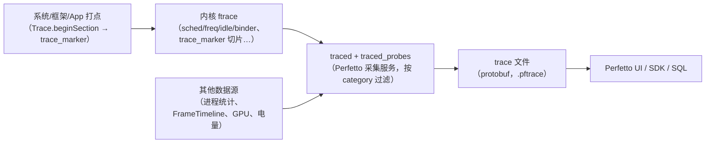
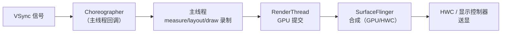
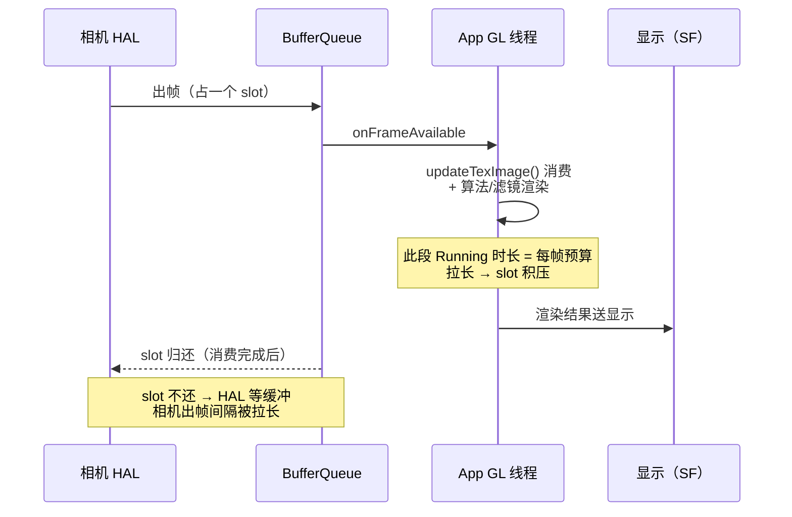
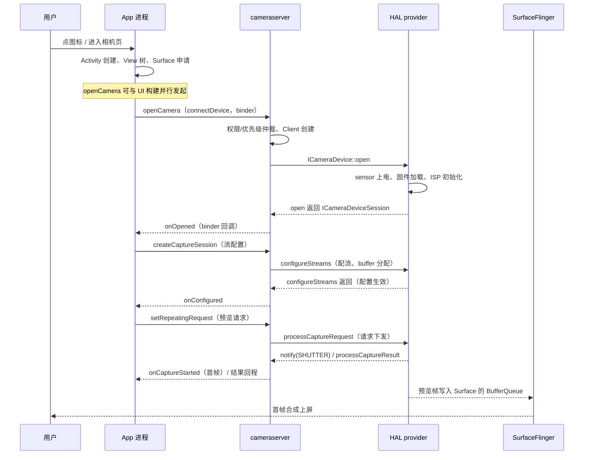
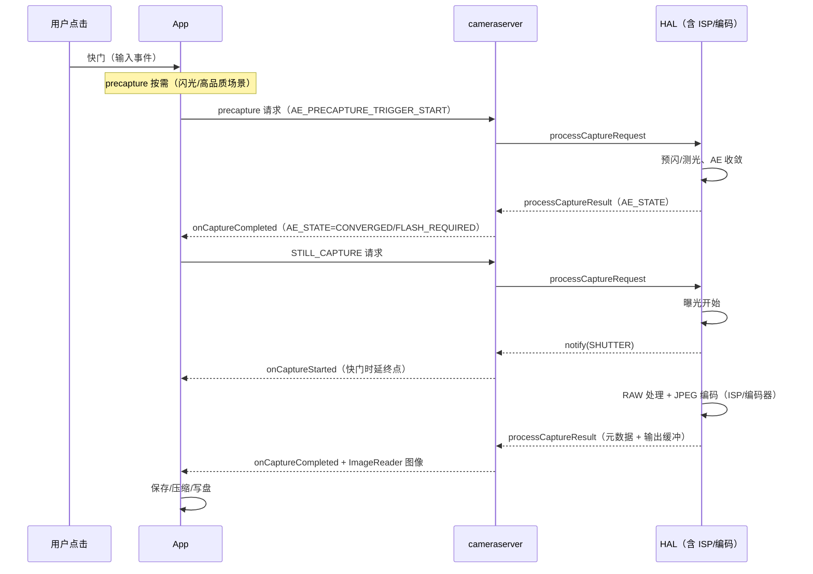
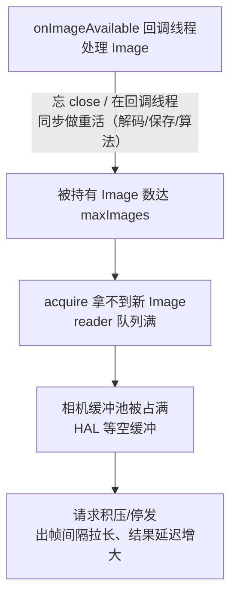

# Android Camera Trace 分析文档（Perfetto / Systrace 基础 + 相机性能实战）

> 本文档是相机学习系列的补充学习文档：前四份主文档讲"机制/接口/源码/ISP"，面试题集讲"考察点"，本篇讲**性能问题怎么被定位出来**——以 Perfetto 为代表的 trace 工具基础，以及 Camera 启动、拍照延迟的 trace 分析方法与实战模式。
>
> 工具入口：<https://ui.perfetto.dev>　官方文档：<https://perfetto.dev/docs/>
> 整理日期：2026-10-18。材料按 A/B/C 分层标注（A = Perfetto/AOSP 官方文档；B = 通行工程知识；C = 社区经验），相机 HAL 内部行为以厂商打点为准。

## 文档结构

| 章节 | 内容 | 适合 |
|---|---|---|
| 第 1 章 Trace 基础 | 数据模型（track/slice/counter/flow）、线程状态、渲染与帧模型、FrameTimeline、相机链路的 trace 语义、消费端地图（SurfaceView/SurfaceTexture/ImageReader/编码 Surface） | 首次接触 trace |
| 第 2 章 抓取与工具链 | Perfetto config、命令行、category 选择、App 自定义打点、legacy atrace、抓取坑位 | 动手抓数据 |
| 第 3 章 Camera 启动分析 | 首帧定义、启动阶段地图、逐段判读、示例拆解、异常模式 | 优化首帧/冷启动 |
| 第 4 章 拍照延迟分析 | 延迟定义、precapture 收敛、pipeline depth、编码落盘、ImageReader 背压、问题速查 | 优化快门/出图 |
| 第 5 章 分析方法论 | 五步法、阻塞链追踪、归因分类、工具组合、误判清单、验收预算 | 形成分析习惯 |
| 第 6 章 Perfetto SQL | schema 速查与常用查询（配流/线程状态/打点/binder/jank/频率） | 批量统计与复核 |

## 与其它文档的关系

- 启动/拍照的机制与优化清单见《Android_Camera_APP_面试题》Q65（首帧启动）与 Q36/Q57（性能与拍照流程）；
- 配套题集：《Android_Camera_Trace面试题》（26 题，覆盖 trace 基础、抓取、启动/拍照分析、方法论与实战），用于自测与面试准备；
- 请求/结果的框架内部链路见《Android_Camera_源码链路文档》第 3~4 章（RequestThread、in-flight、结果回程）；queueBuffer 之后到屏幕的显示链路（BufferQueue/BLAST/SF/HWC）见其第 5 章；
- HAL/3A 的元数据语义见《Android_Camera_ISP_3A文档》第 2~3 章；
- 预览消费端的**选型对比**（SurfaceView/TextureView/GL 中转/PreviewView 模式）见《Android_Camera_性能分析文档》4.4；ImageReader 接口语义见《Android_Camera_接口文档》1.8；GL 中转的完整实现见《Android_Camera_算法集成文档》第 2 章（本篇只讲 trace 判读视角）；
- trace 里的"谁等谁"可与《Android_通用面试题》Handler/Binder/渲染相关题目互相印证。

## 建议阅读路径

1. 先读第 1 章建立"trace 语言"（slice/状态/帧模型）；
2. 按第 2 章配置抓一段自己 App 的启动 trace，对照第 3 章逐段看；
3. 拍照延迟问题按第 4 章的链路拆解；
4. 分析结论用第 5 章的五步法与归因表收口；
5. 需要批量统计时用第 6 章 SQL。

---

# 第 1 章 Trace 基础：数据模型与分析语言

> 本文为分章源文件，供单章阅读；若与主文档不一致，以主文档最新版为准。
>
> 本章讲"trace 是什么、它记录了什么、怎么读"。工具操作见第 2 章，相机场景分析见第 3\~4 章。材料层级按仓库惯例标注：A 层 = Perfetto/AOSP 官方文档，B 层 = 通行工程知识，C 层 = 社区经验。

**材料可信度约定**：

| 层级  | 含义        | 典型来源                                                                                                                                   |
| --- | --------- | -------------------------------------------------------------------------------------------------------------------------------------- |
| A 层 | 官方文档可抓取验证 | [perfetto.dev 文档](https://perfetto.dev/docs/)、[AOSP Systrace/FrameTimeline 文档](https://source.android.google.cn/docs/tools/)、atrace 源码 |
| B 层 | 公开通行知识    | 行业通用的调度/渲染模型描述（各厂商实现略有差异）                                                                                                              |
| C 层 | 社区经验      | 博客/论坛的实操技巧，须标注不确定度                                                                                                                     |

## 1.1 trace 记录的是什么

一句话：**trace = 时间轴上的事件集合**，把"每个线程在哪个 CPU 上、处于什么状态、执行了哪个函数、等了谁"按微秒级时间戳记录下来。与日志互补——日志回答"发生了什么"，trace 回答"时间花在了哪里、谁在等谁"。

一条 trace 能提供四类信息：

| 类别             | 内容                                                    | 典型用途        |
| -------------- | ----------------------------------------------------- | ----------- |
| 切片（slice）      | 有起止时间的区间：函数、binder 事务、绘制阶段、相机请求                       | 找耗时大头、关键路径  |
| 线程状态           | Running / Runnable / Sleeping / Uninterruptible Sleep | 区分"在算"与"在等" |
| 计数器（counter）   | CPU 频率、内存、电量、温度、帧计数                                   | 判断降频/资源瓶颈   |
| 关联（flow/async） | 跨线程、跨进程的事件关联（binder、VSync、异步阶段）                       | 串出端到端调用链    |

trace 与 logcat 的关键区别：trace 有**空间维度**（哪个进程/线程/CPU）与**因果关系**（谁阻塞了谁），这是分析相机这类多进程链路的必需视角。

## 1.2 trace 数据的来源



* **ftrace（内核）**：调度、CPU 频率、空闲状态、binder 驱动事件、电源等，由内核环形缓冲记录；
* **atrace（用户态）**：Android 在 ftrace 上封装的 tag 体系（camera/gfx/view/sched…），系统组件与 App 通过 `Trace.beginSection` 等 API 写入；
* **Perfetto**：新一代统一采集与分析体系（Android 9+ 内置 `traced` 守护进程），protobuf 格式、支持多数据源（ftrace、进程统计、帧时间线、GPU、电量等），逐步取代旧的 systrace HTML；
* **自定义打点**：应用/框架/HAL 主动插桩（第 2 章 2.4），是把业务阶段映射到 trace 的关键手段。

> 旧资料里的 Systrace（HTML + `atrace` 命令）仍在用，但 Perfetto 是其超集：能读 systrace 文件，且提供 SQL/可视化更强的能力。新项目直接上 Perfetto。

## 1.3 数据模型：track、slice、counter、flow

Perfetto 的 UI 与 SQL 建立在统一数据模型上（A 层，[Perfetto trace model](https://perfetto.dev/docs/concepts/trace-model)）：

| 概念           | 含义                       | UI 表现                     |
| ------------ | ------------------------ | ------------------------- |
| Track（轨道）    | 一组事件的时间线容器，按线程/进程/全局分类   | 左侧树形列表的每一行                |
| Slice（切片）    | 有开始/结束（或时长）的区间           | 轨道上的彩色块，宽度=时长             |
| Thread state | 线程调度状态区间                 | 线程轨道底部的状态条                |
| Counter      | 数值随时间变化的采样               | 轨道上的折线/阶梯                 |
| Flow         | 跨轨道的关联箭头                 | 连接事件的小箭头（binder/VSync/异步） |
| Async slice  | 跨线程/跨进程的异步区间，带 cookie 关联 | 独立"async track"上的块        |

**track 的几类常用形态**：

* **thread track**：每线程一条（最常用），包含 slice 与 thread\_state；
* **process track**：进程级汇总（如 binder 汇总、进程内存）；
* **counter track**：CPU 频率/内存等数值；
* **async track**：`Trace.beginAsyncSection` 这类跨回调阶段；
* **FrameTimeline track**：系统帧的期望/实际时间，判断 jank 的权威轨道（1.5 节）。

SQL 侧对应表：`slice`、`thread`、`thread_state`、`thread_track`、`process_track`、`counter`、`track`（示例见第 6 章）。

## 1.4 线程状态与调度：读懂"在算还是在等"

线程轨道底部的状态条是分析的关键（A 层字段定义，B 层解读）：

| 状态（UI 颜色）                       | 含义                        | 分析提示                                   |
| ------------------------------- | ------------------------- | -------------------------------------- |
| Running（绿）                      | 正在 CPU 上执行                | 看执行内容：是计算、拷贝还是锁内的临界区                   |
| Runnable（浅绿/白）                  | 就绪但没抢到 CPU                | 大量 Runnable = 调度压力/争抢，可能与优先级、绑核、大核频率有关 |
| Sleeping（灰）                     | 主动休眠（等锁、等 IO、等 binder 回复） | 结合 slice 判断"在等谁"：等锁、等 futex、等 binder   |
| Uninterruptible Sleep（橙/棕，D 状态） | 内核态不可中断等待（典型：磁盘/驱动 IO）    | 相机出图落盘、DMA/驱动等待常现，往往不是 App 能优化的        |

配套阅读：

* **CPU 频率/核间迁移**：counter 轨道看 `cpufreq`，线程频繁在大核/小核间迁移会导致延迟抖动（绑核/`sched_setaffinity` 场景）；
* **优先级**：相机链路里 Cameraserver、HAL 线程、SurfaceFlinger 的 nice/RT 优先级不同，Runnable 多但 CPU 空闲往往是优先级问题；
* **Runnable vs Sleeping 的区分是归因分水岭**：Running/Runnable 多 → 算力/调度问题；Sleeping 多 → 等待问题（锁/IO/依赖方）。

## 1.5 渲染与帧模型：VSync、Choreographer、RenderThread、FrameTimeline

相机预览、拍照回显都走 Android 渲染管线，理解帧模型才能判断"卡在相机还是卡在显示"（B 层通识，AOSP 文档有框架描述）：



关键概念：

* **VSync 节拍**：60Hz 屏每 16.6ms 一次；120Hz 为 8.3ms。渲染任务必须在 VSync 前完成才能按时上屏；
* **Choreographer**：主线程按 VSync 调度输入/动画/绘制回调；主线程消息队列里的长任务会推迟绘制；
* **RenderThread**：独立线程执行 DisplayList 录制结果的 GPU 渲染，动画/属性动画可脱离主线程；
* **SurfaceFlinger**：系统合成器，把各应用图层合成一帧交给 HWC；
* **FrameTimeline**（Android 12+ 系统能力，Perfetto 有轨道）：记录每个帧的**期望呈现时间与实际呈现时间**，并给出 jank 类型（A 层，[FrameTimeline 文档](https://source.android.google.cn/docs/tools/))：

| jank 类型                            | 含义                     |
| ---------------------------------- | ---------------------- |
| App Deadline Missed                | 应用侧（主线程/渲染线程）未在截止时间前完成 |
| SurfaceFlinger CPU Deadline Missed | SF 主线程合成超时             |
| SurfaceFlinger GPU Deadline Missed | SF GPU 合成超时            |
| Display HAL Deadline Missed        | 显示 HAL/送显超时            |
| Buffer Stuffing                    | 应用提交过快导致缓冲堆积（表象是延迟增大）  |
| Unknown Jank                       | 系统无法归类（版本差异）           |

> 相机场景的价值：预览"卡顿"到底是相机出帧慢（相机侧 track 空档），还是应用绘制慢（主线程/RenderThread 超时），还是合成/送显慢（SF track），FrameTimeline 直接给出归属。

### 1.5.1 Choreographer 是什么

Choreographer 是**按 VSync 节拍调度 UI 工作的帧调度器**（每个有 Looper 的线程都可以有一个，主线程的最常用）。它通过 `DisplayEventReceiver` 从 SurfaceFlinger 接收 VSync 信号，每次 VSync 到来时进入 `doFrame()`，按**固定顺序**执行本帧的回调阶段：

| 阶段                | 内容                                                       | trace 上的子 slice（形如）                   |
| ----------------- | -------------------------------------------------------- | ------------------------------------- |
| INPUT             | 输入事件分发（触摸、按键、手势）                                         | `input`                               |
| ANIMATION         | View 动画、`ValueAnimator` 回调、`postFrameCallback` 等         | `animation`                           |
| INSETS\_ANIMATION | 系统栏/边衬动画（Android 11+）                                    | `insets animation`                    |
| TRAVERSAL         | measure/layout/draw 完整遍历（View 与 Compose 的构图/布局/绘制都在这一阶段） | `traversal`、`measure`、`layout`、`draw` |
| COMMIT            | 绘制后的提交阶段（滚动条、嵌套滚动等收尾）                                    | `commit`                              |

要点：

* UI 工作被**对齐到 VSync**：一帧内的回调按上表顺序执行，这就是"16.6ms 帧预算"的调度载体（120Hz 下预算 8.3ms）；硬件 vsync 只有一个，Choreographer 收到的是软件拆分后的 **VSYNC app 相位**（与 SurfaceFlinger 合成用的 SF_VSYNC 相位错开，实现"显示 N / 合成 N+1 / 渲染 N+2"流水线）——三相位结构见《Android_Camera_源码链路文档》5.4.3；
* trace 上的 `Choreographer#doFrame` slice = 从 VSync 回调开始到本帧所有阶段回调结束的**墙钟时间**——不是 CPU 时间，包含被抢占与阻塞的等待（1.5.2）；
* 主线程消息队列里的长任务不会缩短 doFrame，而是让**下一次 doFrame 开始得更晚**（两类问题要分开看）。

### 1.5.2 为什么 `Choreographer#doFrame` 有时候很长

先分清两种"长"：

1. **doFrame 内部的 slice 本身体积大**（几十毫秒甚至上百毫秒）：这一帧的工作确实重，或被阻塞、被抢占；
2. **doFrame 开始得晚**：主线程队列前面排着长任务，VSync 回调迟迟轮不到（看起点与 VSync 的时间差，而不是 slice 宽度）。

doFrame 本身很长的常见原因，按线程状态分类（对应 1.4 的状态语言）：

| 现象               | 线程状态特征                          | 典型原因                                                                                  |
| ---------------- | ------------------------------- | ------------------------------------------------------------------------------------- |
| 计算/绘制重           | Running 占主导                     | 自定义 View 的 `onDraw` 复杂、动画回调里做重计算、大量属性动画、RecyclerView 绑定/布局、文字排版（StaticLayout）、主线程图片解码 |
| 布局风暴             | Running，且 `measure/layout` 反复出现 | `requestLayout` 在布局过程中再次触发、层级过深、同步刷新列表、复杂约束布局                                         |
| 等锁/等 binder/等 IO | Sleeping                        | 主线程同步 binder（SharedPreferences 提交、ContentProvider 查询）、锁竞争、文件读写                        |
| 抢不到 CPU          | Runnable 占比高                    | CPU 满载/降频、后台负载、绑核/优先级不当、大核频率爬升慢                                                       |
| GC               | `Suspend all`/GC 相关薄片           | 分配风暴（如在 onDraw 里 new 对象）、频繁字符串拼接、大对象                                                  |
| 合成/缓冲背压          | 在 `draw` 中 Sleeping             | SurfaceView 同步、BufferQueue 满、RenderThread/SF 阻塞反向拖住主线程（少见但存在）                         |

**影响因素清单**：

* View 层级深度与布局复杂度、过度绘制（GPU Overdraw）；
* Compose 稳定性（不稳定参数导致大范围重组）、Lazy 列表 item 重绑；
* 动画数量与每帧计算量（动画期间 doFrame 持续变长是典型特征）；
* 主线程消息队列积压与同步调用（IO/binder/锁）；
* CPU 频率/热、调度优先级、绑核；
* 屏幕刷新率档位（120Hz 预算减半，同样的工作更容易"超长"）；
* 调试与 trace 开销（debug 包、全量 category 会放大调度抖动）。

**判读方法**：

1. 展开 `Choreographer#doFrame` 看子 slice：`input` / `animation` / `traversal`（再展开 `measure`/`layout`/`draw`）/ `commit`，先定位到阶段；
2. 看该段线程状态：Running → 真计算；Runnable → 调度；Sleeping → 阻塞（追锁/binder/IO）；
3. 对照 FrameTimeline 的 jank 类型（`App Deadline Missed` 属应用侧）；
4. 区分偶发与系统性：每帧都长 → 结构性问题（布局/渲染）；偶发 → 特定内容、GC 或后台干扰；
5. 相机场景提醒：预览掉帧先看相机出帧 track 是否出现空档，再怪 Choreographer——两者是不同链路，别把"相机出帧慢"误判成"主线程绘制慢"。

## 1.6 相机链路上的 trace 语义

相机是"App → CameraService（cameraserver）→ HAL provider → 内核驱动 → sensor/ISP"的多进程链路，trace 上的读法：

| 链路环节          | trace 上的表现                                                                             | 说明                             |
| ------------- | -------------------------------------------------------------------------------------- | ------------------------------ |
| App 调 API     | 主线程/回调线程上的 slice（`openCamera`、`createCaptureSession`、`capture` 等）                      | Java 方法本身通常很短，耗时多在 binder 等待   |
| 跨进程调用         | `binder transaction` 切片 + 对应服务端线程 Running                                              | 客户端线程 Sleeping 等回复；箭头/关联可追到服务端 |
| CameraService | `CameraService::connectDevice`、`configureStreams`、`submitRequestList` 等 slice（版本差异，形如） | 系统相机服务（AOSP 有 atrace 打点，A/B 层） |
| Vendor HAL    | provider 进程内切片（`camera` category）；命名因厂商而异（CAMX/mtkcam）                                 | 无打点时只能靠 binder/CPU/驱动旁证（C 层）   |
| 内核/驱动         | ftrace 的 irq、dma、i2c、v4l2 事件（厂商 trace 支持差异大）                                           | 排查 sensor 上电/出帧异常              |
| 出帧与显示         | 预览 Surface 出帧 → SF 合成 → FrameTimeline                                                  | 判断"首帧"与"掉帧"的权威视角               |

> 注意：相机 HAL 的大部分内部行为**没有统一的 trace 打点**（厂商可选），所以相机 trace 分析经常是"框架可见 + HAL 旁证"的组合推断，结论要标注置信度（与仓库 A/B/C 分层一致的思路）。

## 1.7 消费端地图：相机帧在 trace 上流向哪里

> 来源：A 层——[SurfaceView](https://developer.android.google.cn/reference/android/view/SurfaceView)、[SurfaceTexture](https://developer.android.google.cn/reference/android/graphics/SurfaceTexture)、[ImageReader](https://developer.android.google.cn/reference/android/media/ImageReader) 官方参考（本文摘译；接口细节与 `maxImages` 语义另见仓库文档：Android/Android_Camera_接口文档.md 第 1.8 节）；B 层——BufferQueue 背压与各消费端的 trace 判读为通行工程知识。**选型对比**（何时用哪个、性能收益）见仓库文档：Android/Android_Camera_性能分析文档.md 第 4.4 节，本节只回答"**这一帧由谁消费、去哪个 track 找**"。

1.5 节讲了 UI 渲染的帧模型（Choreographer/RenderThread/SF），但**相机预览帧不一定经过那套管线**——取决于输出 Surface 的类型。读预览/拍照卡顿的 trace 前，先对照这张地图：

| 消费端 | 帧数据流向（进程视角） | trace 上看哪个 track | 消费慢的 trace 特征 | 反向传导到相机侧 |
|---|---|---|---|---|
| SurfaceView（直通预览） | HAL → BufferQueue → **SF 合成**（独立图层，可走 HWC 硬件叠层） | SF 合成 track + FrameTimeline；App 的 UI 线程/RenderThread **不出预览帧** | SF 侧 jank/合成超时；"App 全空闲却预览卡" | BufferQueue 满 → HAL 等空缓冲 → 出帧间隔拉长 |
| SurfaceTexture（GL 中转） | HAL → BufferQueue → **App 内 GL/EGL 线程** `updateTexImage()` 消费 → 再渲染到显示 Surface | App GL 线程逐帧 slice + `onFrameAvailable` 回调节奏 | GL 线程 Running 拉长、回调积压 | 消费不过来 → BufferQueue 背压 → 相机停帧/丢帧 |
| ImageReader（YUV/RAW/拍照帧） | HAL → reader 有界队列（`maxImages`）→ `onImageAvailable` 回调线程 | 回调线程（自建 Handler 线程）Running 时长 + `camera_memory` | 回调线程 Sleeping（下游排队）或单帧长 slice（同步做重活） | `Image` 不 close → 缓冲池耗尽 → 请求排队、结果延迟增大（详见 4.6） |
| 录制 Surface（MediaCodec input） | HAL → 编码器 input surface → codec 输出 | 编码器 track（`camera`/`video` category 旁证） | codec 满载、输出缓冲阻塞 | 编码背压 → 录像流停帧（与 4.5 节尾段同理） |

三个最常用的判读结论（B 层归纳）：

- **"预览卡但相机帧率正常"——先看消费端**。GL 中转路径去 App GL 线程找长 slice；SurfaceView 直通去 SF/FrameTimeline 找 jank。别在 UI 线程的 `doFrame` 里找预览帧——直通路径下它不在那；
- **JankStats/FrameMetrics 只覆盖 View 渲染**：SurfaceView 直通与 ImageReader 帧都不经过 View 管线，View 层帧监控天然看不见——这是性能分析文档 2.3 节"监控盲区"的机制原因；
- **背压是链条**：任何消费端变慢都会沿 BufferQueue 反向传导为相机侧出帧异常。判读顺序：先看消费线程，再看相机出帧节奏——顺序反了会把"消费慢"误判成"HAL 慢"。

以最典型的 GL 中转背压为例（SurfaceTexture 路径，逐帧闭环）：



## 1.8 本章小结

读懂 trace 需要三层能力：

1. **工具层**：知道怎么抓、怎么开（第 2 章）；
2. **语言层**：能用 slice/状态/计数器/关联回答"时间花在哪、在等谁"（本章）；
3. **领域层**：知道相机启动/拍照链路上"应该出现什么"，才能发现异常（第 3\~4 章；预览/拍照帧出现在哪条 track 见 1.7 消费端地图）。

下一章：抓取配置与工具链。
# 第 2 章 Trace 抓取与工具链

> 本文为分章源文件，供单章阅读；若与主文档不一致，以主文档最新版为准。
>
> 本章是操作手册：怎么抓、抓哪些 category、怎么给 App 打自定义点、抓的时候有哪些坑。命令与配置按 Android 9+ / Perfetto 体系整理（A 层为主）。

## 2.1 方式总览

| 方式 | 适合 | 优点 | 限制 |
|---|---|---|---|
| **Perfetto Web UI**（ui.perfetto.dev 的 Record 页） | 调试机连电脑 | 图形化勾选、自动转换 | 需要设备可被 adb 识别 |
| **Perfetto 命令行**（`adb shell perfetto`） | 脚本化/复现/CI | 可精确控制 config、可自动化 | 需手工写 config |
| **atrace（legacy）** | 快速抓 systrace HTML | 命令短 | HTML 分析能力弱，逐步淘汰 |
| **Android Studio Profiler → System Trace** | 应用开发日常 | 与 Studio 集成、CPU 采样联动 | 相机跨进程分析深度有限 |
| **dumpsys media.camera** | 辅助定位 | 看会话/流/in-flight 状态 | 不是时间轴数据 |

> 相机分析推荐：**Perfetto 命令行/UI 抓完整链路 + dumpsys 对照状态 + logcat 看错误**，三者时间点对齐使用。

## 2.2 Perfetto 配置与抓取

**最小可用配置**（保存为 `camera.cfg`，推到设备）：

```protobuf
# 环形缓冲 64MB，按需覆盖旧数据
buffers { size_kb: 65536 fill_policy: RING_BUFFER }

# 内核 ftrace + atrace 分类
data_sources {
  config {
    name: "linux.ftrace"
    ftrace_config {
      atrace_categories: "camera"
      atrace_categories: "camera_memory"
      atrace_categories: "sched"
      atrace_categories: "freq"
      atrace_categories: "idle"
      atrace_categories: "binder_driver"
      atrace_categories: "binder_lock"
      atrace_categories: "gfx"
      atrace_categories: "view"
      atrace_categories: "wm"
      atrace_categories: "am"
      atrace_categories: "hal"
      atrace_categories: "aidl"
      atrace_categories: "res"
      atrace_categories: "dalvik"
      atrace_categories: "input"
      atrace_apps: "com.example.camera"     # 你的应用包名：开启应用侧 atrace
      buffer_size_kb: 32768
      drain_period_ms: 250
    }
  }
}

# 进程/线程信息（进程名、oom score 等）
data_sources {
  config {
    name: "linux.process_stats"
    process_stats_config { scan_all_processes_on_start: true }
  }
}

# CPU 频率/时间统计
data_sources {
  config {
    name: "linux.sys_stats"
    sys_stats_config {
      stat_period_ms: 1000
      stat_counters: STAT_CPU_TIMES
      stat_counters: STAT_FREQ_TIMES
    }
  }
}

duration_ms: 10000
```

抓取命令（shell 权限即可，多数机型可用）：

```bash
adb push camera.cfg /data/local/tmp/camera.cfg
adb shell perfetto --txt -c /data/local/tmp/camera.cfg -o /data/misc/perfetto-traces/camera.pftrace
adb pull /data/misc/perfetto-traces/camera.pftrace
```

要点：

- 抓取时长用 `duration_ms` 固定，或交互式抓取时靠 `Ctrl+C` 停止（RING_BUFFER 保留最后一段）；
- 输出路径用 `/data/misc/perfetto-traces/`（shell 可写）；部分机型限制其它目录；
- 抓之前先确认数据源可用：`adb shell perfetto --query` 列出当前设备支持的数据源；
- 抓取期间**不要停止操作**——先开 trace，再复现相机启动/拍照动作。

## 2.3 category 选择：抓什么才有用

| category | 内容 | 相机分析里的用途 |
|---|---|---|
| `camera` | CameraService/HAL 的 atrace 打点、相机帧事件 | 启动链路、请求/结果的关键切片 |
| `camera_memory` | 相机 buffer 分配/释放 | 排查首帧前的缓冲分配与内存压力 |
| `sched` | 线程调度（sched_switch/wakeup） | 线程状态、优先级、绑核分析 |
| `freq` | CPU 频率变化 | 大核降频、频率爬升慢 |
| `idle` | CPU 空闲状态 | 判断是否被唤醒频繁/绑在小核 |
| `binder_driver` / `binder_lock` | binder 事务与锁 | 跨进程调用耗时与竞争 |
| `gfx` | 图形（Choreographer、RenderThread、BufferQueue） | 预览/回显的渲染与合成 |
| `view` / `wm` | View 系统与窗口管理 | 首帧上屏、窗口创建 |
| `am` | Activity 管理 | 启动 Activity 的阶段切片 |
| `hal` / `aidl` | HAL/AIDL 调用 | 相机 HAL 的 binder 调用 |
| `res` | 资源加载 | 启动期资源开销 |
| `dalvik` | ART 相关（GC、编译） | 启动期 GC/类加载卡顿 |
| `input` | 输入事件 | 点击拍照的输入延迟 |
| `power` | 电源状态 | 亮屏/省电模式对相机的影响 |
| `audio` | 音频（录视频时） | 音画同步问题 |

取舍原则：**buffer 有限，只开与问题相关的分类**。日常相机排查最小集：`camera + sched + freq + binder_driver + gfx + view + am`。

## 2.4 给 App 打自定义 trace 点

系统只覆盖框架层，业务阶段需要自己打点（A 层 API）：

```java
// 同步区间：包住普通调用
TraceCompat.beginSection("Camera#open");
cameraManager.openCamera(id, callback, handler);
TraceCompat.endSection();

// 异步区间：跨回调（推荐用于启动/拍照链路分段）
TraceCompat.beginAsyncSection("Camera#sessionConfig", 0);   // 在发起配置处
// ... onConfigured 回调里：
TraceCompat.endAsyncSection("Camera#sessionConfig", 0);

// 计数/属性（Perfetto 支持，Android 10+ 的 Trace API）
Trace.beginSection("Camera#capture");
Trace.setCounter("capture#pending", count);
```

规则与坑：

- `beginSection/endSection` 必须成对，异常路径也要 end（否则 slice 悬挂）；
- section 名称用**稳定前缀**（如 `Camera#`）方便在 UI 里搜/在 SQL 里过滤；
- async section 的 cookie 要唯一（同一阶段并发时用自增 ID，避免区间重叠错乱）；
- **release 包默认不输出 trace**：manifest 加 `<profileable android:shell="true" />`（Android 10+）或使用 debuggable 包，才能被 `atrace_apps` 抓到；
- trace 名称会出现在系统 trace 里，不要写敏感信息。

相机启动建议打点（与第 3 章阶段对应）：

| 打点 | 位置 |
|---|---|
| `Camera#open` | openCamera 调用前 → onOpened |
| `Camera#sessionConfig` | createCaptureSession → onConfigured（async） |
| `Camera#firstFrame` | setRepeatingRequest → 首帧 onCaptureStarted（async） |
| `Camera#capture` | 快门点击 → onCaptureCompleted（async） |
| `Camera#imageSave` | onImageAvailable → 写盘完成（async） |

## 2.5 atrace legacy 方式（快速抓取）

```bash
# 10 秒、32MB 缓冲、指定包名与分类
adb shell atrace -a com.example.camera -t 10 -b 32768 camera gfx view wm am sched freq binder_driver > trace.html
```

生成的 HTML 可直接用浏览器打开（内置 Perfetto UI），也可上传 ui.perfetto.dev。适合临时排查；系统性分析建议用 2.2 的 config 方式（可加 FrameTimeline、process_stats 等数据源）。

查看设备支持哪些 tag：

```bash
adb shell atrace --list_categories
```

## 2.6 抓取注意事项（高频坑）

1. **trace 自身有开销**：全量 category + 长时间抓取会改变被测系统（尤其高频 sched/freq 事件），分析结论要结合"轻量 trace 复测"；
2. **buffer 满会覆盖早期数据**：RING_BUFFER 保留尾部；如果复现动作很长，增大 buffer 或缩短抓取窗口；
3. **debug vs release 差异**：debug 包有 JIT/断言/日志开销，启动耗时不能代表线上；用 profileable release 复测；
4. **时间基准对齐**：trace 是设备单调时钟；与 logcat 对照时用同一事件的 slice 名比对，不要用墙上时间；
5. **HAL 打点依赖厂商**：vendor 未开 atrace 时，相机 HAL 内部只有旁证（binder、CPU、驱动），结论标注置信度；
6. **多摄/多进程干扰**：抓之前关掉其他相机类 App，避免相机被抢占或资源竞争污染样本。

## 2.7 分析入口

- **Perfetto UI**（ui.perfetto.dev）：打开 trace，左侧 track 树、顶部搜索、下方 SQL（Query 页）；
- **Android Studio**：Profiler → System Trace 直接看线程/CPU 采样联动；
- **Perfetto SDK/命令行 SQL**：`trace_processor_shell` 对 trace 跑 SQL（第 6 章示例）；
- **FrameTimeline**：UI 里勾选结果中的 Frame Timeline track，看 jank 归属。

下一章开始进入相机场景：Camera 启动性能的 trace 分析。
# 第 3 章 Camera 启动性能的 trace 分析

> 本文为分章源文件，供单章阅读；若与主文档不一致，以主文档最新版为准。
>
> 本章把《Android\_Camera\_APP\_面试题》Q65 的优化清单落到 trace 上：每个阶段在 trace 里长什么样、怎么拆、常见瓶颈怎么归因。文中耗时为**示意量级**（机型差异大），标注"A 层"的切片名为 AOSP 源码可核对，厂商切片名以实际 trace 为准（B/C 层）。

## 3.1 先定义清楚"启动"与"首帧"

分析前必须先锚定指标，否则各说各话（A 层概念，B 层实践口径）：

| 指标                   | 定义              | trace 上怎么取                                                 |
| -------------------- | --------------- | ---------------------------------------------------------- |
| 冷启动（进程被杀）            | 点图标 → 首帧可见      | Activity 启动 slice + 首帧 onCaptureStarted + FrameTimeline 首帧 |
| 温启动（进程在，Activity 重建） | 进相机页 → 首帧可见     | 同上，但少了进程/Application 初始化                                   |
| 热启动（后台返回，会话保留）       | 回前台 → 预览恢复      | `setRepeatingRequest` 到下一帧（或 SF 恢复合成）                      |
| 首帧                   | **预览画面第一帧真正上屏** | 相机 `onCaptureStarted`（曝光开始）+ SF 合成 + FrameTimeline 实际呈现    |

> 最常见的口径错误：把 `onOpened` 或 `onConfigured` 当"启动完成"。用户感知的是**画面可见**，两者之间还有首帧请求下发、曝光、SF 合成几段。

## 3.2 启动阶段地图



trace 上的对应关系（按 Perfetto 轨道）：

> 缩写约定：**SF = SurfaceFlinger**——Android 的系统合成器，独立 native 进程（init 启动，进程名 `surfaceflinger`），与 `system_server` 的 WMS 通过 Binder 协作；它负责把各应用的图层（Layer）按 Z 序合成一帧，再交给 HWC/显示控制器送显。相机预览帧进入 BufferQueue 后，就是由它消费并合成上屏。下文"SF 合成/SF 侧 jank"均指这个进程。**CS = cameraserver**（相机系统服务进程），**HWC = 硬件合成器**。

| 阶段                 | 在 trace 上看什么                                                                               | 典型量级（示意）      |
| ------------------ | ------------------------------------------------------------------------------------------ | ------------- |
| Activity 启动        | 主线程 `ActivityThread`/`Choreographer` 切片、`am` 分类、FrameTimeline                              | 100\~300ms    |
| openCamera（App→CS） | App 线程 `binder transaction` + cameraserver 线程 Running + `CameraService::connectDevice` 等切片 | 几十\~几百 ms     |
| provider 初始化       | provider 进程线程 Running、`camera` 分类切片（厂商）、binder 往返                                          | 冷启动常为最大不确定性   |
| configureStreams   | `configureStreams` 切片（CS/HAL）、`camera_memory` 缓冲分配、binder                                  | 几十\~数百 ms     |
| 首帧请求               | `submitRequestList`/RequestThread 切片、首帧 `onCaptureStarted`                                 | 1\~3 帧间隔 + 曝光 |
| 上屏                 | SF（SurfaceFlinger）合成 track、FrameTimeline                                                   | 1\~2 帧        |

## 3.3 逐段分析要点

### 3.3.1 Activity 与窗口（App 侧）

* 看主线程：`onCreate`/`onResume` 中的长任务（SDK 初始化、布局 inflate、资源加载）；
* 看 `Surface` 申请：SurfaceView 的 surfaceCreated 时机；预览控件尺寸与布局耗时；
* 看 FrameTimeline：进相机页的首个 jank 是否为 `App Deadline Missed`；
* 常见问题：Application 里同步初始化相机 SDK、在 `onCreate` 里同步查设备能力、布局过深导致首帧延迟。

### 3.3.2 openCamera → onOpened

链路（与《源码链路文档》第 2 章对应）：

1. App：`openCamera` 发出后，线程通常进入 **Sleeping（等 binder 回复）**，slice 上是 `binder transaction`；
2. cameraserver：找到对应 binder 线程 Running，可见 `CameraService::connectDevice` 之类切片，内部做权限校验与优先级仲裁；
3. provider：若 provider 进程未启动，先有 **进程冷启动 + 服务绑定** 成本（trace 上表现为新进程出现、线程创建、binder 往返）；随后 HAL `open` 内部进行 sensor 上电、固件加载、ISP 初始化——**厂商是否有打点决定这段可见性**；
4. 回到 App：`onOpened` 回调线程上出现回调 slice。

判读技巧：

* App 线程 Sleeping 而对应服务端线程 **Runnable 很多** → 服务端/系统调度压力（优先级、绑核）；
* 服务端线程 Sleeping 且下方有 D 状态 → 驱动/IO 等待（sensor 上电、I2C、固件读取）；
* 两段 binder 之间出现大段空白 → 看 provider 进程内是否在 Running（有算力消耗）还是也在等（依赖驱动）。

### 3.3.3 configureStreams（高频最大头）

* 在 cameraserver/App 上找 `configureStreams` 相关切片，看**总时长**与**内部构成**：流数量、尺寸、格式、buffer 分配（`camera_memory`）；
* 大流组合（4K 预览/高分辨率 JPEG/YUV 分析多路并存）显著拉长配流；`PRIV` 预览通常最便宜；
* 常见异常：
  * 配流失败后重试（trace 上看到两次 configureStreams）→ 用 `isStreamCombinationSupported`/`isSessionConfigurationSupported` 预检；
  * buffer 分配抖动（`camera_memory` 泳道出现密集分配）→ 检查 maxImages/流数量；
  * HAL 内部分配慢（厂商切片或旁证）→ 属于平台问题，App 侧对策是"小流先出帧、大流后补"。

### 3.3.4 首帧请求到上屏

* `setRepeatingRequest` 后看首帧 `onCaptureStarted` 的间隔：正常为 1\~3 个帧间隔；
* 若首帧迟迟不来：检查请求是否被更晚的配置/会话参数变更挤掉、pipeline 是否在等待 AE 收敛（首帧不需要收敛，但厂商实现可能等）；
* 上屏段看 SF（SurfaceFlinger，系统合成器）：预览帧进入 BufferQueue 后，SF 合成一帧并送显——若 SF 侧 jank，说明是**显示链路**而非相机；
* 亮度跳变（首帧暗）属于 AE 冷启动，不是启动慢，别混淆指标。

## 3.4 示例拆解（示意数据）

假设一次冷启动首帧 1.6s，trace 拆解如下（**数值为示意**，仅演示方法）：

| 阶段                                  | 耗时    | trace 证据                                       | 归因                 |
| ----------------------------------- | ----- | ---------------------------------------------- | ------------------ |
| 点图标 → Activity onCreate             | 260ms | 主线程长任务、FrameTimeline App Deadline              | App：SDK 初始化        |
| openCamera → onOpened               | 540ms | App Sleeping 等 binder；provider 进程冷启动 + Running | 系统/HAL：provider 冷启 |
| createCaptureSession → onConfigured | 380ms | configureStreams 切片长；camera\_memory 分配密集       | 配流：多流组合            |
| setRepeatingRequest → 首帧            | 120ms | 首帧 onCaptureStarted 延迟 \~2 帧                   | 正常                 |
| 首帧 → 上屏                             | 40ms  | SF 合成正常                                        | 正常                 |

优化优先级由此得出：先压 provider 冷启动（能否提前/复用会话）、再减首会话流（两段式）、最后是 App 初始化异步化——**与"先查设备枚举/权限"的直觉相反，数据说了算**。

## 3.5 与 Q65 优化清单的对应关系

| Q65 优化点 | trace 上验证收益看什么                          |
| ------- | --------------------------------------- |
| 提前枚举    | 相机页主线程不再出现设备查询的 binder 等待               |
| 权限预申请   | 启动链路中无弹窗导致的长 Sleeping/空白                |
| 异步并行    | openCamera 等待期间主线程仍有构建任务在 Running（并行度）  |
| 精简首会话   | 首会话只有预览流：configureStreams 时长下降；大流补配在首帧后 |
| 会话参数预热  | 首个请求处理时间变短；会话创建参数阶段无额外往返                |
| 热启动不重建  | 返回前台时无 configureStreams 切片              |

## 3.6 常见异常模式速查

| trace 特征                    | 可能原因              | 处理方向                  |
| --------------------------- | ----------------- | --------------------- |
| provider 进程首次出现 + 大量线程创建    | provider 冷启动      | 与系统团队对齐保活；产品层接受首次慢    |
| App Sleeping，服务端 Runnable 多 | 调度/优先级            | 查绑核、nice、大核频率；避免主线程争抢 |
| configureStreams 超长且内部空白    | HAL 内部配流/驱动等待     | 减流/降尺寸/两段式；平台侧反馈      |
| 首帧 onCaptureStarted 迟迟不来    | 请求未下发、pipeline 等待 | 检查请求发送时机、会话参数变更、3A 实现 |
| SF track 有 jank，相机 track 正常 | 显示/合成问题           | 查图层、遮挡、SF 负载          |
| 多次 configureStreams         | 配流失败重试/两段式误用      | 预检组合；确认两段式是设计而非异常     |

## 3.7 本章小结

* 启动分析的第一步是**锚定首帧指标**并分段，不是直接看总时长；
* 相机链路的多进程特性决定了必须"跳进程"读 trace：App 等 binder → 服务端跑 → HAL 等驱动，每一跳都要看状态；
* 常见大头依次是 provider 冷启动、configureStreams、App 初始化——用 trace 数据定优先级，别按直觉优化；
* 厂商 HAL 打点缺失时，用 binder/CPU/驱动旁证推断，并在结论里标注置信度。

下一章：拍照延迟的 trace 分析。
# 第 4 章 拍照延迟的 trace 分析

> 本文为分章源文件，供单章阅读；若与主文档不一致，以主文档最新版为准。
>
> 本章分析"按下快门到拿到照片"的完整链路。延迟定义、阶段拆分、常见瓶颈与 trace 特征。与第 3 章同口径：耗时量级为示意，厂商切片名以实际 trace 为准。

## 4.1 先定义延迟

| 指标 | 定义 | 用户感知 |
|---|---|---|
| 快门延迟（shutter latency） | 点击 → `onCaptureStarted`（曝光开始） | "按下去有没有反应" |
| 拍照延迟（capture latency） | 点击 → `onImageAvailable` / 照片数据就绪 | "多久能拍到" |
| 出图延迟（end-to-end） | 点击 → 写盘完成/缩略图显示 | "多久能发出去" |
| 首张延迟 | 冷启动后第一次拍照 | 首次体验最差 |
| 连拍间隔 | 相邻两次快门可被接受的最短间隔 | "能不能连按" |

分析前先对齐指标，否则"优化了 200ms"可能优化的是用户无感的段。

## 4.2 trace 上的拍照链路



trace 上的关键观察点：

| 环节 | 观察位置 | 说明 |
|---|---|---|
| 快门输入 | 主线程 `InputEventReceiver`/点击回调 slice | 输入延迟是否被主线程长任务拖累 |
| precapture 序列 | App 线程连续多个请求、cameraserver `submitRequestList` | 帧数 × 帧间隔决定收敛等待 |
| AE 收敛 | result 回程节奏、厂商 3A 切片（若有） | 无打点时用"从触发到 STILL_CAPTURE 的帧数"估计 |
| STILL_CAPTURE | 单次请求 slice + 帧号跳变 | 判断是否与预览 repeating 抢占 |
| 结果回程 | `onCaptureStarted`→`onCaptureCompleted`→`onImageAvailable` | 三段之间的空档分别对应 HAL 处理/编码/回调 |
| 编码落盘 | 编码器 track（若抓了 gfx/media）、App 写盘线程 D 状态 | 大图/HEIF 编码与 IO 是常见尾段 |

## 4.3 precapture 与 AE 收敛

- 高品质静帧前，App 通常发 `AE_PRECAPTURE_TRIGGER_START`，等结果里 `AE_STATE` 到达 CONVERGED/FLASH_REQUIRED 后再发拍照请求（APP 题库 Q26）；
- trace 上这段表现为**连续的请求帧 + 结果回程**，帧数不定（场景亮度、闪光决策、厂商调优）；
- 判读技巧：
  - 数"从 precapture 触发到 STILL_CAPTURE 请求"之间经过的帧（看 `onCaptureStarted` 次数或帧号）；
  - 若这段占比大（常见暗光/闪光场景），优化方向是**减少不必要的 precapture**（不需要闪光/光线充足时可跳过）、或复用已收敛的 3A 状态（连拍场景锁 3A）；
  - 暗光下 AE 拉长曝光本身降低帧率（APP 题库 Q36），trace 上表现为请求间隔变大——这是物理约束，不是 bug。

## 4.4 请求/结果与 pipeline depth

- 相机 HAL 是流水线：请求在途（in-flight）数量由 pipeline depth 决定（《源码链路文档》第 3 章）；
- trace 上：同一时刻多个请求的 `submitRequestList` 与结果回程交错；STILL_CAPTURE 请求要等前面的帧排空才能出结果——**拍照延迟的下限 ≈ pipeline depth × 帧间隔**；
- 判读技巧：
  - 若 `onCaptureStarted` 很快但图像回传晚 → 结果在 HAL/ISP 内部等待，非 App 问题；
  - 若请求提交本身被推迟（App 线程 Sleeping/等锁）→ App 侧问题（主线程卡顿、precapture 逻辑串行过重）；
  - ZSL 模板（`TEMPLATE_ZERO_SHUTTER_LAG`）下，快门前的帧已在流水线里，感知延迟显著降低——trace 上表现为结果回程紧随请求。

## 4.5 编码与落盘的尾段

- JPEG 属于 stalling stream：编码占 ISP/编码器资源，可能造成"拍照瞬间预览掉帧"——trace 上表现为拍照请求期间预览 track 出现空档或 SF jank；
- HEIF/高分辨率（48MP）编码更重；若 App 自己做后处理（滤镜/水印），编码前的 GPU/CPU 处理会在 App 线程可见；
- 尾段瓶颈判别：
  - App 线程 Running 且堆栈在编码/压缩 → App 侧处理慢；
  - 线程 D 状态（Uninterruptible Sleep）→ 写盘 IO（尤其低端机/满盘）；
  - 编码器 track 满载 → 硬件编码资源竞争（多摄/录像同开时）。

## 4.6 ImageReader 与缓冲（背压传导链）

ImageReader 是**有界队列**：`newInstance(w, h, format, maxImages)` 的 `maxImages` 限制"同时被应用持有的 Image 数"（接口语义见仓库文档：Android/Android_Camera_接口文档.md 第 1.8 节）；拿走不 `close()`，缓冲就不归还相机。消费慢不是孤立问题，而是沿链条反向传导（第 1 章 1.7 消费端地图的 ImageReader 行）：



trace 判读要点（APP 题库 Q14/Q35）：

- **消费线程状态**：`onImageAvailable` 回调线程（自建 Handler 线程）长期不 Running → 下游线程池排队；单帧长 slice → 在 listener 线程同步做了重活（典型：JPEG 解码、大图保存、算法推理）——处理移出回调线程、消费后立即 `close()`；
- **相机侧旁证**：结果回程间隔异常拉大 + HAL 无异常打点 + 预览 track 空档 + `camera_memory` 事件密集（缓冲池反复分配）——组合出现时优先怀疑 reader 背压，而不是急着怪 HAL；
- **`maxImages` 取值**：过大占内存（YUV/RAW 大帧尤甚）且**掩盖消费慢**（积压到深处才暴露）；过小直接丢帧。通行做法：最小够用 + 消费端异步化。

## 4.7 常见问题模式速查

| 现象 | trace 特征 | 根因方向 | 处理 |
|---|---|---|---|
| 按快门无反应 | 主线程点击回调前有长 slice；输入事件排队 | 主线程卡顿 | 相机回调移子线程、减少主线程工作 |
| 出图忽快忽慢 | precapture 帧数波动大；暗光帧间隔大 | AE 收敛/曝光物理约束 | 分场景统计、非闪光场景跳 precapture |
| 照片到了但预览卡一下 | 拍照请求期间预览空档；JPEG stalling | 编码资源竞争 | 降 JPEG 尺寸/延后编码；ZSL 路线 |
| 图像延迟固定偏大 | STILL_CAPTURE 结果总在 N 帧后 | pipeline depth 下限 | 接受预算或换 ZSL 模板 |
| 尾段慢且线程 D 状态 | 写盘 IO 等待、文件系统忙 | 存储 IO | 异步写、缓存目录、降低编码尺寸 |
| 连拍间隔大 | 每张都有完整 precapture+编码 | 串行链路 | 锁 3A 连拍、队列化拍照请求 |
| 越拍越慢、相机侧无异常 | 回调线程 Sleeping/长 slice；结果间隔同步拉大 | ImageReader 背压（忘 close/同步重活，见 4.6） | 消费后立即 close、处理异步化 |

## 4.8 本章小结

- 拍照延迟要拆成"快门→曝光→结果→编码→落盘"五段，每段在 trace 上有独立证据；
- precapture 与 pipeline depth 是**协议决定的下限**，优化空间在于跳过不必要环节与并行化；
- 编码/落盘尾段常被忽视，但用户感知的是"出图"，必须纳入预算；
- 消费端（ImageReader）背压会伪装成"相机侧异常"——先查消费线程、再查 HAL（1.7 消费端地图 + 4.6 传导链）；
- 相机 HAL 内部无打点时，用帧号节奏、结果回程间隔与线程状态推断，结论标注置信度。

下一章：把方法沉淀成可复用的分析流程。
# 第 5 章 分析方法论：从"看出来"到"定下来"

> 本文为分章源文件，供单章阅读；若与主文档不一致，以主文档最新版为准。
>
> 本章把前四章的读图技巧收敛成可复用的流程，重点是**归因与结论的可信度**——trace 分析最大的风险不是看不懂，而是看错并据此做错优化。

## 5.1 五步法


1. **定指标与范围**：明确"首帧可见 / 快门到出图 / 帧率"等指标，锁定问题发生的 trace 窗口（一次动作一段，避免多动作混杂）；
2. **找关键轨道与切片**：App 主线程、相机回调线程、cameraserver、provider、SF；用搜索定位关键 slice（`openCamera`、`configureStreams`、`onCaptureStarted`…）；
3. **判线程状态**：目标线程在该段是 Running（在算）、Runnable（抢不到 CPU）、Sleeping（等锁/等 IO/等 binder）还是 D 状态（驱动/磁盘）；
4. **跨进程追依赖**：Sleeping 就找"谁在忙/谁该给它回复"——binder 对手线程、锁持有者、驱动完成事件；一环一环追到根；
5. **归因分类并复测**：把根因归到 App / 框架 / HAL / 驱动 / 系统资源五类，给出证据链；改完后用**同一操作序列 + 同一指标**复测，确认收益与回归。

## 5.2 阻塞链追踪：回答"谁让谁等"

多条实用规则（B 层经验，工具通用）：

- **Sleeping 的线程不会凭空醒来**：一定有 wakeup 源——binder 回复、futex、条件变量、定时器；trace 上的 wakeup 轨迹或对手线程 Running 区段就是证据；
- **binder 两端对照**：客户端 `binder transaction` slice 的时长 ≈ 服务端处理 + 排队；在服务端找同时间段的 Running/slice，若服务端也在 Sleeping，继续追它的下游；
- **锁竞争识别**：目标线程 Sleeping、持有锁的线程 Running 长段；`binder_lock` 分类能看到 binder 内部锁竞争；
- **队列延迟识别**：Runnable 段长 = 排队等 CPU；结合 CPU 利用率与优先级判断是资源满载还是优先级倒置；
- **D 状态不可优化**：内核态 IO/驱动等待靠的是平台侧改进，App/框架层能做的是减少触发次数与错峰。

## 5.3 归因分类表

| 归因类别 | 典型 trace 证据 | 可行动作 |
|---|---|---|
| App | 主线程长 slice、回调线程阻塞、错误的重试/串行逻辑 | 异步化、拆线程、减少主线程工作、预构建请求 |
| 框架（CameraService） | connectDevice/配置/请求调度切片长，内部锁等待 | 减少会话重建、正确使用会话参数、反馈系统性优化 |
| HAL/vendor | provider 内 Running 长段、无打点但 binder 往返长、帧节奏异常 | 平台/厂商侧调优，App 侧通过降配流规避 |
| 驱动/内核 | D 状态、irq 稀疏、freq 异常 | 与平台团队合作，抓内核 trace |
| 系统资源 | Runnable 多、CPU 满载/降频、内存压力、温度 | 降负载、错峰、热管理策略 |

## 5.4 与其它工具组合

| 工具 | 配合方式 |
|---|---|
| `dumpsys media.camera` | 确认当前会话、流、in-flight 数量，与 trace 时间点对照 |
| logcat | 看错误码、HAL 日志、`CameraService` tag；定位 trace 中"空白段"的上下文 |
| `cmd media.camera watch`（Android 13+） | 实时观察指定元数据（如 afState/aeState），验证 3A 收敛过程 |
| Simpleperf / Studio CPU 采样 | trace 显示"在算"但不知道算什么时，用 CPU profile 下钻热点函数 |
| FrameTimeline | 帧级 jank 归属（App/SF/Display），避免把显示问题误判为相机问题 |
| Perfetto SQL | 批量统计（第 6 章），避免肉眼数帧 |

## 5.5 常见误判清单

1. **只看总时长，不看拆分**：总延迟 ±20% 可能来自某一段的 3 倍变化；
2. **把等待当计算**：Sleeping 段被误读为"相机慢"，实际是等锁/等 IO/等 UI；
3. **忽略 trace 开销**：全量 category 下高频事件会放大调度扰动，结论需轻量复测；
4. **用 debug 包下结论**：JIT/日志/断言让启动与拍照延迟失真，线上问题要用 release + profileable；
5. **样本污染**：其他相机 App 抢占、后台下载、充电发热，都会改变结论；
6. **把首帧亮度跳变当启动慢**：AE 冷启动是正常行为，指标定义要排除；
7. **跨版本对比不控制变量**：系统版本、ROM、温度、电量、后台负载都要记录。

## 5.6 验收与性能预算

- 每次优化前后跑**同一脚本化操作**（固定点击序列、固定环境），采集 3~5 次取中位数；
- 预算示例（示意）：冷启动首帧 ≤ 800ms、快门到出图 ≤ 600ms、连拍间隔 ≤ 400ms——按产品档位设定；
- 回归防线：把 trace 打点（第 2 章 2.4）保留在关键路径，接入自动化采集；异常样本自动留存 trace 片段。

## 5.7 本章小结

trace 分析的产出不是"图好看"，而是**一条可复核的证据链**：指标 → 阶段耗时 → 线程状态 → 依赖方 → 归因类别 → 改动 → 复测。缺少任何一环，结论都只能算假设。
# 第 6 章 Perfetto SQL 常用查询

> 本文为分章源文件，供单章阅读；若与主文档不一致，以主文档最新版为准。
>
> Perfetto UI 的 **Query (SQL)** 页可直接对 trace 跑 SQL；命令行用 `trace_processor_shell trace.pftrace` 进入交互后粘贴。表结构以 Perfetto 官方 schema 为准（部分表名随版本演进，报错时以 UI 自动补全为准）。

## 6.1 基础表速查

| 表 | 关键列 | 用途 |
|---|---|---|
| `slice` | `id, ts, dur, track_id, name, depth, arg_set_id` | 所有切片（含 async） |
| `track` | `id, name, type, parent_id` | 轨道 |
| `thread_track` | `id, utid` | 线程轨道（id 即 track.id） |
| `thread` | `utid, tid, name, upid, is_main_thread` | 线程 |
| `process` | `upid, pid, name` | 进程 |
| `thread_state` | `utid, ts, dur, state, cpu` | 线程调度状态 |
| `counter` / `counter_track` | `ts, value, track_id` / `id, name` | 计数器（频率/内存等） |
| `actual_frame_timeline_slice` / `expected_frame_timeline_slice` | `ts, dur, jank_type, jank_tag, process_name` | 系统帧时间线（jank 判定） |

## 6.2 查询示例

**1）找最长的 `configureStreams`（配流定位）**

```sql
SELECT
  p.name  AS process_name,
  t.name  AS thread_name,
  s.name  AS slice_name,
  s.dur / 1e6 AS dur_ms,
  s.ts
FROM slice s
JOIN thread_track tt ON s.track_id = tt.id
JOIN thread t        ON tt.utid = t.utid
JOIN process p       ON t.upid = p.upid
WHERE s.name GLOB '*configureStreams*'
ORDER BY s.dur DESC
LIMIT 20;
```

**2）某进程各线程的状态占比（判"在算还是在等"）**

```sql
SELECT t.name AS thread_name, ts.state, SUM(ts.dur) / 1e6 AS total_ms
FROM thread_state ts
JOIN thread t USING (utid)
WHERE t.upid = (SELECT upid FROM process WHERE name = 'com.example.camera')
GROUP BY t.name, ts.state
ORDER BY total_ms DESC;
```

**3）App 自定义打点的阶段耗时（`Camera#` 前缀）**

```sql
SELECT s.name, s.ts, s.dur / 1e6 AS dur_ms
FROM slice s
WHERE s.name GLOB 'Camera#*'
ORDER BY s.ts;
```

**4）binder 事务耗时 Top N（找跨进程慢调用）**

```sql
SELECT t.name AS client_thread, s.dur / 1e6 AS dur_ms, s.ts
FROM slice s
JOIN thread_track tt ON s.track_id = tt.id
JOIN thread t        ON tt.utid = t.utid
WHERE s.name = 'binder transaction'
ORDER BY s.dur DESC
LIMIT 20;
```

**5）FrameTimeline 的 jank 分布（帧问题归属）**

```sql
SELECT jank_type, COUNT(*) AS frames
FROM actual_frame_timeline_slice
GROUP BY jank_type
ORDER BY frames DESC;
```

**6）首帧相关：某时间窗口内的相机关键切片**

```sql
SELECT s.name, s.ts, s.dur / 1e6 AS dur_ms
FROM slice s
WHERE s.name GLOB '*CaptureStarted*'
   OR s.name GLOB '*submitRequestList*'
ORDER BY s.ts;
```

**7）CPU 频率采样（判断降频/大核爬升）**

```sql
SELECT ct.name, c.ts, c.value
FROM counter c
JOIN counter_track ct ON c.track_id = ct.id
WHERE ct.name GLOB '*cpufreq*'
ORDER BY c.ts
LIMIT 2000;
```

**8）统计某切片出现次数（如 precapture 帧数、配流重试）**

```sql
SELECT s.name, COUNT(*) AS cnt, SUM(s.dur) / 1e6 AS total_ms
FROM slice s
WHERE s.name GLOB '*submitRequestList*'
GROUP BY s.name;
```

## 6.3 使用建议

- **先窄后宽**：先用切片名/进程名过滤到目标窗口，再看全量；直接全表扫描大 trace 会很慢；
- 时间单位：`ts`/`dur` 为纳秒，换算 ms 记得 `/1e6`；
- 切片名大小写与版本相关（AOSP 函数名会变）：用 `GLOB '*关键词*'` 模糊匹配，先 `SELECT DISTINCT name FROM slice WHERE name GLOB '*amera*'` 探明命名；
- 结论落文档时附上 SQL + trace 文件名 + 时间窗口，保证可复核。
