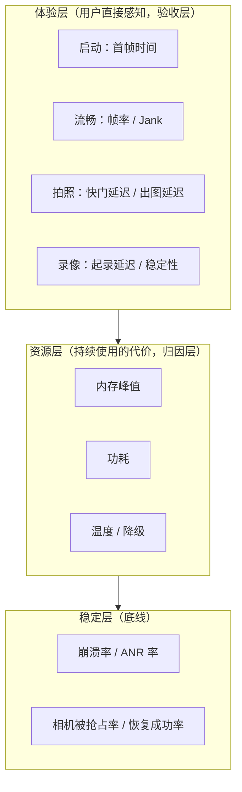
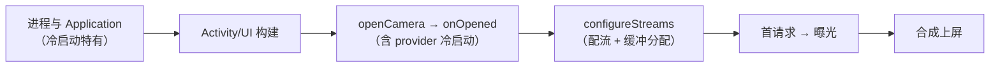
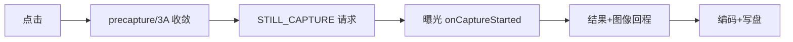

# Android Camera 性能分析文档（指标 / 度量 / 分域优化 / 体系）

> 本文档是相机学习系列的性能总纲：**定义指标 → 建立度量 → 分域优化（启动/预览/拍照录像/内存/功耗热）→ 稳定性与线上体系**。内容不限于本仓库既有文档：以 Android 官方 developer docs（Vitals、JankStats/FrameMetrics、Thermal API、Baseline Profiles、Macrobenchmark、CameraX、前台服务等）、androidx 库、Perfetto 官方文档与公开工程实践为 A/B 层来源，结合本仓库的 Trace 分析、算法集成与源码链路文档组织成体系。
>
> 整理日期：2026-10-25。材料分层沿用仓库惯例：**A = 官方文档可验证；B = 公开通行实践；C = 行业经验（口径不一，仅供参考）**。各章末尾附来源链接。

## 与其它文档的关系

- 《Android_Camera_Trace分析文档》：本篇第 2 章的**工具细节**（Perfetto 配置/判读/SQL）都在那边，本篇只引用不重复；
- 《Android_Camera_算法集成文档》：GL 处理链/多帧融合的**实现方案**在那边（本篇第 4/5 章只讲预算与降级）；
- 《Android_Camera_性能分析面试题》（46 题）：本篇的速查版，问答形式，含板块九公开资料扩展专题；
- 《Android_Camera_源码链路文档》/《ISP_3A文档》：启动链路与 3A 行为的底层依据。

## 文档结构

| 章节 | 内容 | 主要来源层 |
|---|---|---|
| 第 1 章 指标体系与性能预算 | 体验/资源/稳定三层指标、每个指标的起止点定义、冷/温/热启动、行业 KPI 术语（TTFF/Shot-to-Shot）、预算制定方法 | B + A（Vitals） |
| 第 2 章 度量方法学 | 实验室/线上/程序化三环境分工、埋点设计、FrameMetrics 与 JankStats、统计口径与公平性、端到端延迟测量 | A + B |
| 第 3 章 启动性能 | 首帧成本分解、App 层九条优化清单、provider 冷启动对策、Baseline Profile、两段式会话、CameraDeviceSetup 预检 | A + B |
| 第 4 章 预览流畅性与延迟 | 帧预算模型（30/60/120fps）、掉帧四分类归因、SurfaceView 硬件叠层、GL 链预算与降级、高帧率约束、capture-to-display | A（CameraX/Preview）+ B |
| 第 5 章 拍照与录像性能 | 快门/出图延迟五段拆分、precapture 取舍、ZSL、连拍、录像专项（起录/音画/码控/前台服务与 wake lock） | A + B |
| 第 6 章 内存与带宽 | 像素缓冲估算模型、maxImages 策略、Image close 铁律、相机特有泄漏检测、多路流带宽评估、onTrimMemory/低内存降档 | A + B |
| 第 7 章 功耗与热 | 热源构成、Thermal API（状态监听 + headroom 预测式降级）、降级矩阵与滞回、功耗工具链（Battery Historian/power rails/Monsoon）、热稳态基线 | A + B |
| 第 8 章 稳定性与线上体系 | 相机稳定性场景、Vitals 外部红线、线上监控设计、CI 门禁与基线管理、事故复盘模板、成熟度自检 | A + B |

## 建议阅读路径

1. 先读第 1 章建立指标语言（全团队对齐口径的起点）；
2. 按问题域跳读第 3~7 章（每章独立成立，含优化清单与案例）；
3. 搭体系时读第 2 章与第 8 章（度量环境分工 + 线上/CI/复盘闭环）；
4. 需要动手采集时转《Trace分析文档》，需要实现算法链路时转《算法集成文档》。

---

# 第 1 章 指标体系与性能预算

> 本文为分章源文件，供单章阅读；若与主文档不一致，以主文档最新版为准。
>
> 性能工程的第一块基石不是工具，是**指标**。本章回答四个问题：相机 App 应该有哪些指标、每个指标的精确起止点是什么、指标之间怎么组织、预算（红线）怎么定。来源标注：A = Android/Perfetto 官方文档；B = 公开通行实践；C = 行业经验（口径不一，仅供参考）。

## 1.1 为什么指标先行：一个常见的事故模型

没有统一定义的指标体系，性能工作会陷入三个典型陷阱：

1. **口径分裂**：A 团队把"启动完成"记为 `onOpened`，B 团队记为画面上屏——两边数据永远对不上，优化收益无法验收；
2. **均值掩盖长尾**：首帧平均 600ms 看起来达标，但 p95 是 1.8s——低端机用户的真实体验完全不同，而差评恰恰来自他们；
3. **局部最优**：出图延迟优化了 200ms，但快门延迟劣化了 150ms——用户感知是"更难拍"，指标体系如果没有拆分，这类此消彼长根本看不见。

所以指标体系的三个设计原则：**起止点写清楚、分位数必看、体验层指标验收**（资源层是因，体验层是果，向产品汇报以体验层为准）。

## 1.2 指标体系总览

按用户感知分三层（B 层通行做法）：



每层的"消费者"不同，决定了呈现方式不同：体验层给产品（决定预算与验收）、资源层给工程（归因与优化）、稳定层给质量与商店（Vitals 红线）。三层之间的因果链是分析的路径——例如"体验层首帧 p95 超标 → 资源层看该机型是否低内存导致配流慢 → 定位到具体段"。

## 1.3 启动指标：首帧时间的完整定义

**定义**：首帧 = 预览画面第一帧**真正上屏**的时刻。精确起止点用七个打点表达（t0~t6，与第 3 章优化、第 8 章埋点一一对应）：

| 打点 | 时刻 | 期间发生了什么 |
|---|---|---|
| t0 | 用户点图标/进相机页 | — |
| t1 | `openCamera()` 调用发起 | Activity 创建、View 树构建、Surface 申请、权限检查 |
| t2 | `onOpened` 回调 | Binder 往返 + CameraService 仲裁 + provider 打开设备（sensor 上电等） |
| t3 | `createCaptureSession` 发起 | — |
| t4 | `onConfigured` 回调 | HAL `configureStreams`：流协商 + 缓冲分配 |
| t5 | 首帧 `onCaptureStarted` | 首个请求下发 + 曝光（含 1~3 个帧间隔的流水线填充） |
| t6 | 首帧上屏 | 图像经 BufferQueue → SF 合成 → 送显（FrameTimeline 的实际呈现时刻） |

**首帧 = t6 - t0**。三个最常见的口径错误：把 t2 当完成（还差配流与两帧）、把 t5 当完成（还差合成送显）、忘了 t0 之前可能还有权限弹窗（必须前置，见第 3 章）。

三种启动态分开统计（瓶颈完全不同，优化手段也不同）：

| 启动态 | 路径 | 典型瓶颈 | 健康目标（C 层经验值，仅参考） |
|---|---|---|---|
| 冷启动 | 进程被杀后启动，t0~t6 全走 | 进程/Application 初始化、provider 冷启动、完整配流 | 中端机 p95 ≤ 800ms~1s |
| 温启动 | 进程在、Activity 重建 | 相机链路全走（open→配流→首帧） | 冷启动的 60~70% |
| 热启动 | 后台返回、会话保留 | 只需恢复请求（t4'→t6'） | ≤200~300ms |

**行业 KPI 术语**（C 层，各家口径略有差异，面试/跨团队沟通先对齐定义）：

- **TTFF（Time to First Frame）**：≈ 上文的 t6-t0；
- **Time to First Shot**：启动到**第一张照片可拍出**（含 3A 就绪），比 TTFF 苛刻——"打开就能拍"才是用户心智，建议与 TTFF 并列立项（第 5 章）；
- 系统级对标：Android 官方 **TTID/TTFD**（Time To Initial/Full Display，[Macrobenchmark `StartupTimingMetric`](https://developer.android.com/reference/androidx/benchmark/macrobenchmark/StartupTimingMetric) 的口径，A 层）度量的是 Activity 首帧，**不含相机管线**——相机 App 报系统启动数据时必须说明这个差异。

## 1.4 流畅与拍照指标

**流畅性**的三个口径要分开（它们来自不同管线）：

| 口径 | 测什么 | 工具 |
|---|---|---|
| 相机出帧率 | HAL 出帧节奏（`onCaptureStarted` 间隔） | 相机埋点 |
| UI 渲染帧率 | View 体系帧（设置页、面板等） | JankStats/FrameMetrics |
| 端到端 | 场景变化到屏幕呈现 | 时间戳差值/高速摄像（第 2 章 2.6） |

为什么分开：预览走 SurfaceView 独立合成层**不经过 View 渲染管线**（第 4 章），JankStats 测不到预览掉帧；反过来相机出帧正常但 UI 卡顿也会被用户骂"卡"——两个数据合在一起就会互相污染。

**官方帧指标定义**（A 层，[Android Vitals](https://developer.android.com/topic/performance/vitals)）：

- **Slow frames**：单帧渲染超过 16ms（约一个 60Hz 刷新周期）；
- **Frozen frames**：单帧超过 700ms，用户感知"冻住"。

工程上再加两个自己的口径：**Jank 率**（掉帧帧数/总帧数，按超 1 个 VSync 计）与**连续丢帧计数**（>3 帧连续丢）——用户对连续卡顿远比零星掉帧敏感，连续丢帧是差评的直接来源。

**拍照指标族**（起止点必须逐个写清）：

| 指标 | 起止点 | 用户感知 | 健康参考（C 层） |
|---|---|---|---|
| 快门延迟 | 点击 → `onCaptureStarted` | "按下去有没有反应" | ≤150~250ms |
| 拍照延迟 | 点击 → `onImageAvailable` | "多久能拍到" | ≤400~800ms（暗光/夜景另计） |
| 出图延迟 | 点击 → 写盘完成/缩略图可分享 | "多久能发出去" | ≤600ms~1.2s |
| 首张延迟 | 冷启动后第一张 | 首次体验 | 单列预算 |
| Shot-to-Shot | 相邻两张可接受的最短间隔 | "能不能连按" | ≤400ms~1s |

**录像指标**：起录延迟（点录制→首帧视频入码，参考 ≤300~500ms）、录制帧率稳定性（p95 帧间隔）、丢帧数、**音画同步偏移**（人眼/耳对 ±40~80ms 以上的偏移可感，C 层经验阈值，超 100ms 明显）、热稳态码率/帧率衰减、录像中拍照的干扰（掉帧/音画跳变）。

## 1.5 资源与稳定指标

**内存**（详细的模型与策略见第 6 章，这里只定口径）：

- **PSS 峰值**：长时使用（预览 10min + 连拍 + 录像）后的最大值——低端机红线常设 400~500MB 级（按机型分档）；
- **native/Graphics 增长趋势**：进相机/出相机循环 10 次后是否回到基线（泄漏检测，LeakCanary 对像素缓冲无感，见 6.3）；
- **缓冲占用**：Σ(每流 maxBuffers × 单帧) ——配流前就能算出来（6.1 的公式）。

**功耗**：固定脚本（30min 标准预览/录像）的耗电量（mAh 或 %）与平均电流（mA），工具链见第 7 章。口径要点：**同亮度同信号同温机**对比，否则数据不可比。

**温度**：不直接用"温度值"做指标，用**热降级触发时间点**（连续录像多少分钟开始降档）与**降级触发率**（线上用户触发降级的会话占比）——前者实验室测，后者线上采。

**稳定**（对标 [Android Vitals](https://developer.android.com/topic/performance/vitals) 用户感知口径与 Play 行为阈值，A 层）：

- 崩溃率/ANR 率（相机相关，按会话计）；
- 相机被抢占次数（onDisconnected）、自动恢复成功率（回来后多少会话自动恢复预览）；
- 配流失败率、拍照失败率、丢帧率。

## 1.6 性能预算怎么定：一个可操作的流程

预算 = 指标红线。制定流程（B 层方法学）：

1. **按机型分档**：旗舰/中端/入门三档（或按 RAM+SoC 代次自动分）。入门档预算 ≈ 旗舰 × 1.5~2 起步，再用实测校准——不要给所有机型一条线；
2. **分位数红线**：如"中端档冷启动首帧 p95 ≤ 800ms"。为什么用 p95 而不是均值：均值达标 p95 超标 = 长尾用户体验崩（差评来源），且均值对劣化不敏感（少量 5s 样本拉高均值有限，但 p95 会立即跳）；
3. **特殊态单独建基线**：暗光首帧、热稳态出图、低端机连拍、录像中拍照——特殊态常常才是差评来源，"常态达标"不等于"没有糟糕场景"；
4. **预算文档化**：每个指标一行写清起止点/采集方式/统计口径/分档红线/负责人，随版本管理（代码库里的 `PERF_BUDGET.md`）；口头约定 = 没有约定；
5. **外部红线叠加**：Play Vitals 的 slow/frozen frames、ANR 率是**不可协商的下限**，叠在自家预算之上（自家红线应严于商店红线）。

**预算示例**（中端档，示例数值非规范）：

| 指标 | p50 | p95 | 红线动作 |
|---|---|---|---|
| 冷启动首帧 | 600ms | 800ms | 超线阻塞发布 |
| 快门延迟（亮光） | 120ms | 250ms | 超线排查 precapture |
| 出图延迟 | 500ms | 1.0s | 超线查编码/落盘 |
| 预览 Jank 率（亮光 30fps） | <0.5% | 2% | 超线查四分类 |
| 录像 20min 热降级前帧率 | 30fps | ≥28fps | — |
| PSS 峰值 | ≤350MB | 450MB | 超线降档 |

## 1.7 常见教训清单

1. 起止点没写清 → 两团队数据对不上（"首帧"一个按 t2 一个按 t6）；
2. 样本剔除规则没定（是否剔除冷启动前 1s 的帧、是否剔除温度异常样本）→ 版本间数据漂移，告警失灵；
3. 只有均值没有分位数 → 长尾劣化看不见；
4. 指标没有负责人 → 超线无人处理，看板变成摆设；
5. 预算从不更新 → 硬件换代后旧预算形同虚设（每次旗舰 SoC 更替应例行复核）。

---

> 来源与延伸：[Android Vitals 指标定义](https://developer.android.com/topic/performance/vitals)、[Macrobenchmark StartupTimingMetric](https://developer.android.com/reference/androidx/benchmark/macrobenchmark/StartupTimingMetric)；TTFF/Shot-to-Shot/健康参考值为行业通行口径（C 层，各家不一）。本章指标在第 2 章落实为采集方法，预算在第 8 章落实为 CI 门禁。
# 第 2 章 度量方法学：实验室、线上与程序化监控

> 本文为分章源文件，供单章阅读；若与主文档不一致，以主文档最新版为准。
>
> 第 1 章定义了"测什么"，本章解决"怎么测"：三种度量环境的分工与闭环、埋点设计、程序化帧监控（FrameMetrics/JankStats）的原理与代码、统计口径的公平性、以及预览端到端延迟的测量。trace 工具的抓取配置与判读见《Android_Camera_Trace分析文档》第 2~3 章，本章不重复。

## 2.1 三种度量环境的分工与闭环

| 环境 | 手段 | 优势 | 局限 |
|---|---|---|---|
| 实验室 | 固定脚本 + Perfetto/dumpsys + 外设（功耗仪/高速摄像/标准灯箱） | 可复现、可归因（有完整 trace） | 环境理想化，掩盖真实长尾（用户的后台负载/温度/存储状态无法模拟） |
| 线上 | 分段埋点 + 计数器 + 异常采样上报 | 真实分布、机型覆盖广 | 难归因——只能告诉你"哪段慢"，不能告诉你"为什么慢" |
| App 内程序化 | FrameMetrics/JankStats/Choreographer/自定义打点 | 持续运行、粒度到帧、无需外部设备 | 只覆盖 App 侧视角（系统侧/HAL 侧看不到） |

三者不是三选一，是一条**证据链闭环**：

```
线上发现（p95 劣化告警）
  → 实验室复现（同机型同脚本 + Perfetto 采集）
    → trace 归因（定位到 App/框架/HAL/资源，见《Trace分析文档》第 5 章）
      → 修复 → CI 回归（防退化）→ 线上验收（下个版本曲线回落）
```

只有实验室没有线上：优化偏离真实用户（实验室永远 25℃ 满电飞行模式）；只有线上没有实验室：问题发现了但下钻不了。两个都有的团队，才是"性能可运营"。

## 2.2 埋点设计（线上）

### 2.2.1 分段埋点与 trace 同名

原则：**埋点名与 Perfetto 打点名统一**（如 `Camera#sessionConfig`），这样线上数据与实验室 trace 能互相印证——线上说"配流段 p95 劣化"，实验室抓 trace 直接搜同名切片。

```kotlin
// 同一段工作，双通道记录：trace（实验室归因用）+ 埋点（线上统计用）
fun openCameraWithMetrics() {
    val t0 = elapsedRealtime()
    Trace.beginAsyncSection("Camera#open", 0)
    cameraManager.openCamera(id, object : StateCallback() {
        override fun onOpened(device: CameraDevice) {
            Trace.endAsyncSection("Camera#open", 0)
            PerfTracker.report("Camera#open", elapsedRealtime() - t0, dims)
            ...
        }
        ...
    }, handler)
}
```

### 2.2.2 环境维度必带

一条耗时数据不带维度就没有分析价值。最低维度集：

`机型 | SoC | 系统版本 | 前后摄 | 冷/温/热启动 | 光照档（可用 AE 状态/曝光时间近似分桶）| 温度档（Thermal status）| 电量/充电态 | 存储剩余`

维度的作用举例：出图延迟整体正常，但"入门机 × 慢速存储 × 电量低于20%"桶里 p95 是 3s——没有维度这条永远查不出来。

### 2.2.3 采样与上报策略

- **计数器全量**：帧数、掉帧数、拍照失败数、抢占数、降级触发数（这些是低频小数据）；
- **分段耗时采样**：按用户比例（如 10%）上报明细，量级可控；
- **异常样本留详情**：分段耗时超阈值时，附加采集"该次会话的完整分段 + 相机状态快照（dumpsys 摘要）"，供回捞归因；
- **上报节奏**：会话结束批量上报，不要逐帧打网络请求。

### 2.2.4 告警规则

版本对比告警（新版本 p95 - 上版本 p95 > 阈值即报警），不要用绝对值告警（绝对值告警会因机型分布波动一直响，很快被忽略）。告警带维度下钻链接：哪一档、哪个场景劣化，一键可看。

## 2.3 程序化帧监控：FrameMetrics 与 JankStats

### 2.3.1 Window.OnFrameMetricsAvailableListener（API 24+）

系统在每帧渲染完成后回调（A 层，[FrameMetrics](https://developer.android.com/reference/android/view/FrameMetrics)），提供该帧各阶段耗时：

```java
window.addOnFrameMetricsAvailableListener((win, frameMetrics, dropCount) -> {
    float totalMs  = frameMetrics.getMetric(FrameMetrics.TOTAL_DURATION) / 1_000_000f;
    float layoutMs = frameMetrics.getMetric(FrameMetrics.LAYOUT_MEASURE_DURATION) / 1_000_000f;
    float drawMs   = frameMetrics.getMetric(FrameMetrics.DRAW_DURATION) / 1_000_000f;
    float swapMs   = frameMetrics.getMetric(FrameMetrics.SWAP_BUFFERS_DURATION) / 1_000_000f;
    FrameTracker.record(totalMs, layoutMs, drawMs, swapMs);
}, handler);
```

各字段的含义（对应渲染管线，A 层字段定义 + B 层解读）：

| 字段 | 覆盖阶段 | 超标常见原因 |
|---|---|---|
| `LAYOUT_MEASURE_DURATION` | measure/layout 遍历 | 布局过深、requestLayout 风暴、列表重绑 |
| `DRAW_DURATION` | View 绘制指令录制（DisplayList） | onDraw 复杂、大量 invalidate 区域 |
| `SWAP_BUFFERS_DURATION` | 缓冲提交/交换 | GPU 排队、合成背压 |
| `TOTAL_DURATION` | 从 VSync 到呈现的整帧 | 兜底口径（与 Vitals 的 16ms/700ms 对齐） |

注意：回调本身有开销，线上建议按窗口启用（如疑似卡顿的页面）而不是全程常开；`dropCount` 表示系统丢弃了多少帧回调（说明回调处理太慢）。

### 2.3.2 androidx JankStats

在 FrameMetrics（API 24+）/Choreographer（低版本回退）之上封装（A 层，[官方文档](https://developer.android.com/topic/performance/vitals/jank-stats)），输出每帧 `FrameData(frameStartNanos, durationMs, isJank)`：

```kotlin
val jankStats = JankStats.createAndTrack(window) { frameData ->
    if (frameData.isJank) JankTracker.report(frameData.durationMs)
}
jankStats.jankHeuristicMultiplier = 2f   // jank 阈值 = 刷新周期 × 2（可调）
```

它的官方定位就是**生产环境监控**：低开销、可配置阈值、带 `OnFrameListener` 挂钩。适合接入第 1 章的 Jank 率指标做线上采集。

### 2.3.3 相机 App 的关键区分（最容易搞错的一点）

**JankStats/FrameMetrics 监控的是 View 渲染帧**。相机预览走 SurfaceView 的独立合成层（HAL→BufferQueue→SF，不经过 View 的 measure/layout/draw，见第 4 章 4.3），所以：

- JankStats 上报的帧数据反映的是**相机 App 的 UI**（设置面板、滤镜选择页、相册缩略墙），不是预览画面；
- 预览出帧要用相机侧口径：`onCaptureStarted` 间隔统计（出帧节奏）+ `SurfaceTexture` 时间戳（管线延迟，见 2.6）；
- 两个数据源**分开发报**，看板上分开展示——混在一个"帧率"里，预览掉帧会被 UI 帧率稀释到看不见。

其他程序化手段：`Choreographer.postFrameCallback` 的 `frameTimeNanos` 差值（自测帧间隔）；诊断期的 `StrictMode`（主线程 IO/网络违规即时暴露，A 层）。

## 2.4 统计口径与公平性

| 规则 | 为什么 |
|---|---|
| 分位数（p50/p95/p99）而非均值 | 少量极端样本拉不动分位数但决定长尾体验；掉帧类指标看 p95/p99 |
| 剔除冷启动段（帧率统计去前 1s） | 启动抖动污染稳态数据，稳态与启动是两个指标（第 1 章） |
| 分场景统计（亮/暗、前/后摄、帧率档） | 暗光掉帧是曝光物理约束（第 4 章），与亮光混算会互相稀释 |
| 样本量 N≥30 再下结论 | 小样本的分位数无意义；A/B 对比要有显著性概念 |
| 环境全记录（温度/电量/后台/充电） | 热降频与低电降频会系统性改变结果（第 7 章） |

一个均值误导的例子（B 层教学案例）：100 次启动，95 次 500ms、5 次 4000ms。均值 675ms"看起来还行"，p95 = 4000ms——那 5% 用户遇到的是黑屏 4 秒，差评就从这来。**相机场景的长尾通常来自低端机 + 冷 provider + 慢存储，正是均值最掩盖的人群。**

## 2.5 实验室搭建要点

- **环境控制**：标准光照（亮箱/暗箱，可复现 AE 行为）、温机与冷机分开跑（热状态是系统性变量，第 7 章）、飞行模式、固定后台负载、屏幕亮度锁定；
- **机型矩阵**：按"SoC 代次 × 摄像头配置"选 3~5 台代表机型覆盖主要分叉（比堆台数重要——覆盖度看分叉不看数量）；
- **脚本化**：固定操作序列（冷启动→切模式→亮光拍照→暗光拍照→连拍 5 张→录像 10min→后台 30s 返回→退出），用 uiautomator/Macrobenchmark 驱动，人手操作不可复现；
- **自动化基准**（A 层，[Macrobenchmark](https://developer.android.com/macrobenchmark)）：

```kotlin
@get:Rule val benchmarkRule = MacrobenchmarkRule()

@Test
fun coldStartup() = benchmarkRule.measureRepeated(
    packageName = "com.example.camera",
    metrics = listOf(StartupTimingMetric(), FrameTimingMetric()),
    iterations = 10,
    compilationMode = CompilationMode.Partial(),   // 模拟真实编译状态
) {
    pressHome(); device.pressKeyCode(KEYCODE_CAMERA_APP...)  // 或 startActivityAndWait
}
```

`StartupTimingMetric` 给 TTID/TTFD（Activity 口径，第 1 章的差异说明）、`FrameTimingMetric` 给滚动/动画的帧耗时分位。**相机出帧速率没有现成 metric**——由被测 App 内埋点导出，或脚本在测量后读 `dumpsys media.camera` 的帧计数。

- **trace 同步采集**：脚本运行时自动起 Perfetto（配置见《Trace分析文档》2.2），每个用例产出配套 trace——异常样本自带现场，不用等复现；
- **报告**：每机型 p50/p95 对基线版本对比，劣化即标红进 CI 门禁（第 8 章 8.3）。

## 2.6 特殊测量：预览端到端延迟（capture-to-display）

预览延迟 = 场景变化 → 传感器曝光 → 相机管线 → 处理链 → 合成 → 屏幕点亮像素的总时间。扫码对焦、直播、AR 类产品对这个指标敏感（行业术语 motion-to-photon 借自 AR，C 层）。三层测法：

### 2.6.1 时间戳差值法（App 内可做）

原理：`SENSOR_INFO_TIMESTAMP_SOURCE = REALTIME` 的设备上，相机帧的传感器时间戳与 `SystemClock.elapsedRealtimeNanos()` 同基准（A 层），于是：

```
管线延迟 ≈ onFrameAvailable 时刻的 System.nanoTime()
          − SurfaceTexture.getTimestamp()（该帧的传感器时间戳）
```

这测得的是"曝光 → App 侧可采样"；再叠加合成/送显 1~2 个刷新周期近似端到端。注意：`UNKNOWN` 基准的设备上此法无效（时间戳基准未定义）；滤镜链会增加该值（处理 pass 数 × 每 pass 时间 + 队列深度）。

### 2.6.2 高速摄像法（实验室金标准之一）

240fps+ 慢动作相机同时拍"被摄物运动"与"手机屏幕"，逐帧比对物像与屏像的相位差：

```
端到端延迟 = 相位差帧数 ÷ 高速摄像帧率
例：240fps 下滞后 9 帧 → 9/240 ≈ 37.5ms
```

用 LED 闪光触发（灯亮 vs 屏幕出现灯像）同理，测的是纯"光→屏"链路，排除了算法判断的模糊性。

### 2.6.3 FrameTimeline（系统侧权威口径）

Perfetto 的 FrameTimeline 轨道（Android 12+，A 层）给出每帧的期望呈现时刻与实际呈现时刻及 jank 归属——作为线上无法获取时的实验室权威口径，与 2.6.1 的 App 侧数字互为校验。

---

> 来源与延伸：[FrameMetrics](https://developer.android.com/reference/android/view/FrameMetrics)、[JankStats](https://developer.android.com/topic/performance/vitals/jank-stats)、[Macrobenchmark](https://developer.android.com/macrobenchmark)、[StrictMode](https://developer.android.com/reference/android/os/StrictMode)；高速摄像与时间戳差值为通行实践（B 层）。采集之后的分析工具链与归因方法转《Android_Camera_Trace分析文档》第 3~5 章。
# 第 3 章 启动性能：首帧优化

> 本文为分章源文件，供单章阅读；若与主文档不一致，以主文档最新版为准。
>
> 首帧是相机体验的第一道关。本章讲启动链路每一环的**成本构成与成因**、App/框架/系统三层优化手段（含代码骨架）、以及官方通用启动优化在相机场景的落地。逐段 trace 判读与异常模式见《Android_Camera_Trace分析文档》第 3 章。

## 3.1 启动链路的成本结构



逐环拆解成本成因（理解成因才能判断优化空间）：

**① 进程与 Application（冷启动特有）**：Zygote fork、类加载、ART 初始化、Application.onCreate 里的三方 SDK 同步初始化——每个 SDK 几十 ms 累积起来就是几百 ms，而且**串行阻塞在 Activity 创建之前**（第 3.3 节 Baseline Profile 与异步化针对这里）。

**② Activity/UI 构建**：布局 inflate（层级深度直接决定）、Surface 申请（SurfaceView 的 surfaceCreated 时机）、首帧绘制。这一段的优化是通用 Android 启动优化（布局扁平化、viewstub 延迟加载）。

**③ openCamera → onOpened**：App 发起 Binder → CameraService 权限/优先级仲裁 → provider 打开设备。**provider 冷启动**是这段的大变量：provider 进程首次拉起要进程创建、加载厂商 so、sensor 上电（I2C 配置、PLL）、固件加载、ISP 初始化——几十到几百 ms，厂商/机型差异极大，App 层不可控（对策见 3.4）。

**④ configureStreams**：HAL 按流组合协商 pipeline、分配缓冲。成本随**流数量与尺寸**增长（大流组合可到数百 ms，B 层经验），是 App 层最能影响的一段（两段式会话，3.2-5）。

**⑤ 首请求 → 曝光**：请求下发后要等流水线填充（1~3 个帧间隔）+ 首帧曝光。这段接近物理下限，优化空间在"请求尽早下发"与"别被会话参数变更挤掉"。

**⑥ 合成上屏**：帧进 BufferQueue → SF 合成 → 送显，正常 1~2 帧。异常时（SF jank）属显示链路问题，不是相机问题（用 FrameTimeline 区分归属）。

典型量级（B 层经验，机型差异大，仅示比例）：①+② 约 150~300ms，③ 50~500ms（provider 冷启动时取高段），④ 100~400ms，⑤+⑥ 50~100ms。**三大头是 App 初始化、provider 冷启动、配流——优先级要用分段埋点数据定，不是按直觉**（见 3.6 案例）。

## 3.2 App 层优化清单（含代码骨架）

### 3.2.1 权限前置

权限弹窗是**用户交互**，耗时不可控（用户可能思考 10 秒），绝不能挂在启动链路上：

```kotlin
// 入口页/引导页就申请；相机页只做同步检查
if (!hasCameraPermission()) permissionLauncher.launch(CAMERA)   // 入口页
// 相机页 onCreate：
if (!hasCameraPermission()) { showDeniedUi(); return }          // 同步判断，不弹窗
```

配套：`denied` 态做成一级 UI（引导去设置），`onResume` 复查权限撤销（`SecurityException` 兜底）。

### 3.2.2 提前枚举与缓存

`getCameraIdList`/`getCameraCharacteristics` 是 Binder 调用，首次访问还要在 `CameraManagerGlobal` 建 listener 快照（第《源码链路文档》第 1 章）。启动页后台线程预热并缓存：

```kotlin
// Application/启动页，后台线程
scope.launch(Dispatchers.Default) {
    val list = cameraManager.cameraIdList.map { id ->
        id to cameraManager.getCameraCharacteristics(id)
    }
    CameraInfoCache.put(list)   // 相机页直接读缓存
}
```

注意：无 CAMERA 权限时部分 Key 被过滤（A 层，API 32+ 可查 `getKeysNeedingPermission`）——授权后要作废缓存重取；设备热插拔后缓存失效（availability 回调刷新）。

### 3.2.3 尽早发起 openCamera + 启动栅栏

openCamera 是异步的——**等待窗口应该被并行工作填满**，而不是串行等它：

```kotlin
fun onCreate() {
    startBackgroundThread()                    // 1. 先起回调线程
    maybeOpenCamera()                          // 2. 权限 OK 就立刻发起 open（不等 UI 建完）
    initUiAsync()                              // 3. 并行：布局、滤镜资源、编码器预热
}
// 4. 栅栏：Surface 就绪 + onOpened 都到了才建会话
private val surfaceReady = AtomicBoolean(false)
private val deviceReady = AtomicBoolean(false)
private fun maybeCreateSession() {
    if (surfaceReady.get() && deviceReady.get()) createCaptureSession()
}
```

回调用专用 HandlerThread（不与主线程互相阻塞）。这条的要点是**顺序**：很多 demo 把 openCamera 放在 surfaceCreated 之后才调，白白把 provider 打开时间串行到了链路尾部。

### 3.2.4 两段式会话（对配流大头的结构性优化）

首会话只配预览流快速出帧，首帧后再补全量流：

```kotlin
// 第一段：只配预览
device.createCaptureSession(listOf(previewOutput), cb1, …)
// onConfigured → setRepeatingRequest → 首帧上屏（此时用户已看到画面）
// 第二段：首帧后（或用户首次进入高级模式时）重建全量会话
device.createCaptureSession(listOf(previewOutput, jpegOutput, analysisOutput), cb2, …)
```

代价：第二段重建瞬间预览闪断一帧（PRODUCT 决策）。收益：把大流配流成本从首帧路径挪走，通常能省 100~300ms（B 层经验）。注意第二段重建前用 `isSessionConfigurationSupported` 预检，失败降级保持第一段会话。

### 3.2.5 懒配置 + 组合预检

- 拍照 ImageReader 延到首帧后创建（或首帧后预热）、`maxImages` 用最小够用值；
- 预检 API 避免试错往返：`isSessionConfigurationSupported`（API 28）、`isStreamCombinationSupported`（API 29）、**`CameraDeviceSetup`（API 35 / Android 15，A 层）**——无需打开设备即可离线查询组合与模板参数，把"打开→配→失败→重试"变成"预检→一次配成"。

### 3.2.6 会话参数

API 28+ `SessionConfiguration.setSessionParameters(builder)` 把稳定参数（FPS 区间、厂商开关）在建会话时一次下发：HAL 在 `configureStreams` 阶段即可见，还能据此选更优 pipeline（A 层）。代价是改会话参数通常要重建会话——**只放稳定设置**。

### 3.2.7 热启动复用

```kotlin
override fun onPause() {
    // 不 close 相机：只停请求或保持（系统需要时会自己抢占）
    session?.stopRepeating()
}
override fun onResume() {
    session?.setRepeatingRequest(previewRequest, …) ?: startCameraIfPossible()  // 被抢占过才重开
}
```

热启动（后台返回）走恢复路径 t4'→t6'（几十 ms）而不是全链路 t0~t6。被抢占（onDisconnected）才走重开。产品上"每次切回来都卡"几乎都是 onPause 全量 close 导致的。

### 3.2.8 配置变更不重走链路

旋转/分屏/折叠态变化默认销毁重建 Activity——用 ViewModel（或 retained fragment）持有 CameraDevice/Session 引用与尺寸选择结果，重建时只重绑 Surface：

```kotlin
class CameraViewModel : ViewModel() {
    var device: CameraDevice? = null        // 配置变更后仍存活
    var previewSize: Size? = null
    // onCleared() 里才真正释放
}
```

注意 Surface 变化仍需重建会话（Surface 是会话的输出目标），但省掉了 openCamera 段。

## 3.3 框架与系统层手段

- **provider 冷启动**：App 层无法消除，只能降低触发频率（热启动复用）+ 平台协作（OEM 保活/预热策略）+ 产品掩盖（启动动画）+ 监控 p95。系统侧重启后 provider 常驻与否取决于厂商实现（B/C 层）；
- **Baseline Profile**（A 层，[官方文档](https://developer.android.com/topic/performance/baselineprofiles)）：把关键路径预编译为机器码，官方口径冷启动最高 ~30% 收益。相机 App 的关键路径非常固定（启动→openCamera 回调→建会话→首帧回调），是 Baseline Profile 的理想对象；生成器 `profileBlock` 应覆盖：启动 Activity、openCamera 回调链、会话创建、首帧处理（实操全流程见《Android_通用面试题》Q41：`generateBaselineProfile` 任务、profileinstaller、1.5MB 上限、混淆后重新生成）；
- **通用启动优化**（A 层 [App Startup](https://developer.android.com/topic/performance/app-startup)）：Application 三方 SDK 异步化/懒加载、App Startup 库统一初始化器（依赖显式化）、启动期开 StrictMode 抓主线程 IO、`reportFullyDrawn()` 帮系统度量；
- **Profile guided 的系统编译**：线上用户的 Cloud Profile 也会逐步优化热点（第《通用面试题》Q62），实验室对比时注意编译状态一致（Macrobenchmark 的 `CompilationMode.Partial()`）。

## 3.4 验收与防退化

- 分段埋点 t0~t6 上线（第 2 章 2.2 的同名打点），p95 分机型看板；
- CI：Macrobenchmark `StartupTimingMetric` + App 内相机埋点做版本回归（第 8 章 8.3）；
- 常见反模式清单（面试也常考）：首帧前等 AE 收敛（预览不需要收敛）、全部初始化塞 `onOpened` 回调（回调线程被堵）、预览等 JPEG 流一起建会话（配流变大）、主线程做设备枚举、onResume 无条件重开相机、旋转后重走 openCamera。

## 3.5 案例：1.6s → 800ms 的路径（示例数据，方法可复用）

| 阶段 | 优化前 | 手段 | 优化后 | 验收方式 |
|---|---|---|---|---|
| ①+② App/Activity | 260ms | SDK 异步化 + Baseline Profile + 布局扁平化 | 120ms | 埋点 t0~t1 |
| ③ openCamera | 540ms | 热路径会话复用避开 provider 冷启动（第二次启动起） | 180ms | t1~t2 |
| ④ 配流 | 380ms | 两段式（首会话仅预览流）+ 预检 | 150ms | t3~t4 |
| ⑤+⑥ 首帧上屏 | 160ms | 无改动 | 150ms | t4~t6 |
| **合计** | **1.34s** | | **600ms** | p95 对比 |

三条纪律：**优先级由分段数据决定**（此例先做 provider 而非编码）；每步独立验收（防"优化 A 劣化 B"）；把"第二次启动起"单独汇报（provider 冷启动只影响首次，冷/热分开统计正是为了说清这件事，第 1 章 1.3）。

---

> 来源与延伸：[Baseline Profiles](https://developer.android.com/topic/performance/baselineprofiles)、[App Startup](https://developer.android.com/topic/performance/app-startup)、[CameraDevice（会话/预检 API）](https://developer.android.com/reference/android/hardware/camera2/CameraDevice)；两段式会话/会话参数/栅栏模式为通行实践（B 层）。逐段 trace 判读、异常模式速查见《Android_Camera_Trace分析文档》第 3 章。
# 第 4 章 预览流畅性与延迟

> 本文为分章源文件，供单章阅读；若与主文档不一致，以主文档最新版为准。
>
> 预览是相机 App 的"常驻负载"：帧预算被刷新率锁死，任何超支直接表现为掉帧。本章讲帧预算的数学、掉帧的四类归因、显示路径的机制（含 CameraX 官方的硬件叠层说法）、GL 处理链预算与降级阶梯、高帧率约束与端到端延迟。

## 4.1 帧预算模型：钱从哪里来，花到哪里去

每个刷新周期是一笔固定预算，三方分账：

```
帧间隔（刷新周期） = 相机出帧（曝光+读出+ISP） + 处理链（GL/NPU，可选） + 显示合成（SF/HWC） + 余量
```

| 刷新率 | 帧间隔 | 相机+显示通常占 | 建议算法+渲染预算（B 层经验） |
|---|---|---|---|
| 30fps | 33.3ms | ~15~20ms | ≤8~10ms |
| 60fps | 16.6ms | ~8~10ms | ≤4~6ms |
| 120fps | 8.3ms | ~4~5ms | ≤2~3ms |

为什么建议值比"剩余时间"再小一截：调度抖动（GC、binder、中断）、SF 合成的波峰、GC 暂停都会瞬时超支——**预算要按 p95 花销而不是均值**留余量（与第 1 章的分位数原则一致）。

优化的第一问永远是"**超支在哪一方**"：相机出帧慢（`onCaptureStarted` 间隔变大）、处理链慢（GL 帧耗时）、还是显示合成慢（FrameTimeline 的 SF jank）——三方对齐时间窗再动手，否则在错误的层优化（最常见错误：相机出帧慢却去优化 shader）。

## 4.2 暗光的物理约束：帧时长的数学

```
帧时长 = max(曝光时间 + 读出时间, FPS range 设定的帧间隔)
帧率上限 = 1000 / 曝光时间(ms)
```

算例：暗光下 AE 把曝光拉到 50ms → 帧率上限 20fps（无论设置多高的 FPS range）；曝光 100ms（夜景手持）→ 10fps。**这不是 bug，是光电转换的信噪比要求**——同样亮度下，缩短曝光就必须提增益，增益放大噪声。

`AE_TARGET_FPS_RANGE` 的语义（A 层）与产品含义：

| 设置 | AE 行为 | 适用 |
|---|---|---|
| `[30,30]` | 曝光钳在 33ms 内，不够亮就提增益 | 预览/录像防抖体验（代价：暗光噪点） |
| `[10,30]` | 允许暗光降帧换曝光 | 拍照预览（所见即所得优先） |
| `[15,15]` | 固定低帧率 | 扫码/低功耗档 |

夜景模式"主动降帧 + 多帧合成"正是这个数学的产品化：单帧物理不够，就用时间换（多帧平均，噪降 √N，见《算法集成文档》第 3 章）。

## 4.3 掉帧归因四分类（机制与证据）

| 类别 | 机制 | 证据 | 典型修法 |
|---|---|---|---|
| ① 输出配置 | 预览尺寸过大（带宽/ISP 超载）、JPEG stalling 流混入预览请求、流组合超限 | dumpsys 流配置；配流参数 | 降预览尺寸；拍照流按需建（两段式） |
| ② 帧时长约束 | 暗光长曝光（4.2 的数学）；FPS range 设错 | `onCaptureStarted` 间隔变大但节奏稳定、无空档 | 分场景统计；产品档位决策 |
| ③ 缓冲 | Image 不归还 → buffer 池耗尽；消费线程慢 → 排队 | ImageReader 消费线程状态；`camera_memory` 密集分配 | 消费后立即 close；丢旧帧 |
| ④ 线程/调度 | 回调 Handler 阻塞、主线程卡顿拖累 UI、CPU 降频/抢占 | Choreographer 超时、cpufreq 轨道、Runnable 堆积 | 独立线程；主线程减负；绑核/优先级 |

判读流程（三方对齐）：**相机出帧 vs UI 渲染先分开**（第 1 章 1.4 的两套口径）→ 相机侧看 `onCaptureStarted` 间隔 + dumpsys 丢帧计数 → UI 侧看 JankStats/FrameTimeline → 显示侧看 SF 的 jank 类型（`SurfaceFlinger CPU/GPU Deadline Missed`）→ 时间窗对齐后归到上表某一类。工具操作细节见《Trace分析文档》第 3~4 章。

## 4.4 显示路径：机制与选择

三条路径的本质差异在**合成方式**：

| 路径 | 合成机制 | 延迟/功耗 | 能力 |
|---|---|---|---|
| SurfaceView（默认） | 独立图层，可由 **HWC 硬件叠层**直接叠加送显（绕过 GPU，A 层：[CameraX Preview 文档](https://developer.android.com/media/camera/camerax/preview) 明确这是 PERFORMANCE 模式的收益来源） | 最低（零拷贝、无 GPU 参与） | 变换/动画受限 |
| TextureView | 内容变成 GPU 纹理，走 View 树的正常合成 | 高一级（多一次上传+GPU 采样） | 支持平移/缩放/透明/动画 |
| GL 中转（SurfaceTexture→GL→SurfaceView） | App 自己渲染后交给 SurfaceView | 取决于 pass 数（可控） | 任意滤镜/变换 |

CameraX 的 `PreviewView` 默认 PERFORMANCE 模式（内部优先 SurfaceView + 硬件叠层；需要动画兼容时切 COMPATIBLE——A 层官方文档）。需要 GL 中转的完整实现（EGL 初始化、OES 外部纹理、多 pass、方向矩阵）见《算法集成文档》第 2 章与《追问链面试题》链 2 的代码骨架。

实践要点：`SurfaceTexture.setDefaultBufferSize` 与相机输出尺寸一致（避免显示端二次缩放开销）；SurfaceView 独立图层意味着它**不受 View 渲染帧率统计覆盖**（第 2 章 2.3.3 已强调）。

## 4.5 GL 处理链的预算与降级阶梯

### 4.5.1 预算内的开源手段

- **降采样处理**：磨皮/虚化类算法对分辨率不敏感——1080p 输入降到 1/2 处理再放大，GPU 时间近似降 75%（面积 1/4）；
- **多 pass 用 FBO ping-pong**：pass 间不回读 CPU；每个 pass 只读写一次纹理；
- **丢旧帧**：处理链入口"只保留最新帧"（队列深度=1），处理不过来直接丢——**绝不排队**（排队 = 延迟累积 + 更卡）；
- **ML 降频**：人脸/分割网络每 N 帧推理一次，帧间用光流/关键点插值或直接复用 mask（边界做时间平滑防抖动）；
- **YUV→RGB 免费**：OES 外部纹理采样时 GPU 自动完成（第《算法集成文档》），不要自己 CPU 转。

### 4.5.2 一个 pass 预算的算例（B 层示意）

1080p、单 pass 全屏 fragment shader 在中端 GPU 约 1~2ms；美颜三件套（磨皮 1 + 肤色 0.5 + 锐化 0.5 pass）+ LUT 0.5 ≈ 2.5~4ms；再加人脸推理（NPU 5~10ms，每 5 帧摊薄 ≈1~2ms）——30fps 预算 8~10ms 内可容纳，60fps（4~6ms）就要砍 pass 或降采样。**上线前必须真机实测**（GPU 代际差异大），预算表按机型分档维护。

### 4.5.3 降级阶梯（从轻到重，逐级可回退）

```
降算法分辨率（1/2 → 1/4）
  → 减 pass 数 / 降精度（fp16）
  → 降推理频率（每 3 帧 → 每 5 帧 → 关 ML）
  → 关实时效果（保留直出预览）
  → 降预览帧率（60→30）/ 降预览分辨率
```

触发信号三选一或组合：帧耗时滑动窗口超阈值、热状态档位（第 7 章）、掉帧计数。恢复要**滞回**（降级容易、恢复谨慎），防止在阈值附近来回切换造成"效果闪烁"。

### 4.5.4 红线

- 不在相机回调线程做处理（回调线程只入队）；
- 不在预览循环里 `glReadPixels`（同步回读阻塞 GPU 管线，必掉帧；导出/拍照按需读，或用 PBO 异步）；
- 不每帧 new 对象（FloatBuffer/Bitmap——GC 抖动直接体现在帧耗时的 p95 上）。

## 4.6 高帧率预览的约束链

高帧率不是"设个 FPS range"那么简单，约束是链式的（B 层）：

1. **设备能力**：`CONTROL_AE_AVAILABLE_TARGET_FPS_RANGES` 是否有 `[60,60]`/`[120,120]` 档，且**流尺寸越大越难保证**（sensor 读出 + ISP + DDR 带宽都翻倍）；
2. **曝光约束**：120fps 帧间隔 8.3ms → 曝光上限 8ms → 需要更亮环境或更高增益（噪声），暗光下高帧率形同虚设；
3. **下游链路**：TextureView + 滤镜在 120fps 下只剩 2~3ms 预算——通常要 SurfaceView 直通或极轻处理；
4. **功耗**：高帧率 + 高分辨率是发热大户（第 7 章），必须配降级策略与产品档位开关（用户可感知地选择，而不是偷偷全开）。

## 4.7 端到端延迟（capture-to-display）

测量三法（时间戳差值 / 高速摄像 / FrameTimeline）见第 2 章 2.6。这里讲**降低**手段与原理：

| 手段 | 原理 | 收益量级（B 层） |
|---|---|---|
| SurfaceView 硬件叠层 | 少一次 GPU 合成往返 | 0.5~1 帧 |
| 减少处理 pass / 丢旧帧 | 每帧处理时间 × 队列深度都算进延迟 | 每 pass 每帧；队列深度 n 就是 n 帧延迟 |
| `setDefaultBufferSize` 匹配 | 免显示端缩放 | 小 |
| 缩短缓冲队列 | BufferQueue 越深延迟越大（Buffer Stuffing 的反面） | 1~2 帧 |
| 降预览分辨率 | 带宽与处理时间同降 | 与分辨率平方成正比 |

给谁设预算：扫码（对焦帧到达即识别）、直播（推流延迟）、AR（motion-to-photon 通常要求 <20ms 级，C 层 AR 行业口径）——普通拍照 App 可放宽到 3~5 帧。

---

> 来源与延伸：[CameraX Preview（PERFORMANCE 模式/硬件叠层）](https://developer.android.com/media/camera/camerax/preview)、[PreviewView](https://developer.android.com/reference/androidx/camera/view/PreviewView)、[AE FPS range 语义](https://developer.android.com/reference/android/hardware/camera2/CaptureRequest#CONTROL_AE_TARGET_FPS_RANGE)、[Vitals 帧定义](https://developer.android.com/topic/performance/vitals)；帧预算数值、pass 预算与降级阶梯为通行实践（B 层）。GL 链路实现细节见《Android_Camera_算法集成文档》第 2 章；掉帧的 trace 判读见《Android_Camera_Trace分析文档》第 3~4 章。
# 第 5 章 拍照与录像性能

> 本文为分章源文件，供单章阅读；若与主文档不一致，以主文档最新版为准。
>
> 拍照链路的规则与预览相反：允许攒帧重算、允许异步——但用户对"按下没反应"（快门延迟）和"等图太久"（出图延迟）都敏感。本章讲延迟拆分的数学、precapture 的取舍逻辑、ZSL 机制、连拍流水线、录像专项（编码器/音画/前台服务）。trace 判读见《Trace分析文档》第 4 章。

## 5.1 拍照延迟的拆分：五段各有主人



| 段 | 典型量级（亮光，B 层示意） | 暗光典型 | 谁决定 |
|---|---|---|---|
| 点击→precapture | 0ms（可跳过） | 100~500ms | App 策略 + AE 收敛速度 |
| precapture→请求 | 0~50ms | 含在上行 | App |
| 请求→曝光 | 1~3 帧间隔（流水线填充） | 帧间隔变大 | pipeline depth × 帧率（协议下限） |
| 曝光→图像回程 | 1~2 帧 + HAL 处理 | 多帧融合可达秒级 | HAL/ISP |
| 图像→落盘 | 10~100ms 编码 + IO | 更长 | 编码器 + 存储 |

两个关键结论：

1. **快门延迟 = 点击→曝光**，它的优化对象是 precapture 等待与请求路径（App 层可做）；
2. **出图延迟的下限由 pipeline depth 决定**：单张照片至少要等流水线排空（≈ pipeline depth × 帧间隔），协议决定、无法绕过——想突破只能换"起点"（ZSL，5.3）。

埋点必须按这五段拆（第 1 章的指标族），每段独立预算——"出图 800ms"和"快门 600ms + 出图 200ms"是两个完全不同的问题。

## 5.2 快门延迟优化：precapture 的取舍逻辑

### 5.2.1 precapture 是什么、为什么存在

`AE_PRECAPTURE_TRIGGER_START` 触发 AE 做一次**预闪/测光收敛序列**（HAL 可能点亮预闪、重新统计、收敛曝光），为的是正式拍照时曝光正确——尤其闪光场景必须先测光。代价是**多帧等待**（收敛帧数不定：场景亮度、闪光决策、厂商调优，暗光常见 3~10 帧）。

### 5.2.2 取舍决策表（App 策略）

| 场景 | precapture | 理由 |
|---|---|---|
| 亮光 + 无闪光意图 | **跳过** | AE 早已收敛，直接抓当前帧，省 100~300ms |
| 亮光 + auto 闪光可能触发 | 查 `AE_STATE`，CONVERGED 即拍 | 状态机比盲触发快 |
| 暗光 + 闪光 | 必要 | 测光错误 = 成片报废 |
| 暗光无闪光 | 限帧数上限（如 5 帧/300ms），超时降级直拍 | 宁可噪一点不能没反应 |
| 连拍 | **锁 3A** 后全跳过 | 一致性 + 速度双赢 |

### 5.2.3 标准实现骨架（状态机 + 超时）

```kotlin
fun takePhoto() {
    if (aeAlreadyConverged() && !flashWanted()) { captureStill(); return }   // 快路径
    previewBuilder.set(CaptureRequest.CONTROL_AE_PRECAPTURE_TRIGGER, TRIGGER_START)
    session.capture(previewBuilder.build(), cb, handler)                     // 触发收敛
    // cb 里轮询 result.get(CaptureResult.CONTROL_AE_STATE)：
    //   CONVERGED / FLASH_REQUIRED / LOCKED → captureStill()
    //   超时（如 300ms）→ captureStill() 降级直拍
}
```

### 5.2.4 体验补偿：秒回缩略图

快门按下立即用**预览帧**生成缩略图回显（动画/相册胶片条），后台精修完成后替换——延迟的客观存在没变，但感知被转移。系统相机的"先见后精"（对照 iOS 的 deferred photo processing，《iOS 学习文档》第 4 章）就是这个思路。

## 5.3 ZSL：换起点而不是跑更快

**机制**：会话持续以 `TEMPLATE_ZERO_SHUTTER_LAG` 收预览帧并保留每帧的 `TotalCaptureResult`（环形缓冲）；按下快门时取**快门前已曝光的帧**构造 reprocess 请求（`createReprocessCaptureRequest(result)`），对它做高质量重处理——因为帧在按快门前就完成了曝光，快门延迟≈0。

**前提**：设备支持 `YUV_REPROCESSING` / `PRIVATE_REPROCESSING` 能力（characteristics 查询），会话要 `createReprocessableCaptureSession(InputConfiguration(...))`。PRIVATE reprocess 效率更高（HAL 内部格式直通），YUV 更通用（A 层）。

**无设备支持时的近似**：跳过 precapture（快路径）+ 锁 3A + STILL_CAPTURE 直拍——把"换起点"退化为"砍流程"，快门延迟从 300ms 级压到 100~200ms 级（B 层经验）。

## 5.4 出图尾段：编码与落盘

- **编码**：JPEG/HEIF 编码 10~100ms（分辨率/机型），48MP 档显著更重。对策：分辨率档位产品化（标准 12MP/高清可选）、硬编优先、编码异步（不阻塞下一张请求）；
- **落盘**：MediaStore 两段式写入放后台线程；**写盘线程 D 状态**（IO 等待）会拖垮整条消费链（第 6 章 6.3 的检测法）；剩余空间预检、慢速存储降分辨率档；
- **JPEG stalling**：JPEG 是 stalling stream——编码与预览共享管道，拍照瞬间预览掉帧是**协议层特性**（A 层 HAL 文档语义），App 只能缓解：拍照请求不带多余 target、降 JPEG 档位、编码后移。别把它当 bug 修（修不掉），要把它写进产品预期（预览短暂顿挫的动画掩盖）。

## 5.5 连拍：流水线化

瓶颈 = 每张的收敛等待 + 请求串行 + 编码落盘排队。组合拳：

1. **锁 3A**（`AE_LOCK`/`AWB_LOCK`，AF 等收敛态）：整组照片曝光白平衡一致（画质收益）且省掉每张收敛（速度收益）；
2. **请求队列化**：`captureBurst(requests)` 一次下发 N 张，避免逐张 round-trip；
3. **`maxImages` 按深度设**：N 张连拍至少 N（或 N+1）个缓冲位——内存公式见 6.1，深度与分辨率要联立求解（低端机连拍深度自动降）；
4. **编码/写盘异步流水线**：拍照回调只做"复制字节 + close"，编码落盘进独立队列——下一张不被上一张的落盘阻塞；
5. **失败复位**：`onCaptureFailed` 必须复位状态（连拍中最容易漏）。

## 5.6 录像专项

### 5.6.1 指标

起录延迟（点录制→首帧视频入码，参考 ≤300~500ms）、录制帧率稳定性（p95 帧间隔）、丢帧数、**音画同步偏移**（±40~80ms 起可感、超 100ms 明显，C 层经验阈值）、热稳态码率/帧率衰减、录像中拍照干扰。

### 5.6.2 起录延迟：编码器预热

编码器初始化（MediaCodec configure + start + 首个 buffer 就绪）本身几十到几百 ms——进相机页就预热（初始化好等 Surface），点录制时只剩"绑定 surface + 第一个关键帧"，起录延迟从 500ms 级压到 100~200ms（B 层经验）。首帧策略：允许丢帧不允许花屏（起录瞬间掉 1~2 帧无感，花屏必被看见）。

### 5.6.3 音画同步：时间戳同基准

视频帧 PTS 来自传感器时间戳（`SENSOR_INFO_TIMESTAMP_SOURCE=REALTIME` 时与 monotonic 对齐，A 层），音频 PTS 用同一时钟域采集；muxer 起点（`startSession(atSourceTime:)` 类比）取**首个视频帧 PTS**，两轨相对该点对齐。常见坑：音频先于视频启动几十 ms 且未对齐基准——回放口型偏移。

### 5.6.4 资源纪律（合规红线）

- **前台服务**：Android 14 起录像必须 `foregroundServiceType="camera"`（+ 按需 `mediaPlayback`）并申请对应运行时权限（A 层 [官方变更说明](https://developer.android.com/about/versions/14/changes/fgs-types-required)）——没有正确类型的 FGS 直接 `SecurityException`；
- **WakeLock**：录像期间 `PARTIAL_WAKE_LOCK` 保 CPU，结束**必须**释放——Vitals 监控 wake lock 滥用（A 层 [WakeLock 指南](https://developer.android.com/training/scheduling/wakelock)）；
- **码控与热联动**：热降级时主动降码率/分辨率，而不是等编码器丢帧（用户对码率下降的感知 < 对掉帧的感知）；
- **录像中拍照**：`TEMPLATE_VIDEO_SNAPSHOT` 或独立低分辨率流，避免大 JPEG 挤占带宽导致录像掉帧。

### 5.6.5 帧率稳定

FPS range 锁下限（如 `[30,30]`，暗光宁可提增益不降帧——视频降帧比照片噪点更伤体验）；录制流 PRIV 直通编码器（不过 App 的手，省一次拷贝与调度抖动）。

## 5.7 Time to First Shot：把"可拍"纳入预算

首帧（第 3 章）解决"看到"，本章解决"拍到"。完整口径还应含 **Time to First Shot**（启动到第一张**可拍**，含 3A 就绪）：进相机即起 continuous AF、AF 区域先中心加权、ZSL 预缓冲常开——这些决定"抓起手机就拍能不能抓住瞬间"。建议与 TTFF 并列立项、独立预算（第 1 章 1.3），因为它的优化对象（3A 收敛、ZSL）与首帧（配流、进程）几乎不重叠。

---

> 来源与延伸：[Camera2 拍照与模板](https://developer.android.com/media/camera/camera2/capture)、[ZSL/reprocess 能力](https://developer.android.com/reference/android/hardware/camera2/CameraCharacteristics)、[前台服务类型（Android 14）](https://developer.android.com/about/versions/14/changes/fgs-types-required)、[WakeLock](https://developer.android.com/training/scheduling/wakelock)；precapture 决策表/预热数值/音画阈值为通行实践与行业经验（B/C 层）。逐段 trace 判读见《Trace分析文档》第 4 章；多帧融合的画质权衡见《算法集成文档》第 3 章。
# 第 6 章 内存与带宽

> 本文为分章源文件，供单章阅读；若与主文档不一致，以主文档最新版为准。
>
> 相机 App 的内存大头不是 Java 对象，是**像素缓冲**；它的约束也不只 OOM，还有带宽（DDR/MIPI/ISP 吞吐）与缓冲池阻塞（不归还 = 整链卡死）。本章讲估算模型、缓冲策略、相机特有泄漏的检测、带宽评估与低内存设备降档。

## 6.1 内存估算模型：先算后配

### 6.1.1 单帧大小

```
单帧字节 = 宽 × 高 × 每像素字节
  YUV_420_888 ≈ 1.5 B/px    RGBA_8888 ≈ 4 B/px    RAW16 ≈ 2 B/px    PRIV（不落 App）≈ 与实现相关
```

常用速查（B 层量级）：

| 分辨率 | YUV420 | RAW16 | RGBA |
|---|---|---|---|
| 1080p（1920×1080，2.1MP） | ~3.1MB | ~4.1MB | ~8.3MB |
| 12MP（4000×3000） | ~18MB | ~24MB | ~48MB |
| 48MP（8000×6000） | ~72MB | ~96MB | ~192MB |

### 6.1.2 峰值公式

```
峰值 ≈ Σ(每流 maxBuffers × 单帧)        // 相机缓冲（ImageReader + 各 Surface 的 buffer 池）
     + GL 纹理/FBO                      // 处理链（每个 pass 的中间纹理按同公式算）
     + 编码器输入/输出缓冲               // 录像时
     + App 后处理位图                    // 解码后的 Bitmap 同样按像素公式算
```

**算例**（一个典型配置）：预览 1080p×3 缓冲（9MB）+ 12MP JPEG ImageReader maxImages=3（54MB）+ 640×480 分析流×4（1.7MB）+ GL 三 pass 中间纹理 1080p×2（17MB）+ 编码器缓冲（~20MB）≈ **100MB 级**；切到 48MP 档拍照（maxImages=3）瞬间冲到 **~280MB**。这解释了为什么"连拍几张 48MP 后低端机必崩"。

### 6.1.3 工程用法

预算驱动配置（反推），而不是配置后实测碰运气：

```kotlin
val memInfo = ActivityManager.MemoryInfo().also { am.getMemoryInfo(it) }
val budget = if (am.isLowRamDevice) memInfo.availMem / 8 else memInfo.availMem / 4
// 用 budget 反推：连拍深度 N ≤ budget/单帧；48MP 档仅在非低内存设备开放
```

## 6.2 缓冲策略：maxImages 与消费纪律

### 6.2.1 maxImages 的权衡

| 取值 | 效果 | 适用 |
|---|---|---|
| 1~2 | 省内存；"上一张没消费完、下一张已到"时阻塞/丢帧 | 低频拍照（消费快：拿到即复制即 close） |
| N（连拍深度） | 连拍不阻塞 | burst；慢消费（写盘慢/后处理重） |

原则一句话：**按消费速率设**。消费路径若做到"回调里复制字节后立即 close"（下述骨架），2 就够日常；把 maxImages 当连拍深度的"粮仓"是一种用法，但要用 6.1 的公式先算内存。

### 6.2.2 消费纪律（相机内存问题的第一名）

```java
reader.setOnImageAvailableListener(r -> {
    Image image = r.acquireLatestImage();
    if (image == null) return;
    byte[] jpeg;
    try {
        ByteBuffer buf = image.getPlanes()[0].getBuffer();
        jpeg = new byte[buf.remaining()];
        buf.get(jpeg);                    // ① 先把需要的数据复制出来
    } finally {
        image.close();                    // ② 无论成败立即归还——铁律
    }
    saveAsync(jpeg);                      // ③ 慢操作（写盘/编码）在 close 之后
}, handler);
```

为什么铁律：ImageReader 的缓冲池是**有限池**（maxImages 即上限），`close()` 才是"归还给生产方复用"的动作；不归还，池耗尽后 HAL 无缓冲可写——后续拍照阻塞、预览甚至卡死。这不是 GC 意义上的泄漏（对象会被回收，但缓冲没还），所以 LeakCanary 完全看不到。

### 6.2.3 系统内存回调的响应

`onTrimMemory(level)`（A 层，[内存管理](https://developer.android.com/topic/performance/memory)）按级别释放：

| 级别 | 相机 App 应释放什么 |
|---|---|
| `TRIM_MEMORY_UI_HIDDEN` | 滤镜 LUT 纹理、非当前模式的资源 |
| `TRIM_MEMORY_RUNNING_LOW` | 缩略图缓存、后处理 Bitmap 池 |
| `TRIM_MEMORY_RUNNING_CRITICAL` 以上 | 降级到基础预览（关效果流）、缩小 ImageReader |

相机 App 常忽略这个回调，是低端机被杀率高的直接原因之一——系统已经警告了，App 还占着几百 MB 像素缓冲。

## 6.3 相机特有的"泄漏"与检测

| 场景 | 机制 | 检测方法 |
|---|---|---|
| Image 未 close | 缓冲池耗尽（6.2.2） | 进/出拍照循环 10 次：逐渐卡死/丢帧即为铁证 |
| SurfaceTexture/Surface 未释放 | native 缓冲累积 + 重建黑屏 | 页面进出循环看 native 增长曲线 |
| 会话/设备未 close | 持有整条相机管道直到被抢占 | `adb shell dumpsys media.camera` 看本包 client 残留 |
| 相机回调持 Activity | 回调线程生命周期 > 页面（Handler 泄漏的相机版） | LeakCanary（这个它能看到） |
| GL 纹理/FBO 未删 | native 显存累积 | `glDeleteTextures` 配对检查；native 曲线阶梯增长 |

**检测脚本**（B 层实践）：

```bash
# 进/出相机页循环（脚本驱动），每轮采样：
for i in $(seq 1 10); do
  adb shell input keyevent KEYCODE_MOVE_HOME; sleep 1
  adb shell am start -n com.example.camera/.MainActivity; sleep 3
  adb shell dumpsys meminfo com.example.camera | grep -E "TOTAL|Native|Graphics"
done
# 判读：TOTAL/Native/Graphics 单调阶梯上升 = 泄漏；回到基线 = 健康
```

关键认知：**LeakCanary 对 native 缓冲无感**（它查 Java 堆引用链）——像素缓冲泄漏只能靠内存曲线 + `dumpsys meminfo` 的 Graphics/Native 分项 + Perfetto 内存轨道对齐时间点。上线前把"进出循环"做成自动化用例（第 8 章 CI）。

## 6.4 多路流带宽评估

### 6.4.1 带宽公式与算例

```
每流带宽 = 宽 × 高 × 每像素字节 × 帧率
```

| 配置 | 带宽 |
|---|---|
| 1080p30 预览（YUV） | 1920×1080×1.5×30 ≈ **93MB/s** |
| 1080p30 预览（PRIV 直通） | 不经过 App/DDr 路径（合成走叠层），App 侧带宽 ≈ 0 |
| 640×480@15 分析流（YUV） | ≈ **6.9MB/s** |
| 4K30 录像（到编码器） | 3840×2160×1.5×30 ≈ **373MB/s** |

约束点链：MIPI（sensor→SoC）→ ISP 吞吐 → DDR 带宽 → 编码器。多流并存时**求和**逼近上限——"预览 + 4K 录像 + 全分辨率分析流"的组合在多数平台上超限，表现就是配流失败或帧率骤降。

### 6.4.2 工程判断清单

- 分析流用**最小可用尺寸与帧率**（CameraX 用 `ResolutionSelector` 压到 640 级；背压 `STRATEGY_KEEP_ONLY_LATEST`——A 层 [ImageAnalysis 文档](https://developer.android.com/media/camera/camerax/analyze)，消费慢时丢旧不阻塞）；
- 预览走 **PRIV 直通**（不落 YUV、不经 App 手）——省的是整条最大流的 App 侧带宽；
- 不用的流**及时移除**（重建会话）而不是"配着不用"——配着的流就占带宽与缓冲；
- 组合上线前用 `isStreamCombinationSupported`（API 29+）/ `isSessionConfigurationSupported`（API 28+）预检——HAL 拒绝的组合本身就是带宽/资源超限的信号（A 层）；
- 多摄并发（`getConcurrentCameraIds`）的带宽更是翻倍计算，按官方保证组合走（第《学习文档》）。

## 6.5 内存预算实践

- **峰值红线分档**（第 1 章预算表的内存行）：如中端机 ≤450MB，CI 长跑用例（预览 10min + 连拍 + 录像）采集峰值，版本对比超线阻塞；
- **低内存设备自动降档**：`isLowRamDevice` / `availMem` 驱动——降连拍深度、关 48MP 档、分析流降频、滤镜减 pass（与第 4 章降级阶梯复用同一套机制）；
- **Bitmap 处理纪律**（A 层 [Bitmap 管理](https://developer.android.com/topic/performance/graphics/manage-bitmap)）：后处理大图用 `inSampleSize` 降采样解码、`inBitmap` 复用位图池、及时 `recycle()`（老版本）；Android 8+ 像素在 native 堆，但仍占总量；
- **版本纪律**：新功能（新滤镜/新 AI）合入前后峰值对比——多数内存事故是"每个功能各加 50MB，谁都没超标，合起来爆了"。

---

> 来源与延伸：[内存管理](https://developer.android.com/topic/performance/memory)、[Bitmap 管理](https://developer.android.com/topic/performance/graphics/manage-bitmap)、[onTrimMemory/ComponentCallbacks2](https://developer.android.com/reference/android/content/ComponentCallbacks2)、[ImageAnalysis 背压](https://developer.android.com/media/camera/camerax/analyze)、[StreamConfigurationMap](https://developer.android.com/reference/android/hardware/camera2/params/StreamConfigurationMap)；峰值公式/速查表/降档策略为通行实践（B 层）。多路流在算法链路中的带宽权衡另见《算法集成文档》第 4 章；内存曲线在 Perfetto 中的对齐用法见《Trace分析文档》第 6 章。
# 第 7 章 功耗与热

> 本文为分章源文件，供单章阅读；若与主文档不一致，以主文档最新版为准。
>
> 相机是整机最重的负载之一。功耗与热决定"长时间使用的体验下限"：冷机首帧再快，录像 5 分钟就降频掉帧也是失败。本章讲热源构成、官方 Thermal API 的接入代码、降级矩阵与滞回设计、功耗测量工具链与热稳态基线。

## 7.1 热源与功耗构成

### 7.1.1 热源清单

| 热源 | 机制 | 与什么线性相关 |
|---|---|---|
| Sensor + ISP | 每帧光电转换与管线处理 | 分辨率 × 帧率 |
| 多路流带宽 | DDR 读写（预览+分析+录像并存最重） | Σ(流带宽)，见 6.4 |
| GPU/NPU | 滤镜、美颜、ML 推理（连续负载，无空闲帧） | pass 数 × 分辨率；推理频率 |
| 编码器 | 录像硬编持续大吞吐 | 码率 × 帧率 |
| 屏幕 | 相机场景常亮 + 高亮 | 亮度（系统项，App 可建议策略） |

### 7.1.2 功耗特性（B 层经验）

- 预览 ≈ 基础负载（sensor+ISP+显示）；**录像 = 预览 + 编码 + 音频，通常再高 30~60%**；
- **非线性叠加**：高帧率 + 高分辨率 + 滤镜同开时，电压/频率爬升使每 MHz 的功耗上升（DVFS 曲线），"各开一项没事、全开就烫"是常态；
- 功耗优化的本质是**按需降规格**：每一帧都用满足体验的最小规格处理——这与第 4 章的降级阶梯、第 6 章的带宽控制是同一件事的三面。

## 7.2 官方 Thermal API：接入代码与档位语义

A 层（[热管理文档](https://developer.android.com/develop/background-work/background-tasks/thermal/thermal-api)）：

### 7.2.1 热状态监听（API 29+）

```kotlin
val pm = getSystemService(PowerManager::class.java)
pm.addThermalStatusListener(mainExecutor) { status ->
    when (status) {
        PowerManager.THERMAL_STATUS_NONE, PowerManager.THERMAL_STATUS_LIGHT -> degrade(DegradeLevel.NONE)
        PowerManager.THERMAL_STATUS_MODERATE -> degrade(DegradeLevel.LIGHT)   // 降帧/减 pass
        PowerManager.THERMAL_STATUS_SEVERE   -> degrade(DegradeLevel.MEDIUM)  // 关滤镜/降分辨率
        PowerManager.THERMAL_STATUS_CRITICAL,
        PowerManager.THERMAL_STATUS_EMERGENCY-> degrade(DegradeLevel.HEAVY)   // 限录像/强提示
    }
}
```

档位语义（A 层定义，动作是相机侧建议）：`NONE → LIGHT → MODERATE → SEVERE → CRITICAL → EMERGENCY → SHUTDOWN`，由系统按整机状态（多传感器融合）判定。

### 7.2.2 预测式降级：getThermalHeadroom（API 30+）

```kotlin
// 录像中每 30s 轮询：预测 30s 后的热余量
val headroom = pm.getThermalHeadroom(30)
if (headroom > 0.85f) degrade(DegradeLevel.LIGHT)   // 还没到 MODERATE 就提前动作
```

`headroom` 返回预测的热余量（0~1+，越小越热）。**预测式降级**的价值：等 `SEVERE` 回调再动作，降频已经发生（掉帧已被用户看见）；headroom 让你在到达之前降码率——"主动降一点"远好于"被动掉帧"。相机长录场景用**状态回调 + headroom 双信号**。

### 7.2.3 一个重要认知

档位由系统按**整机**判定——相机不一定是最热源（快充 + 环境高温 + 后台大任务都可能）。所以降级了相机还热，要反馈系统侧（充电策略/后台限制），而不是无脑继续压相机画质。

## 7.3 降级矩阵与滞回设计

### 7.3.1 矩阵（示例，接 7.2 的监听）

| 信号（示例阈值） | 动作（叠加执行） |
|---|---|
| headroom > 0.85 或 LIGHT | ML 降频（每 3→5 帧）、滤镜减 pass |
| MODERATE | 预览降帧率（60→30）、关实时滤镜 |
| SEVERE | 降预览分辨率、禁高帧率档、录像降码率 |
| CRITICAL+ | 强提示用户、限制录像时长、引导停止使用 |

### 7.3.2 滞回（防横跳）

温度在阈值附近波动时，单阈值策略会反复降级/恢复——画质"闪烁"比稳定的低画质更糟。设计：

```
降级阈值：headroom < 0.85 → 降到 LIGHT
恢复阈值：headroom > 0.95 且持续 60s → 升回（阈值更宽松 + 时间确认）
```

即**降级容易、恢复谨慎**（升回条件 = 降级条件 + 迟滞区间 + 持续时间）。恢复还要逐级（HEAVY→MEDIUM→LIGHT），不一步跳回全量。

### 7.3.3 降级事件入指标

降级触发率（线上会话占比）与触发时长分布必须上报（第 8 章）——它是功耗回归的**先导指标**：某版本降级触发率翻倍，用户还没抱怨发烫，数据已经报警。

## 7.4 功耗测量工具链

| 工具 | 层级 | 典型用法 |
|---|---|---|
| `dumpsys batterystats` + [Battery Historian](https://developer.android.com/topic/performance/power/setup-battery-historian) | 软件 | 标准流程：`adb shell dumpsys batterystats --reset` → 跑固定脚本 → `dumpsys batterystats > bs.txt` → historian 可视化；看耗电归因（wake lock/传感器/CPU 频率/屏幕）与相机使用时段；适合版本对比 |
| Android Studio Energy Profiler | 开发期 | CPU/网络/定位耗电事件可视化，快速验证"谁在耗电" |
| Perfetto `power.rails` 数据源 | 硬件级 | **部分设备**（如 Pixel）可采实际电流轨（A 层 [Perfetto 文档](https://perfetto.dev/docs/)），与 camera track 对齐做"哪段管线耗电"归因 |
| SoC 厂商工具（如 Snapdragon Profiler） | 硬件级 | CPU/GPU/DDR 频率-功耗联动分析，平台调优常用 |
| Monsoon 等外接功耗仪 | 物理级 | 直接测整机电流，实验室金标准；发布前基准标定 |

**工具选择的工程建议**（B 层）：日常回归用 batterystats（可脚本化进 CI）；深度归因用 power rails/厂商工具；发布前用外接功耗仪标定一次绝对值（软件侧的 mAh 估算是模型值，会漂）。

## 7.5 功耗优化清单（每条带原理）

| 手段 | 原理 |
|---|---|
| 流规格最小化 | 热源与分辨率×帧率线性（7.1.1）——扫码档用 640@15 而不是 1080p@30 |
| 预览 PRIV 直通 | 免掉 App 侧 YUV 的 DDR 往返（6.4.2） |
| 不用的流移除 | 配着的流就耗带宽与 ISP |
| 滤镜 pass 精简 / 处理帧率 < 显示帧率 | GPU 降负载；24fps 处理在 30fps 显示下几乎无感 |
| ML 降频复用 | NPU 是连续大负载，每 3~5 帧一次 + 结果插值 |
| 接近传感器灭屏（贴脸） | 屏幕是常亮大头 |
| 场景化帧率档 | 扫码 15fps、预览 30、取景高帧率仅用户持稳时开 |
| 后台彻底释放相机 | 后台持有 = 白耗电 + 会被抢占（还占着别家的资源） |
| WakeLock 用完即还 / 任务走 WorkManager | Vitals 监控滥用（A 层 [功耗指南](https://developer.android.com/topic/performance/power)） |

**度量纪律**：30min 标准脚本（预览/录像各一轮，固定亮度/信号/温机）对比，杜绝"体感优化"——功耗的体感误差可达 30%。

## 7.6 热稳态基线：性能预算必须包含的口径

冷机数据漂亮、热稳态崩掉的版本，真实体验就是差。所以预算（第 1 章）里"热稳态口径"单独成行：

- **实验室口径**：连续录像 20min，记录帧率/出图延迟/码率随时间的衰减曲线，标记降级触发点（如"第 8 分钟开始降码率"）；
- **对比口径**：版本间比"降级触发时间点"（越晚越好）与降级后的稳定值；
- **线上口径**：降级触发率、触发时长分布（8.2）。

一条 B 层经验：热稳态劣化往往来自"看起来无关"的改动（某版本把日志加密上移了 2ms/帧、某滤镜多了一个 pass）——**只有常跑的长时用例能抓到**，短用例永远绿灯。

---

> 来源与延伸：[Thermal API](https://developer.android.com/develop/background-work/background-tasks/thermal/thermal-api)、[功耗优化](https://developer.android.com/topic/performance/power)、[Battery Historian](https://developer.android.com/topic/performance/power/setup-battery-historian)、[Perfetto](https://perfetto.dev/docs/)；降级矩阵/滞回/热稳态基线为通行实践（B 层）。录像的编码器与前台服务纪律见第 5 章；降级动作与第 4 章 GL 降级阶梯是同一套机制。
# 第 8 章 稳定性与线上体系

> 本文为分章源文件，供单章阅读；若与主文档不一致，以主文档最新版为准。
>
> 性能优化的最后一公里是"不退化"：稳定性兜底（ANR/崩溃/抢占）、线上监控、CI 门禁、事故复盘与体系成熟度。本章把前七章的散点收进一个可持续运转的闭环。

## 8.1 相机的稳定性场景：根因与修法

### 8.1.1 主线程 ANR：相机路径上的同步等待

反模式（三类高频写法）：

```kotlin
// ❌ 1. 轮询等待相机回调（主线程死等）
while (!cameraReady) { }                       // 冻结主线程 → ANR

// ❌ 2. 同步锁跨回调
synchronized(lock) { openCameraSync() }         // 回调持锁 + 主线程等锁

// ❌ 3. 消费链阻塞主线程依赖
// onImageAvailable 里直接写盘，写满后 UI 等"保存完成"提示
```

正确姿势：相机路径**全异步**（回调即终点，不阻塞调用者）+ 每个等待有**超时兜底**（如 openCamera 10s 未回调按失败处理）+ 失败有 UI 出口。ANR 类型与系统阈值参考：输入事件 5s、前台 Service 20s、前台广播 10s（A 层 [ANR 文档](https://developer.android.com/topic/performance/anrs)）。

### 8.1.2 相机被抢占（onDisconnected）

机制：更高优先级客户端打开（通话、安全扫描、系统相机），CameraService 驱逐你（优先级体系见《源码链路文档》第 2 章）。正确处理：

```kotlin
override fun onDisconnected(camera: CameraDevice) {
    camera.close()
    runOnUiThread { showCameraBusyUi() }          // 明示"被占用"，不是黑屏
    cameraManager.registerAvailabilityCallback(...)  // 可用时自动恢复
}
```

纪律：**退避重试**（availability 回调驱动，不是定时器硬轮询）——自动无限重开可能被系统判为异常行为；线上统计"抢占次数 + 自动恢复成功率"（第 1 章 1.5）。

### 8.1.3 服务端卡死与超时兜底

HAL 假死时系统有 CameraServiceWatchdog 自愈（杀进程重启，见《系统面试题》Q6），但**自愈期间 App 的同步等待会先超时**——所以所有等待必须有超时与 `onError` 出口；`ERROR_CAMERA_DEVICE`(4) 需要重开、`ERROR_CAMERA_SERVICE`(5) 通常需要重启设备（A 层错误码语义），App 按码给用户不同提示。

### 8.1.4 配流失败与后台限制

- 配流失败：预检 API（3.2.5）+ 降档重试（减流/降尺寸），而不是直接失败给用户；
- 后台冻结：Android 11+ cached app freezer 冻结缓存进程（A 层），后台持有相机会先被 CameraService 驱逐——**后台彻底释放**，长录走前台服务（5.6.4）。

### 8.1.5 官方红线：Android Vitals

[Android Vitals](https://developer.android.com/topic/performance/vitals)（A 层）的核心行为：用户感知 ANR 率/崩溃率、Slow frames（>16ms）/Frozen frames（>700ms）、wake lock 滥用、过度唤醒。具体行为阈值以 Play Console 当前公布为准（会调整）。**把 Vitals 当外部不可协商红线叠在自家预算上**（自家红线应严于商店红线）；相机 App 的主线程等回调、预览路径卡顿、录像 wake lock 未还，都会直接推高这些指标。

## 8.2 线上监控体系：数据结构到告警

### 8.2.1 事件 schema（示例）

```json
{
  "event": "camera_first_frame",
  "stages": {"t0_t1": 210, "t1_t2": 180, "t3_t4": 150, "t4_t6": 140},
  "total_ms": 680,
  "dims": {
    "model": "PD2186", "soc": "sd778g", "os": "13",
    "camera": "back", "start_type": "cold",
    "light_bucket": "bright", "thermal": "LIGHT", "battery": 85
  },
  "session": "…"
}
```

设计要点（第 2 章 2.2 的展开）：

- **分段耗时 + 总时长同报**（分段用于归因，总时长用于预算）；
- 维度齐全（无维度的均值没有分析价值）；特殊桶（入门机×慢存储×低电）往往藏着长尾真相；
- 计数器类（掉帧数、失败数、抢占数、**降级触发数**）全量上报——它们是低频小数据但价值极高（降级触发率是功耗回归的先导指标，7.3.3）；
- 埋点名与 trace 同名（`Camera#sessionConfig`），线上与实验室证据链互通。

### 8.2.2 告警规则（示例）

```
规则1：新版本冷启动首帧 p95 - 上版本 > 15% → 报警（带机型分档下钻链接）
规则2：某机型档拍照失败率 > 0.5% → 报警
规则3：降级触发率环比翻倍 → 报警（先于用户抱怨发烫）
规则4：音画同步偏移 p95 > 100ms（录像回放埋点）→ 报警
```

为什么**版本对比**而不是绝对值：绝对值会因机型分布/季节（气温）波动一直误报；版本对比问的是"这次发布改变了什么"，噪声小得多。

## 8.3 CI 与自动化回归

### 8.3.1 用例集（对应第 1 章指标）

| 用例 | 采集 | 门禁指标 |
|---|---|---|
| 冷启动×10 | 埋点 + StartupTimingMetric | 首帧 p95 |
| 亮/暗光拍照×20 | 埋点 | 快门/出图 p95 |
| 连拍 10 张 | 埋点 + 内存采样 | 间隔 p95 + 峰值 |
| 录像 10min | 埋点 + batterystats | 帧率稳定性 + 降级触发点 |
| 进出循环×10 | dumpsys meminfo | 内存回到基线（泄漏检测） |
| 预览 5min | JankStats + 相机埋点 | Jank 率 |

### 8.3.2 Macrobenchmark 骨架（A 层）

```kotlin
@Test
fun cameraColdStartup() = benchmarkRule.measureRepeated(
    packageName = "com.example.camera",
    metrics = listOf(StartupTimingMetric(), FrameTimingMetric()),
    iterations = 10,
    startupMode = StartupMode.COLD,
    compilationMode = CompilationMode.Partial(),   // 模拟真实编译状态
) { startActivityAndWait() }
// 相机出帧速率等自有指标由 App 内埋点导出（2.5）
```

### 8.3.3 门禁与基线管理

- **门禁规则**：对基线版本比较 p95 与峰值，劣化超阈值（如 10%）阻塞合入——门禁的价值在于"劣化进不了主线"，而不是"报告好看"；
- **基线管理**：基线随版本**有主地**更新（谁、为什么、何时），否则门禁永远红灯然后被绕过；
- **trace 同步**：脚本运行自动抓 Perfetto + dumpsys，异常样本自带现场（不用等复现）；
- **环境一致性**：固定光照/温机流程/飞行模式；设备老化（电池衰减改变 DVFS 行为）要定期校准或轮换。

## 8.4 性能事故复盘模板（含示例）

每起事故按固定模板归档：

1. **现象**：哪个指标、哪个机型档、什么场景劣化多少（"中端档冷启动首帧 p95 800ms→1.4s，集中在电量<20% 样本"）；
2. **定位**：线上数据 → 实验室复现 → trace/dumpsys 证据链（引用归档文件与时间窗）；
3. **根因**：归到层（App/框架/HAL/系统资源），写清因果——"低电模式下 SoC 限频，配流时间翻倍"而不是"感觉变慢了"；
4. **修复与验收**：改动 + 回归数据（修复前后 p95）+ 上线后线上曲线回落截图；
5. **防复发**：补了哪条 CI 用例/告警规则/预算行。

模板的价值在第 5 条——没有它，同类问题半年后重来一遍（低电档场景后来成了 CI 固定用例，就是这条的产物）。

## 8.5 体系成熟度自检

| 级别 | 特征 | 卡点（常见） |
|---|---|---|
| L0 | 无指标，出问题靠复现与经验 | 起步团队 |
| L1 | 指标定义 + 手工测量，版本间可比 | 口径文档没人维护 |
| L2 | 线上分段埋点 + 看板，能发现劣化 | 只报不修，无责任人 |
| L3 | CI 门禁 + 自动 trace，劣化进不了主线 | 门禁维护成本（基线/环境） |
| L4 | 指标-埋点-trace 同名互通、事故模板闭环、预算随硬件例行更新 | 组织问题而非技术问题 |

多数团队卡在 L2→L3：门禁的建立与维护（基线更新流程、设备一致性）有持续成本。向 L4 的关键是把**指标定义文档、基线记录、复盘模板**当代码管理（进仓库、有 review），而不是 wiki 上的孤儿页面。

---

> 来源与延伸：[Android Vitals](https://developer.android.com/topic/performance/vitals)、[ANR 机制](https://developer.android.com/topic/performance/anrs)、[Macrobenchmark](https://developer.android.com/macrobenchmark)、[应用资源管理](https://developer.android.com/topic/performance/memory)；门禁/复盘/成熟度模型为通行工程实践（B 层）。至此与第 1 章闭环：指标定义 → 度量（第 2 章）→ 分域优化（3~7 章）→ 体系防退化（本章）。
