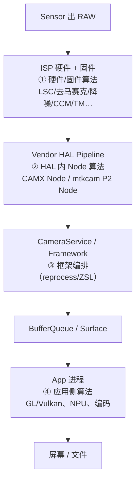
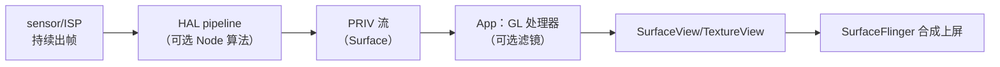
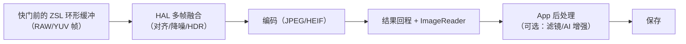
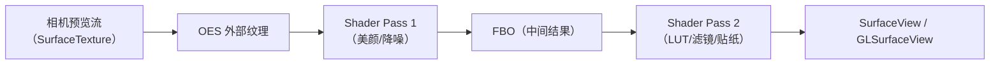
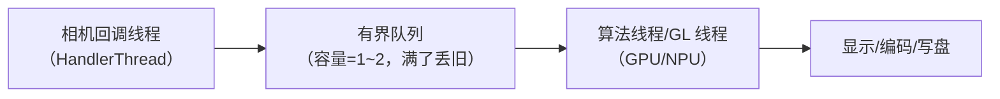
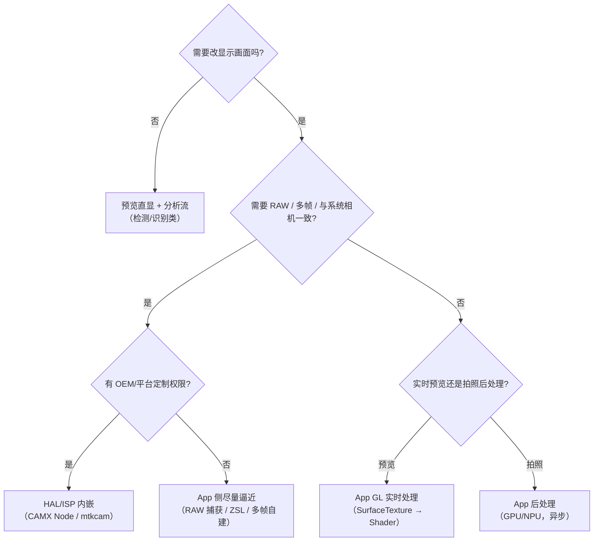

# Android Camera 算法集成文档（预览链路 / 拍照链路）

> 本文档回答一个工程问题：**相机算法到底怎么"集成"进系统**——放在 ISP 固件、vendor HAL、framework，还是 App？预览和拍照为什么是两套做法？各条路线的数据域、延迟预算、画质上限与落地成本是什么？
>
> 整理日期：2026-10-18。材料按仓库惯例分层：A 层 = AOSP/平台官方文档与 API；B 层 = 通行架构知识；C 层 = 厂商内部实现（CAMX/mtkcam 的细节以实际平台代码为准）。

## 文档结构

| 章节 | 内容 | 适合 |
|---|---|---|
| 第 1 章 分层地图 | 四个算法插入点（ISP/HAL/Framework/App）、预览与拍照的六维差异、两条链路数据流、各层能拿到什么 | 建立全局认知 |
| 第 2 章 预览算法集成 | HAL/ISP 内嵌、App GL 实时处理、预览+分析双流、帧预算与降级、实现坑位 | 做实时效果/视频处理 |
| 第 3 章 拍照算法集成 | HAL 多帧融合、ZSL+reprocess、App 后处理（单帧/多帧）、离线会话、画质杠杆 | 做高品质拍照 |
| 第 4 章 工程细节 | 数据格式与色彩空间、时间戳同步、线程与背压、内存估算、热降级、调试、HAL 工作流 | 落地与排障 |
| 第 5 章 选型与案例 | 决策树、场景矩阵、五个案例、上线检查清单、iOS 对照 | 方案评审与选型 |

## 与其它文档的关系

- 算法能用的"原料"（RAW/ISP stage/3A）见《Android_Camera_ISP_3A文档》第 1~3 章；平台 HAL 架构（CAMX/Chi/mtkcam）见第 4 章；
- 会话、请求、结果与 ZSL/reprocess 的框架语义见《Android_Camera_源码链路文档》第 3~4 章与《Android_Camera_接口文档》第 1/5 章；
- 预览 GL 方案的代码骨架见《Android_Camera_追问链面试题》链 2 的延伸部分；
- 算法导致的掉帧/延迟如何用 trace 定位，见《Android_Camera_Trace分析文档》第 3~5 章。

## 一句话结论

**预览算法要在帧预算内、可丢帧、可降级；拍照算法可以攒帧重算、允许异步。选哪一层取决于"要不要 RAW/多帧、有没有平台权限、效果迭代频率"——而所有路线的成败都落在同一组工程细节上：数据域、时间戳、线程背压、内存与热。**

---

# 第 1 章 算法集成的分层地图：预览链路与拍照链路

> 本文为分章源文件，供单章阅读；若与主文档不一致，以主文档最新版为准。
>
> 本章回答"算法能放在哪、放哪一层由谁决定、预览和拍照为什么是两套集成方式"。材料分层沿用仓库惯例：A 层 = AOSP/平台官方文档，B 层 = 通行架构知识，C 层 = 厂商内部实现（CAMX/mtkcam 细节，需以实际平台代码为准）。

## 1.1 完整链路与四个可插入点

相机数据从 sensor 到屏幕/文件，中间有四个可以放算法的地方，它们的所有权、延迟预算和质量上限完全不同：

| 插入点 | 谁能做 | 数据域 | 单帧延迟预算 | 质量上限 | 典型算法 |
|---|---|---|---|---|---|
| ① ISP 硬件/固件 | 芯片/平台厂商 | RAW | 极低（ms 级，硬流水线） | 高（RAW 域、逐像素） | LSC、去马赛克、降噪、CCM、tone mapping、HDR 合成 |
| ② Vendor HAL Node | OEM/平台（CAMX Chi、mtkcam） | RAW/YUV | 低（帧预算内） | 高（可多帧、可用 ISP） | 夜景多帧、HDR、人像虚化、视频防抖、美颜、超分 |
| ③ Framework | AOSP（App 间接使用） | — | 中 | 中 | ZSL/reprocess 编排、离线处理会话；**不自己做图像处理** |
| ④ App（GPU/NPU） | 任意 App | YUV/RGB/JPEG/RAW | 较高（掉帧风险自担） | 取决于实现与数据域 | 滤镜、美颜、贴纸、风格化、扫码、AI 分割/超分 |

关键认知：**"底层集成"通常指 ②（HAL Node），"应用集成"指 ④**。①是厂商出厂 tuning 的领域，③主要是管道能力而非算法本身。

## 1.2 为什么预览和拍照是两套集成方式

同一个算法（比如降噪、虚化）在预览和拍照两条链路里的约束完全不同：

| 维度 | 预览（preview） | 拍照（capture） |
|---|---|---|
| 实时性 | 硬约束：30fps 帧预算 33ms、60fps 16.6ms、120fps 8.3ms | 软约束：几百 ms 到数秒可接受 |
| 帧数 | 单帧（最多邻帧） | 多帧（ZSL 环形缓冲、包围曝光、多帧降噪） |
| 数据域 | 通常 YUV/RGB（PP 后） | 可 RAW（HAL 内）或 YUV（框架/App） |
| 目标 | 流畅、低延迟、省电 | 画质优先（噪声、动态范围、细节） |
| 失败代价 | 掉帧/卡顿直接可见 | 出图慢可等待，但不可丢图/错图 |
| 典型实现 | ISP 固定管道 + HAL 轻量 Node，或 App GL 单 pass | HAL 多帧融合、ZSL reprocess，或 App 后处理 |

由此得到两条工程原则：

1. **预览算法必须"预算内可随时丢弃"**：每帧独立处理，处理不过来就丢帧/降级，绝不能阻塞相机出帧；
2. **拍照算法可以"攒帧重算"**：利用快门前的缓冲与快门后的多帧，允许异步、允许离线，但不能阻塞预览（否则用户看到卡顿）。

## 1.3 两条链路的实际数据流

**预览链路（实时）**：

**拍照链路（高质量）**：

注意两条链路的**汇合点**：预览帧和拍照帧共用同一 ISP/HAL 管道，拍照时的大计算（多帧融合/编码）如果占用同一资源，会反噬预览帧率——这就是"拍照瞬间预览卡一下"的根因（第 3 章）。

## 1.4 各层能拿到什么、拿不到什么

| 能力 | ISP/固件 | HAL Node | App（Camera2/CameraX） |
|---|---|---|---|
| RAW 数据 | 原生 | 可（HAL 内部） | 部分设备（RAW 流） |
| 3A 统计 | 原生 | 可 | 仅结果元数据 |
| 逐帧低延迟 | 最好 | 好 | 受 IPC/调度影响 |
| 多帧融合 | 可 | 可（ZSL 缓冲在 HAL） | 需自建 burst（YUV/RAW） |
| 厂商 tuning 参数 | 有 | 有（Chi/MTK 参数） | 无 |
| 与系统相机一致 | 是 | 是（系统相机走同一 HAL） | 否（默认成品已含系统处理） |
| 跨机型一致性 | 平台相关 | 平台相关 | 好（API 一致，画质受限于数据） |

一句话：**越往下，数据越好、延迟越低、但可改的范围越窄**；越往上，自由度越高，但拿不到 RAW/3A，且要自己承担性能与画质。

## 1.5 本章小结

- 算法集成先定层：ISP 固件（平台）、HAL Node（OEM/平台）、Framework（管道）、App（产品）；
- 预览与拍照的差异不在"用什么算法"，而在**预算**：预览必须帧内完成，拍照可以攒帧重算；
- 两条链共用管道，任何拍照侧的大计算都要评估对预览的反噬（资源、带宽、热）。

下一章：预览算法的两种主流集成方式与实现要点。
# 第 2 章 预览算法的集成：实时链路

> 本文为分章源文件，供单章阅读；若与主文档不一致，以主文档最新版为准。
>
> 预览算法的核心约束只有一个：**在帧预算内完成，处理不过来就降级/丢帧，绝不回压相机**。本章讲两条主流路线（HAL/ISP 内嵌、App 侧 GL）的接入方式、实现要点与选型。

## 2.1 两条主流路线

| 路线 | 位置 | 数据域 | 优点 | 代价/门槛 | 典型场景 |
|---|---|---|---|---|---|
| **A. HAL/ISP 内嵌** | vendor pipeline（CAMX Node / mtkcam Node） | RAW/YUV，可多帧 | 延迟最低、与系统相机一致、可 RAW 域处理 | 需 OEM/平台权限；跨机型要分别移植；调试链路深 | 系统相机美颜/夜景预览、视频防抖（EIS）、视频 HDR、虚化视频 |
| **B. App 侧 GL 处理** | App 进程（GPU/NPU） | YUV/RGB（外部纹理） | 完全可控、跨机型一致、迭代快 | 拿不到 RAW/3A；每帧 GPU 开销；低端机降级 | 第三方相机滤镜、美颜、贴纸、风格化、AI 分割 |
| **C. 双流分离** | 预览流 + 分析流（YUV ImageReader） | 预览：直显；分析：YUV | 算法不阻塞显示链路 | 多一路流，带宽/功耗上升；结果与预览帧需按时间戳对齐 | 扫码、人脸检测、构图提示、防抖检测 |

> 现实中经常组合：HAL 做"基础画质"（降噪/防抖/HDR），App GL 做"产品化效果"（滤镜/贴纸/美颜强度）。

## 2.2 路线 A：HAL/ISP 内嵌（平台侧集成）

**数据位置与做法**（B/C 层，厂商具体实现差异大）：

- 高通 CAMX：算法以 **Node** 形式接入 topology XML 定义的数据流图（例如在 IFE 之后、IPE 之前插自定义节点，或走 Chi-CDK 的 Node override / Feature）；算法跑在 DSP/GPU/NPU 上，输入输出是 gralloc buffer，节点间由 buffer manager 串联；
- MTK mtkcam：在 P1（sensor/ISP 通路）或 P2（后处理通路）挂自定义 Node/Feature，YUV 域处理通常落 P2；
- 与框架的接口：标准能力用 `CaptureRequest` 键（如防抖模式）；私有能力用 **vendor tag**（`ICameraProvider::setVendorTagDescriptor` 注册）或 **Camera Extensions**（`EXTENSION_NIGHT/BOKEH/...`）暴露给 App；
- 验证：厂商自测 + CTS/VTS；图像质量用 ITS 做客观回归（亮度线性、色彩、锐度等）。

**预览算法的特殊要求**（与拍照对比）：

1. **单帧、无回溯**：不能用"未来的帧"，需要多帧时必须用历史帧（如 EIS 的陀螺仪+邻帧校正）；
2. **固定延迟预算**：硬件流水线通常把算法放在 ISP 的"在线路径"（online），处理延迟必须小于帧间隔；
3. **与 3A 协同**：降噪/防抖会改变 AE/AWB 统计的输入（统计在 RAW 域、处理在 YUV 域时要注意顺序），算法不能破坏 3A 收敛；
4. **可开关/可降级**：高温或高负载时能动态关闭（对应系统压力/thermal 信号）。

**适合放在 HAL 的预览算法**：视频防抖（EIS）、视频 HDR/多帧降噪、人像虚化（视频）、系统相机美颜、超分预览、低光增强。理由：这些需要 RAW 域、低延迟、硬件流水线，且要与系统相机一致。

**不适合**：需要频繁迭代、按产品活动变化的滤镜/贴纸/美颜风格——放 HAL 意味着每次改都要过平台验证，迭代成本极高。

## 2.3 路线 B：App 侧 GL 处理（应用集成）

这是第三方相机 App 做实时效果的标准姿势，数据路径：

关键实现点（与追问链文档的 SurfaceView+GL 方案一致）：

1. **零拷贝**：相机输出到 `SurfaceTexture`（`GL_TEXTURE_EXTERNAL_OES`），`updateTexImage()` 后直接采样，GPU 完成 YUV→RGB；
2. **多 pass 用 FBO ping-pong**：简单滤镜单 pass 够用；美颜（磨皮+锐化+肤色）通常 2~3 pass，注意每 pass 的读写带宽；
3. **分辨率策略**：算法在降采样图上算（如 1/2 或 1/4），再双线性放大回显——人像磨皮/虚化对分辨率不敏感，能省一半以上 GPU 时间；
4. **帧率预算**：30fps 下整条链（相机→GL→合成）只有 33ms；单 pass 1080p 通常 1~3ms，多 pass+ML 要实测；留 30% 余量；
5. **丢帧策略**：GL 线程处理不过来时丢旧帧（只渲染最新），绝不能排队；
6. **NPU/ML**：人脸/人像分割用 TFLite/NNAPI，通常按"每 N 帧跑一次 + 帧间复用 mask"的方式降低推理频率；推理输入降采样到 256/512 级别；
7. **线程与生命周期**：GL 线程独立（HandlerThread），surfaceDestroyed/onPause 正确释放 EGL 与纹理；
8. **方向与镜像**：`getTransformMatrix` 处理相机裁剪，顶点矩阵处理旋转/镜像；预览与拍照/录像的方向要统一。

**CameraX 的封装**：`androidx.camera:camera-effects` 提供 `CameraEffect` / `SurfaceProcessor`（OpenGL 处理链），可在 `UseCaseGroup` 上挂"预览效果/录像效果"，把 SurfaceTexture→GL→Surface 的样板代码封装掉（版本与 API 以官方文档为准）。适合中小团队快速落地；复杂多 pass 管线仍建议自管 EGL。

**适合放在 App 的预览算法**：滤镜/LUT、美颜强度、贴纸/AR、风格化、扫码与人脸检测（分析流）、构图辅助线。理由：迭代快、跨机型一致、不依赖厂商。

## 2.4 路线 C：预览直显 + 分析流分离

当算法**不需要改变显示画面**（检测、识别、统计）时，不要走 GL 显示链，而是：

- 预览流：相机 → SurfaceView 直显（零拷贝，不动）；
- 分析流：同一会话再加一路 YUV `ImageReader`（或 CameraX `ImageAnalysis`），算法在分析流上跑；
- 对齐：分析帧与预览帧按 `SensorTimestamp`/PTS 近似对齐；分析帧率可低于预览（`acquireLatestImage` 丢旧帧）；
- 注意：多一路流会增加带宽/功耗，低端机要评估；分析流尺寸选最小可用（如 640×480）。

## 2.5 性能预算与降级策略

| 帧率 | 帧间隔 | 建议算法预算（含相机+显示余量） |
|---|---|---|
| 30fps | 33.3ms | ≤ 8~10ms（GPU/CPU） |
| 60fps | 16.6ms | ≤ 4~6ms |
| 120fps | 8.3ms | ≤ 2~3ms（通常只做极轻处理） |

降级顺序（从轻到重）：降算法分辨率 → 降 pass 数/精度 → 降推理频率 → 关效果 → 降预览帧率/分辨率。降级触发信号：帧耗时监控、`systemPressureState`（iOS 侧概念，Android 用 thermal/负载信号）、掉帧计数。

## 2.6 常见坑

1. **在相机回调线程做算法**：阻塞出帧回调，导致相机侧积压/丢帧——算法必须另起线程；
2. **每帧 `glReadPixels`**：同步回读必掉帧；显示链路不需要回读，拍照/录像才按需读；
3. **每帧 new 对象**（FloatBuffer、数组、Bitmap）：GC 抖动；全部预分配；
4. **预览与拍照方向不一致**：GL 里做了旋转，拍照 ImageReader 没做——两套方向逻辑要统一；
5. **前置镜像做在像素里**：应该用矩阵/EXIF 表达，避免影响算法输入；
6. **多路流尺寸不匹配**：预览 1080p、分析 4K，带宽翻倍，低端机直接掉帧；
7. **忘记释放 SurfaceTexture/EGL**：返回再进黑屏，或 native 内存泄漏。

## 2.7 本章小结

- 预览算法两条主路线：HAL/ISP（低延迟、RAW、需平台权限）与 App GL（灵活、跨机型、拿不到 RAW）；
- 只做检测不改画面的算法走"预览直显 + 分析流"，不要挤占显示链路；
- 预算是硬约束：30fps 只有 33ms 且要和相机/显示分摊，算法要降分辨率、控 pass 数、丢旧帧、可降级。

下一章：拍照算法（高质量链路）的集成方式。
# 第 3 章 拍照算法的集成：高质量链路

> 本文为分章源文件，供单章阅读；若与主文档不一致，以主文档最新版为准。
>
> 拍照算法与预览的本质区别：**允许攒帧、允许异步、追求画质**。本章讲四条路线（HAL 多帧、ZSL reprocess、App 后处理、离线会话）的接入方式、画质杠杆与代价。

## 3.1 四条路线总览

| 路线 | 位置 | 数据域 | 画质上限 | 延迟 | 门槛 |
|---|---|---|---|---|---|
| **A. HAL/ISP 多帧融合** | vendor pipeline | RAW（HAL 内） | 最高（与系统相机一致） | 快门后几百 ms~数秒 | OEM/平台权限 |
| **B. ZSL + reprocess** | 框架会话 + HAL | YUV/PRIVATE | 高（可拿快门前的帧重处理） | 快门后 100~500ms | 设备需 reprocess 能力 |
| **C. App 侧后处理** | App（GPU/NPU） | JPEG/YUV/RAW | 取决于算法与数据 | 可异步，不阻塞预览 | 无（任何 App） |
| **D. 离线处理会话** | HAL/框架（Android 11+） | RAW/YUV | 高 | 后台完成 | 设备支持 offline processing |

选型直觉：**要"和系统相机一样好"且能改平台 → A；要"零快门延迟 + 可控重处理" → B；只要产品化效果/跨机型一致 → C；系统内部延迟优化 → D**。

## 3.2 路线 A：HAL/ISP 多帧融合（平台侧）

**它解决什么**：暗光噪声、动态范围、虚化、超分——这些都需要**多帧 RAW 融合**，而 RAW 缓冲和 ISP 带宽在 HAL 内部，App 拿不到（或拿到也来不及对齐）。

**典型实现**（B/C 层，厂商差异大）：

1. **ZSL 环形缓冲**：HAL 持续把预览帧存进环形缓冲（RAW 或内部格式），快门按下时取"按快门前后"的 N 帧；
2. **对齐**：陀螺仪/特征点估计帧间位移（手抖补偿），运动物体做局部一致性检测；
3. **融合**：时域降噪（多帧平均/加权）、HDR 包围合并、超分（多帧亚像素）、虚化（深度/双摄视差）；
4. **后处理与编码**：融合结果走 ISP 后段 + JPEG/HEIF 编码，经结果回程给 App。

**与 App 的接口**：

- 标准能力：部分特性通过 `CaptureRequest` 键暴露（如防抖、部分 HDR 模式）；
- **Camera Extensions**（Android 12+）：`EXTENSION_NIGHT`（夜景）、`EXTENSION_BOKEH`（虚化）、`EXTENSION_FACE_RETOUCH` 等，`CameraManager.getCameraExtensionCharacteristics()` 查询、`createExtensionSession()` 使用；CameraX 侧有 `camera-extensions` 封装；
- **Vendor tag**：OEM 私有开关（夜景强度、美颜等级），App 按名字查询后写入请求；
- 触发时序：通常仍是"precapture 收敛 → STILL_CAPTURE"，多帧发生在 HAL 内部，App 只见出图变慢。

**优点**：画质天花板最高、与系统相机同源、可 RAW 域处理；
**代价**：需要平台/OEM 配合；机型移植成本高；效果不可由 App 快速迭代。

## 3.3 路线 B：ZSL + reprocess（框架侧能力）

**它解决什么**：让 App 在"零快门延迟"的前提下，对**已经曝光过的帧**做高质量重处理（而不是等快门后再曝光）。

**使用方式**（A 层 API）：

1. 设备能力：`REQUEST_AVAILABLE_CAPABILITIES` 含 `YUV_REPROCESSING`（LEVEL_3）或 `PRIVATE_REPROCESSING`；
2. 建**可重处理会话**：`createReprocessableCaptureSession(InputConfiguration, outputs, callback, handler)`；
3. 持续用 `TEMPLATE_ZERO_SHUTTER_LAG` 发预览请求，拿到每帧的 `TotalCaptureResult`（含 3A 元数据）；
4. 用户按快门时，取最近的 `TotalCaptureResult` + 对应帧，构造 `createReprocessCaptureRequest(result)`，设置高质量参数（如降噪强度、后处理档位），提交 reprocess；
5. 结果经 `processCaptureResult` 返回，App 从 ImageReader 取图。

**注意点**：

- reprocess 请求的帧号/时间戳沿用原始帧，**结果元数据必须与原始捕获一致**（设置里不能改会导致物理语义变化的值）；
- 不是所有设备支持；PRIVATE reprocess 效率更高（HAL 可用内部格式），YUV reprocess 更通用；
- App 只需处理"取哪一帧、给什么后处理参数"，对齐/融合仍在 HAL 内。

## 3.4 路线 C：App 侧拍照后处理（应用集成）

**单帧后处理（最常见）**：

- 拿到 `ImageReader` 的 JPEG/HEIF 或 RAW（`RAW_SENSOR` + `DngCreator` 存 DNG）；
- 在 App 内用 GPU（GL/Vulkan）或 NPU（TFLite/NNAPI）做：调色/LUT、美颜、锐化、风格化、AI 增强、文档矫正；
- 产物质量取决于**数据域**：JPEG 已是显示域（信息有损），RAW 保留最大后期空间但需自建显影链（去马赛克/降噪/色彩，工程量参考《Android_Camera_ISP_3A文档》）。

**多帧后处理（App 自建夜景/HDR）**：

1. 用 `ImageReader` 连续捕获 N 帧（YUV 或 RAW），`maxImages` 要足够大（N 帧 × 缓冲），注意内存：12MP YUV420 单帧约 18MB，8 帧 >140MB；
2. 对齐：陀螺仪 + 特征点单应变换（或 EIS 数据），运动区域检测防鬼影；
3. 融合：加权平均/中值/曝光包围合并；
4. 后处理与编码：GPU 合成 → JPEG/HEIF 写盘；
5. 与预览解耦：捕获/合并放独立线程或独立会话，避免阻塞预览（JPEG stalling 会掉预览帧）。

**代价与风险**：内存峰值、对齐质量（手持夜景的鬼影）、热与功耗、低端机帧率；**收益**：跨机型一致、效果可快速迭代、不依赖 OEM。

## 3.5 路线 D：离线处理会话（Android 11+）

- HAL 支持 `offline_processing` 能力时，切会话/关相机可以把**已提交未完成**的请求与缓冲移交给 `ICameraOfflineSession` 继续处理；
- 典型收益：连拍/多帧拍照时，用户切走相机，剩余照片后台出图，不占用在线设备；
- App 侧无直接 API（框架/HAL 内部机制），但会体现在"出图延迟"与"相机可快速释放"上；
- 对照 iOS：deferred photo processing 是应用可见的"先出预览成品、后台替换精修"机制（见 iOS 学习文档第 4 章），Android 的离线会话更偏框架协议。

## 3.6 画质杠杆：钱花在哪最值

| 画质维度 | 最有效的层 | 说明 |
|---|---|---|
| 噪声（暗光） | HAL 多帧（RAW 域） | 时域融合 + 噪声模型，YUV 域已损失信息 |
| 动态范围 | HAL 多帧（包围曝光） | 不同曝光帧合并，需对齐与鬼影抑制 |
| 细节/锐度 | ISP/RAW 域 | 去马赛克 + 局部对比度，YUV 域只能补偿 |
| 色彩/风格 | App 后处理（成本最低） | LUT/调色对数据域不敏感，迭代快 |
| 人像虚化 | HAL（双摄深度/多帧）或 App（ML 分割） | HAL 效果更自然，App 更可控 |
| 超分 | HAL（多帧）或 App（AI） | 多帧亚像素最难但效果最好 |
| 文档矫正/去反光 | App（CV） | 与相机管道解耦，分析流即可 |

## 3.7 延迟与资源预算

- 多帧融合的延迟 ≈ 帧数 × 帧间隔 + 对齐/融合 + 编码，暗光手持夜景可到 1~3s；
- JPEG/HEIF 编码 10~100ms（分辨率/机型相关）；**不要让编码占用预览所需带宽**（stalling stream 的问题）；
- 内存峰值要按"最大并发帧数 × 单帧大小"估算，低端机优先降分辨率/帧数；
- 热：长时间连拍/夜景会触发降频，出图变慢——预算里要留余量。

## 3.8 常见坑

1. **`Image` 不 close**：缓冲耗尽，后续拍照卡死（最多人栽的坑）；
2. **`maxImages` 估算错误**：多帧 burst 时缓冲不足导致丢帧或丢图；
3. **在相机回调线程做融合**：阻塞结果回程；算法另起线程；
4. **拍照与预览共用大缓冲**：拍照瞬间预览掉帧（JPEG stalling/带宽）；
5. **方向/EXIF 处理不一致**：后处理旋转后 EXIF 未更新，缩略图方向错；
6. **RAW 与 JPEG 同时要**：流组合与带宽翻倍，需验证设备支持；
7. **忘记恢复预览**：拍照完未恢复 repeating，预览冻结。

## 3.9 本章小结

- 拍照算法四路线：HAL 多帧（画质最高）、ZSL reprocess（零延迟可控）、App 后处理（灵活）、离线会话（系统级）；
- 画质的关键在**数据域与帧数**：RAW + 多帧 > YUV 多帧 > 单帧 JPEG；
- 拍照侧的大计算必须与预览解耦（独立线程/会话），否则"拍一张卡一下"。

下一章：无论哪条路线都要面对的工程细节（数据、同步、内存、线程、热、调试）。
# 第 4 章 算法集成的工程细节：数据、同步、内存、线程与热

> 本文为分章源文件，供单章阅读；若与主文档不一致，以主文档最新版为准。
>
> 算法在架构图上"放对了层"只是开始，真正决定成败的是工程细节：数据格式、时间对齐、缓冲管理、线程模型、功耗散热与可观测性。本章是跨路线的通用清单。

## 4.1 数据与格式

| 数据 | 格式/要点 | 算法关心什么 |
|---|---|---|
| RAW | `RAW_SENSOR`（16bit 容器）/`RAW10`/`RAW12`；Bayer 排列见 `SENSOR_INFO_COLOR_FILTER_ARRANGEMENT` | 黑电平（静态/动态）、白电平、噪声模型、LSC 是否已应用 |
| YUV | `YUV_420_888` 三平面语义；布局由 `rowStride`/`pixelStride` 决定 | stride 对齐、UV 交织、色彩空间（BT.601/709）、full/limited range |
| RGB/PRIV | 显示用 `PRIV` 直通；GPU 处理后常为 RGB(A) | 色彩空间（sRGB/P3）、预乘 alpha、位深（8/10bit） |
| 深度 | `DEPTH16`/`DEPTH_POINT_CLOUD`（部分设备）；CameraX/厂商 API | 与彩色帧的**对齐**（内参/外参）、单位（mm/视差） |
| 编码产物 | JPEG/HEIF/DNG | 已损失（JPEG）vs 线性 RAW（DNG）、EXIF 方向 |

要点：

- **不要假设 YUV 内存连续**：按 plane + stride 读（老生常谈但最多 bug）；
- **RAW 必须读动态黑电平**：高增益下静态黑电平不准（`SENSOR_DYNAMIC_BLACK_LEVEL`）；
- **色彩空间要显式传递**：算法链里从 YUV 到 RGB 到编码，每一步都要标注色彩空间，否则 HDR/广色域内容发灰。

## 4.2 时间与同步

| 场景 | 机制 | 注意点 |
|---|---|---|
| 单摄帧时序 | `SensorTimestamp`（ns，单调时钟，`SENSOR_INFO_TIMESTAMP_SOURCE` 决定基准） | 同一请求多流同时间戳；跨请求单调 |
| 多摄同步 | `LOGICAL_MULTI_CAMERA` + `SYNC_MAX_LATENCY`（PER_FRAME_CONTROL/AT_ONCE） | 物理流可漂移；融合前按时间戳配对 |
| 深度与彩色 | 深度帧 PTS 与视频 PTS 独立 | 最近邻配对 + 标定（`AVCameraCalibrationData` 对应 Android 的 calibration 元数据） |
| 音视频同步 | 视频/音频 sample PTS 同一时间基准 | 录制 muxer 前对齐；丢帧策略要一致 |
| 算法与显示 | 预览帧与 GL 渲染帧的时间差 | 不要给算法加 >1 帧的额外延迟 |

实践原则：**任何跨流的算法（多摄、深度、音频）都以时间戳为准配对，不以"回调顺序"配对**。

## 4.3 线程模型与背压

三条线程边界必须分清：

- **相机回调线程**：只做"拿帧、入队、close Image"，绝不做重计算；
- **队列必须有界**：预览用"只保留最新帧"（丢旧），拍照用"不可丢"（计数背压，但要有上限防 OOM）；
- **算法线程**：GL 需要自己的 EGL 上下文（或共享上下文）；NPU 推理串行化，避免并发抢资源；
- **背压信号**：帧耗时统计、队列深度、掉帧计数；超过阈值触发降级（第 2 章）。

## 4.4 内存与缓冲

- **BufferQueue/ImageReader 是有限池**：`maxImages` 既是容量也是背压手段；不 `close()` 就等于永久占用；
- **零拷贝优先**：相机 buffer（gralloc/dma-buf）→ GPU 纹理（`CVMetalTextureCache`/`EGLImage`）直接映射，避免 CPU 中转；
- **内存估算**：12MP YUV420 ≈ 18MB/帧；8 帧 burst ≈ 144MB；12MP RAW16 ≈ 24MB/帧；低端机必须按可用内存反推帧数与分辨率；
- **大对象复用**：Bitmap/Buffer/FBO 预分配与池化；避免每帧分配；
- **释放顺序**：停流 → 释放 Surface/纹理 → 释放 ImageReader → 退出算法线程。

## 4.5 功耗、热与降级

- 长时间预览/连拍/夜景会触发降频与热保护：帧率下降、出图变慢、甚至相机被系统限制；
- 可观测信号：`systemPressureState`（iOS 的对应概念；Android 侧用 thermal status/负载/掉帧指标自建）；
- 降级矩阵（示例）：`serious` → 关实时滤镜/降推理频率；`critical` → 只保留基础预览，提示用户；
- 拍照多帧在热状态下应减少帧数/降分辨率，而不是硬扛导致掉帧或 ANR。

## 4.6 可观测性与调试

| 手段 | 用途 |
|---|---|
| 自定义 trace（`Trace.beginSection`/`beginAsyncSection`） | 把算法阶段（采集/对齐/融合/编码）映射到 Perfetto 时间轴 |
| FrameTimeline | 判断算法导致的掉帧是 App 侧还是显示侧 |
| 帧耗时/队列深度埋点 | 线上监控降级与卡顿 |
| `dumpsys media.camera` | 会话/流/in-flight 状态 |
| ITS / 客观指标 | HAL 算法回归（噪声、色彩、锐度、动态范围） |

trace 分析的具体方法见《Android_Camera_Trace分析文档》第 2~5 章。

## 4.7 HAL 集成的工作流（平台侧）

以 CAMX/mtkcam 为例的通用步骤（B/C 层，细节以平台文档为准）：

1. **需求拆解**：输入数据域、延迟预算、是否多帧、是否需要 3A 统计；
2. **选插入点**：在线路径（预览）vs 离线路径（拍照）；Node 放在 IFE 后/IPE 前还是 P2；
3. **接口设计**：标准键 vs vendor tag vs Camera Extension；开关粒度（全局/场景/强度）；
4. **数据通路**：buffer 格式/usage、是否需要 RAW、是否需要额外 buffer 轮转；
5. **同步与 3A**：算法是否影响 AE/AWB 统计；多帧的对齐与时间戳；
6. **验证**：功能用例 + 图像质量 ITS 回归 + 性能（帧率/延迟/功耗）+ 稳定性（长跑/热）；
7. **灰度与回退**：开关默认值、异常降级、版本兼容（旧设备无此能力时 App 侧兜底）。

## 4.8 本章小结

算法集成的成败取决于六个"不起眼"的工程点：格式与色彩空间不糊涂、时间戳配对、回调线程不干活、队列有界可丢、内存按峰值算、热了能降级。这些点在预览与拍照两条链路上同样适用。
# 第 5 章 选型决策与实战案例

> 本文为分章源文件，供单章阅读；若与主文档不一致，以主文档最新版为准。
>
> 本章把前四章收敛成"怎么选、怎么落地"：一张决策树、几张场景矩阵、五个真实形态的案例，以及上线检查清单。

## 5.1 选型决策树

补充判断项：

- **延迟敏感度**：预览/录像必须帧内完成；拍照可异步；
- **迭代频率**：产品效果频繁变化 → App 层；稳定画质基线 → HAL；
- **跨机型一致性**：要求一致 → App 层；接受机型差异 → HAL/Ext；
- **团队资源**：没有平台团队就选 App 路线（HAL 定制需要厂商协作与 ITS 验证）。

## 5.2 场景选型矩阵

| 场景 | 推荐路线 | 数据域 | 预算 |
|---|---|---|---|
| 实时滤镜/LUT | App GL（或 CameraX `CameraEffect`） | YUV→RGB | 30fps ≤8ms |
| 实时美颜 | App GL（磨皮+肤色，多 pass） | YUV→RGB | 30fps ≤8ms，降采样 |
| 视频背景虚化 | HAL（双摄/深度）优先；否则 App ML 分割 | 深度/彩色 | 30fps ≤10ms |
| 扫码/OCR | 预览直显 + YUV 分析流 | YUV | 分析流 5~15fps 即可 |
| 夜景拍照 | HAL 多帧（`EXTENSION_NIGHT`） | RAW | 快门后 0.5~3s |
| 人像拍照虚化 | HAL（`EXTENSION_BOKEH`）或 App 后处理 | RAW/深度/JPEG | 快门后 0.2~1s |
| 拍照后 AI 增强 | App 后处理（NPU） | JPEG/RAW | 异步，1~3s |
| 多帧 HDR（无 OEM 支持） | App burst 自建 | YUV（或 RAW） | 0.3~1s |
| 专业模式/RAW 直出 | App（RAW 捕获 + 自建显影） | RAW | 异步 |

## 5.3 五个案例

**案例 1：第三方相机 App 的实时美颜滤镜**

- 架构：Camera2 预览 → SurfaceTexture → GL 多 pass（磨皮/肤色/LUT）→ SurfaceView；
- 预算：1080p 30fps，磨皮降采样到 1/2，总 GPU ≤6ms；ML 人脸检测每 5 帧一次复用框；
- 降级：低端机砍 pass 数/降分辨率；热了关效果；
- 不选 HAL 的理由：无平台权限、效果要频繁迭代。

**案例 2：手机厂商系统相机的夜景**

- 架构：HAL ZSL 环形缓冲（RAW）→ 对齐（陀螺仪+特征）→ 多帧融合（噪声模型/HDR）→ ISP 后段 → JPEG/HEIF；
- App 接口：Camera Extensions（`EXTENSION_NIGHT`）或相机 App 走私有 vendor tag；
- 关键：多帧帧数随场景光自适应；热/低电降帧数；与预览共用管道时保证预览不掉帧（拍照请求优先级/离线会话）。

**案例 3：文档扫描**

- 架构：预览直显（零拷贝）+ 分析流（YUV，640×480~1080p）→ 边缘检测/透视矫正 → 拍照时用高分辨率 JPEG；
- 要点：分析流尺寸小、频率低（5~10fps）；检测结果与预览帧时间戳对齐用于叠加框；拍照后处理在 App 完成，不占相机管道。

**案例 4：视频人像虚化**

- 方案 A（平台）：双摄深度/ML 分割在 HAL 内逐帧处理，延迟最低；
- 方案 B（App）：ML 分割（每 N 帧）+ GL 合成（背景模糊 + 边缘羽化），预算 30fps ≤10ms，分割输入降采样；
- 常见问题：边缘抖动（帧间 mask 平滑）、发丝锯齿（matting 而非粗分割）、深度与彩色对齐误差。

**案例 5：拍照后 AI 增强（超分/去雾）**

- 架构：ImageReader 取 JPEG/RAW → NPU 推理（TFLite GPU delegate/NNAPI）→ 合成写盘；
- 要点：异步执行、进度反馈；内存峰值控制（大图分块）；原图保留以支持重试；
- 与预览解耦：处理期间继续预览，保存完成再提示。

## 5.4 上线检查清单

1. **数据域确认**：RAW/YUV/JPEG？是否已损失信息？色彩空间是否标注？
2. **预算实测**：帧耗时、内存峰值、热状态下表现（不是实验室常温一次）；
3. **线程与背压**：回调线程不计算、队列有界、丢帧策略明确；
4. **生命周期**：进后台/来电/切相机/旋转时正确释放与恢复；
5. **降级路径**：低端机/热/低电/权限受限时的兜底；
6. **可观测性**：关键阶段 trace 打点 + 线上埋点（耗时/掉帧/降级次数）；
7. **回归**：固定脚本多次采集，与基线对比（启动/拍照延迟、帧率、画质指标）；
8. **兼容性**：机型矩阵（芯片代 + 镜头组合）覆盖；厂商 tag/extension 不支持时的回退。

## 5.5 与 iOS 的对照（简要）

| 能力 | Android | iOS |
|---|---|---|
| 预览算法 | HAL Node 或 App GL；SurfaceTexture 零拷贝 | 无第三方 HAL；App 侧 `AVCaptureVideoDataOutput` + Metal/Core Image；系统相机能力不开放 |
| 拍照算法 | HAL 多帧 / ZSL reprocess / App 后处理 | 系统计算摄影默认在场；ProRAW/Log 交付给 App 后期；`AVCapturePhoto` 延迟处理 |
| 平台扩展 | HAL/vendor tag/Camera Extensions | 仅 macOS 有 Camera Extensions（DriverKit）；iOS 无相机 HAL 扩展 |

对照细节见《iOS_Camera_ISP_图像管线文档》与《iOS_Camera_学习文档》第 2~5 章。

## 5.6 本章小结

- 选型的本质是三个问题：要不要改画面、需不需要 RAW/多帧、有没有平台权限；
- 预览与拍照的算法应视为两条独立管线，共享资源时以预览不掉帧为底线；
- 落地的胜负手在工程细节（预算、线程、内存、热、可观测性），而不是算法本身多先进。
