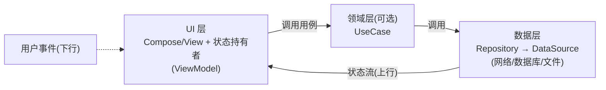
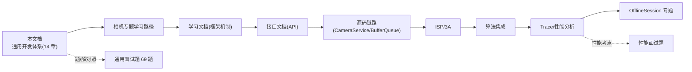

# Android 开发知识文档（通用开发体系）

> 本文档是相机学习系列的**通用底座文档**：在相机专题之外，把 Android 应用开发的知识体系（组件与生命周期、进程与 IPC、消息机制、View 体系、Jetpack 架构、Kotlin 协程、Compose、网络、存储、性能、稳定性、构建发布、安全权限、版本演进）按官方资料整理成一份可系统学习、可面试对照的详解文档。
>
> 整理日期：2026-10-30。材料按仓库惯例分层标注：**A 层** = developer.android.com 官方文档/官方指南（附录 A 给出全部链接）；**B 层** = 通行工程知识；**C 层** = 社区经验（均显式标注）。版本事实经联网校准：Android 17（API 37，2026-06 发布）、AGP 9.0、Kotlin 2.x（K2 编译器默认）。
>
> **与《Android_通用面试题》的关系**：题集给"怎么考"，本文给"怎么懂"——题集每板块在本文都有对应章节，答案可逐层展开溯源。

## 文档结构

| 章节 | 内容 | 对应通用面试题板块 |
|---|---|---|
| 第 1 章 组件与生命周期 | 四大组件、Activity/Fragment 生命周期、launchMode、前台服务、广播限制、进程优先级 | 组件 |
| 第 2 章 进程与 IPC | Zygote 进程模型、Binder 原理、AIDL 三件套与 demo、IPC 选型、多进程陷阱 | IPC |
| 第 3 章 Handler 与线程 | 消息机制源码级原理、同步屏障与 VSync、线程方案对比、卡顿检测、ANR 机制 | Handler |
| 第 4 章 View 体系 | 三大流程、事件分发、滑动冲突、刷新机制、RecyclerView 缓存、自定义 View、Surface 家族 | View（含自定义 View） |
| 第 5 章 Jetpack 与应用架构 | 官方架构指南三层、Lifecycle/ViewModel/Room/DataStore/WorkManager/Navigation/Hilt | Jetpack |
| 第 6 章 Kotlin 与协程 | 语言要点、挂起原理、结构化并发、Flow/StateFlow/SharedFlow、与回调互操作 | Kotlin/协程 |
| 第 7 章 Compose | 声明式模型、重组与稳定性、副作用 API、渲染性能、与 View 互操作 | Compose |
| 第 8 章 网络与序列化 | OkHttp/Retrofit 原理、序列化选型、HTTPS/证书固定、网络安全配置、图片加载 | 网络 |
| 第 9 章 数据存储 | SP 的缺陷与 DataStore、Room 深入、Scoped Storage/FileProvider、缓存策略 | 存储（随组件/性能穿插） |
| 第 10 章 性能优化总览 | 启动/渲染/内存/功耗要点与工具矩阵（索引章，详解指向《Android_Camera_性能分析文档》） | 性能 |
| 第 11 章 稳定性与测试 | Crash/ANR/泄漏排查体系、兼容性治理、测试金字塔与 CI 门禁 | 稳定性（随性能穿插） |
| 第 12 章 构建与发布 | Gradle/AGP 9、多模块、R8、签名、AAB 与 Play 分发、KMP | 构建工程 |
| 第 13 章 安全与权限 | 权限模型与三态、特殊权限、隐私演进 10→17、Keystore、组件与 WebView 安全 | 安全 |
| 第 14 章 版本演进与生态 | API 30→37 特性速查、行为变更应对、生态趋势、与本仓库文档衔接 | 版本/综合 |

## 与其它文档的关系

- **题/解对照**：《Android_通用面试题》（69 题 12 板块）的每道题都能在对应章节找到展开；文中以"↔ 通用题 Qxx"标注回链；
- 相机专题深入：框架机制见《Android_Camera_学习文档》、API 见《Android_Camera_接口文档》、CameraService 源码与 BufferQueue/VSync 见《Android_Camera_源码链路文档》第 3~5 章；
- 性能与 trace：本文第 10/11 章是索引总览，完整指标体系、代码骨架与线上体系见《Android_Camera_性能分析文档》与《Android_Camera_Trace分析文档》；
- 相机工程实战：Camera2Demo（Java）与 OfflineSession 专题见《Android_Camera_OfflineSession文档》。

## 建议阅读路径

1. 系统学习：第 1→3→4 章打牢"组件/消息/渲染"三大地基，再按 5→6→7 进入现代 Android（架构/协程/Compose）；
2. 面试对照：先做题集定位短板，再按"对应通用题板块"列跳读对应章节；
3. 工程查阅：第 8~13 章按需检索（网络/存储/构建/安全各自独立成篇）；
4. 版本跟进：第 14 章速查表 + 附录 A 官方链接，年度校准一次。

---

# 第 1 章 组件与生命周期

> 本文为分章源文件，供单章阅读；若与主文档不一致，以主文档最新版为准。材料分层：A = 官方指南（developer.android.com/guide/components），B = 通行工程知识。↔ 通用题：组件板块。

## 1.1 四大组件总览

| 组件 | 角色 | 入口/宿主 | 生命周期 owner | 跨进程 |
|---|---|---|---|---|
| Activity | 用户交互界面 | Intent / Launcher | 自身 | 可被外部启动（exported） |
| Service | 后台长任务 | startService / bindService | 自身 | 支持（AIDL 绑定） |
| BroadcastReceiver | 系统级事件分发 | Intent 发送 | 收到广播期间 | 支持（全局/应用内） |
| ContentProvider | 跨进程数据共享 | ContentResolver 访问 | 无（按需创建） | 核心能力 |

共同约束（A 层）：组件都必须在 manifest 注册（动态广播除外）；均在主线程回调，回调内做耗时操作是 ANR 高发原因。

## 1.2 Activity 生命周期

七个回调（A 层，[官方指南](https://developer.android.com/guide/components/activities/activity-lifecycle)）：

| 回调 | 含义 | 之后通常做 |
|---|---|---|
| onCreate | 创建 | setContentView、findViewById/绑定、恢复 SavedState |
| onStart | 可见 | 注册接收器（onStop 成对） |
| onResume | 前台可交互 | 启动相机/传感器等独占资源 |
| onPause | 失去焦点 | 轻量收尾（必须快，影响下一个界面显示） |
| onStop | 不可见 | 释放资源、注销接收器 |
| onRestart | 重新可见前 | — |
| onDestroy | 销毁 | 最终清理 |

**状态保存**：`onSaveInstanceState(Bundle)` 在 Activity 进入后台（stop 前）被调用，进程被杀后重建时经 `onCreate(savedInstanceState)` / `onRestoreInstanceState` 恢复。坑位（B 层）：

- Bundle 走 Binder 事务共享缓冲（约 1MB 上限），塞大 Bitmap 会抛 `TransactionTooLargeException`——大数据应持久化，Bundle 只存轻量状态；Android 13+ 推荐 `SavedStateHandle`（ViewModel）承载；
- **横竖屏重建是"双份调用"**：旧实例 `onPause→onStop→onDestroy` 与新实例 `onCreate→onStart→onResume` 交错执行，旧实例的 onDestroy 晚于新实例的 onCreate——日志排查时不要误判顺序 bug。

**配置变更的三种策略**（B 层，按推荐排序）：

1. ViewModel + SavedStateHandle 承载数据 + UI 状态自动恢复（现代默认）；
2. `android:configChanges` 接管（仅限确有理由的场景，如相机预览不想重建 Surface——本仓库 Camera2Demo 即如此处理旋转）；
3. 放任重建 + 完整保存/恢复状态（官方默认行为，最可靠）。

**launchMode 与任务栈**：

| 模式 | 行为 | 典型场景 |
|---|---|---|
| standard | 每次新建实例 | 普通页面 |
| singleTop | 栈顶复用（走 onNewIntent） | 搜索页防连点 |
| singleTask | 栈内复用、清其上 Activity | 应用主页 |
| singleInstance | 独占任务栈 | 系统级入口（少见） |

常用 flags：`NEW_TASK`（service/广播中启动 Activity 必需）、`CLEAR_TOP`（清上方）、`SINGLE_TOP`。↔ 通用题"launchMode 区别"。

## 1.3 Fragment

- 生命周期比 Activity 多 `onAttach/onCreateView/onViewCreated/onDestroyView`；**View 销毁（onDestroyView）与 Fragment 实例销毁（onDestroy）分离**是泄漏高发点：View 绑定的协程/观察者必须在 onDestroyView 取消（B 层）；
- 管理：FragmentManager + BackStack；事务写法 `supportFragmentManager.commit { replace... addToBackStack... }`；
- 与 ViewPager2 搭配用 `FragmentStateAdapter`，构造传 `BEHAVIOR_RESUME_ONLY_CURRENT_FRAGMENT`——可见性以 onResume 为准（老的 `setUserVisibleHint` 已废弃）；
- 结果通信用 **Fragment Result API**（`setFragmentResult`/`setFragmentResultListener`），替代被废弃的 `onActivityResult` 转发与接口回调（A 层）；
- `viewLifecycleOwner` vs `this`：观察 LiveData/Flow 时用前者，防止重复订阅与 View 泄漏。↔ 通用题"Fragment 生命周期"。

## 1.4 Service

两种形态（A 层，[Services 指南](https://developer.android.com/guide/components/services)）：

| 形态 | 启动 | 生命周期 | 典型 |
|---|---|---|---|
| Started | `startService()` | onCreate→onStartCommand→（stopSelf/stopService）→onDestroy | 音乐播放 |
| Bound | `bindService()` | onCreate→onBind→（onUnbind→onRebind…）→onDestroy | 与 UI 交互的长任务 |

前台服务（A 层）：

- `startForegroundService()` 启动后**必须在 5 秒内调用 `startForeground()`**，否则 ANR/崩溃；
- **Android 14 强制声明前台服务类型**：manifest 加 `android:foregroundServiceType` + 对应权限（如相机类型需 `FOREGROUND_SERVICE_CAMERA`）+ 运行时前提（相机权限已授予）——相机后台预览/录像即走此路径，↔ 本仓库性能文档第 5 章；
- Android 12 起后台启动 FGS 受严格限制（豁免清单外直接抛异常），替代方案 WorkManager expedited。

## 1.5 BroadcastReceiver

- 注册两式：manifest 静态注册（Android 8 起仅豁免清单内的隐式广播可用，绝大多数系统广播静态注册失效）；代码动态注册（必须配对注销）；
- **Android 13/14 强制指定导出性**：`ContextCompat.registerReceiver(context, receiver, filter, ContextCompat.RECEIVER_NOT_EXPORTED)`，静态注册用 `android:exported`——不给会直接崩；
- `goAsync()` 可把处理窗口延到约 10s（仍不应做重活）；有序广播 `sendOrderedBroadcast` 可截断；LocalBroadcastManager 已废弃，应用内事件用 SharedFlow/EventBus 替代（B 层）。

## 1.6 ContentProvider

- 唯一官方推荐的跨进程结构化数据访问入口；四方法（query/insert/update/delete）+ `getType`；URI 经 authority 定位，建议配套 Contract 类常量；
- `call()` 方法可自定义跨进程命令（MediaStore 等系统 API 即此用法）；
- Android 11 引入**包可见性（package visibility）**：跨应用解析 provider/包信息需在 manifest `<queries>` 声明，否则 getInstalledPackages/resolveActivity 等被过滤（↔ 第 13 章安全）；
- 共享单文件用 **FileProvider**（第 9.4 节模板）。

## 1.7 进程优先级与保活

进程优先级（oom_adj 粗粒度，A 层[Linux 中的进程](https://developer.android.com/guide/components/activities/process-lifecycle)）：

| 级别 | 状态 | 举例 |
|---|---|---|
| 前台进程 | 正在交互/FGS/onPause 前 | 当前 Activity |
| 可见进程 | 可见但非前台 | 覆盖透明 Activity |
| 服务进程 | 绑定到可见组件 | 音乐播放 |
| 缓存进程 | 无活动组件 | 退出后的应用 |

要点（B 层）：

- Android 11 起**缓存应用冻结（Cached Apps Freezer）**：缓存进程被 cgroup 冻结，不消费 CPU，但"保活心跳"也因此失效；
- **不要做进程保活**：Android 12+ 限制逐年收紧（显式广播限制、FGS 后台启动禁令、Phantom Process 杀戮），投入产出比为负；正确姿势是 WorkManager 延续任务 + 用户主动回到应用；
- 多进程写法 `android:process=":xxx"`（私有）或 `.xxx`（全局可共享）——注意每个进程都会独立初始化一次 Application（第 2.5 节陷阱）。

↔ 通用题：组件板块全部、性能板块"进程保活"。


# 第 2 章 进程与 IPC

> 材料分层：A = 官方文档（developer.android.com/guide/components/aidl 等），B = 通行工程知识。↔ 通用题：IPC 板块；↔ APP 题 Q30（AIDL 详解与 demo）。

## 2.1 Android 进程模型

- **Zygote 孵化**：系统启动时 Zygote 进程预加载框架类与资源，之后每个 App 进程都由它 fork——共享只读的框架映射，启动快、内存省（A 层）；
- **沙箱隔离**：每个应用分配独立 Linux UID，进程间默认无共享内存，一切跨界都要走 IPC；
- 进程名：默认为包名；`android:process=":remote"` 为应用私有进程（冒号开头），`.remote` 为全局进程（需共享 UID 才能同进程）。

## 2.2 Binder 原理（面试核心）

一次 Binder 调用的角色分工（B 层通行结论，↔ 系统题 Binder 相关）：

| 角色 | 职责 |
|---|---|
| 客户端代理（Proxy） | 打包参数（序列化）→ 交给驱动 |
| Binder 驱动 | 路由到目标进程，**借 mmap 只拷贝一次**（普通 IPC 如管道/Socket 需两次） |
| 服务端 Stub | 解包 → 执行 `onTransact` → 回写结果 |

关键事实（系统面试题已核对过的事实，直接沿用）：

- 每个进程的 Binder 默认线程池 **15 个线程**（`DEFAULT_MAX_BINDER_THREADS`）——服务端处理慢会耗尽线程池导致远端阻塞；
- 默认同步调用（客户端挂起等待）；`oneway` 异步不等待，但同一 Binder 代理的 oneway 调用在驱动层**仍按序排队**；
- 死亡通知：`linkToDeath`/`unlinkToDeath` + `DeathRecipient`——跨进程断线重连的基础设施；
- 排查工具：`binder` 相关 trace、`binder_transactions`、Perfetto binder 面板（↔ Trace 文档 ch6 SQL）。

## 2.3 AIDL 三件套与代码骨架

三件套（A 层）：

1. `.aidl` 接口文件：声明方法与参数方向；
2. 服务端：继承生成的 `Stub` 实现方法，`onBind` 返回；
3. 客户端：`bindService` → `asInterface(binder)` 拿代理 → 调用。

参数方向符（服务端视角）：

| 方向 | 数据流 | 开销 |
|---|---|---|
| `in` | 客户端 → 服务端 | 一次序列化 |
| `out` | 服务端 → 客户端 | 服务端写，回传时空对象填充 |
| `inout` | 双向 | 两次序列化 |

> 默认即 `in`；`out/inout` 需实现 `Parcelable` 的 writeTo/createFromParcel 对（或用 AIDL 生成的辅助类），仅必要时使用。

服务端断线重连模板（B 层）：

```java
private final IBinder.DeathRecipient mDeathRecipient = () -> rebindService();
private IMyService mRemote;

private void connect(IBinder binder) {
    mRemote = IMyService.Stub.asInterface(binder);
    try {
        binder.linkToDeath(mDeathRecipient, 0);
    } catch (RemoteException e) { rebindService(); }
}
private void rebindService() { /* 延迟后重新 bindService，并 unlink 旧引用 */ }
```

**服务端必须校验调用方**（安全底线，↔ 第 13 章）：`enforceCallingPermission()` / `getCallingUid()` 反查包名白名单——`getCallingPid/Uid` 仅在 onTransact 调用栈内有效，缓存到线程外会失真（B 层）。

## 2.4 IPC 选型对比

| 方式 | 能力 | 性能 | 适用 |
|---|---|---|---|
| Bundle（Intent extras） | 传数据 | 一般 | 启动组件带参 |
| Messenger | 串行消息 | 一般 | 简单排队请求（无需并发） |
| **AIDL** | 完整接口、并发 | **最快（一次拷贝）** | 接口复杂/高频（相机/音频 HAL 同款机制） |
| ContentProvider | 结构化数据 CRUD | 中 | 数据共享给其他 App |
| Broadcast | 一对多事件 | 慢、延迟大 | 系统事件/低频通知 |
| 文件/SharedPreferences | 落盘共享 | 慢 | 非实时、无并发 |
| Socket | 全双工 | 中 | 跨设备/本地守护进程 |

↔ 通用题"Messenger vs AIDL"；本仓库 APP 题 Q30 有完整 AIDL demo。

## 2.5 多进程陷阱清单（B 层）

1. **Application.onCreate 每进程各走一次**：初始化逻辑要按进程名分流（`ActivityThread.currentProcessName()`）；
2. **静态变量/单例不跨进程**：每个进程独立堆，别指望内存同步；
3. SharedPreferences 多进程读写不可靠（无跨进程锁，Android 官方明确不支持）——多进程配置用 ContentProvider 封装或 MMKV（C 层：微信开源，mmap+文件锁）；
4. 文件并发写需自建文件锁或改用 provider；
5. 多进程使内存翻倍、Worker 不共享——**除非必要（独立的推送/WebView 进程隔离崩溃域），尽量单进程**。

↔ 通用题：IPC 板块、Handler 板块"多进程注意事项"。

# 第 3 章 Handler 与线程

> 材料分层：A = 官方 Handler/进程线程文档，B = 通行源码知识（AOSP main 已核对：Android 17 起 MessageQueue 有无锁实现优化，见第 14 章版本表）。↔ 通用题：Handler 板块、性能板块。

## 3.1 四件套与线程绑定

| 组件 | 职责 |
|---|---|
| Looper | 每线程一个，循环取消息并分发（`Looper.prepare()` 创建 + `loop()` 开跑） |
| MessageQueue | Looper 内部的按 `when` 排序的消息链表 |
| Message | 消息本体（what/arg/obj/target/when/callback），可用 `obtain()` 池化复用 |
| Handler | 发送（post/send）与处理（handleMessage）的统一门面 |

关键事实：

- 主线程的 Looper 在 `ActivityThread.main()` 里 `prepareMainLooper()` 创建——**App 主线程就是一个消息循环驱动的线程**，一切主线程回调（生命周期/输入/绘制）都是 Message；
- 每线程一个 Looper 靠 **ThreadLocal** 存取（`sThreadLocal.get()`）；子线程用完必须 `quit()`，否则 loop() 永不退出（泄漏）。

## 3.2 取消息：next() 的阻塞原理

`MessageQueue.next()` 的行为（源码级，B 层）：

1. 队头无消息 → `nativePollOnce(-1)` 无限阻塞（底层 epoll 等待，**不烧 CPU**，这就是"空转不耗电"的答案）；
2. 队头是延迟消息 → 按剩余时间 `nativePollOnce(timeoutMillis)` 定时唤醒；
3. 有到期消息 → 摘链返回；
4. 取到**同步屏障**（target == null 的特殊消息）时跳过同步消息，只找异步消息（见 3.4）。

## 3.3 分发：dispatchMessage 三分支（伪码）

```java
public void dispatchMessage(Message msg) {
    if (msg.callback != null) {              // post(Runnable) 发的
        handleCallback(msg);                 //   → 走 Runnable.run()
    } else {
        if (mCallback != null) {             // new Handler(callback) 构造的
            if (mCallback.handleMessage(msg)) return;
        }
        handleMessage(msg);                  // → 子类覆写的 handleMessage
    }
}
```

> 面试高频："post 的消息和 sendMessage 的消息最终都进同一个队列，区别只在分发分支"。

## 3.4 同步屏障与 VSync（与渲染衔接）

- **同步屏障**：`ViewRootImpl.scheduleTraversals()` 在等待 VSync 时插入屏障，把"绘制消息"标记为异步优先执行——保证 UI 绘制不被普通消息插队（↔ 系统题已核对：屏障由 ViewRootImpl 调度；↔ 源码链路文档 5.4.3 VSync 三相位）；
- **泄漏级坑**：若屏障插入后异常路径未移除，主线程所有普通消息被饿死 → 全局卡死（B 层）；
- **IdleHandler**：队列空闲时回调（适合一次性轻量任务如延迟日志），可能不执行或多次执行，不要放关键逻辑。

## 3.5 泄漏与治理

- 泄漏链：非静态 Handler（内部类）持有 Activity → 消息排队期间 Message.target 引用 Handler → Activity 无法回收（↔ 通用题 Q16 有治理 demo）；
- 治理：静态 Handler + WeakReference 持 Activity；或 `Handler(Looper.myLooper())` + 在 onDestroy `removeCallbacksAndMessages(null)`；现代方案直接 `lifecycleScope`/`viewModelScope` 协程替代裸 Handler（↔ 第 6 章）。

## 3.6 线程方案对比

| 方案 | 特点 | 适用 |
|---|---|---|
| HandlerThread | 自带 Looper 的串行线程 | 串行任务队列（Camera2 回调线程即此用法，↔ Camera2Demo） |
| Executor 家族 | newFixedThreadPool(固定 N)/cached(可增长)/single(串行) | 并发任务池 |
| Kotlin 协程 | 挂起式、结构化取消 | 现代 App 默认（↔ 第 6 章） |
| IntentService | 已废弃 → WorkManager | 后台任务 |

线程池参数语义（B 层）：`corePoolSize` 常驻、`maximumPoolSize` 上限、队列满才扩容——`newFixedThreadPool` 队列无界，OOM 风险；`newCachedThreadPool` 上限 Integer.MAX_VALUE，线程爆炸风险。生产用 `ThreadPoolExecutor` 显式指定有界队列 + 拒绝策略。

## 3.7 主线程卡顿监控（三种手段）

| 手段 | 原理 | 粒度 |
|---|---|---|
| LooperPrinter | `setMessageLogging` 打印 `>>>>> Dispatching` / `<<<<< Finished`，计算间隔 | 每条消息耗时 |
| Choreographer.FrameCallback | 每帧回调对比相邻帧间隔 | 掉帧检测 |
| FrameMetrics（API 24+） | 每帧各阶段耗时（measure/layout/draw…） | 帧分阶段（↔ 性能文档 ch2 代码） |

## 3.8 ANR 机制

| 场景 | 超时（前台） |
|---|---|
| 输入事件 5 秒无响应 | 5s |
| 前台广播 onReceive | 10s（Android 14 起有加速收紧） |
| 前台 Service 生命周期回调 | 20s |

- 判定本质：**主线程消息循环被占死**（耗时计算/同步 binder/锁竞争/大量 SP 写入）导致输入或生命周期消息无法及时处理；
- 取证：`/data/anr/` 下 trace 文件（`adb bugreport` 可取），看 main 线程栈与持锁者（↔ Trace 文档 ch5 归因方法）。

↔ 通用题：Handler 板块全部、"ANR 发生机制"（↔ 性能文档第 8 章 ANR 反模式）。

# 第 4 章 View 体系

> 材料分层：A = 官方自定义 View/性能文档，B = 通行源码知识。↔ 通用题：View 板块（含 Q24~Q27 自定义 View 专题）；↔ 源码链路文档第 5 章（queueBuffer→屏幕）、Trace 文档第 1 章（渲染帧模型）。

## 4.1 从窗口到 View：三大流程的入口

调用链（B 层，源码级）：`ActivityThread.handleResumeActivity` → WindowManager.addView → **ViewRootImpl** 创建 → `performTraversals()` 依次执行：

```text
performTraversals()
 ├── performMeasure()  ← View.measure → onMeasure()          （自顶向下量尺寸）
 ├── performLayout()   ← View.layout → onLayout()            （定位置）
 └── performDraw()     ← View.draw → onDraw()  → Surface 解锁提交给 SurfaceFlinger
```

- DecorView 是根 View；ViewRootImpl 是 View 树与 WMS/SurfaceFlinger 之间的桥梁（每窗口一个）；
- measure/layout/draw 必须在主线程（有屏障保护优先级，↔ 第 3.4 节）。

## 4.2 MeasureSpec 与量传递

三种测量模式：

| 模式 | 含义 | 对应 LayoutParams |
|---|---|---|
| EXACTLY | 精确值 | match_parent / 具体dp |
| AT_MOST | 不超过给定值 | wrap_content |
| UNSPECIFIED | 不约束（容器自定） | ScrollView 对子 View 等 |

父子传递规则（`getChildMeasureSpec` 伪码结论，B 层）：

- 父 EXACTLY + 子具体值 → EXACTLY(子值)；父 EXACTLY + 子 match_parent → EXACTLY(父尺寸)；父 EXACTLY + 子 wrap_content → AT_MOST(父尺寸)；
- 父 AT_MOST + 子 wrap_content → AT_MOST(父尺寸)；其余同理递推。

> **自定义 View 经典坑**：直接在 onMeasure 用 `MeasureSpec.getSize()` 而不处理 wrap_content，会表现为撑满父容器——正确做法是 AT_MOST 分支自己算 content 尺寸再 `setMeasuredDimension`（↔ 通用题 Q25）。onMeasure 可能被调用多次（如 ListView 量两遍），别在里面做副作用。

## 4.3 layout / draw / 刷新 API 对比

draw 过程七步（View.draw 源码顺序）：绘制背景 → 保存图层（可选）→ **onDraw 内容** → **dispatchDraw 子 View** → 淡入渐变（可关）→ 滚动条/边缘效果 → 装饰（前景）。纯自定义无子 View 时 `setWillNotDraw(true)` 跳过 onDraw 优化。

| API | 触发 | 是否重测重排 |
|---|---|---|
| invalidate | 仅重绘（draw） | 否 |
| requestLayout | measure + layout + draw | 是 |
| postInvalidate | 非线程安全的 invalidate（可子线程） | 否 |

## 4.4 事件分发（面试核心）

三个方法职责：

| 方法 | 归属 | 作用 |
|---|---|---|
| dispatchTouchEvent | 所有 View | 事件路由总入口 |
| onInterceptTouchEvent | 仅 ViewGroup | 父级决定要不要拦截 |
| onTouchEvent | 所有 View | 真正消费（返回 true 表示接管） |

分发伪码规则（B 层通行结论）：

```text
父 dispatch → 问 onIntercept? 
   ├─ 拦截 → 父 onTouchEvent
   └─ 不拦截 → 按 Z 序/绘制序**逆序**问子 dispatch（点击的子优先）
        └─ 子不消费 → 冒泡回父 onTouchEvent
规则1：ACTION_DOWN 没人消费 → 后续 MOVE/UP 整串不再下发给子
规则2：子消费了 DOWN 后，父可在 MOVE 阶段中途拦截（子收到 CANCEL）
规则3：onTouch(listener) 优先于 onTouchEvent；onClick 在 UP 中触发
```

滑动冲突两法（↔ 通用题 Q23）：

- **外部拦截法**（推荐）：父容器 onInterceptTouchEvent 里按方向/位移规则决定拦截——代码集中在父，逻辑清晰；
- **内部拦截法**：子 View 在 dispatch 里调 `parent.requestDisallowInterceptTouchEvent(true)` 争抢，配合父的规则——适合子 View 需要自主决定的场景。

## 4.5 刷新机制：VSync 与 Choreographer

- 显示以 **VSync（60Hz 下 16.67ms 一拍）**为节拍；Choreographer 在主线程接收帧回调，依次执行 input → animation → traversal（measure/layout/draw）四大回调阶段；
- UI 有更新 → `ViewRootImpl.scheduleTraversals()` 插同步屏障 + `postCallback` 等 VSync → 到点执行 performTraversals → RenderThread 绘制 → queueBuffer（↔ 源码链路文档 5.4.3：VSYNC-app/SF_VSYNC/DispSync 三相位）；
- 掉帧 = 帧工作超过 16.67ms 预算（↔ 性能文档 ch4 帧预算分账算例）。

## 4.6 RecyclerView 缓存四级

| 级别 | 容器 | 是否需重绑 |
|---|---|---|
| 1 | AttachedScrap / ChangedScrap（屏幕内暂存） | 否（布局期间临时） |
| 2 | CachedViews（默认 2 个，按 position 命中） | 否（可直接复用） |
| 3 | ViewCacheExtension | 自定义（一般不用） |
| 4 | RecycledViewPool（按 viewType，默认各 5） | 是（需重新 bind） |

- 未命中 → `Adapter.onCreateViewHolder` 创建；
- 局部刷新：`notifyItemChanged(pos, payload)` + 三参 `onBindViewHolder` 只更新变化子项（B 层）；
- 列表 diff 用 `DiffUtil`/`ListAdapter`（后台线程算差异 + 自动动画）。↔ 通用题"RecyclerView 缓存机制"。

## 4.7 自定义 View 检查清单

构造器齐全（含 4 参支持 XML style）→ 读 TypedArray 后 `recycle()` → 处理 padding → 处理 wrap_content（4.2）→ onDraw 不建对象/不分配 → 触摸处理考虑父拦截 → 保存状态实现 `onSaveInstanceState`（Parcelable/SaveState）→ 无障碍（contentDescription/AccessibilityNode）→ 硬件加速兼容（避免 `canvas.clipPath` 等 API 级关黑名单）。（↔ 通用题 Q24~Q27 有展开）

## 4.8 Surface 家族（相机场景衔接）

| 控件 | 渲染层 | 特点 |
|---|---|---|
| SurfaceView | 独立 Window 层（合成器直取） | 低延迟；位置动画受限（黑块问题） |
| TextureView | View 层内（GPU 纹理） | 可普通 View 变换；多一次 GPU 拷贝，延迟略高；**自动补偿 sensor 旋转**（↔ Camera2Demo 实测经验） |
| ImageReader | 非 UI（CPU 可读缓冲） | 拍照/分析流用 |
| PreviewView（CameraX） | 自动选 SurfaceView/TextureView | PERFORMANCE 模式走硬件 overlay（↔ 性能文档 ch3） |

↔ 通用题：View 板块全部、性能板块"渲染优化"。

# 第 5 章 Jetpack 与应用架构

> 材料分层：A = 官方架构指南（developer.android.com/topic/architecture）与各 Jetpack 组件页，B = 通行工程知识。↔ 通用题：Jetpack 板块；↔ 性能文档 ch3（CameraX 性能配置）。

## 5.1 官方架构指南：三层 + 单向数据流（A 层核心）



两条铁律：**单向数据流（UDF）**——事件向下、状态向上；**状态下沉（State Hoisting）**——状态归谁所有，谁就负责持久与恢复。MVVM/MVI 都是 UDF 的具体形态：MVI = 单一状态对象 + 事件规约（B 层）。

## 5.2 Lifecycle

- 状态机：INITIALIZED → CREATED → STARTED → RESUMED（事件与状态两套 API，推荐 `DefaultLifecycleObserver`）；
- 关键 API：`repeatOnLifecycle(STARTED) { flow.collect... }`——进入 STARTED 采集、STOP 取消，替代废弃的 `launchWhenStarted`（防后台消费）；
- 特殊 Owner：`ProcessLifecycleOwner`（前后台切换）、`LifecycleService`、`SavedStateHandle` 配套。

## 5.3 ViewModel

- 为什么旋转后存活（源码级，B 层）：Activity 重建时 `ViewModelStore` 被挂到 `NonConfigurationInstances` 上原样交接，新 Activity 取回同一 Store——所以**只在真正 finish 时才清空**；
- 作用域：Activity/Fragment/NavBackStackEntry（导航图内共享）；
- 参数注入：`CreationExtras` + `SavedStateHandle`（进程死亡恢复的键值仓库，与 onSaveInstanceState 同源）；
- 禁忌：不持有 Context/View（内存泄漏 + 状态失真）；需要 Application 用 `AndroidViewModel`。

## 5.4 数据流选型（高频面试）

| 类型 | 冷/热 | 生命周期感知 | 默认值 | 典型用途 |
|---|---|---|---|---|
| LiveData | 热（感知） | 是（自动） | 可设 | 简单 UI 状态、Java 项目 |
| StateFlow | 热 | 否（需 repeatOnLifecycle） | 必须有 | UI 状态（推荐） |
| SharedFlow | 热 | 否 | 无（可 replay） | 一次性事件/事件总线 |
| Flow | 冷 | — | — | 数据层响应式管道 |

> 一次性事件防"旋转重放"：SharedFlow replay=0 + 手工消费，或状态建模（把事件做成带 id 的 UI 状态）。↔ 第 6.7 节。

## 5.5 Room

三件套 `@Entity/@Dao/@Database`（A 层）：编译期校验 SQL（写错直接编译失败）；`@Query` 返回 `Flow<List<T>>` 即得响应式（表变更自动重发）；`@Upsert` 合并插入更新；迁移用 `Migration(old, new) { db.execSQL... }` + `fallbackToDestructiveMigration` 慎用；KSP 处理器；测试用 in-memory database。

## 5.6 DataStore

| | Preferences DataStore | Proto DataStore |
|---|---|---|
| 数据 | 键值对 | 类型安全对象（protobuf schema） |
| 安全 | 无事务保证的对象 | 事务性读写、schema 校验 |

替代 SharedPreferences：协程 API、无 ANR 风险（SP 的 queued work 问题见第 9.2 节）、迁移 `dataStore = preferencesDataStore(...) { sp -> ... }` 一次性搬运。

## 5.7 WorkManager

- 定位：**可延迟的可靠后台任务**（进程死亡/重启后仍保证执行，内部 Room 持久化 + 定时器兜底，A 层）；
- 周期任务最小 15 分钟；约束（网络/充电/电量）；链式输入输出（`Then`）；`setExpedited` 抢占式（Android 12+）；
- 长任务：`setForeground(ForegroundInfo(...))` 转前台服务——Android 14 须声明类型（↔ 第 1.4 节）；
- 与 AlarmManager 对比：精确时刻唤醒用 Alarm（`canScheduleExactAlarms` 特殊权限，↔ 第 13.2 节）；"大概那时候跑、必须跑完"用 WorkManager。

## 5.8 Navigation

- Compose 版 `NavHost + NavController`；参数传递 Kotlin DSL；**类型安全导航（2.8+）**：路由用 `@Serializable` 对象直接传参；
- Deep link：`navDeepLink { uriPattern = "app://..." }` + manifest intent-filter；
- 状态恢复：`rememberSaveable` 与导航回栈天然配合；singleTop/restoreState 处理重复目的地。

## 5.9 Paging 3

三层结构（A 层）：`PagingSource`（定义分页加载页）→ `Pager`（配置 + Flow<PagingData>）→ `PagingDataAdapter`/`collectAsLazyPagingItems` 消费；跨层缓存/更多源用 `RemoteMediator`（Room + 网络）。

## 5.10 Hilt（依赖注入）

组件层级（A 层）：`SingletonComponent → ActivityRetainedComponent → ActivityComponent → FragmentComponent → ViewComponent`，作用域注解逐级收紧。MVVM 全家桶：`@HiltAndroidApp` + `@AndroidEntryPoint` + `@HiltViewModel` + 构造器 `@Inject`。与 Koin 对比：Hilt 编译期生成（安全、慢一拍），Koin 运行时 DSL（灵活、错误晚暴露）。手动 DI（官方"基础"方案）在小型项目依然有效——依赖注入的本质是"依赖由外部传入，可替换可测试"。

## 5.11 App Startup

统一初始化入口 `InitializationProvider` + `Initializer<T>`，替代各家 SDK 塞 ContentProvider 的轮询开销；支持依赖拓扑与延迟初始化（`InitializerProvider` 手动触发）。

↔ 通用题：Jetpack 板块全部；CameraX 本身是 Jetpack 组件（性能配置 ↔ 性能面试题板块九）。

# 第 6 章 Kotlin 与协程

> 材料分层：A = Kotlin 官方文档（kotlinlang.org）与官方协程指南（developer.android.com/kotlin/coroutines），B = 通行工程知识。↔ 通用题：Kotlin 板块、协程板块。

## 6.1 语言要点速查

| 特性 | 一句话要点 | 高频坑 |
|---|---|---|
| 空安全 | `?.`/`?:`/`!!`；平台类型 `T!` 来自 Java | `!!` 滥用；Java 互操作判空 |
| lateinit vs by lazy | lateinit var（var、非空、运行期检查）；lazy（val、首次访问初始化、默认 SYNC 加锁） | lateinit 前访问抛 UninitializedPropertyAccessException |
| data class | 自动 equals/hashCode/copy/componentN | **不会**用 getter 重写（属性在构造器外则不参与） |
| sealed vs enum | sealed class 子类可带状态多实例；enum 固定单例 | when 穷尽性检查 |
| object/companion | 单例 / 静态等价物 | 静态上下文持 Activity 引用（泄漏） |
| inline | 函数体复制到调用点，lambda 可 return（非局部返回） | crossinline 禁止非局部返回；noinline 保留对象 |
| reified | 内联后保留泛型实参（`filterIsInstance<T>()`） | 只能用于 inline 函数 |
| 型变 | `out T` 生产者（协变）、`in T` 消费者（逆变）、`*` 星投影 | Java `? extends/super` 对应 |
| 委托 | `by` 接口委托、`Delegates.observable` | 属性委托对象生命周期 |

↔ 通用题 Kotlin 板块前 8 题。

## 6.2 协程本质：挂起 = 可恢复的回调

`suspend` 函数经编译器变换（CPS，续体传递风格）：每个挂起点之后的部分被封装成**状态机**，挂在 `Continuation` 上；挂起时**释放线程**（不阻塞），就绪后由调度器在任意线程恢复——所以一个线程可承载成千上万协程（A 层[官方协程指南](https://developer.android.com/kotlin/coroutines)）。

> 面试一句话：**"协程是用状态机把'回调地狱'折叠回顺序写法的轻量并发单元，挂起不等于暂停线程。"**

## 6.3 结构化并发

| 概念 | 规则 |
|---|---|
| Job | 协程句柄；生命周期 Active→Cancelling→Cancelled/Completed |
| 父子传播 | 父取消 → 所有子取消；**任一子异常（非 Cancellation）→ 取消父与兄弟** |
| SupervisorJob | 子互不连坐（UI 场景常用） |
| coroutineScope | 等全部子完成（出错全炸）；supervisorScope 子互不影响 |

作用域选择（A 层推荐）：

| 作用域 | 生命周期 | 用途 |
|---|---|---|
| viewModelScope | ViewModel 清除时取消 | UI 数据加载 |
| lifecycleScope + repeatOnLifecycle | 页面可见性 | Flow 采集 |
| 自建 `CoroutineScope(SupervisorJob() + Dispatchers.IO)` | 手动管理 | 全局任务（明确持有者） |

标准 MVVM 片段（B 层模板）：

```kotlin
class MyViewModel(repo: Repo) : ViewModel() {
    private val _uiState = MutableStateFlow(UiState())
    val uiState: StateFlow<UiState> = _uiState.asStateFlow()

    fun load() = viewModelScope.launch {
        _uiState.value = _uiState.value.copy(loading = true)
        runCatching { repo.fetch() }
            .onSuccess { _uiState.value = UiState(items = it) }
            .onFailure { if (it !is CancellationException) _uiState.value = UiState(error = it.message) }
    }
}
// View 侧：
lifecycleScope.launch {
    repeatOnLifecycle(Lifecycle.State.STARTED) {
        vm.uiState.collect { render(it) }
    }
}
```

## 6.4 调度器

| 调度器 | 线程池 | 用途 |
|---|---|---|
| Dispatchers.Main / Main.immediate | 主线程（immediate 不再 post 一次） | UI 更新 |
| Dispatchers.IO | 弹性池（默认 ≤64） | 阻塞 IO |
| Dispatchers.Default | ≈CPU 核数 | CPU 密集 |
| Dispatchers.Unconfined | 不固定 | 少用（恢复点不可控） |

`withContext` 切换有复用优化（同池切换廉价）；**不要在 Main 里做磁盘 IO**（StrictMode 违规 + 卡顿）。

## 6.5 异常处理

- `CoroutineExceptionHandler` 只装在**根协程**才生效；子协程异常会先取消父再冒泡；
- **`CancellationException` 必须放行**：`runCatching { suspendFn() }` 会把取消当普通失败吞掉，导致"取消失效"——捕获后判断 `currentCoroutineContext().ensureActive()` 或 `if (e is CancellationException) throw e`（高频坑，B 层）；
- 取消是**协作式**：循环里 `ensureActive()`/`isActive`；`yield()` 给同池协程让路。

## 6.6 Flow

- 冷流：collect 才执行，每次采集独立跑一遍；
- 常用操作符：`map/filter`、`debounce`（搜索防抖）、`flatMapLatest`（取最新请求）、`combine`（多流合状态）、`conflate`（合并堆积值）、`buffer`（生产消费解耦）、`collectLatest`（新值到取消旧处理）；
- **flowOn 决定上游线程**（其上游切到指定调度器，下游不变）；
- Channel/callbackFlow 桥接回调 API（模板见 6.8）。

## 6.7 StateFlow vs SharedFlow（高频对比）

| | StateFlow | SharedFlow |
|---|---|---|
| 初始值 | 必须 | 无 |
| 新订阅者 | 立即收到当前值（粘性） | 按 replay 配置 |
| 去重 | 值相等不发射 | 原样发射 |
| 用途 | UI 状态 | 事件、广播 |

UI 状态用 StateFlow；Toast/导航类一次性事件用 replay=0 的 SharedFlow 或状态建模（事件带 id/id 去重）。

## 6.8 与回调互操作

```kotlin
fun cameraEvents(): Flow<CameraEvent> = callbackFlow {
    val listener = CameraListener { event -> trySend(event) }   // 非挂起侧用 trySend
    register(listener)
    awaitClose { unregister(listener) }                          // 取消时清理（必须）
}
```

一次性回调用 `suspendCancellableCoroutine { cont -> ...; cont.resume(v) }`（配 `invokeOnCancellation` 清理）。↔ 通用题协程板块全部。

# 第 7 章 Compose

> 材料分层：A = 官方 Compose 文档（developer.android.com/jetpack/compose），B = 通行工程知识。↔ 通用题：Compose 板块。

## 7.1 声明式模型与重组

- 核心：**UI = f(state)**；状态变化触发**重组**（重新执行受影响的可组合函数）；
- 智能重组：只重执行**输入变化**的作用域（最近的可重启函数）；参数全部 **stable 且 equals 相等** → 跳过（skippable）；
- 稳定性规则（B 层）：基本类型/String/data class（全 val）默认稳定；`List/Map`（接口类型）**不稳定** → 用 `kotlinx.collections.immutable` 的 ImmutableList 或 `@Immutable` 注解声明；不稳定参数每次都重组，是性能杀手第一名。

## 7.2 状态管理

| API | 用途 | 关键差异 |
|---|---|---|
| `remember { mutableStateOf(x) }` | 组合内记忆 | 重建（旋转）丢失 |
| `rememberSaveable` | 存入 SavedState | 可跨重建；自定义类型配 `Saver` |
| 状态提升（hoisting） | `XxxStateless(value, onValueChange)` | 调用者持有状态，可复用可测试 |

状态提升模板（A 层推荐模式）：

```kotlin
@Composable
fun CounterScreen() {
    var count by rememberSaveable { mutableStateOf(0) }
    CounterDisplay(count = count, onInc = { count++ })   // 无状态子组件
}
```

单一数据源：同一状态只有一个所有者（通常 ViewModel 的 StateFlow → `collectAsStateWithLifecycle`）。

## 7.3 副作用 API 家族（面试高频表）

| API | 语义 | 典型用途 |
|---|---|---|
| `LaunchedEffect(key)` | 进入组合/换 key 时启动协程，离开取消 | 采集 Flow、一次性拉取 |
| `DisposableEffect(key)` | 需要 onDispose 清理 | 注册广播/监听器 |
| `SideEffect` | **每次成功重组后**同步执行 | 把状态回写给非 Compose 对象 |
| `rememberUpdatedState` | 长生命周期效果里拿到最新值 | LaunchedEffect 中防闭包旧值 |
| `derivedStateOf` | 只在派生结果变化时重组 | 高频滚动里判断"是否显示回顶部" |
| `snapshotFlow` | 状态 → Flow | 组合内状态转冷流 |
| `rememberCoroutineScope` | 拿组合内作用域（onOk 回调里启动） | 触发导航/滚动等命令 |

坑：key 不稳定 → 副作用反复重启；LaunchedEffect 里读到的 lambda 捕获旧值 → 配 rememberUpdatedState。

## 7.4 渲染三阶段与性能

三阶段（A 层）：**Composition**（决定显示什么）→ **Layout**（测量摆放，1~多次）→ **Drawing**。优化手法：

1. **延迟读取**：读状态的代码放进 lambda（如 `Modifier.offset { x }`、`graphicsLayer { alpha = s }`），滚动/动画时只走 Layout/Draw 不触发重组；
2. 稳定参数 + key（`LazyColumn(items = ..., key = { it.id })`）；
3. 避免在重组路径做重计算（`derivedStateOf`/提前到 ViewModel）；
4. 工具：Recompose Highlighter、Composition Tracing（Perfetto）、Layout Inspector 重组计数；
5. Baseline Profile 对首屏收益同样适用（↔ 性能文档 ch3）。

## 7.5 Modifier 链的顺序语义

Modifier 按链序从外到内生效：`Modifier.padding(8.dp).background(...).clickable()` 与调换顺序的命中区域/绘制范围不同——"先 size 后 padding"和"先 padding 后 size"是两个布局（高频坑，B 层）。底层 Modifier.Node 引擎（1.7+）优化了链式查找与更新。

## 7.6 与 View 互操作

| 方向 | API | 相机场景 |
|---|---|---|
| Compose 用 View | `AndroidView(factory = { PreviewView(it) }, update = {...})` | Compose 界面嵌 PreviewView（↔ CameraX） |
| XML 用 Compose | `ComposeView` + `setViewCompositionStrategy(DISPOSE_ON_DETACHED_FROM_WINDOW)` | 老页面渐进迁移 |

## 7.7 页面与测试

- 导航：Navigation Compose（类型安全路由 ↔ 第 5.8 节）；脚手架 Scaffold + SnackbarHostState；
- 测试：`createComposeRule()` + `onNodeWithText(...).performClick().assertIsDisplayed()`；语义树（Semantics）是 Compose 测试与无障碍的共同基础（A 层）；
- 生态：Compose 已是官方默认 UI 方案，随 BOM 发布（版本以 [BOM 页](https://developer.android.com/develop/ui/compose/bom/bom-mapping) 为准）；Material 3 为默认主题。

↔ 通用题：Compose 板块全部。

# 第 8 章 网络与序列化

> 材料分层：A = 官方网络文档，B = OkHttp/Retrofit 通行知识（开源项目文档）。↔ 通用题：网络板块。

## 8.1 栈总览

| 层 | 事实标准 | 说明 |
|---|---|---|
| HTTP 客户端 | **OkHttp** | 连接管理/拦截器/HTTP2 |
| 接口声明 | **Retrofit** | 注解→动态代理→OkHttp |
| 序列化 | kotlinx.serialization / Moshi | Gson 反射坑多（8.4） |
| 图片 | Coil / Glide | 协程优先选 Coil |

 HttpURLConnection 仍在官方文档（兼容用），新项目一律 OkHttp+Retrofit（B 层）。

## 8.2 OkHttp 原理

**拦截器责任链**（面试核心）：请求依次穿过拦截器链，响应逆程回来。内置顺序：

```text
addInterceptor(用户应用层) → RetryAndFollowUp(重试重定向) → Bridge(补头/解压 gzip)
→ Cache → ConnectInterceptor(建连) → [networkInterceptors(用户网络层)] → CallServer(读写socket)
```

- **应用拦截器 vs 网络拦截器**：前者只调一次（含重定向后的最终响应）、拿不到中间过程；后者每次真实连接都调、可观察重定向与缓存命中（面试高频区别）；
- 连接池默认 5 空闲连接、keep-alive 5 分钟；HTTP/2 复用单连接多路复用；
- 超时四件套：callTimeout（整次）/ connectTimeout / readTimeout / writeTimeout；DNS 可换 `Dns` 接口（HttpDNS 落点）。

## 8.3 Retrofit 原理

`Retrofit.create(Api::class.java)` 返回**动态代理**：调用注解方法 → InvocationHandler 解析注解成 ServiceMethod（请求模板）→ 组装 OkHttp Call。挂起函数支持：Kotlin 扩展 `awaitResponse` 把 Call 包装成 suspend（成功 resume body，失败 resumeWithException）——**没有 magic，就是回调转协程**（B 层）。

常用注解：`@GET/@POST/@Path/@Query/@Field/@Body/@Header/@Url`；`@Streaming` 大文件不整体载入内存。

## 8.4 序列化选型

| 方案 | 机制 | Kotlin 兼容 |
|---|---|---|
| **kotlinx.serialization** | 编译期插件，无反射 | ✅ 默认值/可空正确（推荐） |
| Moshi | codegen（KSP）或反射 | 基本正确 |
| Gson | 运行时反射 | ❌ 非空字段可被 null 注入、默认值丢失、data class 组件不用 |

Gson + Kotlin 的高危示例：服务端漏字段 → 反射绕过构造器 → `val name: String` 实际为 null → 运行时 NPE 而非反序列化失败。↔ 通用题"Gson 坑"。

## 8.5 HTTPS 与证书固定

- 系统校验证书链 + 主机名；中间人风险场景（金融类）用 **CertificatePinner**：

```kotlin
val pinner = CertificatePinner.Builder()
    .add("api.example.com", "sha256/AAAA...主证书公钥")
    .add("api.example.com", "sha256/BBBB...备用公钥")   // 必须留备份！
    .build()
```

- 固定的运维代价：证书轮换期**新旧公钥双 pin 过渡**，单 pin 轮换会全线断网（B 层教训）。

## 8.6 网络安全配置（A 层）

`res/xml/network_security_config.xml` + manifest 引用（targetSdk 28+ 默认禁明文 HTTP）：

```xml
<network-security-config>
    <base-config cleartextTrafficPermitted="false" />
    <domain-config cleartextTrafficPermitted="true">   <!-- 仅调试包/指定域名 -->
        <domain includeSubdomains="true">10.0.0.3</domain>
    </domain-config>
    <debug-overrides>
        <trust-anchors><certificates src="user"/></trust-anchors>  <!-- 允许抓包工具证书 -->
    </debug-overrides>
</network-security-config>
```

## 8.7 工程实践清单

- 重试：指数退避 + 抖动（1s/2s/4s±随机），只对幂等请求自动重试（POST 幂等需业务侧幂等键）；
- Token：OkHttp `Authenticator` 同步刷新 401（需防并发多刷——单飞 + 缓存互斥）；拦截器统一注入头；
- 弱网：分级超时（连接 5s / 读 15s）、请求合并、离线缓存策略（stale-while-revalidate 语义）；
- 抓包：debug 变体允许 user 证书 + release 关闭；生产排查用服务端日志与线上网关指标。

## 8.8 图片加载对比

| | Coil | Glide |
|---|---|---|
| API | 协程/Compose First（`AsyncImage`） | 传统流式 |
| 体积 | 小（基于 OkHttp） | 大而全 |
| 成熟度 | 较新 | 久经考验、生命周期整合深 |

↔ 通用题：网络板块全部。

# 第 9 章 数据存储

> 材料分层：A = 官方存储文档（DataStore/Scoped Storage），B = 通行工程知识。↔ 通用题：组件/性能板块的存储相关题。

## 9.1 选型决策

| 需求 | 首选 | 次选 |
|---|---|---|
| 键值配置（小） | Preferences DataStore | SharedPreferences（遗留） |
| 结构化配置/模型 | Proto DataStore | JSON 文件 |
| 关系数据/列表 | Room | — |
| 媒体文件 | MediaStore | App-specific 目录 |
| 用户挑选的文档 | SAF（DocumentsContract） | — |
| HTTP 缓存 | OkHttp Cache | 自建 LRU |

## 9.2 SharedPreferences：原理与缺陷（面试高频）

缺陷根源（B 层源码结论）：

1. **首次 getSharedPreferences 全量读 XML**，主线程等待载入完成（大文件直接卡）；
2. **apply() 不是即时落盘**：先写内存，事务进 `QueuedWork` 异步落盘——Activity onPause/Service 停止时 **QueuedWork 会同步等待全部待写任务完成**（wait），SP 多且大时这里就是 ANR 元凶（↔ 第 3.8 节 ANR 元凶清单）；
3. 全量重写 XML（每次 setXxx 都是整文件序列化）；
4. **官方明确不支持多进程**。

迁移：`preferencesDataStore(name = "settings") { it: SharedPreferences → 迁移逻辑 }`，DataStore 启动时一次性搬运后删除旧文件。

## 9.3 Room 要点补充（配合第 5.5 节）

- 索引：`@Entity(indices = [Index("timestamp")])`——查询慢先看 EXPLAIN QUERY PLAN（是否全表扫）；
- 大字段拆表或存文件路径（BLOB 慎用）；
- FTS（全文搜索）、`@Transaction` 保证多表一致性；
- 加密：SQLCipher 支持库（Room 直接换 factory）；
- 测试：`Room.inMemoryDatabaseBuilder` + runTest。

## 9.4 Scoped Storage 与 FileProvider

分区存储模型（Android 10 引入、11 强制，A 层）：

- **App-specific 目录**（getExternalFilesDir）：随意读写，卸载即清，免权限；
- **公共媒体**（图片/音视频）：经 MediaStore 插入，别的应用写入的媒体需申请读权限或用户授权；
- **用户主动挑选**：SAF（ACTION_OPEN_DOCUMENT）或 Photo Picker（13+，免权限拿用户选中的图片——推荐，↔ 第 13.3 节）。

FileProvider 分享模板（把私有文件给相机/微信等）：

```xml
<!-- res/xml/file_paths.xml -->
<paths>
    <external-files-path name="pics" path="Pictures/" />
</paths>
```

```kotlin
val uri = FileProvider.getUriForFile(ctx, "${ctx.packageName}.fileprovider", file)
startActivity(Intent(ACTION_VIEW).setDataAndType(uri, "image/jpeg")
    .addFlags(Intent.FLAG_GRANT_READ_URI_PERMISSION))
```

（拍照落盘用 `MediaStore.ACTION_IMAGE_CAPTURE` + EXTRA_OUTPUT 的 uri——↔ Camera2Demo 的 MediaStore 两段式保存。）

## 9.5 缓存策略

- HTTP 层：OkHttp `Cache(dir, 50MB)` 自动按 Cache-Control 协商；服务端给 `max-age`/`stale-while-revalidate`；
- 磁盘 LRU：OkHttp Cache 内部即 DiskLruCache 实现；自建缓存注意**总配额 + 清理时机**（启动/低电/后台时）；
- 图片缓存两级：内存 LruCache + 磁盘；Coil/Glide 内置（可调 percent）。

## 9.6 多进程一致性

DataStore/Room 均单进程设计；多进程共享配置：ContentProvider 封装（自带跨进程串行）或 MMKV（C 层：微信开源，mmap + 进程间文件锁）。禁止"两个进程各自读写同一 SP/XML"。

↔ 通用题：存储/性能相关题；官方 Storage 指南见附录 A。

# 第 10 章 性能优化总览（索引章）

> 本章是**索引与概览**：完整指标定义、度量方法、代码骨架与线上体系见《Android_Camera_性能分析文档》（8 章详解）；数据采集与判读见《Android_Camera_Trace分析文档》。↔ 通用题：性能板块。

## 10.1 与仓库性能体系的分工

| 主题 | 本章 | 详解所在 |
|---|---|---|
| 指标定义（TTFF/掉帧率/卡顿） | 不重复 | 性能文档第 1 章 |
| 度量（FrameMetrics/JankStats） | 一句话 | 性能文档第 2 章（含代码） |
| 启动/预览/拍照优化 | 通用清单 | 性能文档第 3~5 章 |
| 内存/带宽/功耗热 | 要点 | 性能文档第 6~7 章 |
| Vitals/CI 门禁/复盘 | 一句话 | 性能文档第 8 章 |
| Trace 采集与判读 | 指路 | Trace 文档全文 |

## 10.2 启动优化清单

- 冷启动路径：进程创建（Zygote fork）→ Application.onCreate → Activity 创建/首帧（↔ 第 2.1 节进程模型）；
- 手段：Application 只做必要初始化（其余进 App Startup 懒加载/后台线程）、**Baseline Profile**（关键路径 AOT，官方数据冷启动约 30% 收益）、避免首帧前同步初始化 SDK；
- 观测：`adb shell am start -W`、`reportFullyDrawn()`（灰区标记）、Macrobenchmark `StartupTimingMetric`（A 层）。

## 10.3 渲染优化清单

- 帧预算 16.67ms（60Hz）；瓶颈判定看 trace 的 RenderThread（主线程慢 → 布局/重组；RT 慢 → 绘制复杂度）；
- 通用手段：降低布局层级（ConstraintLayout/Compose 天然单 pass）、避免过度绘制（开发者选项可视化调试）、RecyclerView 复用（↔ 4.6）、主线程零 IO 零 binder 重活；
- 度量：JankStats（androidx）、Vitals 后台掉帧率红线（↔ 性能文档第 8 章）。

## 10.4 内存要点

- Bitmap 尺寸算例：1080×1920 ARGB_8888 = 1080×1920×4 ≈ **7.9MB**——大图必须按 View 尺寸降采样（inSampleSize）；
- 泄漏排查流程：LeakCanary 自动抓 hprof → 引用链定位 → 修复 → 回归（↔ 第 11.3 节、通用题 Q16）；
- 数据结构：大映射用 ArrayMap/SparseArray 替代 HashMap（条目少时省内存）；
- 多媒体场景特殊性（相机/视频）见性能文档第 6 章（maxImages 纪律、缓冲归还）。

## 10.5 功耗

- Doze/App Standby：闲置时网络/Job 被延后——周期任务一律 WorkManager（系统批处理省电，A 层）；
- 精确闹钟（AlarmManager.setExact）需 `SCHEDULE_EXACT_ALARM` 权限且被审查（↔ 第 13.2 节）；
- 热与相机/游戏的降级策略见性能文档第 7 章（Thermal API 监听 + 滞回降级）。

## 10.6 工具矩阵

| 工具 | 用途 | 详见 |
|---|---|---|
| Perfetto | 全链路 trace（CPU/渲染/binder/内存/功耗轨） | Trace 文档 ch1~ch2 |
| Memory Profiler / LeakCanary | 堆与泄漏 | 本文 11.3 |
| Macrobenchmark | 实验室启动/帧指标回归 | 性能文档 ch2/ch3 |
| Baseline Profiles | AOT 优化 | 性能文档 ch3 |
| Android Vitals | 线上用户感知质量 | 性能文档 ch8 |

↔ 通用题：性能板块全部。

# 第 11 章 稳定性与测试

> 材料分层：A = 官方文档（Vitals/测试指南），B = 通行工程知识，C = 社区经验（测试比例提法）。↔ 通用题：性能板块稳定性部分。

## 11.1 稳定性问题分类

| 类型 | 本质 | 典型根因 |
|---|---|---|
| Java Crash | 未捕获异常 | 空指针/角标/状态竞争 |
| Native Crash | 信号（SIGSEGV 等） | SO 库/内存越界 |
| ANR | 主线程消息循环阻塞 | 同步 binder/锁/IO（↔ 3.8） |
| OOM | 堆耗尽 | 泄漏累积/大对象 |

- Java 崩溃流程：默认 UncaughtExceptionHandler 记录 → 杀进程；自建处理器需先记录再放行链（否则丢失系统收尾）；
- Native 崩溃：tombstone 可从 `/data/tombstones` 或 bugreport 取；三方捕获（xCrash 等，C 层）用信号处理器 + unwind；
- Crash 上报要素：进程/线程/堆栈（**release 需上传 mapping.txt 反混淆**，↔ 12.5）、设备与 OS 版本、内存水位、近期 breadcrumb。

## 11.2 ANR 定位流程

1. 拿 trace：`adb bugreport` → FS/data/anr/anr_*；
2. 看 main 线程栈顶：锁（BLOCKED 持有者）、binder（对端进程是谁）、IO；
3. 交叉看 binder 线程与 CPU 轨（Perfetto 复现线上场景）；
4. 分类治理：同步调用改异步、锁粒度、SP 迁 DataStore（↔ 9.2）。

## 11.3 内存泄漏排查

- LeakCanary 原理（B 层）：watch 销毁生命周期对象 → 弱引用 + ReferenceQueue → 5s 未回收 → dump hprof → 自动算最短引用链；
- 高发榜：静态持有 Activity/View、非静态 Handler（↔ 3.5）、匿名内部类异步任务、注册未注销（广播/监听/EventBus）、单例持 Context（用 applicationContext）、协程用错作用域。

## 11.4 兼容性治理

| SDK 语义 | 含义 |
|---|---|
| compileSdk | 编译用的最高 API（跟最新） |
| targetSdk | 声明适配到的行为版本（**决定官方行为变更是否生效**） |
| minSdk | 最低安装版本（决定可调用下限与安装覆盖率） |

- Google Play 每年要求 targetSdk 达标（滞后一年内的版本，截止日以 Play 政策页为准，A 层）；
- 行为变更三档：**安装即生效**（所有应用）/ **针对 targetSdk 生效** / **需用户开启**——升级 targetSdk 前读官方 Behavior changes 对应页（↔ 第 14 章）；
- 测试策略：低/中/高三档真机矩阵 + 云真机；Camera 类 App 注意厂商 ROM 差异（↔ 本仓库 ISP 文档平台章节）。

## 11.5 测试体系

测试金字塔（比例提法为 C 层经验：多/中/少 ≈ 7/2/1）：

| 层 | 工具 | 要点 |
|---|---|---|
| 单元测试 | JUnit + MockK + kotlinx-coroutines-test（runTest） | ViewModel/Repository 为主；Turbine 测 Flow 发射序列 |
| 组件测试 | Robolectric（JVM 跑 Android 框架） | 依赖库兼容矩阵需对齐 |
| UI 测试 | Espresso（View）/ Compose Test API（语义树） | 同步等待用 IdlingResource / compose 空闲机制 |
| 截图测试 | Paparazzi / Roborazzi（C 层生态） | UI 回归防"像素漂移" |
| 端到端 | Gradle Managed Devices / 云真机 | CI 可复现 |

Room/DataStore/网络层用 fake + TestDispatcher 注入（避免 sleep 式等待）。

## 11.6 质量门禁

- 静态：lint（官方 + 自定义规则）、detekt/ktlint（风格与坏味道）；
- CI 卡口：单元测试覆盖率阈值、启动/帧性能基准回归（Macrobenchmark 与上版基线对比，↔ 性能文档 ch8 CI 门禁节）；
- 线上：Vitals 红线（崩溃率/ANR 率/掉帧率）+ 分版本/机型看板。

↔ 通用题：稳定性相关题。

# 第 12 章 构建与发布

> 材料分层：A = 官方构建文档（developer.android.com/build），B = 通行工程知识。版本事实（2026-10 校准）：**AGP 9.0**（要求 Gradle 9.1，内置 Kotlin 支持，新增 Android KMP 库插件）。↔ 通用题：构建/工程化相关。

## 12.1 Gradle 生命周期与性能

三阶段：**Initialization**（settings.gradle 确定参与项目）→ **Configuration**（执行所有 build.gradle 脚本，生成任务图）→ **Execution**（按依赖图跑任务）。性能要点：

- 大部分"改一行等半天"都死在 Configuration——脚本里**避免顶层执行重逻辑**（读文件/网络），只声明 Task；
- `org.gradle.caching=true` + `parallel=true` + Configuration Cache（AGP 8+ 成熟）；
- KSP 替代 kapt（注解处理提速数倍，Room/Hilt 均已支持）。

## 12.2 版本对应与升级

AGP ↔ Gradle ↔ SDK 有严格对应表（官方 [AGP 发布说明](https://developer.android.com/build/releases/gradle-plugin)），升级顺序：先 Gradle Wrapper → AGP → Kotlin → 依赖。版本号与 Android Studio 绑定（IDE 版本内嵌对应 AGP 最低要求）。

## 12.3 工程组织（现代写法）

- **Version Catalog**（libs.versions.toml）统一依赖版本；共享逻辑用 **Convention Plugin**（build-logic 复合构建）替代 buildSrc（buildSrc 改动全量重编）；
- 多模块分层（B 层通行结构）：`app`（壳）+ `core:*`（model/design/network/db）+ `feature:*`（业务，依赖 core）——模块化收益：并行编译、依赖边界清晰、发布粒度；
- Groovy → Kotlin DSL（.kts）是官方默认。

## 12.4 构建变体

| 维度 | 内容 | 典型 |
|---|---|---|
| buildType | debug/release | minifyEnabled/signingConfig/debuggable |
| productFlavor | 业务形态 | free/paid、国内/海外 |
| dimension | flavor 分组 | channel × market |
| sourceSet | 覆盖优先级 | flavor > buildType > main |

`BuildConfig` 字段按变体注入（API host/开关）；渠道包生产环境用 Play 分发或 VAS 方案（C 层：国内多渠道现状）。

## 12.5 R8 混淆与瘦身

三种作用：**shrink**（删未引用代码）/ **optimize**（内联等优化）/ **obfuscate**（改名 a.b.c）。规则要点：

- `-keep class X` 保留类不被删/改名；`-keepclassmembers` 只保成员；反射/序列化/JNI/`@Serializable` 相关类常需补规则；
- `@Keep` 注解 = keep 全量（粗粒度，能用精确规则就不用它）；
- **mapping.txt 必须归档上传**（崩溃堆栈反混淆的唯一依据）；`retrace` 工具还原；
- 体积优化：`resConfigs "zh", "en"` 限语言、webp 图片、So 按 abi split。

## 12.6 签名

| 方案 | 覆盖 | 说明 |
|---|---|---|
| v1（JAR） | 逐条目 | 老，Android 11+ 可不签 |
| v2 | 整个 APK 字节 | Android 7+ 必备 |
| v3 | 密钥轮换支持 | 11+ 推荐 |
| v4 | 增量安装（ADB） | 12+ 可选 |

**Play App Signing**（A 层）：上传密钥（本地保管）→ Google 用应用签名密钥出最终包——密钥丢失可重置上传钥；本地 keystore 务必离线备份。

## 12.7 AAB 与 Play 分发

- **AAB（App Bundle）**：上传单一制品，Play 按设备 split 出 APK（ABI/语言/密度），用户下载显著变小；
- 发布轨道：internal → closed → open → production；**分阶段发布（staged rollout）**按比例放量 + Pre-launch report 自动云测；
- 国内渠道仍是多 APK/多包（差异包 + 渠道号），策略与 Play 不同（C 层）。

## 12.8 Kotlin Multiplatform（KMP）概览

- 共享业务逻辑层（data/domain），UI 可选 Compose Multiplatform；`expect/actual` 声明平台差异实现；
- AGP 9.0 新增 Android KMP 库插件，官方工具链已把 KMP 纳入主航道（2026 校准事实）；Android 侧引入门槛：依赖需 KMP 兼容（klib/源集）。

## 12.9 发布 Checklist

versionCode 递增 ✓ targetSdk 达标 ✓ 签名配置与 mapping 归档 ✓ ProGuard 回归（反射路径）✓ 灰度 5% 观察 Vitals ✓ 全量。

↔ 通用题：构建/工程化相关。

# 第 13 章 安全与权限

> 材料分层：A = 官方权限/安全文档，B = 通行工程知识。↔ 通用题：安全板块。

## 13.1 权限模型

四级（A 层）：

| 级别 | 授予方式 | 例子 |
|---|---|---|
| normal | 安装即授予 | 网络、振动 |
| **dangerous** | 运行时请求 | 相机、位置、麦克风、存储 |
| signature | 同签名才授予 | 系统级协作 |
| 特殊（special） | 设置页手动开 | 悬浮窗、精确闹钟、所有文件 |

运行时请求流程（现代写法）：

```kotlin
val launcher = registerForActivityResult(
    ActivityResultContracts.RequestPermission()) { granted ->
    if (granted) openCamera() else showWhyWeNeedIt()
}
launcher.launch(Manifest.permission.CAMERA)
```

**shouldShowRequestPermissionRationale 三态**（高频）：

| 返回 | 含义 | 处理 |
|---|---|---|
| true | 拒过一次（未永久拒） | 解释价值后再请求 |
| false | 首次请求，或已永久拒绝 | 首次直接请求；永久拒后引导设置页 |
| （区分） | 首次 vs 永久拒需自记标记 | 用 SharedPreferences 记"请求过" |

## 13.2 特殊权限

- `SYSTEM_ALERT_WINDOW`（悬浮窗）/ `WRITE_SETTINGS`：intent 跳设置页授权；
- 精确闹钟：Android 12 `SCHEDULE_EXACT_ALARM`，14 起默认拒绝需用户在设置授（`USE_EXACT_ALARM` 限闹钟类应用）；
- `MANAGE_EXTERNAL_STORAGE`（所有文件）：Play 白名单审查，能不用就不用；
- 后台位置（Android 10+）：**必须分步**——先请求使用中，再引导"始终允许"（Play 政策要求渐进披露）。

## 13.3 隐私行为演进速览（Android 10 → 17）

| 版本 | 关键隐私/行为变化 |
|---|---|
| 10 | Scoped Storage 起步、后台位置独立权限 |
| 11 | 包可见性（<queries>）、权限自动重置（闲置应用）、Scoped Storage 强制 |
| 12 | 蓝牙拆分权限（SCAN/CONNECT）、PendingIntent 必须显式可变性、麦克风/相机使用指示器与总开关 |
| 13 | **通知运行时权限**、Photo Picker、附近设备权限、按应用语言 |
| 14 | **前台服务类型强制**、部分照片访问（READ_MEDIA_VISUAL_USER_SELECTED） |
| 15 | 私密空间、16KB 页对齐（native so）、屏幕录制检测 |
| 16 | 预测性返回完善、照片访问进一步收紧（以官方 behavior changes 页为准） |
| 17 | 大屏适配限制 opt-out 移除（targetSdk 37 强制自适应）、后台音频行为变更、MessageQueue 无锁实现（↔ 第 14 章） |

## 13.4 数据存储安全

- **Android Keystore**：密钥不出安全硬件（TEE/StrongBox），用于对称（AES-GCM）/非对称加解密——本地敏感数据加密的基石（A 层）；
- 数据库加密：SQLCipher（Room 可接入）；注意 **EncryptedSharedPreferences / EncryptedFile（Jetpack Security-Crypto）已废弃**，官方建议直接用 Tink 或 Keystore 自管（B 层，2026 校准）；
- 日志红线：release 关闭 verbose、禁止落盘用户敏感明文。

## 13.5 传输安全

TLS 默认 + 明文禁用（networkSecurityConfig，↔ 8.6）；证书固定权衡（↔ 8.5）；禁止信任用户证书进 release（debug-overrides 仅调试）。

## 13.6 组件与 WebView 安全清单

- **exported 显式声明**（Android 12 起含 intent-filter 的组件必须写）；对外组件做调用方校验（↔ 2.3）；
- Intent 重定向漏洞：把外部 intent 直接 startActivity 前要校验目标（防权限绕过）；
- PendingIntent：始终显式包名/组件 + FLAG_IMMUTABLE（默认推荐）；
- WebView：`allowFileAccess=false`、JS 桥白名单方法 + 输入校验、`setSafeBrowsingEnabled`、postMessage 通道替代 addJavascriptInterface 传对象（B 层）。

## 13.7 完整性与反作弊

- **Play Integrity API**（A 层）：设备/应用/账号三重完整性判定，替代 SafetyNet；
- root/模拟器检测属对抗领域（C 层）：分层降级策略（可观察但不动手 → 功能限制 → 拒绝服务），误杀率优先评估。

## 13.8 安全编码 Checklist

权限最小化 ✓ exported 最小化 ✓ 输入校验（含 intent extra）✓ 敏感数据不进日志/不进明文存储 ✓ 网络全 TLS ✓ WebView 收紧 ✓ 三方 SDK 版本跟进（CVE）✓ 上架前 lint 安全项清零。

↔ 通用题：安全板块全部。

# 第 14 章 版本演进与生态

> 材料分层：A = 官方版本页（每行特性以官方 Features/Behavior changes 页为准），B = 生态通行认知。版本事实 2026-10 校准。↔ 通用题：综合题、版本相关。

## 14.1 Android 版本特性速查（App 开发视角）

| 版本 | API | 对 App 最相关的变化 |
|---|---|---|
| 10 | 29 | 深色主题、手势导航、Scoped Storage 起步、后台位置 |
| 11 | 30 | 包可见性、Scoped Storage 强制、权限自动重置、**离线会话（相机）**、bubble |
| 12 | 31/32 | Splash Screen API、PendingIntent 可变性强制、蓝牙权限拆分、通知 trampoline 限制、性能等级（Performance Class） |
| 13 | 33 | 通知权限、Photo Picker、主题图标、按应用语言、预测性返回（雏形） |
| 14 | 34 | FGS 类型强制、部分照片访问、注册广播导出性强制 |
| 15 | 35 | **targetSdk 35 强制 edge-to-edge**、私密空间、16KB 页对齐（native）、屏幕录制保护 |
| 16 | 36 | 预测性返回默认开启、自适应刷新率 API、加强的隐私选择（以官方页为准） |
| 17 | 37 | **大屏适配限制 opt-out 移除**（targetSdk 37 必须自适应布局）、后台音频行为变更、`MessageQueue` 无锁实现（性能优化） |

> 相机专项版本演进（Camera2/CameraX/Camera Extensions）见《Android_Camera_接口文档》第 1 章，此处不重复。

## 14.2 行为变更应对方法（官方方法论，A 层）

1. 读当版 [Behavior changes: all apps]（装上就生效）与 [behavior changes: apps targeting]（targetSdk 升级才生效）两页；
2. compileSdk 升到最新 + targetSdk 分两步走（先编译适配，再声明适配）；
3. 用兼容框架开关（`adb shell device_config` 可在调试设备上切换行为变更，回归验证）；
4. 低/新版本双真机回归（重点：权限/后台/前台服务/媒体）。

## 14.3 生态趋势（2026 视角，B 层）

- **Kotlin First**：K2 编译器默认（编译速度与 IDE 体验大幅提升）、新 API 以 Kotlin 文档优先；
- **Compose 默认 UI**：新项目模板默认 Compose；View 体系长期共存但进入维护心智；
- **KMP 主航道**：AGP 9.0 内置 Kotlin 支持 + Android KMP 库插件；Compose Multiplatform 覆盖桌面/iOS；
- **AI 辅助开发**：Android Studio 内置 Gemini（代码/错误解释/测试生成），已成默认工具链一部分；
- **性能要求制度化**：Performance Class 分级（R12+）、Vitals 影响搜索排名与分发权重——"性能即产品力"。

## 14.4 与本仓库文档的衔接



学习闭环建议：**先通用后专题**——本文打地基（组件/消息/渲染/协程/架构），再进相机专题（上面 C 链）；面试准备则"通用题集 + 相机题集"双线并行，答案均可回溯本文与专题文档。

↔ 通用题：全部板块（本文即题集的知识底座）。

## 附录 A：官方资料索引（A 层来源）

| 主题 | 链接 |
|---|---|
| Android 官方指南总览 | <https://developer.android.com/guide> |
| Activity 生命周期 | <https://developer.android.com/guide/components/activities/activity-lifecycle> |
| Fragment 指南 | <https://developer.android.com/guide/fragments> |
| 服务/前台服务 | <https://developer.android.com/develop/background-work/services> |
| AIDL | <https://developer.android.com/develop/background-work/services/aidl> |
| 进程与线程 | <https://developer.android.com/guide/components/processes-and-threads> |
| Handler 官方参考 | <https://developer.android.com/reference/android/os/Handler> |
| 自定义 View | <https://developer.android.com/develop/ui/views/layout/custom-views/custom-components> |
| 官方架构指南 | <https://developer.android.com/topic/architecture> |
| Jetpack 总览 | <https://developer.android.com/jetpack> |
| 协程指南（Kotlin） | <https://developer.android.com/kotlin/coroutines> |
| Compose 思维模型/性能 | <https://developer.android.com/develop/ui/compose/mental-model> |
| 官方 Kotlin 资料 | <https://kotlinlang.org/docs/home.html> |
| DataStore | <https://developer.android.com/topic/libraries/architecture/datastore> |
| WorkManager | <https://developer.android.com/develop/background-work/background-tasks> |
| 网络安全配置 | <https://developer.android.com/privacy-and-security/security-config> |
| 权限 | <https://developer.android.com/permission> |
| Scoped Storage | <https://developer.android.com/training/data-storage> |
| 测试指南 | <https://developer.android.com/training/testing> |
| 构建总览/AGP 发布 | <https://developer.android.com/build> / <https://developer.android.com/build/releases/gradle-plugin> |
| Baseline Profiles | <https://developer.android.com/topic/performance/baselineprofiles> |
| Macrobenchmark | <https://developer.android.com/topic/performance/benchmarking/macrobenchmark-overview> |
| Android Vitals | <https://developer.android.com/topic/performance/vitals> |
| Play Integrity | <https://developer.android.com/google/play/integrity> |
| 版本页（含 17） | <https://developer.android.com/about/versions/17/features> |
| 行为变更（targetSdk 37） | <https://developer.android.com/about/versions/17/behavior-changes-17> |
| Kotlin 发布页 | <https://kotlinlang.org/docs/releases.html> |

## 修改记录

- 2026-10-30：首次成文（14 章）。以官方资料为 A 层来源系统整理 Android 应用开发知识体系：组件与生命周期、进程与 IPC（Binder/AIDL）、Handler 与线程（含同步屏障/VSync 衔接）、View 体系（三大流程/事件分发/RecyclerView 缓存/Surface 家族）、Jetpack 与官方架构指南、Kotlin 协程与 Flow、Compose（重组/副作用/渲染性能）、网络与序列化（OkHttp/Retrofit 原理）、存储（SP 缺陷/DataStore/Scoped Storage）、性能索引章、稳定性与测试、构建与发布（AGP 9.0/KMP）、安全与权限（演进 10→17）、版本演进（API 30→37 速查）。版本事实经联网校准：Android 17（API 37，2026-06）、AGP 9.0（Gradle 9.1，内置 Kotlin 支持）、Kotlin 2.x/K2。与《Android_通用面试题》69 题构成题/解对照。
