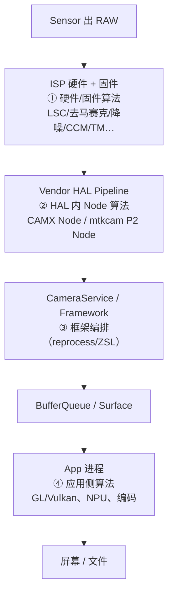
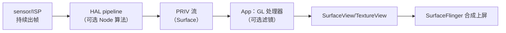

# 第 1 章 算法集成的分层地图：预览链路与拍照链路

> 本文为分章源文件，供单章阅读；若与主文档不一致，以主文档最新版为准。
>
> 本章回答"算法能放在哪、放哪一层由谁决定、预览和拍照为什么是两套集成方式"。材料分层沿用仓库惯例：A 层 = AOSP/平台官方文档，B 层 = 通行架构知识，C 层 = 厂商内部实现（CAMX/mtkcam 细节，需以实际平台代码为准）。

## 1.1 完整链路与四个可插入点

相机数据从 sensor 到屏幕/文件，中间有四个可以放算法的地方，它们的所有权、延迟预算和质量上限完全不同：

| 插入点               | 谁能做                     | 数据域              | 单帧延迟预算        | 质量上限          | 典型算法                                 |
| ----------------- | ----------------------- | ---------------- | ------------- | ------------- | ------------------------------------ |
| ① ISP 硬件/固件       | 芯片/平台厂商                 | RAW              | 极低（ms 级，硬流水线） | 高（RAW 域、逐像素）  | LSC、去马赛克、降噪、CCM、tone mapping、HDR 合成  |
| ② Vendor HAL Node | OEM/平台（CAMX Chi、mtkcam） | RAW/YUV          | 低（帧预算内）       | 高（可多帧、可用 ISP） | 夜景多帧、HDR、人像虚化、视频防抖、美颜、超分             |
| ③ Framework       | AOSP（App 间接使用）          | —                | 中             | 中             | ZSL/reprocess 编排、离线处理会话；**不自己做图像处理** |
| ④ App（GPU/NPU）    | 任意 App                  | YUV/RGB/JPEG/RAW | 较高（掉帧风险自担）    | 取决于实现与数据域     | 滤镜、美颜、贴纸、风格化、扫码、AI 分割/超分             |

关键认知：**"底层集成"通常指 ②（HAL Node），"应用集成"指 ④**。①是厂商出厂 tuning 的领域，③主要是管道能力而非算法本身。

## 1.2 为什么预览和拍照是两套集成方式

同一个算法（比如降噪、虚化）在预览和拍照两条链路里的约束完全不同：

| 维度   | 预览（preview）                                  | 拍照（capture）                      |
| ---- | -------------------------------------------- | -------------------------------- |
| 实时性  | 硬约束：30fps 帧预算 33ms、60fps 16.6ms、120fps 8.3ms | 软约束：几百 ms 到数秒可接受                 |
| 帧数   | 单帧（最多邻帧）                                     | 多帧（ZSL 环形缓冲、包围曝光、多帧降噪）           |
| 数据域  | 通常 YUV/RGB（PP 后）                             | 可 RAW（HAL 内）或 YUV（框架/App）        |
| 目标   | 流畅、低延迟、省电                                    | 画质优先（噪声、动态范围、细节）                 |
| 失败代价 | 掉帧/卡顿直接可见                                    | 出图慢可等待，但不可丢图/错图                  |
| 典型实现 | ISP 固定管道 + HAL 轻量 Node，或 App GL 单 pass       | HAL 多帧融合、ZSL reprocess，或 App 后处理 |

由此得到两条工程原则：

1. **预览算法必须"预算内可随时丢弃"**：每帧独立处理，处理不过来就丢帧/降级，绝不能阻塞相机出帧；
2. **拍照算法可以"攒帧重算"**：利用快门前的缓冲与快门后的多帧，允许异步、允许离线，但不能阻塞预览（否则用户看到卡顿）。

## 1.3 两条链路的实际数据流

**预览链路（实时）**：

**拍照链路（高质量）**：

注意两条链路的**汇合点**：预览帧和拍照帧共用同一 ISP/HAL 管道，拍照时的大计算（多帧融合/编码）如果占用同一资源，会反噬预览帧率——这就是"拍照瞬间预览卡一下"的根因（第 3 章）。

## 1.4 各层能拿到什么、拿不到什么

| 能力           | ISP/固件 | HAL Node       | App（Camera2/CameraX） |
| ------------ | ------ | -------------- | -------------------- |
| RAW 数据       | 原生     | 可（HAL 内部）      | 部分设备（RAW 流）          |
| 3A 统计        | 原生     | 可              | 仅结果元数据               |
| 逐帧低延迟        | 最好     | 好              | 受 IPC/调度影响           |
| 多帧融合         | 可      | 可（ZSL 缓冲在 HAL） | 需自建 burst（YUV/RAW）   |
| 厂商 tuning 参数 | 有      | 有（Chi/MTK 参数）  | 无                    |
| 与系统相机一致      | 是      | 是（系统相机走同一 HAL） | 否（默认成品已含系统处理）        |
| 跨机型一致性       | 平台相关   | 平台相关           | 好（API 一致，画质受限于数据）    |

一句话：**越往下，数据越好、延迟越低、但可改的范围越窄**；越往上，自由度越高，但拿不到 RAW/3A，且要自己承担性能与画质。

## 1.5 本章小结

* 算法集成先定层：ISP 固件（平台）、HAL Node（OEM/平台）、Framework（管道）、App（产品）；
* 预览与拍照的差异不在"用什么算法"，而在**预算**：预览必须帧内完成，拍照可以攒帧重算；
* 两条链共用管道，任何拍照侧的大计算都要评估对预览的反噬（资源、带宽、热）。

下一章：预览算法的两种主流集成方式与实现要点。
