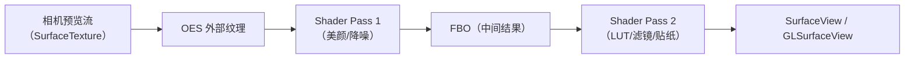

# 第 2 章 预览算法的集成：实时链路

> 本文为分章源文件，供单章阅读；若与主文档不一致，以主文档最新版为准。
>
> 预览算法的核心约束只有一个：**在帧预算内完成，处理不过来就降级/丢帧，绝不回压相机**。本章讲两条主流路线（HAL/ISP 内嵌、App 侧 GL）的接入方式、实现要点与选型。

## 2.1 两条主流路线

| 路线 | 位置 | 数据域 | 优点 | 代价/门槛 | 典型场景 |
|---|---|---|---|---|---|
| **A. HAL/ISP 内嵌** | vendor pipeline（CAMX Node / mtkcam Node） | RAW/YUV，可多帧 | 延迟最低、与系统相机一致、可 RAW 域处理 | 需 OEM/平台权限；跨机型要分别移植；调试链路深 | 系统相机美颜/夜景预览、视频防抖（EIS）、视频 HDR、虚化视频 |
| **B. App 侧 GL 处理** | App 进程（GPU/NPU） | YUV/RGB（外部纹理） | 完全可控、跨机型一致、迭代快 | 拿不到 RAW/3A；每帧 GPU 开销；低端机降级 | 第三方相机滤镜、美颜、贴纸、风格化、AI 分割 |
| **C. 双流分离** | 预览流 + 分析流（YUV ImageReader） | 预览：直显；分析：YUV | 算法不阻塞显示链路 | 多一路流，带宽/功耗上升；结果与预览帧需按时间戳对齐 | 扫码、人脸检测、构图提示、防抖检测 |

> 现实中经常组合：HAL 做"基础画质"（降噪/防抖/HDR），App GL 做"产品化效果"（滤镜/贴纸/美颜强度）。

## 2.2 路线 A：HAL/ISP 内嵌（平台侧集成）

**数据位置与做法**（B/C 层，厂商具体实现差异大）：

- 高通 CAMX：算法以 **Node** 形式接入 topology XML 定义的数据流图（例如在 IFE 之后、IPE 之前插自定义节点，或走 Chi-CDK 的 Node override / Feature）；算法跑在 DSP/GPU/NPU 上，输入输出是 gralloc buffer，节点间由 buffer manager 串联；
- MTK mtkcam：在 P1（sensor/ISP 通路）或 P2（后处理通路）挂自定义 Node/Feature，YUV 域处理通常落 P2；
- 与框架的接口：标准能力用 `CaptureRequest` 键（如防抖模式）；私有能力用 **vendor tag**（`ICameraProvider::setVendorTagDescriptor` 注册）或 **Camera Extensions**（`EXTENSION_NIGHT/BOKEH/...`）暴露给 App；
- 验证：厂商自测 + CTS/VTS；图像质量用 ITS 做客观回归（亮度线性、色彩、锐度等）。

**预览算法的特殊要求**（与拍照对比）：

1. **单帧、无回溯**：不能用"未来的帧"，需要多帧时必须用历史帧（如 EIS 的陀螺仪+邻帧校正）；
2. **固定延迟预算**：硬件流水线通常把算法放在 ISP 的"在线路径"（online），处理延迟必须小于帧间隔；
3. **与 3A 协同**：降噪/防抖会改变 AE/AWB 统计的输入（统计在 RAW 域、处理在 YUV 域时要注意顺序），算法不能破坏 3A 收敛；
4. **可开关/可降级**：高温或高负载时能动态关闭（对应系统压力/thermal 信号）。

**适合放在 HAL 的预览算法**：视频防抖（EIS）、视频 HDR/多帧降噪、人像虚化（视频）、系统相机美颜、超分预览、低光增强。理由：这些需要 RAW 域、低延迟、硬件流水线，且要与系统相机一致。

**不适合**：需要频繁迭代、按产品活动变化的滤镜/贴纸/美颜风格——放 HAL 意味着每次改都要过平台验证，迭代成本极高。

## 2.3 路线 B：App 侧 GL 处理（应用集成）

这是第三方相机 App 做实时效果的标准姿势，数据路径：

关键实现点（与追问链文档的 SurfaceView+GL 方案一致）：

1. **零拷贝**：相机输出到 `SurfaceTexture`（`GL_TEXTURE_EXTERNAL_OES`），`updateTexImage()` 后直接采样，GPU 完成 YUV→RGB；
2. **多 pass 用 FBO ping-pong**：简单滤镜单 pass 够用；美颜（磨皮+锐化+肤色）通常 2~3 pass，注意每 pass 的读写带宽；
3. **分辨率策略**：算法在降采样图上算（如 1/2 或 1/4），再双线性放大回显——人像磨皮/虚化对分辨率不敏感，能省一半以上 GPU 时间；
4. **帧率预算**：30fps 下整条链（相机→GL→合成）只有 33ms；单 pass 1080p 通常 1~3ms，多 pass+ML 要实测；留 30% 余量；
5. **丢帧策略**：GL 线程处理不过来时丢旧帧（只渲染最新），绝不能排队；
6. **NPU/ML**：人脸/人像分割用 TFLite/NNAPI，通常按"每 N 帧跑一次 + 帧间复用 mask"的方式降低推理频率；推理输入降采样到 256/512 级别；
7. **线程与生命周期**：GL 线程独立（HandlerThread），surfaceDestroyed/onPause 正确释放 EGL 与纹理；
8. **方向与镜像**：`getTransformMatrix` 处理相机裁剪，顶点矩阵处理旋转/镜像；预览与拍照/录像的方向要统一。

**CameraX 的封装**：`androidx.camera:camera-effects` 提供 `CameraEffect` / `SurfaceProcessor`（OpenGL 处理链），可在 `UseCaseGroup` 上挂"预览效果/录像效果"，把 SurfaceTexture→GL→Surface 的样板代码封装掉（版本与 API 以官方文档为准）。适合中小团队快速落地；复杂多 pass 管线仍建议自管 EGL。

**适合放在 App 的预览算法**：滤镜/LUT、美颜强度、贴纸/AR、风格化、扫码与人脸检测（分析流）、构图辅助线。理由：迭代快、跨机型一致、不依赖厂商。

## 2.4 路线 C：预览直显 + 分析流分离

当算法**不需要改变显示画面**（检测、识别、统计）时，不要走 GL 显示链，而是：

- 预览流：相机 → SurfaceView 直显（零拷贝，不动）；
- 分析流：同一会话再加一路 YUV `ImageReader`（或 CameraX `ImageAnalysis`），算法在分析流上跑；
- 对齐：分析帧与预览帧按 `SensorTimestamp`/PTS 近似对齐；分析帧率可低于预览（`acquireLatestImage` 丢旧帧）；
- 注意：多一路流会增加带宽/功耗，低端机要评估；分析流尺寸选最小可用（如 640×480）。

## 2.5 性能预算与降级策略

| 帧率 | 帧间隔 | 建议算法预算（含相机+显示余量） |
|---|---|---|
| 30fps | 33.3ms | ≤ 8~10ms（GPU/CPU） |
| 60fps | 16.6ms | ≤ 4~6ms |
| 120fps | 8.3ms | ≤ 2~3ms（通常只做极轻处理） |

降级顺序（从轻到重）：降算法分辨率 → 降 pass 数/精度 → 降推理频率 → 关效果 → 降预览帧率/分辨率。降级触发信号：帧耗时监控、`systemPressureState`（iOS 侧概念，Android 用 thermal/负载信号）、掉帧计数。

## 2.6 常见坑

1. **在相机回调线程做算法**：阻塞出帧回调，导致相机侧积压/丢帧——算法必须另起线程；
2. **每帧 `glReadPixels`**：同步回读必掉帧；显示链路不需要回读，拍照/录像才按需读；
3. **每帧 new 对象**（FloatBuffer、数组、Bitmap）：GC 抖动；全部预分配；
4. **预览与拍照方向不一致**：GL 里做了旋转，拍照 ImageReader 没做——两套方向逻辑要统一；
5. **前置镜像做在像素里**：应该用矩阵/EXIF 表达，避免影响算法输入；
6. **多路流尺寸不匹配**：预览 1080p、分析 4K，带宽翻倍，低端机直接掉帧；
7. **忘记释放 SurfaceTexture/EGL**：返回再进黑屏，或 native 内存泄漏。

## 2.7 本章小结

- 预览算法两条主路线：HAL/ISP（低延迟、RAW、需平台权限）与 App GL（灵活、跨机型、拿不到 RAW）；
- 只做检测不改画面的算法走"预览直显 + 分析流"，不要挤占显示链路；
- 预算是硬约束：30fps 只有 33ms 且要和相机/显示分摊，算法要降分辨率、控 pass 数、丢旧帧、可降级。

下一章：拍照算法（高质量链路）的集成方式。
