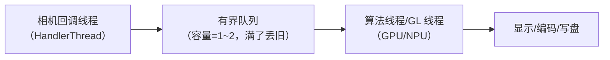

# 第 4 章 算法集成的工程细节：数据、同步、内存、线程与热

> 本文为分章源文件，供单章阅读；若与主文档不一致，以主文档最新版为准。
>
> 算法在架构图上"放对了层"只是开始，真正决定成败的是工程细节：数据格式、时间对齐、缓冲管理、线程模型、功耗散热与可观测性。本章是跨路线的通用清单。

## 4.1 数据与格式

| 数据 | 格式/要点 | 算法关心什么 |
|---|---|---|
| RAW | `RAW_SENSOR`（16bit 容器）/`RAW10`/`RAW12`；Bayer 排列见 `SENSOR_INFO_COLOR_FILTER_ARRANGEMENT` | 黑电平（静态/动态）、白电平、噪声模型、LSC 是否已应用 |
| YUV | `YUV_420_888` 三平面语义；布局由 `rowStride`/`pixelStride` 决定 | stride 对齐、UV 交织、色彩空间（BT.601/709）、full/limited range |
| RGB/PRIV | 显示用 `PRIV` 直通；GPU 处理后常为 RGB(A) | 色彩空间（sRGB/P3）、预乘 alpha、位深（8/10bit） |
| 深度 | `DEPTH16`/`DEPTH_POINT_CLOUD`（部分设备）；CameraX/厂商 API | 与彩色帧的**对齐**（内参/外参）、单位（mm/视差） |
| 编码产物 | JPEG/HEIF/DNG | 已损失（JPEG）vs 线性 RAW（DNG）、EXIF 方向 |

要点：

- **不要假设 YUV 内存连续**：按 plane + stride 读（老生常谈但最多 bug）；
- **RAW 必须读动态黑电平**：高增益下静态黑电平不准（`SENSOR_DYNAMIC_BLACK_LEVEL`）；
- **色彩空间要显式传递**：算法链里从 YUV 到 RGB 到编码，每一步都要标注色彩空间，否则 HDR/广色域内容发灰。

## 4.2 时间与同步

| 场景 | 机制 | 注意点 |
|---|---|---|
| 单摄帧时序 | `SensorTimestamp`（ns，单调时钟，`SENSOR_INFO_TIMESTAMP_SOURCE` 决定基准） | 同一请求多流同时间戳；跨请求单调 |
| 多摄同步 | `LOGICAL_MULTI_CAMERA` + `SYNC_MAX_LATENCY`（PER_FRAME_CONTROL/AT_ONCE） | 物理流可漂移；融合前按时间戳配对 |
| 深度与彩色 | 深度帧 PTS 与视频 PTS 独立 | 最近邻配对 + 标定（`AVCameraCalibrationData` 对应 Android 的 calibration 元数据） |
| 音视频同步 | 视频/音频 sample PTS 同一时间基准 | 录制 muxer 前对齐；丢帧策略要一致 |
| 算法与显示 | 预览帧与 GL 渲染帧的时间差 | 不要给算法加 >1 帧的额外延迟 |

实践原则：**任何跨流的算法（多摄、深度、音频）都以时间戳为准配对，不以"回调顺序"配对**。

## 4.3 线程模型与背压

三条线程边界必须分清：

- **相机回调线程**：只做"拿帧、入队、close Image"，绝不做重计算；
- **队列必须有界**：预览用"只保留最新帧"（丢旧），拍照用"不可丢"（计数背压，但要有上限防 OOM）；
- **算法线程**：GL 需要自己的 EGL 上下文（或共享上下文）；NPU 推理串行化，避免并发抢资源；
- **背压信号**：帧耗时统计、队列深度、掉帧计数；超过阈值触发降级（第 2 章）。

## 4.4 内存与缓冲

- **BufferQueue/ImageReader 是有限池**：`maxImages` 既是容量也是背压手段；不 `close()` 就等于永久占用；
- **零拷贝优先**：相机 buffer（gralloc/dma-buf）→ GPU 纹理（`CVMetalTextureCache`/`EGLImage`）直接映射，避免 CPU 中转；
- **内存估算**：12MP YUV420 ≈ 18MB/帧；8 帧 burst ≈ 144MB；12MP RAW16 ≈ 24MB/帧；低端机必须按可用内存反推帧数与分辨率；
- **大对象复用**：Bitmap/Buffer/FBO 预分配与池化；避免每帧分配；
- **释放顺序**：停流 → 释放 Surface/纹理 → 释放 ImageReader → 退出算法线程。

## 4.5 功耗、热与降级

- 长时间预览/连拍/夜景会触发降频与热保护：帧率下降、出图变慢、甚至相机被系统限制；
- 可观测信号：`systemPressureState`（iOS 的对应概念；Android 侧用 thermal status/负载/掉帧指标自建）；
- 降级矩阵（示例）：`serious` → 关实时滤镜/降推理频率；`critical` → 只保留基础预览，提示用户；
- 拍照多帧在热状态下应减少帧数/降分辨率，而不是硬扛导致掉帧或 ANR。

## 4.6 可观测性与调试

| 手段 | 用途 |
|---|---|
| 自定义 trace（`Trace.beginSection`/`beginAsyncSection`） | 把算法阶段（采集/对齐/融合/编码）映射到 Perfetto 时间轴 |
| FrameTimeline | 判断算法导致的掉帧是 App 侧还是显示侧 |
| 帧耗时/队列深度埋点 | 线上监控降级与卡顿 |
| `dumpsys media.camera` | 会话/流/in-flight 状态 |
| ITS / 客观指标 | HAL 算法回归（噪声、色彩、锐度、动态范围） |

trace 分析的具体方法见《Android_Camera_Trace分析文档》第 2~5 章。

## 4.7 HAL 集成的工作流（平台侧）

以 CAMX/mtkcam 为例的通用步骤（B/C 层，细节以平台文档为准）：

1. **需求拆解**：输入数据域、延迟预算、是否多帧、是否需要 3A 统计；
2. **选插入点**：在线路径（预览）vs 离线路径（拍照）；Node 放在 IFE 后/IPE 前还是 P2；
3. **接口设计**：标准键 vs vendor tag vs Camera Extension；开关粒度（全局/场景/强度）；
4. **数据通路**：buffer 格式/usage、是否需要 RAW、是否需要额外 buffer 轮转；
5. **同步与 3A**：算法是否影响 AE/AWB 统计；多帧的对齐与时间戳；
6. **验证**：功能用例 + 图像质量 ITS 回归 + 性能（帧率/延迟/功耗）+ 稳定性（长跑/热）；
7. **灰度与回退**：开关默认值、异常降级、版本兼容（旧设备无此能力时 App 侧兜底）。

## 4.8 本章小结

算法集成的成败取决于六个"不起眼"的工程点：格式与色彩空间不糊涂、时间戳配对、回调线程不干活、队列有界可丢、内存按峰值算、热了能降级。这些点在预览与拍照两条链路上同样适用。
