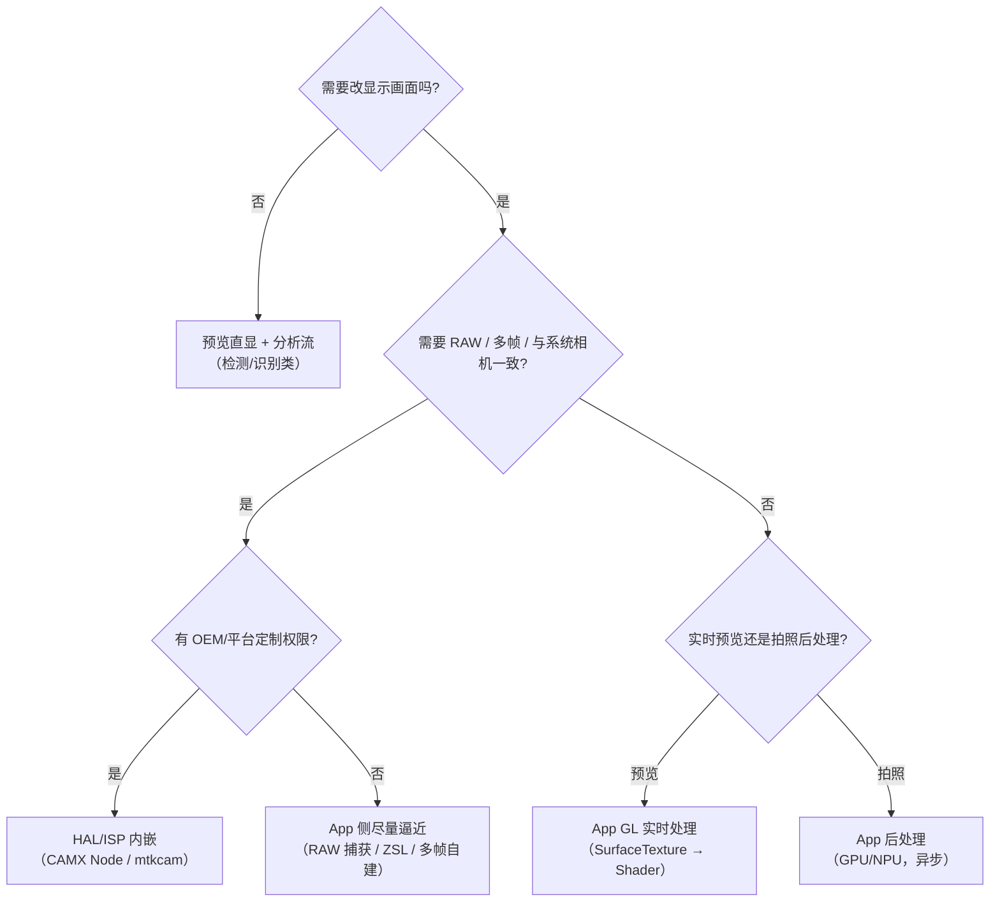

# 第 5 章 选型决策与实战案例

> 本文为分章源文件，供单章阅读；若与主文档不一致，以主文档最新版为准。
>
> 本章把前四章收敛成"怎么选、怎么落地"：一张决策树、几张场景矩阵、五个真实形态的案例，以及上线检查清单。

## 5.1 选型决策树

补充判断项：

- **延迟敏感度**：预览/录像必须帧内完成；拍照可异步；
- **迭代频率**：产品效果频繁变化 → App 层；稳定画质基线 → HAL；
- **跨机型一致性**：要求一致 → App 层；接受机型差异 → HAL/Ext；
- **团队资源**：没有平台团队就选 App 路线（HAL 定制需要厂商协作与 ITS 验证）。

## 5.2 场景选型矩阵

| 场景 | 推荐路线 | 数据域 | 预算 |
|---|---|---|---|
| 实时滤镜/LUT | App GL（或 CameraX `CameraEffect`） | YUV→RGB | 30fps ≤8ms |
| 实时美颜 | App GL（磨皮+肤色，多 pass） | YUV→RGB | 30fps ≤8ms，降采样 |
| 视频背景虚化 | HAL（双摄/深度）优先；否则 App ML 分割 | 深度/彩色 | 30fps ≤10ms |
| 扫码/OCR | 预览直显 + YUV 分析流 | YUV | 分析流 5~15fps 即可 |
| 夜景拍照 | HAL 多帧（`EXTENSION_NIGHT`） | RAW | 快门后 0.5~3s |
| 人像拍照虚化 | HAL（`EXTENSION_BOKEH`）或 App 后处理 | RAW/深度/JPEG | 快门后 0.2~1s |
| 拍照后 AI 增强 | App 后处理（NPU） | JPEG/RAW | 异步，1~3s |
| 多帧 HDR（无 OEM 支持） | App burst 自建 | YUV（或 RAW） | 0.3~1s |
| 专业模式/RAW 直出 | App（RAW 捕获 + 自建显影） | RAW | 异步 |

## 5.3 五个案例

**案例 1：第三方相机 App 的实时美颜滤镜**

- 架构：Camera2 预览 → SurfaceTexture → GL 多 pass（磨皮/肤色/LUT）→ SurfaceView；
- 预算：1080p 30fps，磨皮降采样到 1/2，总 GPU ≤6ms；ML 人脸检测每 5 帧一次复用框；
- 降级：低端机砍 pass 数/降分辨率；热了关效果；
- 不选 HAL 的理由：无平台权限、效果要频繁迭代。

**案例 2：手机厂商系统相机的夜景**

- 架构：HAL ZSL 环形缓冲（RAW）→ 对齐（陀螺仪+特征）→ 多帧融合（噪声模型/HDR）→ ISP 后段 → JPEG/HEIF；
- App 接口：Camera Extensions（`EXTENSION_NIGHT`）或相机 App 走私有 vendor tag；
- 关键：多帧帧数随场景光自适应；热/低电降帧数；与预览共用管道时保证预览不掉帧（拍照请求优先级/离线会话）。

**案例 3：文档扫描**

- 架构：预览直显（零拷贝）+ 分析流（YUV，640×480~1080p）→ 边缘检测/透视矫正 → 拍照时用高分辨率 JPEG；
- 要点：分析流尺寸小、频率低（5~10fps）；检测结果与预览帧时间戳对齐用于叠加框；拍照后处理在 App 完成，不占相机管道。

**案例 4：视频人像虚化**

- 方案 A（平台）：双摄深度/ML 分割在 HAL 内逐帧处理，延迟最低；
- 方案 B（App）：ML 分割（每 N 帧）+ GL 合成（背景模糊 + 边缘羽化），预算 30fps ≤10ms，分割输入降采样；
- 常见问题：边缘抖动（帧间 mask 平滑）、发丝锯齿（matting 而非粗分割）、深度与彩色对齐误差。

**案例 5：拍照后 AI 增强（超分/去雾）**

- 架构：ImageReader 取 JPEG/RAW → NPU 推理（TFLite GPU delegate/NNAPI）→ 合成写盘；
- 要点：异步执行、进度反馈；内存峰值控制（大图分块）；原图保留以支持重试；
- 与预览解耦：处理期间继续预览，保存完成再提示。

## 5.4 上线检查清单

1. **数据域确认**：RAW/YUV/JPEG？是否已损失信息？色彩空间是否标注？
2. **预算实测**：帧耗时、内存峰值、热状态下表现（不是实验室常温一次）；
3. **线程与背压**：回调线程不计算、队列有界、丢帧策略明确；
4. **生命周期**：进后台/来电/切相机/旋转时正确释放与恢复；
5. **降级路径**：低端机/热/低电/权限受限时的兜底；
6. **可观测性**：关键阶段 trace 打点 + 线上埋点（耗时/掉帧/降级次数）；
7. **回归**：固定脚本多次采集，与基线对比（启动/拍照延迟、帧率、画质指标）；
8. **兼容性**：机型矩阵（芯片代 + 镜头组合）覆盖；厂商 tag/extension 不支持时的回退。

## 5.5 与 iOS 的对照（简要）

| 能力 | Android | iOS |
|---|---|---|
| 预览算法 | HAL Node 或 App GL；SurfaceTexture 零拷贝 | 无第三方 HAL；App 侧 `AVCaptureVideoDataOutput` + Metal/Core Image；系统相机能力不开放 |
| 拍照算法 | HAL 多帧 / ZSL reprocess / App 后处理 | 系统计算摄影默认在场；ProRAW/Log 交付给 App 后期；`AVCapturePhoto` 延迟处理 |
| 平台扩展 | HAL/vendor tag/Camera Extensions | 仅 macOS 有 Camera Extensions（DriverKit）；iOS 无相机 HAL 扩展 |

对照细节见《iOS_Camera_ISP_图像管线文档》与《iOS_Camera_学习文档》第 2~5 章。

## 5.6 本章小结

- 选型的本质是三个问题：要不要改画面、需不需要 RAW/多帧、有没有平台权限；
- 预览与拍照的算法应视为两条独立管线，共享资源时以预览不掉帧为底线；
- 落地的胜负手在工程细节（预算、线程、内存、热、可观测性），而不是算法本身多先进。
