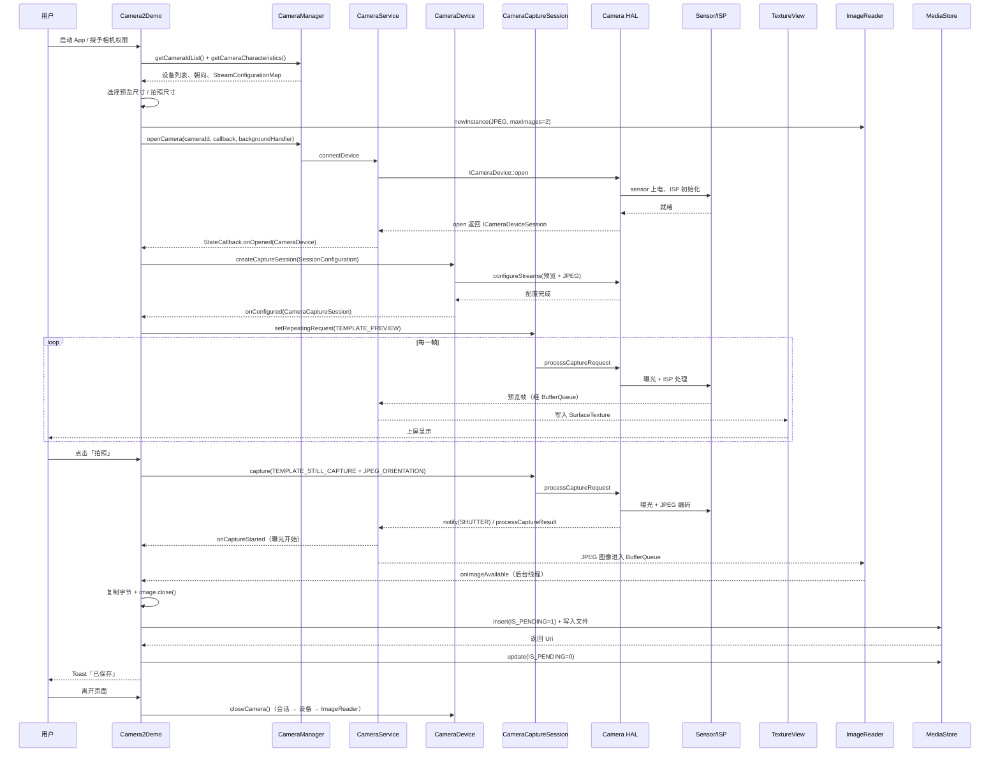
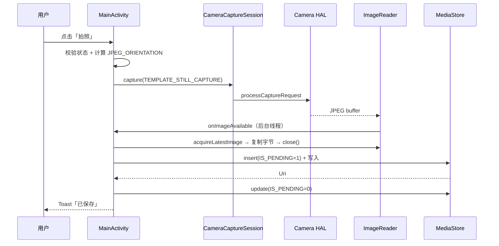

# Camera2Demo

一个最小可运行的 Android **Camera2** 示例：TextureView 预览 + 拍照保存到系统相册。

配套学习文档：
[Camera 学习文档](../../Android_Camera_学习文档.md) ·
[接口文档](../../Android_Camera_接口文档.md) ·
[源码链路文档](../../Android_Camera_源码链路文档.md) ·
[ISP/3A 文档](../../Android_Camera_ISP_3A文档.md) ·
[Trace 分析文档](../../Android_Camera_Trace分析文档.md) ·
[算法集成文档](../../Android_Camera_算法集成文档.md)

## 功能

- Camera2 + TextureView 实时预览；
- 点击「拍照」输出 JPEG 到系统相册 `Pictures/Camera2Demo`；
- 预览/拍照尺寸从 `StreamConfigurationMap` 动态选择（预览**优先 4:3** 且不超过 1920×1440，与拍照成片比例一致；拍照取 12MP 以内最大）；
- 处理预览与拍照方向：TextureView 自动处理 sensor 方向，预览只补偿屏幕旋转；照片用 `JPEG_ORIENTATION` 按 sensor + 屏幕旋转合成；
- 前置摄像头镜像预览（当前默认后置，无切换 UI）；
- 运行时权限使用 `ActivityResult` API，兼容 Android 15/16。

## 环境

| 项 | 值 |
|---|---|
| AGP | 8.13.2 |
| compileSdk / targetSdk | 36 |
| minSdk | **35（Android 15+）** |
| 语言 | Java 11 |

## 运行

用 Android Studio 打开本目录（`Android/demo/Camera2Demo`），等待 Gradle Sync 后直接 Run。

命令行：

```bash
./gradlew :app:assembleDebug
adb install -r app/build/outputs/apk/debug/app-debug.apk
```

> 首次启动会请求相机权限；拒绝则退出。拍下的照片可在相册的 `Pictures/Camera2Demo` 目录或通过 Toast 中的 URI 找到。

## Camera2 完整流程

一次「打开相机 → 预览 → 拍照 → 保存」在 Camera2 中会经过以下阶段（括号内为本 demo 的实现位置）：

| # | 阶段 | 做了什么 | 关键 API |
|---|------|----------|----------|
| 1 | 权限 | 申请并确认 `CAMERA` 权限 | `ActivityResultContracts.RequestPermission` |
| 2 | 枚举设备 | 列出 `cameraId`，按 `LENS_FACING` 选后置 | `CameraManager.getCameraIdList()` / `getCameraCharacteristics()` |
| 3 | 查询能力 | 取 `StreamConfigurationMap`，挑预览/拍照尺寸 | `getOutputSizes(SurfaceTexture.class / ImageFormat.JPEG)` |
| 4 | 准备输出 | 预览用 TextureView 的 `SurfaceTexture`，拍照用 `ImageReader` 的 Surface | `ImageReader.newInstance()` |
| 5 | 打开设备 | 异步打开，成功后拿到 `CameraDevice` | `CameraManager.openCamera()` → `StateCallback.onOpened()` |
| 6 | 构造请求 | 选模板，`addTarget()` 指定本次请求要写哪个输出 Surface | `CameraDevice.createCaptureRequest(TEMPLATE_PREVIEW / STILL_CAPTURE)` |
| 7 | 配流建会话 | 一次性登记所有输出 Surface，HAL 完成 `configureStreams` | `SessionConfiguration` + `CameraDevice.createCaptureSession()` |
| 8 | 预览 | 重复下发预览请求，帧持续写入 TextureView | `CameraCaptureSession.setRepeatingRequest()` |
| 9 | 拍照 | 单次下发高质量静态图请求 | `CameraCaptureSession.capture()` |
| 10 | 结果回程 | 快门/元数据回调 + JPEG 进入 ImageReader | `CaptureCallback`、`ImageReader.OnImageAvailableListener` |
| 11 | 保存 | MediaStore 两段式写入系统相册 | `ContentResolver.insert()` + `IS_PENDING` |
| 12 | 释放 | 会话 → 设备 → ImageReader 依次关闭 | `closeCamera()` |

### 完整时序



### 各阶段要点

**1）权限与设备枚举**
`getCameraIdList()` 返回的 ID 没有顺序语义，`"0"` 不一定是后置；必须查 `LENS_FACING`。`getCameraCharacteristics()` 一次拿全静态能力（朝向、sensor 安装角、支持的输出尺寸等），应缓存复用，不要每次开相机都重新查。

**2）打开设备**
`openCamera()` 是异步的：返回时相机尚未打开，真正可用要等 `onOpened`。打开过程包含 CameraService 的权限/优先级仲裁、HAL 的 `open`、sensor 上电与 ISP 初始化；冷启动时这一段常是耗时大头。被更高优先级客户端抢占会走 `onDisconnected`，设备不可再用，必须清理后重开。

**3）查询能力与选择尺寸**
`StreamConfigurationMap` 是“设备支持什么”的菜单：预览尺寸查 `getOutputSizes(SurfaceTexture.class)`，拍照尺寸查 `getOutputSizes(ImageFormat.JPEG)`。**不要硬编码尺寸**，否则 `configureStreams` 可能直接失败。本 demo 预览优先 4:3（与成片比例一致），拍照取 12MP 以内最大。

**4）准备输出**
预览的消费者是 TextureView 的 `SurfaceTexture`；拍照的消费者是 `ImageReader`。`ImageReader.newInstance(w, h, JPEG, maxImages)` 的 `maxImages` 是缓冲上限，也是背压手段——每张 `Image` 都必须 `close()`，否则缓冲耗尽后拍照阻塞。

**5）构造请求**
`createCaptureRequest(template)` 只是给出一组合理默认值：预览用 `TEMPLATE_PREVIEW`（低延迟、连续 3A），拍照用 `TEMPLATE_STILL_CAPTURE`（倾向高质量）。`addTarget(surface)` 决定这一帧写到哪些输出：预览请求只加预览 Surface，拍照请求只加 ImageReader Surface。

**6）配流建会话**
`createCaptureSession` 会把所有输出 Surface 一次性交给 HAL 做 `configureStreams`（协商尺寸、格式、buffer 数量、usage）。这是启动链路里除 provider 冷启动之外的另一个大耗时点；流组合不被支持时走 `onConfigureFailed`。本 demo 用 `SessionConfiguration`（API 28+）替代已废弃的 List 重载。

**7）预览**
`setRepeatingRequest()` 让同一个请求在 HAL 里无限重复，是预览/录像的常态；每帧参数基本不变，避免逐帧提交。预览帧经 CameraService → BufferQueue → TextureView 上屏，App 不接触像素。

**8）拍照**
`capture()` 是单次请求，优先级高于 repeating。拍照请求会带上 `JPEG_ORIENTATION`（sensor 安装角 + 屏幕旋转的合成角），并 target `ImageReader`。本 demo 直接抓当前帧，没有做 AE/AF 的 precapture 收敛序列。

**9）结果回程（两条通道）**
- **notify 通道**：`onCaptureStarted`（曝光开始，含时间戳）等事件；
- **result 通道**：`onCaptureCompleted`（元数据）+ 图像 buffer 进入对应输出。
CameraService 按 frame number 匹配请求与结果；`partial result` 允许元数据分批返回，框架累积后才是 `TotalCaptureResult`。

**10）保存**
拿到 `ImageReader` 的 JPEG 后先复制字节，再 `close()` 归还缓冲，然后走 MediaStore 两段式写入（`IS_PENDING=1` 占位 → 写文件 → 置 0 发布），失败删除占位记录。整个过程在后台线程完成，手机相册的 `Pictures/Camera2Demo` 目录可见。

**11）释放**
`onPause` / `onSurfaceTextureDestroyed` 触发 `closeCamera()`：先关会话，再关设备，最后关 ImageReader；三者独立判空，避免打开中途失败时泄漏。之后停止后台线程。

### 线程分布

| 阶段 | 所在线程 |
|------|----------|
| 权限、布局、Toast | 主线程 |
| openCamera 调用 | 主线程发起（回调在后台） |
| onOpened / 会话回调 / 请求下发 / 结果回程 | `backgroundHandler`（HandlerThread） |
| ImageReader 取图 + 保存 JPEG | `backgroundHandler` |
| 预览上屏 | SurfaceFlinger / 合成线程（系统侧） |

> 框架内部细节（CameraService 的请求泵、in-flight 匹配、结果回程）见仓库《Android_Camera_源码链路文档》第 3~4 章；请求/结果模型的规则见《Android_Camera_学习文档》第 2 章。

## 代码结构

全部逻辑在 `app/src/main/java/com/example/camera2demo/MainActivity.java`，主链路：

1. `onCreate`：注册权限（`ActivityResultContracts.RequestPermission`）→ `startCameraIfPossible()`；
2. `openCamera()`：按 `LENS_FACING_BACK` 选相机 → 读 `CameraCharacteristics` → 动态选尺寸 → 创建 `ImageReader` → `openCamera()`；
3. `startPreview()`：`TextureView` 的 Surface + `ImageReader` 的 Surface 通过 `SessionConfiguration` 建会话 → `setRepeatingRequest()`；
4. `takePicture()`：`TEMPLATE_STILL_CAPTURE` + `JPEG_ORIENTATION` → 单次 `capture()`；
5. `onImageAvailable`：取 JPEG 字节 → **`finally` 里 `image.close()`**；
6. `saveJpeg()`：MediaStore 两段式写入（`IS_PENDING`），完成后通知相册。

`activity_main.xml`：TextureView（等比显示 + 黑边）+ 底部拍照按钮。

## 拍照与保存的实现逻辑

### 1. 拍照：takePicture()

```java
private void takePicture() {
    if (cameraDevice == null || captureSession == null || imageReader == null) {
        showToast(R.string.camera_not_ready);
        return;
    }
    if (isCapturing) {
        return; // 防止连点造成并发 capture
    }

    CaptureRequest.Builder builder =
            cameraDevice.createCaptureRequest(CameraDevice.TEMPLATE_STILL_CAPTURE);
    builder.addTarget(imageReader.getSurface());
    builder.set(CaptureRequest.CONTROL_AF_MODE,
            CaptureRequest.CONTROL_AF_MODE_CONTINUOUS_PICTURE);
    builder.set(CaptureRequest.JPEG_ORIENTATION, getJpegOrientation());

    isCapturing = true;
    captureSession.capture(builder.build(), captureCallback, backgroundHandler);
}
```

要点：

- **模板**：`TEMPLATE_STILL_CAPTURE` 让 HAL 按高质量静态图路径处理；
- **target**：把 `ImageReader` 的 Surface 加进请求。会话创建时已经把它算在输出流里（预览请求只 target 预览 Surface），所以拍照请求只影响这一张；
- **方向**：`JPEG_ORIENTATION` 必须是「sensor 安装角 + 屏幕旋转」的合成角，否则照片横竖不对（前置摄像头公式不同，见 `getJpegOrientation()`）；
- **防重入**：`isCapturing` 在图片到达或失败回调里复位，连点不会并发发起多次拍照；
- **失败出口**：`captureCallback.onCaptureFailed` 复位 `isCapturing` 并提示，避免失败后按钮永久失效；
- demo 未做 precapture/AE 收敛序列：直接抓当前帧，适合演示；追求成片质量的 App 应先等 AE/AF 收敛（见仓库面试题 Q26/Q57）。

### 2. 保存：onImageAvailable() + saveJpeg()

```java
private final ImageReader.OnImageAvailableListener imageAvailableListener = reader -> {
    Image image = reader.acquireLatestImage();
    if (image == null) {
        return;
    }
    byte[] jpeg;
    try {
        ByteBuffer buffer = image.getPlanes()[0].getBuffer();
        jpeg = new byte[buffer.remaining()];
        buffer.get(jpeg);
    } finally {
        image.close(); // 关键：必须归还缓冲，否则 maxImages 耗尽后拍照会阻塞
    }

    try {
        Uri saved = saveJpeg(jpeg);
        // 成功后 runOnUiThread 弹 Toast
    } finally {
        isCapturing = false;
    }
};

private Uri saveJpeg(byte[] jpeg) {
    ContentValues values = new ContentValues();
    values.put(MediaStore.Images.Media.DISPLAY_NAME,
            "IMG_" + System.currentTimeMillis() + ".jpg");
    values.put(MediaStore.Images.Media.MIME_TYPE, "image/jpeg");
    values.put(MediaStore.Images.Media.RELATIVE_PATH,
            Environment.DIRECTORY_PICTURES + "/Camera2Demo");
    values.put(MediaStore.Images.Media.IS_PENDING, 1);      // ① 占位，尚未写完

    Uri uri = getContentResolver().insert(
            MediaStore.Images.Media.EXTERNAL_CONTENT_URI, values);
    if (uri == null) {
        return null;
    }
    try (OutputStream out = getContentResolver().openOutputStream(uri)) {
        out.write(jpeg);                                     // ② 写文件
    } catch (IOException e) {
        getContentResolver().delete(uri, null, null);        // 失败回滚
        return null;
    }

    ContentValues done = new ContentValues();
    done.put(MediaStore.Images.Media.IS_PENDING, 0);         // ③ 发布
    getContentResolver().update(uri, done, null, null);
    return uri;
}
```

要点：

- **两段式写入**：`IS_PENDING=1` 时其他应用/相册看不到这条记录，写完置 0 才发布，避免出现「半张图」；失败时删除占位记录；
- **不需要存储权限**：使用 MediaStore 的 `RELATIVE_PATH` 写入公共图片区（`Pictures/Camera2Demo`），属于 scoped storage 的合法路径，因此 Manifest 里没有 `WRITE_EXTERNAL_STORAGE`；
- **线程**：`onImageAvailable` 跑在创建 `ImageReader` 时传入的 `backgroundHandler` 上，写盘不占主线程；UI 提示用 `runOnUiThread`；
- **close 时机**：先把 JPEG 字节复制出来，`finally` 里立即 `image.close()`，之后写盘不再占用相机缓冲；
- **可见性**：照片落在系统相册的 `Pictures/Camera2Demo` 目录，可在相册查看，也可通过 Toast 中的 URI 定位。

### 3. 完整时序



## 关键实现点（也是常见坑）

- **Image 必须 close**：`maxImages` 有限，不归还会导致后续拍照/预览阻塞；
- **尺寸不要硬编码**：必须以 `StreamConfigurationMap` 为准，否则 `configureStreams` 可能直接失败；
- **方向要分开算**：**预览**由 TextureView 自动转正 sensor 方向，只需补偿屏幕旋转（`setRotation(-displayRotation)`）；**JPEG** 不走 TextureView，`JPEG_ORIENTATION` 才需要「sensor 安装角 + 屏幕旋转」合成（前置公式不同）；
- **权限回调用 ActivityResult**：API 36 新增的 4 参 `onRequestPermissionsResult` 在 Android 15 上不存在；
- **资源释放**：session / device / ImageReader 独立关闭，`onSurfaceTextureDestroyed` 返回 `true` 交回 TextureView 释放；
- **拍照与预览共用会话**：JPEG 属于 stalling stream，连续高频拍照会反噬预览帧率；
- **保存用 MediaStore**：`RELATIVE_PATH + IS_PENDING`，不需要存储权限（minSdk 35 场景）。

## 已知限制

- 只使用后置相机，没有前后摄切换、闪光灯、变焦、手动 3A；
- 没有连拍/ZSL、视频录制、RAW 输出；
- `minSdk 35`，低版本设备需自行补兼容（尤其是图片保存路径）；
- 前置镜像通过 View 的 `scaleX=-1` 实现，若后续加入前置切换需在真机上核对镜像与旋转组合。
