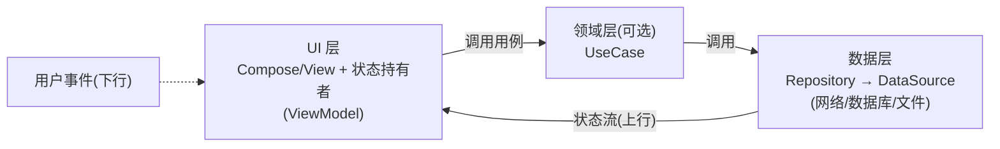

# 第 5 章 Jetpack 与应用架构

> 材料分层：A = 官方架构指南（developer.android.com/topic/architecture）与各 Jetpack 组件页，B = 通行工程知识。↔ 通用题：Jetpack 板块；↔ 性能文档 ch3（CameraX 性能配置）。

## 5.1 官方架构指南：三层 + 单向数据流（A 层核心）

两条铁律：**单向数据流（UDF）**——事件向下、状态向上；**状态下沉（State Hoisting）**——状态归谁所有，谁就负责持久与恢复。MVVM/MVI 都是 UDF 的具体形态：MVI = 单一状态对象 + 事件规约（B 层）。

## 5.2 Lifecycle

- 状态机：INITIALIZED → CREATED → STARTED → RESUMED（事件与状态两套 API，推荐 `DefaultLifecycleObserver`）；
- 关键 API：`repeatOnLifecycle(STARTED) { flow.collect... }`——进入 STARTED 采集、STOP 取消，替代废弃的 `launchWhenStarted`（防后台消费）；
- 特殊 Owner：`ProcessLifecycleOwner`（前后台切换）、`LifecycleService`、`SavedStateHandle` 配套。

## 5.3 ViewModel

- 为什么旋转后存活（源码级，B 层）：Activity 重建时 `ViewModelStore` 被挂到 `NonConfigurationInstances` 上原样交接，新 Activity 取回同一 Store——所以**只在真正 finish 时才清空**；
- 作用域：Activity/Fragment/NavBackStackEntry（导航图内共享）；
- 参数注入：`CreationExtras` + `SavedStateHandle`（进程死亡恢复的键值仓库，与 onSaveInstanceState 同源）；
- 禁忌：不持有 Context/View（内存泄漏 + 状态失真）；需要 Application 用 `AndroidViewModel`。

## 5.4 数据流选型（高频面试）

| 类型 | 冷/热 | 生命周期感知 | 默认值 | 典型用途 |
|---|---|---|---|---|
| LiveData | 热（感知） | 是（自动） | 可设 | 简单 UI 状态、Java 项目 |
| StateFlow | 热 | 否（需 repeatOnLifecycle） | 必须有 | UI 状态（推荐） |
| SharedFlow | 热 | 否 | 无（可 replay） | 一次性事件/事件总线 |
| Flow | 冷 | — | — | 数据层响应式管道 |

> 一次性事件防"旋转重放"：SharedFlow replay=0 + 手工消费，或状态建模（把事件做成带 id 的 UI 状态）。↔ 第 6.7 节。

## 5.5 Room

三件套 `@Entity/@Dao/@Database`（A 层）：编译期校验 SQL（写错直接编译失败）；`@Query` 返回 `Flow<List<T>>` 即得响应式（表变更自动重发）；`@Upsert` 合并插入更新；迁移用 `Migration(old, new) { db.execSQL... }` + `fallbackToDestructiveMigration` 慎用；KSP 处理器；测试用 in-memory database。

## 5.6 DataStore

| | Preferences DataStore | Proto DataStore |
|---|---|---|
| 数据 | 键值对 | 类型安全对象（protobuf schema） |
| 安全 | 无事务保证的对象 | 事务性读写、schema 校验 |

替代 SharedPreferences：协程 API、无 ANR 风险（SP 的 queued work 问题见第 9.2 节）、迁移 `dataStore = preferencesDataStore(...) { sp -> ... }` 一次性搬运。

## 5.7 WorkManager

- 定位：**可延迟的可靠后台任务**（进程死亡/重启后仍保证执行，内部 Room 持久化 + 定时器兜底，A 层）；
- 周期任务最小 15 分钟；约束（网络/充电/电量）；链式输入输出（`Then`）；`setExpedited` 抢占式（Android 12+）；
- 长任务：`setForeground(ForegroundInfo(...))` 转前台服务——Android 14 须声明类型（↔ 第 1.4 节）；
- 与 AlarmManager 对比：精确时刻唤醒用 Alarm（`canScheduleExactAlarms` 特殊权限，↔ 第 13.2 节）；"大概那时候跑、必须跑完"用 WorkManager。

## 5.8 Navigation

- Compose 版 `NavHost + NavController`；参数传递 Kotlin DSL；**类型安全导航（2.8+）**：路由用 `@Serializable` 对象直接传参；
- Deep link：`navDeepLink { uriPattern = "app://..." }` + manifest intent-filter；
- 状态恢复：`rememberSaveable` 与导航回栈天然配合；singleTop/restoreState 处理重复目的地。

## 5.9 Paging 3

三层结构（A 层）：`PagingSource`（定义分页加载页）→ `Pager`（配置 + Flow<PagingData>）→ `PagingDataAdapter`/`collectAsLazyPagingItems` 消费；跨层缓存/更多源用 `RemoteMediator`（Room + 网络）。

## 5.10 Hilt（依赖注入）

组件层级（A 层）：`SingletonComponent → ActivityRetainedComponent → ActivityComponent → FragmentComponent → ViewComponent`，作用域注解逐级收紧。MVVM 全家桶：`@HiltAndroidApp` + `@AndroidEntryPoint` + `@HiltViewModel` + 构造器 `@Inject`。与 Koin 对比：Hilt 编译期生成（安全、慢一拍），Koin 运行时 DSL（灵活、错误晚暴露）。手动 DI（官方"基础"方案）在小型项目依然有效——依赖注入的本质是"依赖由外部传入，可替换可测试"。

## 5.11 App Startup

统一初始化入口 `InitializationProvider` + `Initializer<T>`，替代各家 SDK 塞 ContentProvider 的轮询开销；支持依赖拓扑与延迟初始化（`InitializerProvider` 手动触发）。

↔ 通用题：Jetpack 板块全部；CameraX 本身是 Jetpack 组件（性能配置 ↔ 性能面试题板块九）。
