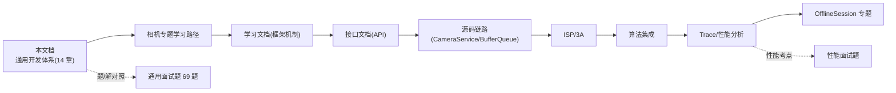

# 第 14 章 版本演进与生态

> 材料分层：A = 官方版本页（每行特性以官方 Features/Behavior changes 页为准），B = 生态通行认知。版本事实 2026-10 校准。↔ 通用题：综合题、版本相关。

## 14.1 Android 版本特性速查（App 开发视角）

| 版本 | API | 对 App 最相关的变化 |
|---|---|---|
| 10 | 29 | 深色主题、手势导航、Scoped Storage 起步、后台位置 |
| 11 | 30 | 包可见性、Scoped Storage 强制、权限自动重置、**离线会话（相机）**、bubble |
| 12 | 31/32 | Splash Screen API、PendingIntent 可变性强制、蓝牙权限拆分、通知 trampoline 限制、性能等级（Performance Class） |
| 13 | 33 | 通知权限、Photo Picker、主题图标、按应用语言、预测性返回（雏形） |
| 14 | 34 | FGS 类型强制、部分照片访问、注册广播导出性强制 |
| 15 | 35 | **targetSdk 35 强制 edge-to-edge**、私密空间、16KB 页对齐（native）、屏幕录制保护 |
| 16 | 36 | 预测性返回默认开启、自适应刷新率 API、加强的隐私选择（以官方页为准） |
| 17 | 37 | **大屏适配限制 opt-out 移除**（targetSdk 37 必须自适应布局）、后台音频行为变更、`MessageQueue` 无锁实现（性能优化） |

> 相机专项版本演进（Camera2/CameraX/Camera Extensions）见《Android_Camera_接口文档》第 1 章，此处不重复。

## 14.2 行为变更应对方法（官方方法论，A 层）

1. 读当版 [Behavior changes: all apps]（装上就生效）与 [behavior changes: apps targeting]（targetSdk 升级才生效）两页；
2. compileSdk 升到最新 + targetSdk 分两步走（先编译适配，再声明适配）；
3. 用兼容框架开关（`adb shell device_config` 可在调试设备上切换行为变更，回归验证）；
4. 低/新版本双真机回归（重点：权限/后台/前台服务/媒体）。

## 14.3 生态趋势（2026 视角，B 层）

- **Kotlin First**：K2 编译器默认（编译速度与 IDE 体验大幅提升）、新 API 以 Kotlin 文档优先；
- **Compose 默认 UI**：新项目模板默认 Compose；View 体系长期共存但进入维护心智；
- **KMP 主航道**：AGP 9.0 内置 Kotlin 支持 + Android KMP 库插件；Compose Multiplatform 覆盖桌面/iOS；
- **AI 辅助开发**：Android Studio 内置 Gemini（代码/错误解释/测试生成），已成默认工具链一部分；
- **性能要求制度化**：Performance Class 分级（R12+）、Vitals 影响搜索排名与分发权重——"性能即产品力"。

## 14.4 与本仓库文档的衔接

学习闭环建议：**先通用后专题**——本文打地基（组件/消息/渲染/协程/架构），再进相机专题（上面 C 链）；面试准备则"通用题集 + 相机题集"双线并行，答案均可回溯本文与专题文档。

↔ 通用题：全部板块（本文即题集的知识底座）。
