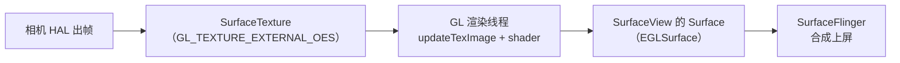

# Android Camera 追问链面试题（模拟真实面试节奏）

> 真实面试不是"一问一答"，而是面试官沿一个点**连续追问 3\~6 层**，直到你答不上来或触到原理底。本文把《Android\_Camera\_APP\_面试题》的核心考点重新组织成 **16 条追问链**：每条从开放题起手，逐层下潜（APP 层 → 框架层 → HAL/驱动层），标注每层考察的深度与常见"答断点"。
> 用法：自测时先只看链首问题，口头答完再展开下一层；`⏹` 是链底（多数候选人到此答不上）。难度：★\~★★★ 沿链递增。

## 目录

* [链 1：打开一台相机](#链-1打开一台相机)
* [链 2：预览是怎么显示出来的](#链-2预览是怎么显示出来的)
* [链 3：拍一张照片](#链-3拍一张照片)
* [链 4：点按对焦](#链-4点按对焦)
* [链 5：曝光与手动模式](#链-5曝光与手动模式)
* [链 6：ImageReader 与缓冲区](#链-6imagereader-与缓冲区)
* [链 7：CameraX 与 Camera2 选型](#链-7camerax-与-camera2-选型)
* [链 8：多摄像头](#链-8多摄像头)
* [链 9：变焦](#链-9变焦)
* [链 10：帧率上不去](#链-10帧率上不去)
* [链 11：YUV 格式与图像读取](#链-11yuv-格式与图像读取)
* [链 12：HAL3 请求模型](#链-12hal3-请求模型)
* [链 13：结果回程](#链-13结果回程)
* [链 14：3A 锁定与连拍一致性](#链-14-3a-锁定与连拍一致性)
* [链 15：暗光拍摄](#链-15暗光拍摄)
* [链 16：相机启动速度](#链-16相机启动速度)

***

## 链 1：打开一台相机

**Q：说说你们 App 打开相机的流程。** ★

→ 枚举 `getCameraIdList` + `LENS_FACING` 选 ID → 运行时权限 → `openCamera(id, callback, handler)` → `onOpened` 拿 CameraDevice 建会话。（答出五步主线即过，见 APP 题库 Q7。）

**追问 1：openCamera 是同步的吗？内部做了什么？** ★★

→ 异步回调；Java 层 `openCameraDeviceUserAsync` 先拿 `ICameraService` Binder 代理，调 `connectDevice`（带 cameraId 与回调接口），cameraserver 侧完成权限校验、优先级仲裁、创建 `CameraDeviceClient`（内含 Camera3Device）并打开 HAL，句柄回传后 APP 侧才回调 onOpened。

**追问 2：如果此时微信视频正在用相机，会发生什么？** ★★

→ 走优先级驱逐：CameraService 的 ClientManager 比较两个 client 的（state, score）——你前台新 client 分数高，旧 client 被断开收 `onDisconnected`；反之若你是后台打开，会收到 `onError(ERROR_CAMERA_IN_USE)` 或直接被拒。（答断点：只说"被抢占"，说不出谁踢谁的规则。）

**追问 3：onDisconnected 之后你怎么办？** ★★

→ 该设备实例不可再用（后续调用抛 IllegalStateException），应 `close()` 释放；结合产品逻辑监听 availability 回调，等相机重新 available 再走重开流程。close 的最终确认是 onClosed。

**追问 4：底层为什么设计成"APP 参数不可信"？** ⏹ ★★★

→ Binder 边界即安全边界：任何 App 都能构造任意参数调相机接口，CameraService 必须自己校验（权限、Surface、流参数）；而 CameraService→HAL 是下一段边界，HAL 收到的缓冲区长度/fence 同样要自行验证——"每段边界各自负责"是系统分层的信任模型。

***

## 链 2：预览是怎么显示出来的

**Q：预览画面从相机到屏幕，经过哪些环节？** ★★

→ 相机出帧（HAL 填缓冲）→ BufferQueue 交给消费端（SurfaceView 的 Surface / SurfaceFlinger 合成）→ 屏幕刷新。APP 侧只是把 Surface 配进会话，数据不过 App 手。

**追问 1：预览 Surface 你用什么控件提供？为什么？** ★★

→ 优先 SurfaceView：独立合成层、零拷贝直通；TextureView 是 View 树里的 GPU 纹理，支持动画变换但多一次上传、延迟功耗更高。（对照通用题库 Q20。）

**延伸：SurfaceView + OpenGL ES 2.0 做预览（可变换、可实时滤镜）** ★★★

只做"看到画面"时，相机直接输出到 SurfaceView 的 Surface 就是零拷贝最优解。但一旦需要**旋转/镜像/裁剪/透视校正**或**实时滤镜**，数据就必须经过 GPU：此时不能让相机直写 SurfaceView，而是让相机写 **SurfaceTexture（OES 外部纹理）**，再用 GL 渲染到 SurfaceView 的 Surface 上：



**具体流程（6 步）**

1. **SurfaceView 就绪**：`surfaceCreated` 回调拿到 `holder.getSurface()`，起一个专用 GL 线程（`HandlerThread("gl-preview")`），不要在相机回调线程里做 GL。
2. **初始化 EGL**：`eglGetDisplay → eglInitialize → eglChooseConfig（ES2 + WINDOW_BIT）→ eglCreateContext（EGL_CONTEXT_CLIENT_VERSION=2）→ eglCreateWindowSurface(holder.getSurface()) → eglMakeCurrent`。
3. **创建外部纹理与 SurfaceTexture**：`glGenTextures` 后用 `GL_TEXTURE_EXTERNAL_OES` 绑定，`new SurfaceTexture(texId)`；`setDefaultBufferSize(previewW, previewH)` 与相机输出尺寸一致；`setOnFrameAvailableListener(listener, glHandler)`。
4. **交给相机**：`cameraSurface = new Surface(surfaceTexture)`，作为预览流 target 配进会话。Camera2 是 `OutputConfiguration(cameraSurface)` + `preview.addTarget(cameraSurface)`；CameraX 是自定义 `Preview.setSurfaceProvider`，在 `provideSurface` 里交出这个 Surface（注意按 `SurfaceRequest.resolution` 设置 buffer 尺寸）。
5. **渲染循环（GL 线程）**：收到帧回调 → `updateTexImage()` 把相机帧更新到 OES 纹理 → `getTransformMatrix()` 拿相机裁剪/翻转矩阵 → 应用顶点变换（旋转/镜像/裁剪）→ 片元着色器采样并做滤镜 → `eglSwapBuffers` 上屏。
6. **释放**：相机先停流 → `cameraSurface.release()` → `surfaceTexture.release()` → `eglMakeCurrent(no-surface)` → 销毁 EGLSurface/Context → `glThread.quitSafely()`。`surfaceDestroyed` 与 `onPause` 都要走这条路，否则重建后是黑屏/泄漏。

**关键代码骨架（Java）**

```java
// —— 初始化（GL 线程上执行）——
EGLDisplay display = EGL14.eglGetDisplay(EGL14.EGL_DEFAULT_DISPLAY);
EGL14.eglInitialize(display, new int[2], 0, new int[2], 1);
int[] cfgAttrs = {
    EGL14.EGL_RENDERABLE_TYPE, EGL14.EGL_OPENGL_ES2_BIT,
    EGL14.EGL_SURFACE_TYPE, EGL14.EGL_WINDOW_BIT,
    EGL14.EGL_RED_SIZE, 8, EGL14.EGL_GREEN_SIZE, 8,
    EGL14.EGL_BLUE_SIZE, 8, EGL14.EGL_ALPHA_SIZE, 8, EGL14.EGL_NONE };
EGLConfig[] configs = new EGLConfig[1]; int[] num = new int[1];
EGL14.eglChooseConfig(display, cfgAttrs, 0, configs, 0, 1, num, 0);
EGLContext ctx = EGL14.eglCreateContext(display, configs[0], EGL14.EGL_NO_CONTEXT,
    new int[]{ EGL14.EGL_CONTEXT_CLIENT_VERSION, 2, EGL14.EGL_NONE }, 0);
EGLSurface eglSurface = EGL14.eglCreateWindowSurface(display, configs[0],
    holder.getSurface(), new int[]{ EGL14.EGL_NONE }, 0);
EGL14.eglMakeCurrent(display, eglSurface, eglSurface, ctx);

// 外部纹理 + SurfaceTexture（供相机写）
int[] tex = new int[1];
GLES20.glGenTextures(1, tex, 0);
GLES20.glBindTexture(GLES11Ext.GL_TEXTURE_EXTERNAL_OES, tex[0]);
GLES20.glTexParameteri(GLES11Ext.GL_TEXTURE_EXTERNAL_OES,
    GLES20.GL_TEXTURE_MIN_FILTER, GLES20.GL_LINEAR);
GLES20.glTexParameteri(GLES11Ext.GL_TEXTURE_EXTERNAL_OES,
    GLES20.GL_TEXTURE_MAG_FILTER, GLES20.GL_LINEAR);
SurfaceTexture st = new SurfaceTexture(tex[0]);
st.setDefaultBufferSize(previewW, previewH);
st.setOnFrameAvailableListener(frame -> glHandler.post(this::drawFrame), glHandler);
Surface cameraSurface = new Surface(st);   // 交给相机做预览输出

// —— 每帧绘制 ——
void drawFrame() {
    st.updateTexImage();                       // 相机帧 → OES 纹理
    st.getTransformMatrix(texMatrix);          // 相机侧裁剪/翻转
    // uMvp: 旋转（SENSOR_ORIENTATION + 屏幕旋转）/镜像（前置）/裁剪（数字变焦）
    GLES20.glUniformMatrix4fv(uMvpLoc, 1, false, mvp, 0);
    GLES20.glUniformMatrix4fv(uTexMatrixLoc, 1, false, texMatrix, 0);
    GLES20.glUniform1f(uGrayLoc, grayLevel);   // 滤镜参数
    GLES20.glDrawArrays(GLES20.GL_TRIANGLE_STRIP, 0, 4);
    EGL14.eglSwapBuffers(display, eglSurface);
}
```

顶点着色器（变换都在这层做）：

```glsl
attribute vec4 aPosition;
attribute vec4 aTexCoord;
uniform mat4 uMvp;        // 旋转/镜像/裁剪矩阵
uniform mat4 uTexMatrix;  // getTransformMatrix 得到的纹理矩阵
varying vec2 vTexCoord;
void main() {
    gl_Position = uMvp * aPosition;
    vTexCoord = (uTexMatrix * aTexCoord).xy;
}
```

片元着色器（示例：灰度滤镜，改成其它 kernel 即实时滤镜）：

```glsl
#extension GL_OES_EGL_image_external : require
precision mediump float;
varying vec2 vTexCoord;
uniform samplerExternalOES uTexture;
uniform float uGray;      // 0=原图，1=全灰
void main() {
    vec3 rgb = texture2D(uTexture, vTexCoord).rgb;
    float gray = dot(rgb, vec3(0.299, 0.587, 0.114));
    gl_FragColor = vec4(mix(rgb, vec3(gray), uGray), 1.0);
}
```

**能力边界与注意点**

* **能做**：预览旋转/镜像（顶点矩阵）、裁剪与数字变焦（纹理坐标或顶点缩放）、透视校正、任意片元着色器滤镜（灰度/反色/锐化/美颜/贴纸）；多 pass 滤镜用 FBO ping-pong。
* **YUV 转换免费**：采样 `samplerExternalOES` 时 GPU 自动完成 YUV→RGB（外部纹理的硬件路径），滤镜在 RGB 域做即可。
* **拍照与滤镜的关系**：GL 只影响预览；要"滤镜照"，拍照走 ImageReader 拿原图后在 GPU 上复渲染，或渲染到 FBO 再用 PBO 回读——**不要在预览循环里每帧 `glReadPixels`**（同步阻塞，必掉帧）。
* **性能**：1080p 单 pass 滤镜开销很低；预览尺寸 = SurfaceTexture buffer = 相机输出尺寸，避免多余缩放；渲染线程独立，不阻塞相机回调。
* **替代方案**：不想手写 EGL 就用 `GLSurfaceView`（本质是 SurfaceView + 内置 GL 线程）；TextureView + GL 也能做，但多一次纹理上传，延迟与功耗更高。

**追问 2：BufferQueue 的生产者消费者是谁？缓冲区怎么流转？** ★★★

→ HAL（经 CameraService 转发）是生产方，SurfaceFlinger/编码器是消费方；空闲缓冲被消费者出队→生产方填充（等 acquire fence）→入队→消费（等 release fence）→释放回环。配流时按 max buffers 预分配。

**追问 3：预览为什么会卡？你排查过吗？** ★★

→ 分四类：输出配置问题（尺寸过大/JPEG stalling 流混入）、帧时长（暗光长曝光超帧间隔）、缓冲（消费端不归还）、线程（回调 Handler 阻塞）。工具：dumpsys media.camera + perfetto。（APP 题库 Q36。）

**追问 4：帧到 SurfaceFlinger 之后怎么上屏的？VSync 起什么作用？** ⏹ ★★★

→ 图层（Layer）经 BLASTBufferQueue 提交事务，SurfaceFlinger 按 VSync 节拍合成（GPU 合成或硬件 overlay 叠层）送显；VSync 同步了"渲染-合成-送显"三级流水，相机预览的每一帧也要跟上这个节拍，掉拍即掉帧。

***

## 链 3：拍一张照片

**Q：描述你们的拍照流程。** ★

→ 预览 repeating 基础上发单次 `capture()`（TEMPLATE\_STILL\_CAPTURE，target 是 JPEG ImageReader 的 Surface），回调里等 onCaptureCompleted，ImageReader 收图保存，最后恢复 repeating。（可展开 APP 题库 Q57 骨架。）

**追问 1：拍照前为什么要发 precapture？不发会怎样？** ★★★

→ 高品质静帧需要 AE 先收敛（尤其闪光场景要先预闪测光）；流程 `AE_PRECAPTURE_TRIGGER_START` → 状态到 PRECAPTURE → 等结果里 `AE_STATE` 为 CONVERGED/FLASH\_REQUIRED → 再发拍照请求。不发：暗光/闪光场景出片曝光错、忽明忽暗。

**追问 2：precapture 期间连续发了多个请求，结果怎么对应？** ★★★

→ 每个请求有 frameNumber，结果按帧回（同帧同时间戳）；precapture 触发键本身也是随请求下发的——HAL 按 FIFO 作用在"触发之后的帧"上；所以判断收敛要轮询的是**结果元数据的状态**，不是发完触发就同步生效。

**追问 3：拍照出来的 JPEG 旋转是怎么来的？** ★★

→ 传感器物理安装角（`SENSOR_ORIENTATION`）+ 设备当前旋转 → 算 `JPEG_ORIENTATION` 下发，HAL/编码时旋转像素并写 EXIF；预览方向由显示端 transform 处理。前置镜像靠 EXIF orientation 表达，不自己翻像素。（APP 题库 Q58。）

**追问 4：同一请求能同时出 JPEG 和 RAW 吗？约束是什么？** ⏹ ★★★

→ 能：请求 target 同时加 RAW\_SENSOR 与 JPEG 两个 Surface（一个请求多输出，同帧同时间戳）；约束是流组合必须在保证列表内（RAW 属于 LEVEL\_3 能力），且 RAW 流的尺寸是 sensor 原生分辨率，组合带宽与 ISP 资源要够。

***

## 链 4：点按对焦

**Q：用户点了一下屏幕，你做什么？** ★

→ 把点击坐标换算成 sensor 坐标（metering region，活动阵列 0\~1000 坐标系 + 方向换算）→ `AF_MODE=AUTO` + `AF_TRIGGER_START` 下发 → 轮询结果 `AF_STATE` → FOCUSED\_LOCKED 后可拍照。（APP 题库 Q24/Q25。）

**追问 1：AF\_TRIGGER 是作用在哪一帧上的？** ★★★

→ 触发随请求进入 FIFO，作用在**该请求之后的帧**（一般下一帧进入 ACTIVE\_SCAN）；所以标准做法是 repeating 请求带 trigger 发一次，后续 repeating 不再带（trigger 是边沿语义不是电平语义）。

**追问 2：状态机里 PASSIVE 和 ACTIVE 的区别？** ★★

→ PASSIVE\_\* 是连续对焦模式的被动扫描/聚焦态（CONTINUOUS\_PICTURE/VIDEO 下持续跑）；ACTIVE\_SCAN 是触发式主动扫描（AUTO 模式 + trigger）。预览走 passive，点按后混用：先 trigger 转 active，锁定后可回 passive。

**追问 3：底层 PDAF 和反差对焦怎么配合的？** ★★★

→ PDAF 用相位差一步算出离焦量直接推镜头（快、暗光/弱纹理失效），CDAF 爬山搜锐度峰（准、慢、拉风箱）；实际是混合：PDAF 粗调 + CDAF 微调，按 PDAF 置信度加权。（ISP 题库 Q52/Q33。）

**追问 4：对焦一直拉风箱，你怎么定位是 App 的问题还是设备的问题？** ⏹ ★★★

→ 先排除 App 层：坐标换算是否错（方向/区域写错会反复触发错误搜索）、是否频繁重发 trigger 打断扫描；再看设备层：弱纹理/暗光场景本来置信度低（换高对比场景验证）、`cmd media.camera watch` 盯 afState 迁移是否在 SCAN↔UNFOCUSED 振荡——振荡且场景正常则 HAL/算法侧问题。

***

## 链 5：曝光与手动模式

**Q：AE 自动曝光收敛到什么目标？能干预吗？** ★★

→ 收敛到目标亮度（分区加权均值），App 能干预：曝光补偿 `AE_EXPOSURE_COMPENSATION`（步进）、测光区域 `AE_REGIONS`；参考 APP 题库 Q26 状态机。

**追问 1：曝光补偿的步进哪来的？** ★★

→ `CONTROL_AE_COMPENSATION_STEP`/`RANGE`（characteristics 查询），App 把"用户 EV 滑条"量化到步进档位——不是连续值，UI 要按 step 取整。

**追问 2：手动曝光怎么设？有哪些 Key？** ★★

→ `CONTROL_AE_MODE=OFF` + `SENSOR_EXPOSURE_TIME`（ns）+ `SENSOR_SENSITIVITY`（ISO），范围查 `SENSOR_INFO_*_RANGE`；实际生效值以 result 为准（HAL 可能因约束微调）。（APP 题库 Q29。）

**追问 3：曝光时间和帧率什么关系？为什么手动拉长曝光帧率会掉？** ★★★

→ 曝光时间 ≤ 帧时长（frame duration）：30fps 帧时长 33ms，曝光拉到 50ms 则帧率上限 20fps——读出与曝光不能超帧间隔；AE 自动模式下 `AE_TARGET_FPS_RANGE` 会反过来约束曝光上限，暗光下"要么长曝降帧、要么加增益增噪"。

**追问 4：增益的模拟/数字之分？AE 怎么拆分？** ⏹ ★★★

→ 模拟增益在电荷/模拟域放大（SNR 损失小优先用），数字增益 ADC 后乘系数（噪声一起放大，兜底用）；AE 曝光表策略：先拉曝光时长（到帧时长约束）→ 加模拟增益（到上限）→ 最后数字增益。（ISP 题库 Q50。）

***

## 链 6：ImageReader 与缓冲区

**Q：你们的分析流怎么收帧的？** ★

→ `ImageReader.newInstance(w, h, YUV_420_888, maxImages)`，`getSurface()` 配进会话，listener 里 `acquireLatestImage()` 取帧处理，**用完 close()**。

**追问 1：acquireLatestImage 和 acquireNextImage 用哪个？** ★

→ 实时分析用 latest（丢旧帧防积压）；连拍/不可丢帧用 next + maxImages 背压。（APP 题库 Q14。）

**追问 2：Image 不 close 会怎样？为什么？** ★★

→ 缓冲区耗尽，HAL 无空缓冲可填，供流停摆、预览卡死；因为缓冲池有限（maxImages + 流 max buffers），close 才是"归还给 BufferQueue"的动作。

**追问 3：maxImages 设很大有什么代价？** ★★

→ 内存线性增长（每缓冲 = 宽×高×格式位深），且加剧"处理慢→积压→延迟"问题；正确做法是小 maxImages + latest 丢帧策略。

**追问 4：Android 10 之后框架引入了什么机制优化这块？** ⏹ ★★★

→ HAL 缓冲区管理 API（requestStreamBuffers/returnStreamBuffers/signalStreamFlush）：从"框架按峰值预分配"改为"HAL 按需申请归还"，降峰值内存；代价是 HAL 实现复杂度。（系统题库 Q21，APP 题库 Q38。）

***

## 链 7：CameraX 与 Camera2 选型

**Q：你们项目用 CameraX 还是 Camera2？为什么？** ★

→ 按需求：常规预览拍照录像扫码 → CameraX（生命周期安全、兼容性、开发效率）；逐帧控制/多 Surface 编排/reprocess/高速连拍 → Camera2。（APP 题库 Q19。）

**追问 1：CameraX 是新框架吗？它和 HAL 什么关系？** ★★

→ 不是：Jetpack 库，默认实现就是 Camera2（camera-camera2），最终走同一套 framework→HAL 链路；只是把生命周期/兼容/用例抽象包掉了。

**追问 2：用 CameraX 时怎么下发 Camera2 独有的参数？** ★★

→ `Camera2Interop.Extender`（Builder 期注入 CaptureRequest 键值）+ `Camera2CameraControl.setCaptureRequestOptions()`（运行时）；读底层信息用 `Camera2CameraInfo`。

**追问 3：CameraX 的分辨率协商规则？三个用例冲突怎么办？** ★★

→ 优先级 ImageCapture > Preview > ImageAnalysis；bindToLifecycle 时按能力表与优先级选各用例尺寸；同时最多绑 3 个用例，冲突解不了会抛异常（需减用例或降档）。

**追问 4：Preview 的 Surface 是怎么给到 CameraX 的？不提供会怎样？** ⏹ ★★★

→ `Preview.setSurfaceProvider` 回调 `SurfaceRequest`，App 提供 Surface（通常 PreviewView\.surfaceProvider 一行）；不打算提供必须 `request.close()`，否则 CameraX 一直等 Surface、相机不启动——这是集成时最经典的卡死点。（APP 题库 Q20。）

***

## 链 8：多摄像头

**Q：一台手机四五个摄像头，框架怎么组织的？** ★★

→ 每个物理头一个 cameraId；支持逻辑多摄的机型另有一个**逻辑相机**（`LOGICAL_MULTI_CAMERA` 能力）聚合多个物理头，`PHYSICAL_IDS` 列出成员；App 通常打开逻辑相机。

**追问 1：逻辑相机的流和物理相机的流什么关系？** ★★★

→ 逻辑相机 session 可同时配置逻辑流与物理流（`OutputConfiguration.setPhysicalCameraId()`）：逻辑流是融合后的输出（自动镜头切换），物理流直接来自指定物理头（用于双摄深度/Bokeh 等自研融合）；物理流的元数据带在各物理 result 里。

**追问 2：镜头切换时画面怎么做到无缝？** ★★

→ 框架/HAL 负责切换时的曝光与色彩匹配（逻辑相机的保证），变焦经过切换点由 `ZOOM_RATIO` 连续驱动；App 侧要处理的是切换瞬间的平滑 UI（倍率显示）与可能的帧率波动。

**追问 3：前后同时开怎么做？** ★★★

→ `getConcurrentCameraIds()` 查保证并发组合 → 分别 openCamera 各建会话；组合限制（强制并发流组合，低分辨率）是硬件 ISP/MIPI 资源决定的。（APP 题库 Q61。）

**追问 4：并发时两个相机的 3A 会互相影响吗？** ⏹ ★★★

→ 各自独立 3A 状态（每设备一套），但 ISP 资源共享可能约束帧率/降噪档位；多摄**同步**（SYNC\_MAX\_LATENCY）解决的是帧对齐不是 3A 联动——同步曝光用于融合，异步时两个流时间戳可漂移。（ISP 题库 Q35。）

***

## 链 9：变焦

**Q：数字变焦怎么实现的？** ★★

→ `CONTROL_ZOOM_RATIO`（Android 11+，推荐）或 `SCALER_CROP_REGION` 裁剪传感器区域 + 放大输出；上限查 `SCALER_AVAILABLE_MAX_DIGITAL_ZOOM`。（APP 题库 Q32。）

**追问 1：CROP\_REGION 的坐标系是什么？多流共享吗？** ★★

→ active array 坐标系（`SENSOR_INFO_ACTIVE_ARRAY_SIZE` 像素坐标，可映射到 0\~1000 的 metering 坐标）；同一请求的多个输出流共享同一 crop（各自缩放到自己分辨率）。

**追问 1.5：为什么有了 CROP\_REGION 还要造 ZOOM\_RATIO？** ★★★

→ crop region 难用且易错（坐标换算、与测光区联动、逻辑多摄切换表达不了）；zoom ratio 语义直白（2.0 = 两倍），框架换算成 crop 或镜头切换，且与多摄联动（跨过切换点自动切物理头）。

**追问 2：变焦过程中画面会模糊一下再清晰，为什么？** ★★★

→ 切换点附近：数字放大先生效（分辨率损失瞬态模糊）→ 物理镜头切换（光学画质量恢复）；另外 AE 在切换瞬间重新匹配亮度可能有跳变——逻辑相机已尽量匹配，但极限场景（大倍率暗光）仍有可见过渡。

**追问 3：平滑变焦的 API 层面怎么做？** ⏹ ★★★

→ 没有原生 ramp API（对比 iOS 的 ramp(toVideoZoomFactor:)）；App 层自己插值（每帧/每几帧步进 zoom ratio，或用 ValueAnimator 驱动），注意步进频率过高会频繁触发流重配置类工作的风险（zoom 不重配流，但 HAL 内部 resize 有成本）。

***

## 链 10：帧率上不去

**Q：用户反馈预览卡顿/只有 20fps，怎么排查？** ★★

→ 四查：输出配置（尺寸/格式/组合）、帧时长约束（暗光长曝光）、缓冲区（Image 未 close/消费慢）、线程（回调阻塞）；工具 dumpsys + perfetto。（APP 题库 Q36。）

**追问 1：暗光下帧率为什么必然掉？机制是什么？** ★★★

→ 帧时长 = max(曝光时间 + 读出时间, 设定帧间隔)；AE 为亮度把曝光拉长（如 50ms），帧率上限 = 1000/50 = 20fps；`AE_TARGET_FPS_RANGE` 决定 AE 在"保帧率（提增益增噪）"与"保画质（降帧率）"间的取舍。

**追问 2：FPS range 是 \[a,b] 区间，设 \[30,30] 意味着什么？** ★★

→ 锁 30fps：AE 被强制把曝光钳在帧间隔内（不够亮就加增益）；代价是暗光噪点暴增。设 \[10,30] 则允许 AE 暗光降帧。录像防抖通常锁下限。

**追问 3：120/240fps 高帧率为什么是专用会话？** ★★★

→ CONSTRAINED\_HIGH\_SPEED\_VIDEO 能力 + `CameraConstrainedHighSpeedCaptureSession`：高速模式锁 3A、只允许预览+录像两路、固定尺寸帧率组合——因为曝光被压到毫秒级、ISP 后处理预算不足，必须跳过部分处理级。（APP 题库 Q40，系统题库 Q23。）

**追问 4：高速录像和"普通录像抽帧做慢放"效果差在哪？** ⏹ ★★★

→ 采样时刻：240fps 是每 4.2ms 实拍一帧（运动连续、无运动模糊突跳），抽帧是 30fps 实拍（帧间 33ms，慢放时插值/重复帧，运动跳跃）；且高速模式曝光短、单帧"凝固"感强。

***

## 链 11：YUV 格式与图像读取

**Q：YUV\_420\_888 是什么？为什么分析流用它？** ★

→ 通用 YUV 4:2:0 半平面语义格式（Y/U/V 三 plane，色度减半），ISP 原生输出、算法/编码器直接吃；它是**语义约定**不是内存布局——具体 stride 由实现定。（APP 题库 Q34。）

**追问 1：读 Image 的 Y 平面代码怎么写？rowStride 和 pixelStride 什么用？** ★★

→ 按 plane 逐行读：`plane.buffer.position(row * rowStride + col * pixelStride)`；rowStride 是行字节数（含对齐 padding），pixelStride 是相邻像素间距（色度平面常为 2，交织 UV）。直接按紧凑数组读必然花屏。

**追问 2：为什么不同厂商 stride 不一样？** ★★★

→ 硬件对齐要求：ISP/总线带宽按 16/64 字节对齐、缓存行、多平面 tile 布局——格式只约束采样语义，布局自由度留给实现；所以任何"假设连续内存"的代码在某些机型必炸。

**追问 3：YUV 转 Bitmap/NV21 怎么做才不踩坑？** ★★

→ 手动按 stride 拷三个 plane 到紧凑缓冲（NV21 需 VU 交织）再 `YuvImage` 或 RenderScript/rangement 替代品；或直接 `ImageToBitmap` 库；坑点：色度 plane 交织与否（buffer 里 UV 交替时 pixelStride=2，两个 plane 指向同一 buffer 的不同偏移）。

**追问 4：能不能直接把 YUV 流给编码器，不转格式？** ⏹ ★★★

→ 能：MediaCodec 的 Surface 输入模式吃 `COLOR_FormatSurface`，把 ImageReader 换成编码器 Surface（PRIV 流），零拷贝；代价是拿不到中间帧（要处理又要编码就得两路流或 PRIV→YUV 分叉）。

***

## 链 12：HAL3 请求模型

**Q：HAL3 的管道模型是什么？和 HAL1 区别？** ★★

→ 请求/结果管道：每请求 1:1 出帧、流预配置、逐帧全参数控制；HAL1 是黑盒三模式。Treble 后 HAL 走 HIDL/AIDL 独立进程。（APP 题库 Q3。）

**追问 1：请求进 HAL 之后必须按什么顺序处理？为什么？** ★★★

→ FIFO 按提交顺序处理（官方协议强制）——因为 App 语义依赖顺序（precapture 先于拍照、3A 触发顺序）；HAL 内部可以并行流水，但**帧结果语义上按序**。

**追问 2：在途请求数量由什么限制？超了会怎样？** ★★★

→ pipeline depth（`REQUEST_PIPELINE_MAX_DEPTH`，典型 4\~8）+ 每流缓冲数；超限框架会拒绝提交或阻塞（RequestThread 队列积压）。拍照延迟下限 = pipeline depth × 帧间隔。（系统题库 Q15。）

**追问 3：为什么不无限加深流水线？** ★★★

→ 每级占缓冲与存储（RAW/YUV 各级缓存）、延迟线性上升（结果滞后）、功耗与内存代价；"深"只在 ZSL 类场景有价值（预缓冲命中跳过等待）。

**追问 4：capture() 的单次请求为什么会"插队"？** ⏹ ★★★

→ 不是插队：repeating 请求是"队列里始终保活的一份模板"，单次请求提交后排在当前 repeating 之后、下一轮 repeating 之前——语义上"下一个周期生效"，所以拍照参数（STILL\_CAPTURE 模板）能立刻作用于紧随其后的帧，看起来像插队。（APP 题库 Q10。）

***

## 链 13：结果回程

**Q：onCaptureCompleted 的结果是从哪来的？** ★★

→ HAL 经 `processCaptureResult` 回传元数据+缓冲 → CameraService 按 frameNumber 匹配 in-flight 请求 → 组装 TotalCaptureResult → Binder/FMQ 回 App → CaptureCallback。

**追问 1：partial result 是什么？为什么存在？** ★★★

→ 一帧元数据可拆多次回（3A 状态先回、重统计后回），框架累积成 Total 才回调 completed；中间态经 onCaptureProgressed 暴露。动机：3A 早回让上层早响应。（APP 题库 Q44，系统题库 Q16。）

**追问 2：notify 通道除了 SHUTTER 还有什么？** ★★★

→ ERROR 消息（ERROR\_REQUEST/ERROR\_RESULT/ERROR\_BUFFER 分级：请求级丢弃/结果丢弃/单缓冲丢弃）；SHUTTER 带 frameNumber + 时间戳，是"这帧真实曝光了"的权威信号。

**追问 3：元数据回传用什么传输？为什么？** ★★★

→ AIDL/HIDL 下走 FMQ（共享内存 + 轻量 Binder 通知），元数据数 KB 且 60fps 高频，纯 Binder 双拷贝扛不住——控制面 Binder、数据面共享内存。（系统题库 Q5。）

**追问 4：如果 HAL 少回了一个结果会怎样？** ⏹ ★★★

→ in-flight 表里该 frameNumber 悬挂：缓冲被占（可能拖垮流）、App 回调缺失；框架有超时清理与 watchdog 兜底（ERROR\_DEVICE 级自愈），但合规 HAL 必须对每个请求回 result 或 error——这是 ITS/VTS 的硬性验证项。

***

## 链 14：3A 锁定与连拍一致性

**Q：连拍一组照片，怎么保证曝光白平衡一致？** ★★

→ 起拍前锁 3A：`AE_LOCK`/`AWB_LOCK`（AF 等状态 FOCUSED\_LOCKED），整组请求同一参数；连拍用 burst capture() 序列。（APP 题库 Q28。）

**追问 1：AE\_LOCK 和 AE\_MODE=OFF 有什么区别？** ★★

→ lock：冻结当前**自动收敛值**（HAL 维持该曝光，场景变化不动）；OFF：完全手动，参数必须自己填。lock 语义轻、随时可解锁回自动，是连拍首选。

**追问 2：全景扫描（镜头移动中连拍）为什么要锁 AWB？** ★★★

→ 不锁则 AWB 随场景色温逐帧调整（进暖光区偏黄、出冷光区偏蓝），拼接后同全景色彩断裂；锁死后由拼接算法统一色校正。同理 HDR 包围曝光也锁 AE。

**追问 3：锁定期间画面突然变亮/变暗怎么办？** ★★

→ 锁定本质是冻结，场景剧变会过曝/欠曝；产品上给"自动重新收敛"出口（解锁重收敛再锁），或检测 result 的 `AE_STATE` 与亮度统计做智能重锁。

**追问 4：录像变焦时你说要锁 AE，但夜录变焦呢？** ⏹ ★★★

→ 权衡：锁 AE 防亮度跳变，但变焦进暗区画面全黑；进阶做法是**限制收敛速率**（厂商 vendor tag 或 AE compensation 渐变）而非硬锁——对齐 iOS 侧 ramp 变焦 + AE 匹配的系统行为（iOS 无此纠结，系统托管匹配）。

***

## 链 15：暗光拍摄

**Q：暗光拍照为什么又慢又差？** ★★

→ 慢：AE 拉长曝光（帧率降）+ precapture 多帧 + 夜景模式多帧合成耗时；差：增益抬升噪声、噪点进 JPEG、色彩漂移（AWB 暗光不稳）。

**追问 1：从元数据层面你怎么"证明"是增益问题？** ★★★

→ 读 result 的 `SENSOR_SENSITIVITY`（ISO 飙到上限区间）、`SENSOR_EXPOSURE_TIME`（拉长）、`SENSOR_NOISE_PROFILE`（噪声系数随增益的模型）——三者合起来定量解释画质；对照 characteristics 的范围看余量。

**追问 2：你们能做什么改善？**（开放） ★★

→ App 层：提示稳定拍摄、夜景多帧自研（ImageReader YUV 连拍 + 对齐融合）、限制 ISO 上限换更长曝光（需稳定支撑）；系统侧：OEM 夜景扩展（`EXTENSION_NIGHT`）、tuning 侧的暗光 AE 策略。

**追问 3：夜景模式的"多帧合成"和 HDR 的多帧合成区别？** ★★★

→ 目标不同：HDR 合成解决**动态范围**（不同曝光包围），夜景合成解决**信噪比**（同曝光多帧平均去噪，N 帧平均噪降 √N）；实现共通点：都需要对齐（手抖补偿/ISP 时间滤波）与鬼影抑制（运动区域检测）。

**追问 4：为什么夜景模式拍运动物体会有鬼影？帧间对齐原理？** ⏹ ★★★

→ 全局对齐（陀螺仪/特征点单应变换）只补**相机自身运动**，物体自身运动对不齐——融合时运动区域要么选参考帧（鬼影变重影抑制）要么加权丢弃；算法在"去噪强度 vs 鬼影"间权衡，这是各家夜景质量分化的核心点。

***

## 链 16：相机启动速度

**Q：相机 App 首帧慢（点图标到看到预览 1.5s+），怎么优化？** ★★★

→ 分段度量（冷启动→onOpened→onConfigured→首帧 onCaptureStarted）逐段压：提前枚举设备、权限预申请、Application 减负、小尺寸首会话快速出帧、会话参数预热、专用回调线程。（APP 题库 Q65。）

**追问 1：哪一段通常最耗时？为什么？** ★★★

→ configureStreams（HAL 配流，大流组合数百 ms）与 provider 冷启动（进程首次绑定 + sensor 上电）；前者靠"先小流后大流"两段式（或 session reconfig 特性）压缩，后者是系统级成本（后台保活受限后首次更慢）。

**追问 2：两段式会话（先小预览再补大流）为什么能更快？有代价吗？** ★★★

→ 首会话只配小预览流（HAL 配流耗时随流数/尺寸暴涨），出帧后再重建全量会话；代价：重建期间预览中断一瞬 + 二次 configureStreams 成本仍要付（只是挪到首帧后），用户感知"先见到画面"就赢了。

**追问 3：打开快但"对焦清楚"慢，算启动问题吗？怎么优化？** ★★

→ 体验上是（用户等的是"可拍"）：首帧后 3A 冷启动（AF 首次扫描 + AE 收敛）占大头；优化：ZSL 思路（预缓冲已收敛帧）、进相机即起 continuous AF、`AF_REGIONS` 先中心加权。

**追问 4：系统层面还能怎么压？** ⏹ ★★★

→ Baseline Profile 提前编译关键路径（相机 App 收益显著，见通用题库 Q41）；相机专用：与系统团队对齐 provider 保活策略、MULTI\_CAMERA 预热、Android 15 的 `CameraDeviceSetup` 在建会话前离线查询组合合法性避免试错往返。

***

> 使用建议：每条链自测时录音回听，统计"答断点"集中在哪一层（App 层断 → 补 API 题库；框架层断 → 补《源码链路文档》；HAL/ISP 层断 → 补《ISP\_3A文档》对应章）。链底 ⏹ 问题能答出的，基本达到 senior 相机工程师水准。
