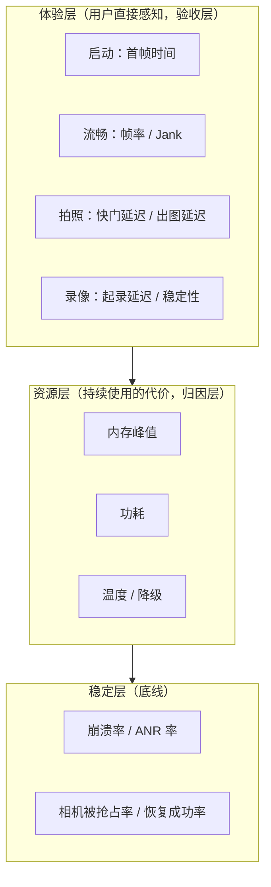

# 第 1 章 指标体系与性能预算

> 本文为分章源文件，供单章阅读；若与主文档不一致，以主文档最新版为准。
>
> 性能工程的第一块基石不是工具，是**指标**。本章回答四个问题：相机 App 应该有哪些指标、每个指标的精确起止点是什么、指标之间怎么组织、预算（红线）怎么定。来源标注：A = Android/Perfetto 官方文档；B = 公开通行实践；C = 行业经验（口径不一，仅供参考）。

## 1.1 为什么指标先行：一个常见的事故模型

没有统一定义的指标体系，性能工作会陷入三个典型陷阱：

1. **口径分裂**：A 团队把"启动完成"记为 `onOpened`，B 团队记为画面上屏——两边数据永远对不上，优化收益无法验收；
2. **均值掩盖长尾**：首帧平均 600ms 看起来达标，但 p95 是 1.8s——低端机用户的真实体验完全不同，而差评恰恰来自他们；
3. **局部最优**：出图延迟优化了 200ms，但快门延迟劣化了 150ms——用户感知是"更难拍"，指标体系如果没有拆分，这类此消彼长根本看不见。

所以指标体系的三个设计原则：**起止点写清楚、分位数必看、体验层指标验收**（资源层是因，体验层是果，向产品汇报以体验层为准）。

## 1.2 指标体系总览

按用户感知分三层（B 层通行做法）：

每层的"消费者"不同，决定了呈现方式不同：体验层给产品（决定预算与验收）、资源层给工程（归因与优化）、稳定层给质量与商店（Vitals 红线）。三层之间的因果链是分析的路径——例如"体验层首帧 p95 超标 → 资源层看该机型是否低内存导致配流慢 → 定位到具体段"。

## 1.3 启动指标：首帧时间的完整定义

**定义**：首帧 = 预览画面第一帧**真正上屏**的时刻。精确起止点用七个打点表达（t0~t6，与第 3 章优化、第 8 章埋点一一对应）：

| 打点 | 时刻 | 期间发生了什么 |
|---|---|---|
| t0 | 用户点图标/进相机页 | — |
| t1 | `openCamera()` 调用发起 | Activity 创建、View 树构建、Surface 申请、权限检查 |
| t2 | `onOpened` 回调 | Binder 往返 + CameraService 仲裁 + provider 打开设备（sensor 上电等） |
| t3 | `createCaptureSession` 发起 | — |
| t4 | `onConfigured` 回调 | HAL `configureStreams`：流协商 + 缓冲分配 |
| t5 | 首帧 `onCaptureStarted` | 首个请求下发 + 曝光（含 1~3 个帧间隔的流水线填充） |
| t6 | 首帧上屏 | 图像经 BufferQueue → SF 合成 → 送显（FrameTimeline 的实际呈现时刻） |

**首帧 = t6 - t0**。三个最常见的口径错误：把 t2 当完成（还差配流与两帧）、把 t5 当完成（还差合成送显）、忘了 t0 之前可能还有权限弹窗（必须前置，见第 3 章）。

三种启动态分开统计（瓶颈完全不同，优化手段也不同）：

| 启动态 | 路径 | 典型瓶颈 | 健康目标（C 层经验值，仅参考） |
|---|---|---|---|
| 冷启动 | 进程被杀后启动，t0~t6 全走 | 进程/Application 初始化、provider 冷启动、完整配流 | 中端机 p95 ≤ 800ms~1s |
| 温启动 | 进程在、Activity 重建 | 相机链路全走（open→配流→首帧） | 冷启动的 60~70% |
| 热启动 | 后台返回、会话保留 | 只需恢复请求（t4'→t6'） | ≤200~300ms |

**行业 KPI 术语**（C 层，各家口径略有差异，面试/跨团队沟通先对齐定义）：

- **TTFF（Time to First Frame）**：≈ 上文的 t6-t0；
- **Time to First Shot**：启动到**第一张照片可拍出**（含 3A 就绪），比 TTFF 苛刻——"打开就能拍"才是用户心智，建议与 TTFF 并列立项（第 5 章）；
- 系统级对标：Android 官方 **TTID/TTFD**（Time To Initial/Full Display，[Macrobenchmark `StartupTimingMetric`](https://developer.android.com/reference/androidx/benchmark/macrobenchmark/StartupTimingMetric) 的口径，A 层）度量的是 Activity 首帧，**不含相机管线**——相机 App 报系统启动数据时必须说明这个差异。

## 1.4 流畅与拍照指标

**流畅性**的三个口径要分开（它们来自不同管线）：

| 口径 | 测什么 | 工具 |
|---|---|---|
| 相机出帧率 | HAL 出帧节奏（`onCaptureStarted` 间隔） | 相机埋点 |
| UI 渲染帧率 | View 体系帧（设置页、面板等） | JankStats/FrameMetrics |
| 端到端 | 场景变化到屏幕呈现 | 时间戳差值/高速摄像（第 2 章 2.6） |

为什么分开：预览走 SurfaceView 独立合成层**不经过 View 渲染管线**（第 4 章），JankStats 测不到预览掉帧；反过来相机出帧正常但 UI 卡顿也会被用户骂"卡"——两个数据合在一起就会互相污染。

**官方帧指标定义**（A 层，[Android Vitals](https://developer.android.com/topic/performance/vitals)）：

- **Slow frames**：单帧渲染超过 16ms（约一个 60Hz 刷新周期）；
- **Frozen frames**：单帧超过 700ms，用户感知"冻住"。

工程上再加两个自己的口径：**Jank 率**（掉帧帧数/总帧数，按超 1 个 VSync 计）与**连续丢帧计数**（>3 帧连续丢）——用户对连续卡顿远比零星掉帧敏感，连续丢帧是差评的直接来源。

**拍照指标族**（起止点必须逐个写清）：

| 指标 | 起止点 | 用户感知 | 健康参考（C 层） |
|---|---|---|---|
| 快门延迟 | 点击 → `onCaptureStarted` | "按下去有没有反应" | ≤150~250ms |
| 拍照延迟 | 点击 → `onImageAvailable` | "多久能拍到" | ≤400~800ms（暗光/夜景另计） |
| 出图延迟 | 点击 → 写盘完成/缩略图可分享 | "多久能发出去" | ≤600ms~1.2s |
| 首张延迟 | 冷启动后第一张 | 首次体验 | 单列预算 |
| Shot-to-Shot | 相邻两张可接受的最短间隔 | "能不能连按" | ≤400ms~1s |

**录像指标**：起录延迟（点录制→首帧视频入码，参考 ≤300~500ms）、录制帧率稳定性（p95 帧间隔）、丢帧数、**音画同步偏移**（人眼/耳对 ±40~80ms 以上的偏移可感，C 层经验阈值，超 100ms 明显）、热稳态码率/帧率衰减、录像中拍照的干扰（掉帧/音画跳变）。

## 1.5 资源与稳定指标

**内存**（详细的模型与策略见第 6 章，这里只定口径）：

- **PSS 峰值**：长时使用（预览 10min + 连拍 + 录像）后的最大值——低端机红线常设 400~500MB 级（按机型分档）；
- **native/Graphics 增长趋势**：进相机/出相机循环 10 次后是否回到基线（泄漏检测，LeakCanary 对像素缓冲无感，见 6.3）；
- **缓冲占用**：Σ(每流 maxBuffers × 单帧) ——配流前就能算出来（6.1 的公式）。

**功耗**：固定脚本（30min 标准预览/录像）的耗电量（mAh 或 %）与平均电流（mA），工具链见第 7 章。口径要点：**同亮度同信号同温机**对比，否则数据不可比。

**温度**：不直接用"温度值"做指标，用**热降级触发时间点**（连续录像多少分钟开始降档）与**降级触发率**（线上用户触发降级的会话占比）——前者实验室测，后者线上采。

**稳定**（对标 [Android Vitals](https://developer.android.com/topic/performance/vitals) 用户感知口径与 Play 行为阈值，A 层）：

- 崩溃率/ANR 率（相机相关，按会话计）；
- 相机被抢占次数（onDisconnected）、自动恢复成功率（回来后多少会话自动恢复预览）；
- 配流失败率、拍照失败率、丢帧率。

## 1.6 性能预算怎么定：一个可操作的流程

预算 = 指标红线。制定流程（B 层方法学）：

1. **按机型分档**：旗舰/中端/入门三档（或按 RAM+SoC 代次自动分）。入门档预算 ≈ 旗舰 × 1.5~2 起步，再用实测校准——不要给所有机型一条线；
2. **分位数红线**：如"中端档冷启动首帧 p95 ≤ 800ms"。为什么用 p95 而不是均值：均值达标 p95 超标 = 长尾用户体验崩（差评来源），且均值对劣化不敏感（少量 5s 样本拉高均值有限，但 p95 会立即跳）；
3. **特殊态单独建基线**：暗光首帧、热稳态出图、低端机连拍、录像中拍照——特殊态常常才是差评来源，"常态达标"不等于"没有糟糕场景"；
4. **预算文档化**：每个指标一行写清起止点/采集方式/统计口径/分档红线/负责人，随版本管理（代码库里的 `PERF_BUDGET.md`）；口头约定 = 没有约定；
5. **外部红线叠加**：Play Vitals 的 slow/frozen frames、ANR 率是**不可协商的下限**，叠在自家预算之上（自家红线应严于商店红线）。

**预算示例**（中端档，示例数值非规范）：

| 指标 | p50 | p95 | 红线动作 |
|---|---|---|---|
| 冷启动首帧 | 600ms | 800ms | 超线阻塞发布 |
| 快门延迟（亮光） | 120ms | 250ms | 超线排查 precapture |
| 出图延迟 | 500ms | 1.0s | 超线查编码/落盘 |
| 预览 Jank 率（亮光 30fps） | <0.5% | 2% | 超线查四分类 |
| 录像 20min 热降级前帧率 | 30fps | ≥28fps | — |
| PSS 峰值 | ≤350MB | 450MB | 超线降档 |

## 1.7 常见教训清单

1. 起止点没写清 → 两团队数据对不上（"首帧"一个按 t2 一个按 t6）；
2. 样本剔除规则没定（是否剔除冷启动前 1s 的帧、是否剔除温度异常样本）→ 版本间数据漂移，告警失灵；
3. 只有均值没有分位数 → 长尾劣化看不见；
4. 指标没有负责人 → 超线无人处理，看板变成摆设；
5. 预算从不更新 → 硬件换代后旧预算形同虚设（每次旗舰 SoC 更替应例行复核）。

---

> 来源与延伸：[Android Vitals 指标定义](https://developer.android.com/topic/performance/vitals)、[Macrobenchmark StartupTimingMetric](https://developer.android.com/reference/androidx/benchmark/macrobenchmark/StartupTimingMetric)；TTFF/Shot-to-Shot/健康参考值为行业通行口径（C 层，各家不一）。本章指标在第 2 章落实为采集方法，预算在第 8 章落实为 CI 门禁。
