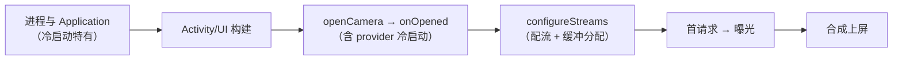

# 第 3 章 启动性能：首帧优化

> 本文为分章源文件，供单章阅读；若与主文档不一致，以主文档最新版为准。
>
> 首帧是相机体验的第一道关。本章讲启动链路每一环的**成本构成与成因**、App/框架/系统三层优化手段（含代码骨架）、以及官方通用启动优化在相机场景的落地。逐段 trace 判读与异常模式见《Android_Camera_Trace分析文档》第 3 章。

## 3.1 启动链路的成本结构



逐环拆解成本成因（理解成因才能判断优化空间）：

**① 进程与 Application（冷启动特有）**：Zygote fork、类加载、ART 初始化、Application.onCreate 里的三方 SDK 同步初始化——每个 SDK 几十 ms 累积起来就是几百 ms，而且**串行阻塞在 Activity 创建之前**（第 3.3 节 Baseline Profile 与异步化针对这里）。

**② Activity/UI 构建**：布局 inflate（层级深度直接决定）、Surface 申请（SurfaceView 的 surfaceCreated 时机）、首帧绘制。这一段的优化是通用 Android 启动优化（布局扁平化、viewstub 延迟加载）。

**③ openCamera → onOpened**：App 发起 Binder → CameraService 权限/优先级仲裁 → provider 打开设备。**provider 冷启动**是这段的大变量：provider 进程首次拉起要进程创建、加载厂商 so、sensor 上电（I2C 配置、PLL）、固件加载、ISP 初始化——几十到几百 ms，厂商/机型差异极大，App 层不可控（对策见 3.4）。

**④ configureStreams**：HAL 按流组合协商 pipeline、分配缓冲。成本随**流数量与尺寸**增长（大流组合可到数百 ms，B 层经验），是 App 层最能影响的一段（两段式会话，3.2-5）。

**⑤ 首请求 → 曝光**：请求下发后要等流水线填充（1~3 个帧间隔）+ 首帧曝光。这段接近物理下限，优化空间在"请求尽早下发"与"别被会话参数变更挤掉"。

**⑥ 合成上屏**：帧进 BufferQueue → SF 合成 → 送显，正常 1~2 帧。异常时（SF jank）属显示链路问题，不是相机问题（用 FrameTimeline 区分归属）。

典型量级（B 层经验，机型差异大，仅示比例）：①+② 约 150~300ms，③ 50~500ms（provider 冷启动时取高段），④ 100~400ms，⑤+⑥ 50~100ms。**三大头是 App 初始化、provider 冷启动、配流——优先级要用分段埋点数据定，不是按直觉**（见 3.6 案例）。

## 3.2 App 层优化清单（含代码骨架）

### 3.2.1 权限前置

权限弹窗是**用户交互**，耗时不可控（用户可能思考 10 秒），绝不能挂在启动链路上：

```kotlin
// 入口页/引导页就申请；相机页只做同步检查
if (!hasCameraPermission()) permissionLauncher.launch(CAMERA)   // 入口页
// 相机页 onCreate：
if (!hasCameraPermission()) { showDeniedUi(); return }          // 同步判断，不弹窗
```

配套：`denied` 态做成一级 UI（引导去设置），`onResume` 复查权限撤销（`SecurityException` 兜底）。

### 3.2.2 提前枚举与缓存

`getCameraIdList`/`getCameraCharacteristics` 是 Binder 调用，首次访问还要在 `CameraManagerGlobal` 建 listener 快照（第《源码链路文档》第 1 章）。启动页后台线程预热并缓存：

```kotlin
// Application/启动页，后台线程
scope.launch(Dispatchers.Default) {
    val list = cameraManager.cameraIdList.map { id ->
        id to cameraManager.getCameraCharacteristics(id)
    }
    CameraInfoCache.put(list)   // 相机页直接读缓存
}
```

注意：无 CAMERA 权限时部分 Key 被过滤（A 层，API 32+ 可查 `getKeysNeedingPermission`）——授权后要作废缓存重取；设备热插拔后缓存失效（availability 回调刷新）。

### 3.2.3 尽早发起 openCamera + 启动栅栏

openCamera 是异步的——**等待窗口应该被并行工作填满**，而不是串行等它：

```kotlin
fun onCreate() {
    startBackgroundThread()                    // 1. 先起回调线程
    maybeOpenCamera()                          // 2. 权限 OK 就立刻发起 open（不等 UI 建完）
    initUiAsync()                              // 3. 并行：布局、滤镜资源、编码器预热
}
// 4. 栅栏：Surface 就绪 + onOpened 都到了才建会话
private val surfaceReady = AtomicBoolean(false)
private val deviceReady = AtomicBoolean(false)
private fun maybeCreateSession() {
    if (surfaceReady.get() && deviceReady.get()) createCaptureSession()
}
```

回调用专用 HandlerThread（不与主线程互相阻塞）。这条的要点是**顺序**：很多 demo 把 openCamera 放在 surfaceCreated 之后才调，白白把 provider 打开时间串行到了链路尾部。

### 3.2.4 两段式会话（对配流大头的结构性优化）

首会话只配预览流快速出帧，首帧后再补全量流：

```kotlin
// 第一段：只配预览
device.createCaptureSession(listOf(previewOutput), cb1, …)
// onConfigured → setRepeatingRequest → 首帧上屏（此时用户已看到画面）
// 第二段：首帧后（或用户首次进入高级模式时）重建全量会话
device.createCaptureSession(listOf(previewOutput, jpegOutput, analysisOutput), cb2, …)
```

代价：第二段重建瞬间预览闪断一帧（PRODUCT 决策）。收益：把大流配流成本从首帧路径挪走，通常能省 100~300ms（B 层经验）。注意第二段重建前用 `isSessionConfigurationSupported` 预检，失败降级保持第一段会话。

### 3.2.5 懒配置 + 组合预检

- 拍照 ImageReader 延到首帧后创建（或首帧后预热）、`maxImages` 用最小够用值；
- 预检 API 避免试错往返：`isSessionConfigurationSupported`（API 28）、`isStreamCombinationSupported`（API 29）、**`CameraDeviceSetup`（API 35 / Android 15，A 层）**——无需打开设备即可离线查询组合与模板参数，把"打开→配→失败→重试"变成"预检→一次配成"。

### 3.2.6 会话参数

API 28+ `SessionConfiguration.setSessionParameters(builder)` 把稳定参数（FPS 区间、厂商开关）在建会话时一次下发：HAL 在 `configureStreams` 阶段即可见，还能据此选更优 pipeline（A 层）。代价是改会话参数通常要重建会话——**只放稳定设置**。

### 3.2.7 热启动复用

```kotlin
override fun onPause() {
    // 不 close 相机：只停请求或保持（系统需要时会自己抢占）
    session?.stopRepeating()
}
override fun onResume() {
    session?.setRepeatingRequest(previewRequest, …) ?: startCameraIfPossible()  // 被抢占过才重开
}
```

热启动（后台返回）走恢复路径 t4'→t6'（几十 ms）而不是全链路 t0~t6。被抢占（onDisconnected）才走重开。产品上"每次切回来都卡"几乎都是 onPause 全量 close 导致的。

### 3.2.8 配置变更不重走链路

旋转/分屏/折叠态变化默认销毁重建 Activity——用 ViewModel（或 retained fragment）持有 CameraDevice/Session 引用与尺寸选择结果，重建时只重绑 Surface：

```kotlin
class CameraViewModel : ViewModel() {
    var device: CameraDevice? = null        // 配置变更后仍存活
    var previewSize: Size? = null
    // onCleared() 里才真正释放
}
```

注意 Surface 变化仍需重建会话（Surface 是会话的输出目标），但省掉了 openCamera 段。

## 3.3 框架与系统层手段

- **provider 冷启动**：App 层无法消除，只能降低触发频率（热启动复用）+ 平台协作（OEM 保活/预热策略）+ 产品掩盖（启动动画）+ 监控 p95。系统侧重启后 provider 常驻与否取决于厂商实现（B/C 层）；
- **Baseline Profile**（A 层，[官方文档](https://developer.android.com/topic/performance/baselineprofiles)）：把关键路径预编译为机器码，官方口径冷启动最高 ~30% 收益。相机 App 的关键路径非常固定（启动→openCamera 回调→建会话→首帧回调），是 Baseline Profile 的理想对象；生成器 `profileBlock` 应覆盖：启动 Activity、openCamera 回调链、会话创建、首帧处理（实操全流程见《Android_通用面试题》Q41：`generateBaselineProfile` 任务、profileinstaller、1.5MB 上限、混淆后重新生成）；
- **通用启动优化**（A 层 [App Startup](https://developer.android.com/topic/performance/app-startup)）：Application 三方 SDK 异步化/懒加载、App Startup 库统一初始化器（依赖显式化）、启动期开 StrictMode 抓主线程 IO、`reportFullyDrawn()` 帮系统度量；
- **Profile guided 的系统编译**：线上用户的 Cloud Profile 也会逐步优化热点（第《通用面试题》Q62），实验室对比时注意编译状态一致（Macrobenchmark 的 `CompilationMode.Partial()`）。

## 3.4 验收与防退化

- 分段埋点 t0~t6 上线（第 2 章 2.2 的同名打点），p95 分机型看板；
- CI：Macrobenchmark `StartupTimingMetric` + App 内相机埋点做版本回归（第 8 章 8.3）；
- 常见反模式清单（面试也常考）：首帧前等 AE 收敛（预览不需要收敛）、全部初始化塞 `onOpened` 回调（回调线程被堵）、预览等 JPEG 流一起建会话（配流变大）、主线程做设备枚举、onResume 无条件重开相机、旋转后重走 openCamera。

## 3.5 案例：1.6s → 800ms 的路径（示例数据，方法可复用）

| 阶段 | 优化前 | 手段 | 优化后 | 验收方式 |
|---|---|---|---|---|
| ①+② App/Activity | 260ms | SDK 异步化 + Baseline Profile + 布局扁平化 | 120ms | 埋点 t0~t1 |
| ③ openCamera | 540ms | 热路径会话复用避开 provider 冷启动（第二次启动起） | 180ms | t1~t2 |
| ④ 配流 | 380ms | 两段式（首会话仅预览流）+ 预检 | 150ms | t3~t4 |
| ⑤+⑥ 首帧上屏 | 160ms | 无改动 | 150ms | t4~t6 |
| **合计** | **1.34s** | | **600ms** | p95 对比 |

三条纪律：**优先级由分段数据决定**（此例先做 provider 而非编码）；每步独立验收（防"优化 A 劣化 B"）；把"第二次启动起"单独汇报（provider 冷启动只影响首次，冷/热分开统计正是为了说清这件事，第 1 章 1.3）。

---

> 来源与延伸：[Baseline Profiles](https://developer.android.com/topic/performance/baselineprofiles)、[App Startup](https://developer.android.com/topic/performance/app-startup)、[CameraDevice（会话/预检 API）](https://developer.android.com/reference/android/hardware/camera2/CameraDevice)；两段式会话/会话参数/栅栏模式为通行实践（B 层）。逐段 trace 判读、异常模式速查见《Android_Camera_Trace分析文档》第 3 章。
