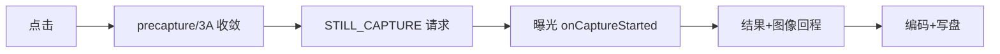

# 第 5 章 拍照与录像性能

> 本文为分章源文件，供单章阅读；若与主文档不一致，以主文档最新版为准。
>
> 拍照链路的规则与预览相反：允许攒帧重算、允许异步——但用户对"按下没反应"（快门延迟）和"等图太久"（出图延迟）都敏感。本章讲延迟拆分的数学、precapture 的取舍逻辑、ZSL 机制、连拍流水线、录像专项（编码器/音画/前台服务）。trace 判读见《Trace分析文档》第 4 章。

## 5.1 拍照延迟的拆分：五段各有主人



| 段 | 典型量级（亮光，B 层示意） | 暗光典型 | 谁决定 |
|---|---|---|---|
| 点击→precapture | 0ms（可跳过） | 100~500ms | App 策略 + AE 收敛速度 |
| precapture→请求 | 0~50ms | 含在上行 | App |
| 请求→曝光 | 1~3 帧间隔（流水线填充） | 帧间隔变大 | pipeline depth × 帧率（协议下限） |
| 曝光→图像回程 | 1~2 帧 + HAL 处理 | 多帧融合可达秒级 | HAL/ISP |
| 图像→落盘 | 10~100ms 编码 + IO | 更长 | 编码器 + 存储 |

两个关键结论：

1. **快门延迟 = 点击→曝光**，它的优化对象是 precapture 等待与请求路径（App 层可做）；
2. **出图延迟的下限由 pipeline depth 决定**：单张照片至少要等流水线排空（≈ pipeline depth × 帧间隔），协议决定、无法绕过——想突破只能换"起点"（ZSL，5.3）。

埋点必须按这五段拆（第 1 章的指标族），每段独立预算——"出图 800ms"和"快门 600ms + 出图 200ms"是两个完全不同的问题。

## 5.2 快门延迟优化：precapture 的取舍逻辑

### 5.2.1 precapture 是什么、为什么存在

`AE_PRECAPTURE_TRIGGER_START` 触发 AE 做一次**预闪/测光收敛序列**（HAL 可能点亮预闪、重新统计、收敛曝光），为的是正式拍照时曝光正确——尤其闪光场景必须先测光。代价是**多帧等待**（收敛帧数不定：场景亮度、闪光决策、厂商调优，暗光常见 3~10 帧）。

### 5.2.2 取舍决策表（App 策略）

| 场景 | precapture | 理由 |
|---|---|---|
| 亮光 + 无闪光意图 | **跳过** | AE 早已收敛，直接抓当前帧，省 100~300ms |
| 亮光 + auto 闪光可能触发 | 查 `AE_STATE`，CONVERGED 即拍 | 状态机比盲触发快 |
| 暗光 + 闪光 | 必要 | 测光错误 = 成片报废 |
| 暗光无闪光 | 限帧数上限（如 5 帧/300ms），超时降级直拍 | 宁可噪一点不能没反应 |
| 连拍 | **锁 3A** 后全跳过 | 一致性 + 速度双赢 |

### 5.2.3 标准实现骨架（状态机 + 超时）

```kotlin
fun takePhoto() {
    if (aeAlreadyConverged() && !flashWanted()) { captureStill(); return }   // 快路径
    previewBuilder.set(CaptureRequest.CONTROL_AE_PRECAPTURE_TRIGGER, TRIGGER_START)
    session.capture(previewBuilder.build(), cb, handler)                     // 触发收敛
    // cb 里轮询 result.get(CaptureResult.CONTROL_AE_STATE)：
    //   CONVERGED / FLASH_REQUIRED / LOCKED → captureStill()
    //   超时（如 300ms）→ captureStill() 降级直拍
}
```

### 5.2.4 体验补偿：秒回缩略图

快门按下立即用**预览帧**生成缩略图回显（动画/相册胶片条），后台精修完成后替换——延迟的客观存在没变，但感知被转移。系统相机的"先见后精"（对照 iOS 的 deferred photo processing，《iOS 学习文档》第 4 章）就是这个思路。

## 5.3 ZSL：换起点而不是跑更快

**机制**：会话持续以 `TEMPLATE_ZERO_SHUTTER_LAG` 收预览帧并保留每帧的 `TotalCaptureResult`（环形缓冲）；按下快门时取**快门前已曝光的帧**构造 reprocess 请求（`createReprocessCaptureRequest(result)`），对它做高质量重处理——因为帧在按快门前就完成了曝光，快门延迟≈0。

**前提**：设备支持 `YUV_REPROCESSING` / `PRIVATE_REPROCESSING` 能力（characteristics 查询），会话要 `createReprocessableCaptureSession(InputConfiguration(...))`。PRIVATE reprocess 效率更高（HAL 内部格式直通），YUV 更通用（A 层）。

**无设备支持时的近似**：跳过 precapture（快路径）+ 锁 3A + STILL_CAPTURE 直拍——把"换起点"退化为"砍流程"，快门延迟从 300ms 级压到 100~200ms 级（B 层经验）。

## 5.4 出图尾段：编码与落盘

- **编码**：JPEG/HEIF 编码 10~100ms（分辨率/机型），48MP 档显著更重。对策：分辨率档位产品化（标准 12MP/高清可选）、硬编优先、编码异步（不阻塞下一张请求）；
- **落盘**：MediaStore 两段式写入放后台线程；**写盘线程 D 状态**（IO 等待）会拖垮整条消费链（第 6 章 6.3 的检测法）；剩余空间预检、慢速存储降分辨率档；
- **JPEG stalling**：JPEG 是 stalling stream——编码与预览共享管道，拍照瞬间预览掉帧是**协议层特性**（A 层 HAL 文档语义），App 只能缓解：拍照请求不带多余 target、降 JPEG 档位、编码后移。别把它当 bug 修（修不掉），要把它写进产品预期（预览短暂顿挫的动画掩盖）。

## 5.5 连拍：流水线化

瓶颈 = 每张的收敛等待 + 请求串行 + 编码落盘排队。组合拳：

1. **锁 3A**（`AE_LOCK`/`AWB_LOCK`，AF 等收敛态）：整组照片曝光白平衡一致（画质收益）且省掉每张收敛（速度收益）；
2. **请求队列化**：`captureBurst(requests)` 一次下发 N 张，避免逐张 round-trip；
3. **`maxImages` 按深度设**：N 张连拍至少 N（或 N+1）个缓冲位——内存公式见 6.1，深度与分辨率要联立求解（低端机连拍深度自动降）；
4. **编码/写盘异步流水线**：拍照回调只做"复制字节 + close"，编码落盘进独立队列——下一张不被上一张的落盘阻塞；
5. **失败复位**：`onCaptureFailed` 必须复位状态（连拍中最容易漏）。

## 5.6 录像专项

### 5.6.1 指标

起录延迟（点录制→首帧视频入码，参考 ≤300~500ms）、录制帧率稳定性（p95 帧间隔）、丢帧数、**音画同步偏移**（±40~80ms 起可感、超 100ms 明显，C 层经验阈值）、热稳态码率/帧率衰减、录像中拍照干扰。

### 5.6.2 起录延迟：编码器预热

编码器初始化（MediaCodec configure + start + 首个 buffer 就绪）本身几十到几百 ms——进相机页就预热（初始化好等 Surface），点录制时只剩"绑定 surface + 第一个关键帧"，起录延迟从 500ms 级压到 100~200ms（B 层经验）。首帧策略：允许丢帧不允许花屏（起录瞬间掉 1~2 帧无感，花屏必被看见）。

### 5.6.3 音画同步：时间戳同基准

视频帧 PTS 来自传感器时间戳（`SENSOR_INFO_TIMESTAMP_SOURCE=REALTIME` 时与 monotonic 对齐，A 层），音频 PTS 用同一时钟域采集；muxer 起点（`startSession(atSourceTime:)` 类比）取**首个视频帧 PTS**，两轨相对该点对齐。常见坑：音频先于视频启动几十 ms 且未对齐基准——回放口型偏移。

### 5.6.4 资源纪律（合规红线）

- **前台服务**：Android 14 起录像必须 `foregroundServiceType="camera"`（+ 按需 `mediaPlayback`）并申请对应运行时权限（A 层 [官方变更说明](https://developer.android.com/about/versions/14/changes/fgs-types-required)）——没有正确类型的 FGS 直接 `SecurityException`；
- **WakeLock**：录像期间 `PARTIAL_WAKE_LOCK` 保 CPU，结束**必须**释放——Vitals 监控 wake lock 滥用（A 层 [WakeLock 指南](https://developer.android.com/training/scheduling/wakelock)）；
- **码控与热联动**：热降级时主动降码率/分辨率，而不是等编码器丢帧（用户对码率下降的感知 < 对掉帧的感知）；
- **录像中拍照**：`TEMPLATE_VIDEO_SNAPSHOT` 或独立低分辨率流，避免大 JPEG 挤占带宽导致录像掉帧。

### 5.6.5 帧率稳定

FPS range 锁下限（如 `[30,30]`，暗光宁可提增益不降帧——视频降帧比照片噪点更伤体验）；录制流 PRIV 直通编码器（不过 App 的手，省一次拷贝与调度抖动）。

## 5.7 Time to First Shot：把"可拍"纳入预算

首帧（第 3 章）解决"看到"，本章解决"拍到"。完整口径还应含 **Time to First Shot**（启动到第一张**可拍**，含 3A 就绪）：进相机即起 continuous AF、AF 区域先中心加权、ZSL 预缓冲常开——这些决定"抓起手机就拍能不能抓住瞬间"。建议与 TTFF 并列立项、独立预算（第 1 章 1.3），因为它的优化对象（3A 收敛、ZSL）与首帧（配流、进程）几乎不重叠。

---

> 来源与延伸：[Camera2 拍照与模板](https://developer.android.com/media/camera/camera2/capture)、[ZSL/reprocess 能力](https://developer.android.com/reference/android/hardware/camera2/CameraCharacteristics)、[前台服务类型（Android 14）](https://developer.android.com/about/versions/14/changes/fgs-types-required)、[WakeLock](https://developer.android.com/training/scheduling/wakelock)；precapture 决策表/预热数值/音画阈值为通行实践与行业经验（B/C 层）。逐段 trace 判读见《Trace分析文档》第 4 章；多帧融合的画质权衡见《算法集成文档》第 3 章。
