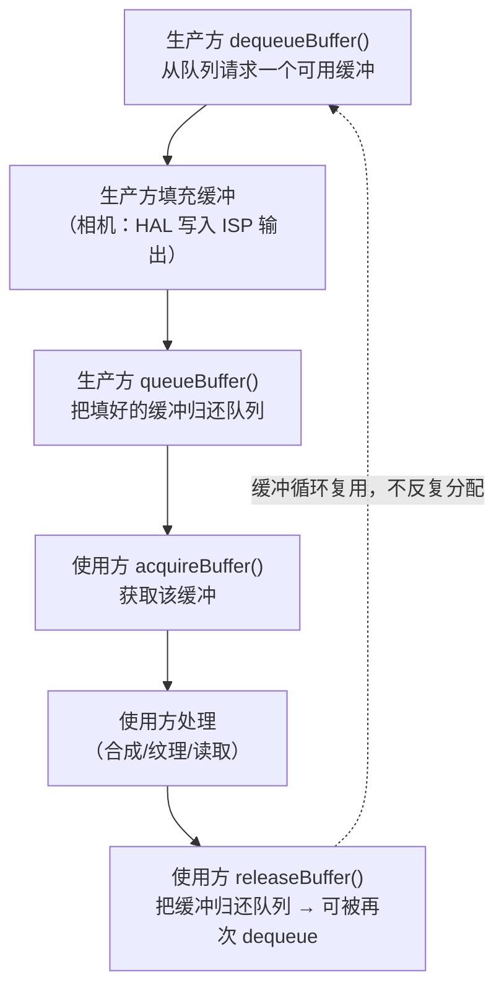
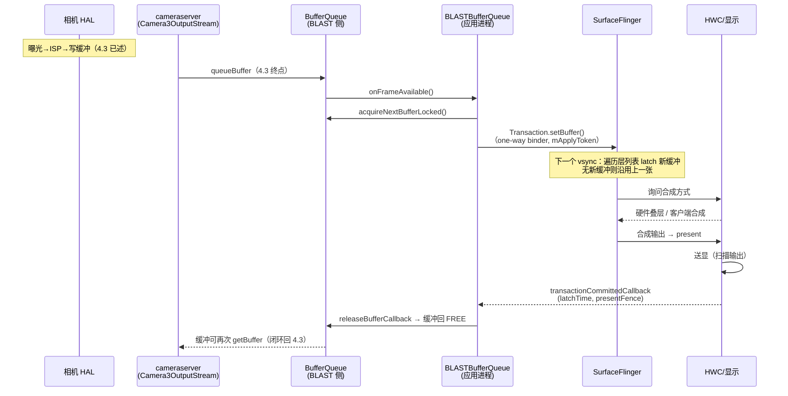
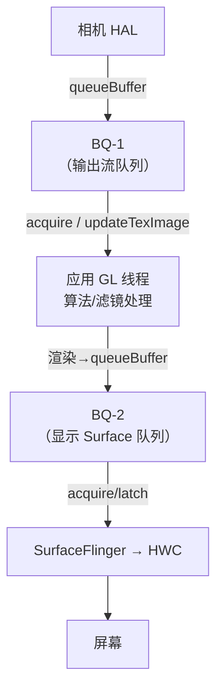
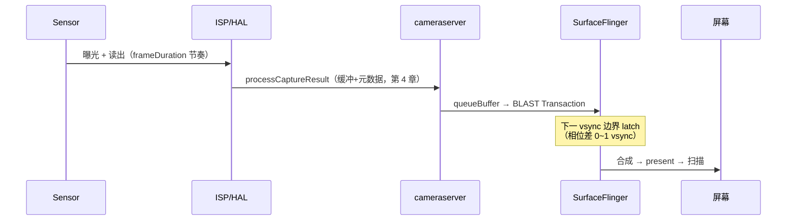

# 第 5 章 从 queueBuffer 到屏幕：BufferQueue 与显示链路

> 本文为分章源文件，供单章阅读；若与主文档不一致，以主文档最新版为准。

本章接第 4 章：4.3 节的终点是"cancelBuffer/queueBuffer 到 Surface"，本章继续往下——缓冲区进入 BufferQueue 之后，如何被消费、如何被 SurfaceFlinger 合成、如何最终出现在屏幕上。至此，"一次拍帧"才从 sensor 真正走到人眼。

**材料分层说明**：与 CameraService 侧不同，图形栈有官方文档板块背书，本章 A 层密度更高——A 层 = [AOSP 官方图形文档](https://source.android.google.cn/docs/core/graphics/architecture?hl=zh-cn)（图形架构、BufferQueue 与 gralloc、SurfaceFlinger 与 WindowManager 三页，2026-10 抓取摘译）+ frameworks/native 源码（[BLASTBufferQueue.h](https://android.googlesource.com/platform/frameworks/native/+/refs/heads/main/libs/gui/include/gui/BLASTBufferQueue.h)，main 分支本文核对，注释原文摘译）；B 层 = 机制细节的通行归纳。官方文档页未展开的实现细节（如槽位上限、过载丢弃策略），本文不引未经核对的数字，如实标注。

> 来源：A 层——[图形架构](https://source.android.google.cn/docs/core/graphics/architecture?hl=zh-cn)、[BufferQueue 和 gralloc](https://source.android.google.cn/docs/core/graphics/arch-bq-gralloc?hl=zh-cn)、[SurfaceFlinger 和 WindowManager](https://source.android.google.cn/docs/core/graphics/arch-sf-hwc?hl=zh-cn)、[BLASTBufferQueue.h](https://android.googlesource.com/platform/frameworks/native/+/refs/heads/main/libs/gui/include/gui/BLASTBufferQueue.h)（以上均本文写作时抓取核对）；B 层——预览队列深度、vsync 相位等通行工程知识（显示/流畅指标详见仓库内文档：Android/Android_Camera_性能分析文档.md）

## 5.1 BufferQueue：生产者与消费者的解耦层

### 5.1.1 官方模型与生命周期（A 层）

官方定义（图形架构页原文）："**BufferQueue 类将可生成图形数据缓冲区的组件（生产方）连接到接受数据以便进行显示或进一步处理的组件（使用方）**"。一次缓冲交接的完整生命周期（BufferQueue 和 gralloc 页原文归纳，函数名 A 层）：

容量语义（官方原文）："BufferQueue 的一些特性（例如**可以容纳的最大缓冲区数）由生产方和使用方联合决定**"，且"BufferQueue 会根据需要分配缓冲区"——格式/尺寸变化时"系统会释放旧的缓冲区，并根据需要分配新的缓冲区"。相机预览的典型队列深度为 2~4 张（B 层通行配置；具体值由 HAL `max_buffers` 与消费者能力协商，第 4 章 4.3 的 `outstanding 达 max_buffers 时等缓冲归还`正是这个上界的框架侧执行点）。

**Surface 的官方定位**（图形架构页）："Surface 可生成一个通常由 SurfaceFlinger 使用的缓冲区队列"；`ANativeWindow` 是 Java `Surface` 的 C/C++ 等价类。第 4 章 4.3 中 `anw->dequeueBuffer` 的 `anw` 正是它——相机 HAL3 的输出流在框架侧就是经 ANativeWindow 接口与 BufferQueue 打交道。

### 5.1.2 gralloc：缓冲区的分配与跨进程共享（A 层）

官方页要点：分配由**两个供应商 HAL 接口**承担（allocator 与 mapper，位于 `hardware/interfaces/graphics/`）；`allocate()` 接收宽高、像素格式与**一组用法标志（usage）**——访问频率（软件 CPU/硬件 GPU）、是否用作 GLES 纹理、视频编码器是否使用等；典型例子：RGBA_8888 加软件访问"按 R-G-B-A 顺序为每像素创建 4 字节缓冲"，仅硬件访问则可用"BGRA 排序、非线性搅和布局和替代颜色格式等"更优布局；**"Gralloc 返回的句柄可以通过 Binder 在进程之间进行传递"**——这正是相机链路里"cameraserver 分配/持有缓冲、SF/GPU 消费"成为可能的基础。另有 `GRALLOC_USAGE_PROTECTED` 保护缓冲（DRM 内容仅能经硬件保护路径/叠层显示）。

### 5.1.3 相机链路里的三对生产者-消费者（A 层定位 + B 层归纳）

| BufferQueue | 生产方 | 消费方 | 出现场景 |
|---|---|---|---|
| BQ-1：输出流队列 | 相机 HAL（cameraserver 代理 dequeue/queue） | SF（SurfaceView 直通）/ 应用 GL（SurfaceTexture）/ 应用线程（ImageReader）/ 编码器（录制 Surface） | 一切输出流 |
| BQ-2：GL 中转的显示队列 | 应用 GL 线程（消费 BQ-1 后渲染） | SF | SurfaceTexture→GL→显示 Surface |
| —（无独立队列） | SF | 屏幕（经 HWC/显示控制器） | 所有路径的末端 |

（与仓库内文档：Android/Android_Camera_Trace分析文档.md 第 1.7 节"消费端地图"一一对应——那边讲 trace 判读，本节讲机制。）

---

## 5.2 直通预览：BLASTBufferQueue → SurfaceFlinger → HWC

### 5.2.1 SurfaceView 的官方定位（A 层）

官方原文："**SurfaceView 结合了 Surface 和 View**"，其 View 部分"由 SurfaceFlinger（而不是应用）合成"，"从而可以通过单独的线程/进程渲染，并与应用界面渲染隔离"——相机预览选 SurfaceView 的根本原因：HAL 写入的缓冲由 SF 直接消费合成，不经过应用的 View 绘制管线。

### 5.2.2 BLASTBufferQueue：应用侧的"消费者代理"（A 层源码）

`frameworks/native/libs/gui/include/gui/BLASTBufferQueue.h`（main 分支，本文核对）。它**本质是一个消费者侧组件**：`class BLASTBufferQueue : public ConsumerBase::FrameAvailableListener`，经 `createBufferQueue()` 自建一对 producer/consumer，把 `getSurface()`/`getIGraphicBufferProducer()` 交给生产方（相机场景即 cameraserver 的 `Camera3OutputStream` 持有的 IGraphicBufferProducer）。工作方式（成员/函数均为源码实名，注释原文摘译）：

- **缓冲到达**：生产方 `queueBuffer` 后触发 `onFrameAvailable()`（FrameAvailableListener 回调）→ `acquireNextBufferLocked(Transaction*)` 取得缓冲并把它**装进一个 `SurfaceComposerClient::Transaction`**（`setBuffer`）提交给 SF；
- **提交不阻塞应用**：`mApplyToken` 注释原文——"使用此 token 在 SurfaceFlinger 中排队事务，**防止 client 其他部分排队的事务阻塞本事务**"；头部大段注释进一步说明：*"我们把所有事务经 one-way binder 调用发送，以避免阻塞 client 线程。由于是同一进程发往同一接口的 one-way 调用，事务保持有序……"*；从同步（sync）路径切回正常帧时靠 `setBufferHasBarrier` 声明顺序（源码注释）；
- **在途缓冲极浅**：`mMaxAcquiredBuffers = 1`，注释原文——"BufferQueue 内部允许比上限多获取 1 张"；即 BLAST 侧同时只持 1 张已获取缓冲，其余仍留在 BufferQueue 里排队；
- **缓冲归还的终点**：`mSubmitted` 注释原文——"持有已提交缓冲的引用，以便在 **SurfaceFlinger 丢弃该缓冲**或**该缓冲已上屏且新缓冲就绪待上屏**时释放"；`releaseBufferCallback()` 携带 release fence 归还缓冲——**这一步闭环回第 4 章**：缓冲回到 BufferQueue 的 FREE 态，cameraserver 的下一次 `getBuffer` 才拿得到（4.3 节 `outstanding 达 max_buffers 时等待`的唤醒来源之一）；
- **时序信息外供**：`transactionCommittedCallback(latchTime, presentFence, stats)`——SF 回调 latch 时刻与 present fence；`setFrameTimelineInfo()` 逐帧携带 FrameTimeline 信息——这正是 Perfetto FrameTimeline track 的数据来源（与仓库内文档：Android/Android_Camera_Trace分析文档.md 第 1.5 节衔接）；
- **工具可见性**：`mQueuedBufferTrace` 注释原文——"表示来自 buffer queue 的排队缓冲计数（pre-BLAST 语义），= mNumFrameAvailable + mNumAcquired + mPendingRelease.size()，**该计数器被 Android Studio profiler 读取**"。

版本注记：BLAST 自 Android 12（S）起引入并成为应用窗口内容提交的默认通路（B 层通行结论；机制为本仓核对的 main 分支源码事实）。此前生产方直接经 binder 调用 SF 侧 BufferQueue 的 `queueBuffer`（B 层，旧路径描述）。

### 5.2.3 SurfaceFlinger 的工作循环与合成分工（A 层）

官方页（SurfaceFlinger 和 WindowManager）原文要点：

- "**SurfaceFlinger 接受来自多个源的数据缓冲区，然后将它们进行合成并发送到显示屏**"；
- SF"**仅能在屏幕处于两次刷新之间时唤醒**，以接受缓冲区"；收到 VSYNC 后"遍历其层列表，以查找新的缓冲区"，找到则获取，否则"**继续使用上一次获取的那个缓冲区**"（无新缓冲的层被跳过）——这就是"相机帧率正常但屏幕慢半拍"的机制根源：SF 只在 vsync 边界取最新已入队的缓冲；
- 收集完所有可见层缓冲区后，SF 询问 HWC 应如何合成；"**如果 HWC 将层合成类型标记为客户端合成，则 SurfaceFlinger 将合成这些层**"（GPU/RenderEngine 路径，B 层注：RenderEngine 为其实现名），合成输出再交 HWC 送显——**HWC 硬件叠层与 client（GPU）合成的分工由 HWC 在 prepare 阶段逐层判定**，这就是性能文档 4.4"硬件叠层零拷贝"的机制出处；
- **预旋转**（官方页专节）：许多硬件叠加层不支持旋转（"即使支持，也需要耗用处理能力"），故用 `NATIVE_WINDOW_TRANSFORM_HINT` 做"预旋转"以"节省电量"——对应 HAL3 输出流的 transform hint 协商（A 层机制；相机侧用法为 B 层通行实践）。

### 5.2.4 直通路径全链时序（本章综合）

---

## 5.3 应用内消费：SurfaceTexture 与 TextureView

### 5.3.1 SurfaceTexture：应用成为 BufferQueue 的消费者（A 层）

官方定义："**SurfaceTexture 将 Surface 和 GLES 纹理相结合来创建 BufferQueue，而您的应用是 BufferQueue 的消费者**"；"**当生产者将新的缓冲区排入队列时，它会通知您的应用**"（即 `onFrameAvailable` 回调，A 层 API），随后应用"获取新缓冲区并执行 EGL 调用"——API 名即 `updateTexImage()`（把最新缓冲绑定为 GLES 的外部纹理 `GL_TEXTURE_EXTERNAL_OES`，A 层 API 语义；完整实现骨架见仓库内文档：Android/Android_Camera_算法集成文档.md 第 2 章）。

由此形成**双 BufferQueue 结构**（B 层结构归纳，各段机制均为前述 A 层）：

对比 5.2 的直通路径：多一次"应用内 GPU 消费 + 再入队"，代价是每帧多一段 GL 处理与一次队列交接（收益是任意算法处理能力——选型对比见仓库内文档：Android/Android_Camera_性能分析文档.md 第 4.4 节，trace 判读见 Android/Android_Camera_Trace分析文档.md 第 1.7 节）。

### 5.3.2 TextureView（A 层）

官方定义："**TextureView 结合了 View 和 SurfaceTexture**"，用最近缓冲区内容按 View 状态渲染；关键差异——"**View 合成始终通过 GLES 来执行，这意味着内容更新可能会导致其他 View 元素重绘**"。即 TextureView 的内容进入**应用的 View 硬件层**参与应用侧渲染，最终仍经应用的窗口 Surface（一个 BufferQueue）交 SF——比 SurfaceTexture 直连显示 Surface 再多一层 View 绑定（结构为 B 层归纳，引文 A 层）。

---

## 5.4 VSync 节拍与端到端时间线

### 5.4.1 VSYNC 的官方语义（A 层）

官方原文：屏幕向 SurfaceFlinger 发送 VSYNC 信号，该信号"表明可对屏幕进行刷新而不会产生撕裂"，从而避免可见撕裂并"最大限度地减少内存使用量"；"刷新周期因设备而异"。SF 的合成与 HWC 的送显均以此节拍推进（5.2.3 已引）。

### 5.4.2 相机帧与屏幕节拍的相位差（B 层归纳 + A 层锚点）

相机出帧由 sensor 曝光节奏决定（第 1 章 `frameDuration`），**与屏幕刷新节奏无相位对齐**。因此一帧从"queueBuffer"到"上屏"平均要等 0.5~1 个 vsync：SF 只在 vsync 边界 latch（5.2.3 引文），错过本帧窗口就得等下一拍——这是预览端到端延迟里"显示段"的固有组成，也是 FrameTimeline jank 归因要区分"相机出帧晚"还是"SF latch 晚"的原因。App/SF 的 vsync 相位细分与 FrameTimeline 判读见仓库内文档：Android/Android_Camera_Trace分析文档.md 第 1.5 节；capture-to-display 的指标化测量见仓库内文档：Android/Android_Camera_性能分析文档.md 第 4.7 节。

---

## 5.5 本章小结

- **一条 buffer 的完整旅行**：cameraserver `getBuffer` 出队（4.3）→ HAL 填充 → `queueBuffer` 入 BufferQueue（4.3 终点/本章起点）→ BLASTBufferQueue acquire 并转 Transaction → SF 在 vsync 边界 latch → HWC 判定叠层/GPU 合成 → present 上屏 → `releaseBufferCallback` 归还 → 缓冲回池可复用——frameNumber 贯穿元数据线，fence 贯穿缓冲线；
- **三个角色各司其职**：BufferQueue 是生产者与消费者的解耦层（容量联合决定、gralloc 分配、句柄跨进程）；BLASTBufferQueue 是应用侧消费者代理（one-way 事务、在途 1 张、latch/present 时序回调）；SurfaceFlinger + HWC 是唯一合成者（vsync 驱动、逐层判定叠层 vs GPU）；
- **消费端不同，队列结构不同**：SurfaceView 一段队列；SurfaceTexture 两段（GL 中转）；TextureView 再叠 View 硬件层；ImageReader/编码器是另外的消费终点（机制同 BQ-1，判读见 Trace 文档 1.7）；
- 与前三章合起来，"sensor → 屏幕"全链路在源码级闭环：请求下行（第 3 章）→ 结果/缓冲回程（第 4 章）→ 显示上屏（本章）。

<!-- ch5 done -->
