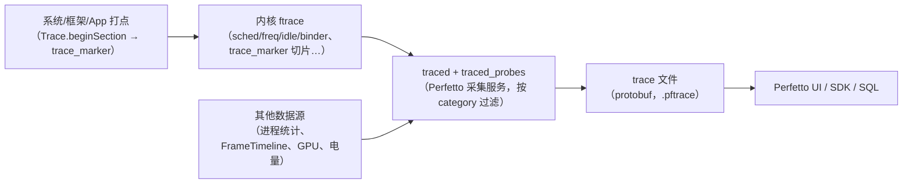
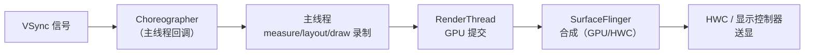

# 第 1 章 Trace 基础：数据模型与分析语言

> 本文为分章源文件，供单章阅读；若与主文档不一致，以主文档最新版为准。
>
> 本章讲"trace 是什么、它记录了什么、怎么读"。工具操作见第 2 章，相机场景分析见第 3\~4 章。材料层级按仓库惯例标注：A 层 = Perfetto/AOSP 官方文档，B 层 = 通行工程知识，C 层 = 社区经验。

**材料可信度约定**：

| 层级  | 含义        | 典型来源                                                                                                                                   |
| --- | --------- | -------------------------------------------------------------------------------------------------------------------------------------- |
| A 层 | 官方文档可抓取验证 | [perfetto.dev 文档](https://perfetto.dev/docs/)、[AOSP Systrace/FrameTimeline 文档](https://source.android.google.cn/docs/tools/)、atrace 源码 |
| B 层 | 公开通行知识    | 行业通用的调度/渲染模型描述（各厂商实现略有差异）                                                                                                              |
| C 层 | 社区经验      | 博客/论坛的实操技巧，须标注不确定度                                                                                                                     |

## 1.1 trace 记录的是什么

一句话：**trace = 时间轴上的事件集合**，把"每个线程在哪个 CPU 上、处于什么状态、执行了哪个函数、等了谁"按微秒级时间戳记录下来。与日志互补——日志回答"发生了什么"，trace 回答"时间花在了哪里、谁在等谁"。

一条 trace 能提供四类信息：

| 类别             | 内容                                                    | 典型用途        |
| -------------- | ----------------------------------------------------- | ----------- |
| 切片（slice）      | 有起止时间的区间：函数、binder 事务、绘制阶段、相机请求                       | 找耗时大头、关键路径  |
| 线程状态           | Running / Runnable / Sleeping / Uninterruptible Sleep | 区分"在算"与"在等" |
| 计数器（counter）   | CPU 频率、内存、电量、温度、帧计数                                   | 判断降频/资源瓶颈   |
| 关联（flow/async） | 跨线程、跨进程的事件关联（binder、VSync、异步阶段）                       | 串出端到端调用链    |

trace 与 logcat 的关键区别：trace 有**空间维度**（哪个进程/线程/CPU）与**因果关系**（谁阻塞了谁），这是分析相机这类多进程链路的必需视角。

## 1.2 trace 数据的来源

* **ftrace（内核）**：调度、CPU 频率、空闲状态、binder 驱动事件、电源等，由内核环形缓冲记录；
* **atrace（用户态）**：Android 在 ftrace 上封装的 tag 体系（camera/gfx/view/sched…），系统组件与 App 通过 `Trace.beginSection` 等 API 写入；
* **Perfetto**：新一代统一采集与分析体系（Android 9+ 内置 `traced` 守护进程），protobuf 格式、支持多数据源（ftrace、进程统计、帧时间线、GPU、电量等），逐步取代旧的 systrace HTML；
* **自定义打点**：应用/框架/HAL 主动插桩（第 2 章 2.4），是把业务阶段映射到 trace 的关键手段。

> 旧资料里的 Systrace（HTML + `atrace` 命令）仍在用，但 Perfetto 是其超集：能读 systrace 文件，且提供 SQL/可视化更强的能力。新项目直接上 Perfetto。

## 1.3 数据模型：track、slice、counter、flow

Perfetto 的 UI 与 SQL 建立在统一数据模型上（A 层，[Perfetto trace model](https://perfetto.dev/docs/concepts/trace-model)）：

| 概念           | 含义                       | UI 表现                     |
| ------------ | ------------------------ | ------------------------- |
| Track（轨道）    | 一组事件的时间线容器，按线程/进程/全局分类   | 左侧树形列表的每一行                |
| Slice（切片）    | 有开始/结束（或时长）的区间           | 轨道上的彩色块，宽度=时长             |
| Thread state | 线程调度状态区间                 | 线程轨道底部的状态条                |
| Counter      | 数值随时间变化的采样               | 轨道上的折线/阶梯                 |
| Flow         | 跨轨道的关联箭头                 | 连接事件的小箭头（binder/VSync/异步） |
| Async slice  | 跨线程/跨进程的异步区间，带 cookie 关联 | 独立"async track"上的块        |

**track 的几类常用形态**：

* **thread track**：每线程一条（最常用），包含 slice 与 thread\_state；
* **process track**：进程级汇总（如 binder 汇总、进程内存）；
* **counter track**：CPU 频率/内存等数值；
* **async track**：`Trace.beginAsyncSection` 这类跨回调阶段；
* **FrameTimeline track**：系统帧的期望/实际时间，判断 jank 的权威轨道（1.5 节）。

SQL 侧对应表：`slice`、`thread`、`thread_state`、`thread_track`、`process_track`、`counter`、`track`（示例见第 6 章）。

## 1.4 线程状态与调度：读懂"在算还是在等"

线程轨道底部的状态条是分析的关键（A 层字段定义，B 层解读）：

| 状态（UI 颜色）                       | 含义                        | 分析提示                                   |
| ------------------------------- | ------------------------- | -------------------------------------- |
| Running（绿）                      | 正在 CPU 上执行                | 看执行内容：是计算、拷贝还是锁内的临界区                   |
| Runnable（浅绿/白）                  | 就绪但没抢到 CPU                | 大量 Runnable = 调度压力/争抢，可能与优先级、绑核、大核频率有关 |
| Sleeping（灰）                     | 主动休眠（等锁、等 IO、等 binder 回复） | 结合 slice 判断"在等谁"：等锁、等 futex、等 binder   |
| Uninterruptible Sleep（橙/棕，D 状态） | 内核态不可中断等待（典型：磁盘/驱动 IO）    | 相机出图落盘、DMA/驱动等待常现，往往不是 App 能优化的        |

配套阅读：

* **CPU 频率/核间迁移**：counter 轨道看 `cpufreq`，线程频繁在大核/小核间迁移会导致延迟抖动（绑核/`sched_setaffinity` 场景）；
* **优先级**：相机链路里 Cameraserver、HAL 线程、SurfaceFlinger 的 nice/RT 优先级不同，Runnable 多但 CPU 空闲往往是优先级问题；
* **Runnable vs Sleeping 的区分是归因分水岭**：Running/Runnable 多 → 算力/调度问题；Sleeping 多 → 等待问题（锁/IO/依赖方）。

## 1.5 渲染与帧模型：VSync、Choreographer、RenderThread、FrameTimeline

相机预览、拍照回显都走 Android 渲染管线，理解帧模型才能判断"卡在相机还是卡在显示"（B 层通识，AOSP 文档有框架描述）：

关键概念：

* **VSync 节拍**：60Hz 屏每 16.6ms 一次；120Hz 为 8.3ms。渲染任务必须在 VSync 前完成才能按时上屏；
* **Choreographer**：主线程按 VSync 调度输入/动画/绘制回调；主线程消息队列里的长任务会推迟绘制；
* **RenderThread**：独立线程执行 DisplayList 录制结果的 GPU 渲染，动画/属性动画可脱离主线程；
* **SurfaceFlinger**：系统合成器，把各应用图层合成一帧交给 HWC；
* **FrameTimeline**（Android 12+ 系统能力，Perfetto 有轨道）：记录每个帧的**期望呈现时间与实际呈现时间**，并给出 jank 类型（A 层，[FrameTimeline 文档](https://source.android.google.cn/docs/tools/))：

| jank 类型                            | 含义                     |
| ---------------------------------- | ---------------------- |
| App Deadline Missed                | 应用侧（主线程/渲染线程）未在截止时间前完成 |
| SurfaceFlinger CPU Deadline Missed | SF 主线程合成超时             |
| SurfaceFlinger GPU Deadline Missed | SF GPU 合成超时            |
| Display HAL Deadline Missed        | 显示 HAL/送显超时            |
| Buffer Stuffing                    | 应用提交过快导致缓冲堆积（表象是延迟增大）  |
| Unknown Jank                       | 系统无法归类（版本差异）           |

> 相机场景的价值：预览"卡顿"到底是相机出帧慢（相机侧 track 空档），还是应用绘制慢（主线程/RenderThread 超时），还是合成/送显慢（SF track），FrameTimeline 直接给出归属。

### 1.5.1 Choreographer 是什么

Choreographer 是**按 VSync 节拍调度 UI 工作的帧调度器**（每个有 Looper 的线程都可以有一个，主线程的最常用）。它通过 `DisplayEventReceiver` 从 SurfaceFlinger 接收 VSync 信号，每次 VSync 到来时进入 `doFrame()`，按**固定顺序**执行本帧的回调阶段：

| 阶段                | 内容                                                       | trace 上的子 slice（形如）                   |
| ----------------- | -------------------------------------------------------- | ------------------------------------- |
| INPUT             | 输入事件分发（触摸、按键、手势）                                         | `input`                               |
| ANIMATION         | View 动画、`ValueAnimator` 回调、`postFrameCallback` 等         | `animation`                           |
| INSETS\_ANIMATION | 系统栏/边衬动画（Android 11+）                                    | `insets animation`                    |
| TRAVERSAL         | measure/layout/draw 完整遍历（View 与 Compose 的构图/布局/绘制都在这一阶段） | `traversal`、`measure`、`layout`、`draw` |
| COMMIT            | 绘制后的提交阶段（滚动条、嵌套滚动等收尾）                                    | `commit`                              |

要点：

* UI 工作被**对齐到 VSync**：一帧内的回调按上表顺序执行，这就是"16.6ms 帧预算"的调度载体（120Hz 下预算 8.3ms）；
* trace 上的 `Choreographer#doFrame` slice = 从 VSync 回调开始到本帧所有阶段回调结束的**墙钟时间**——不是 CPU 时间，包含被抢占与阻塞的等待（1.5.2）；
* 主线程消息队列里的长任务不会缩短 doFrame，而是让**下一次 doFrame 开始得更晚**（两类问题要分开看）。

### 1.5.2 为什么 `Choreographer#doFrame` 有时候很长

先分清两种"长"：

1. **doFrame 内部的 slice 本身体积大**（几十毫秒甚至上百毫秒）：这一帧的工作确实重，或被阻塞、被抢占；
2. **doFrame 开始得晚**：主线程队列前面排着长任务，VSync 回调迟迟轮不到（看起点与 VSync 的时间差，而不是 slice 宽度）。

doFrame 本身很长的常见原因，按线程状态分类（对应 1.4 的状态语言）：

| 现象               | 线程状态特征                          | 典型原因                                                                                  |
| ---------------- | ------------------------------- | ------------------------------------------------------------------------------------- |
| 计算/绘制重           | Running 占主导                     | 自定义 View 的 `onDraw` 复杂、动画回调里做重计算、大量属性动画、RecyclerView 绑定/布局、文字排版（StaticLayout）、主线程图片解码 |
| 布局风暴             | Running，且 `measure/layout` 反复出现 | `requestLayout` 在布局过程中再次触发、层级过深、同步刷新列表、复杂约束布局                                         |
| 等锁/等 binder/等 IO | Sleeping                        | 主线程同步 binder（SharedPreferences 提交、ContentProvider 查询）、锁竞争、文件读写                        |
| 抢不到 CPU          | Runnable 占比高                    | CPU 满载/降频、后台负载、绑核/优先级不当、大核频率爬升慢                                                       |
| GC               | `Suspend all`/GC 相关薄片           | 分配风暴（如在 onDraw 里 new 对象）、频繁字符串拼接、大对象                                                  |
| 合成/缓冲背压          | 在 `draw` 中 Sleeping             | SurfaceView 同步、BufferQueue 满、RenderThread/SF 阻塞反向拖住主线程（少见但存在）                         |

**影响因素清单**：

* View 层级深度与布局复杂度、过度绘制（GPU Overdraw）；
* Compose 稳定性（不稳定参数导致大范围重组）、Lazy 列表 item 重绑；
* 动画数量与每帧计算量（动画期间 doFrame 持续变长是典型特征）；
* 主线程消息队列积压与同步调用（IO/binder/锁）；
* CPU 频率/热、调度优先级、绑核；
* 屏幕刷新率档位（120Hz 预算减半，同样的工作更容易"超长"）；
* 调试与 trace 开销（debug 包、全量 category 会放大调度抖动）。

**判读方法**：

1. 展开 `Choreographer#doFrame` 看子 slice：`input` / `animation` / `traversal`（再展开 `measure`/`layout`/`draw`）/ `commit`，先定位到阶段；
2. 看该段线程状态：Running → 真计算；Runnable → 调度；Sleeping → 阻塞（追锁/binder/IO）；
3. 对照 FrameTimeline 的 jank 类型（`App Deadline Missed` 属应用侧）；
4. 区分偶发与系统性：每帧都长 → 结构性问题（布局/渲染）；偶发 → 特定内容、GC 或后台干扰；
5. 相机场景提醒：预览掉帧先看相机出帧 track 是否出现空档，再怪 Choreographer——两者是不同链路，别把"相机出帧慢"误判成"主线程绘制慢"。

## 1.6 相机链路上的 trace 语义

相机是"App → CameraService（cameraserver）→ HAL provider → 内核驱动 → sensor/ISP"的多进程链路，trace 上的读法：

| 链路环节          | trace 上的表现                                                                             | 说明                             |
| ------------- | -------------------------------------------------------------------------------------- | ------------------------------ |
| App 调 API     | 主线程/回调线程上的 slice（`openCamera`、`createCaptureSession`、`capture` 等）                      | Java 方法本身通常很短，耗时多在 binder 等待   |
| 跨进程调用         | `binder transaction` 切片 + 对应服务端线程 Running                                              | 客户端线程 Sleeping 等回复；箭头/关联可追到服务端 |
| CameraService | `CameraService::connectDevice`、`configureStreams`、`submitRequestList` 等 slice（版本差异，形如） | 系统相机服务（AOSP 有 atrace 打点，A/B 层） |
| Vendor HAL    | provider 进程内切片（`camera` category）；命名因厂商而异（CAMX/mtkcam）                                 | 无打点时只能靠 binder/CPU/驱动旁证（C 层）   |
| 内核/驱动         | ftrace 的 irq、dma、i2c、v4l2 事件（厂商 trace 支持差异大）                                           | 排查 sensor 上电/出帧异常              |
| 出帧与显示         | 预览 Surface 出帧 → SF 合成 → FrameTimeline                                                  | 判断"首帧"与"掉帧"的权威视角               |

> 注意：相机 HAL 的大部分内部行为**没有统一的 trace 打点**（厂商可选），所以相机 trace 分析经常是"框架可见 + HAL 旁证"的组合推断，结论要标注置信度（与仓库 A/B/C 分层一致的思路）。

## 1.7 本章小结

读懂 trace 需要三层能力：

1. **工具层**：知道怎么抓、怎么开（第 2 章）；
2. **语言层**：能用 slice/状态/计数器/关联回答"时间花在哪、在等谁"（本章）；
3. **领域层**：知道相机启动/拍照链路上"应该出现什么"，才能发现异常（第 3\~4 章）。

下一章：抓取配置与工具链。
