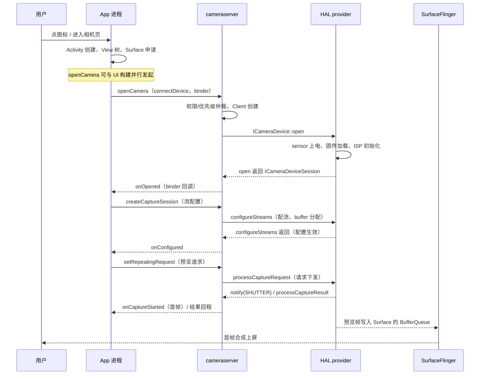

# 第 3 章 Camera 启动性能的 trace 分析

> 本文为分章源文件，供单章阅读；若与主文档不一致，以主文档最新版为准。
>
> 本章把《Android\_Camera\_APP\_面试题》Q65 的优化清单落到 trace 上：每个阶段在 trace 里长什么样、怎么拆、常见瓶颈怎么归因。文中耗时为**示意量级**（机型差异大），标注"A 层"的切片名为 AOSP 源码可核对，厂商切片名以实际 trace 为准（B/C 层）。

## 3.1 先定义清楚"启动"与"首帧"

分析前必须先锚定指标，否则各说各话（A 层概念，B 层实践口径）：

| 指标                   | 定义              | trace 上怎么取                                                 |
| -------------------- | --------------- | ---------------------------------------------------------- |
| 冷启动（进程被杀）            | 点图标 → 首帧可见      | Activity 启动 slice + 首帧 onCaptureStarted + FrameTimeline 首帧 |
| 温启动（进程在，Activity 重建） | 进相机页 → 首帧可见     | 同上，但少了进程/Application 初始化                                   |
| 热启动（后台返回，会话保留）       | 回前台 → 预览恢复      | `setRepeatingRequest` 到下一帧（或 SF 恢复合成）                      |
| 首帧                   | **预览画面第一帧真正上屏** | 相机 `onCaptureStarted`（曝光开始）+ SF 合成 + FrameTimeline 实际呈现    |

> 最常见的口径错误：把 `onOpened` 或 `onConfigured` 当"启动完成"。用户感知的是**画面可见**，两者之间还有首帧请求下发、曝光、SF 合成几段。

## 3.2 启动阶段地图

trace 上的对应关系（按 Perfetto 轨道）：

> 缩写约定：**SF = SurfaceFlinger**——Android 的系统合成器，独立 native 进程（init 启动，进程名 `surfaceflinger`），与 `system_server` 的 WMS 通过 Binder 协作；它负责把各应用的图层（Layer）按 Z 序合成一帧，再交给 HWC/显示控制器送显。相机预览帧进入 BufferQueue 后，就是由它消费并合成上屏。下文"SF 合成/SF 侧 jank"均指这个进程。**CS = cameraserver**（相机系统服务进程），**HWC = 硬件合成器**。

| 阶段                 | 在 trace 上看什么                                                                               | 典型量级（示意）      |
| ------------------ | ------------------------------------------------------------------------------------------ | ------------- |
| Activity 启动        | 主线程 `ActivityThread`/`Choreographer` 切片、`am` 分类、FrameTimeline                              | 100\~300ms    |
| openCamera（App→CS） | App 线程 `binder transaction` + cameraserver 线程 Running + `CameraService::connectDevice` 等切片 | 几十\~几百 ms     |
| provider 初始化       | provider 进程线程 Running、`camera` 分类切片（厂商）、binder 往返                                          | 冷启动常为最大不确定性   |
| configureStreams   | `configureStreams` 切片（CS/HAL）、`camera_memory` 缓冲分配、binder                                  | 几十\~数百 ms     |
| 首帧请求               | `submitRequestList`/RequestThread 切片、首帧 `onCaptureStarted`                                 | 1\~3 帧间隔 + 曝光 |
| 上屏                 | SF（SurfaceFlinger）合成 track、FrameTimeline                                                   | 1\~2 帧        |

## 3.3 逐段分析要点

### 3.3.1 Activity 与窗口（App 侧）

* 看主线程：`onCreate`/`onResume` 中的长任务（SDK 初始化、布局 inflate、资源加载）；
* 看 `Surface` 申请：SurfaceView 的 surfaceCreated 时机；预览控件尺寸与布局耗时；
* 看 FrameTimeline：进相机页的首个 jank 是否为 `App Deadline Missed`；
* 常见问题：Application 里同步初始化相机 SDK、在 `onCreate` 里同步查设备能力、布局过深导致首帧延迟。

### 3.3.2 openCamera → onOpened

链路（与《源码链路文档》第 2 章对应）：

1. App：`openCamera` 发出后，线程通常进入 **Sleeping（等 binder 回复）**，slice 上是 `binder transaction`；
2. cameraserver：找到对应 binder 线程 Running，可见 `CameraService::connectDevice` 之类切片，内部做权限校验与优先级仲裁；
3. provider：若 provider 进程未启动，先有 **进程冷启动 + 服务绑定** 成本（trace 上表现为新进程出现、线程创建、binder 往返）；随后 HAL `open` 内部进行 sensor 上电、固件加载、ISP 初始化——**厂商是否有打点决定这段可见性**；
4. 回到 App：`onOpened` 回调线程上出现回调 slice。

判读技巧：

* App 线程 Sleeping 而对应服务端线程 **Runnable 很多** → 服务端/系统调度压力（优先级、绑核）；
* 服务端线程 Sleeping 且下方有 D 状态 → 驱动/IO 等待（sensor 上电、I2C、固件读取）；
* 两段 binder 之间出现大段空白 → 看 provider 进程内是否在 Running（有算力消耗）还是也在等（依赖驱动）。

### 3.3.3 configureStreams（高频最大头）

* 在 cameraserver/App 上找 `configureStreams` 相关切片，看**总时长**与**内部构成**：流数量、尺寸、格式、buffer 分配（`camera_memory`）；
* 大流组合（4K 预览/高分辨率 JPEG/YUV 分析多路并存）显著拉长配流；`PRIV` 预览通常最便宜；
* 常见异常：
  * 配流失败后重试（trace 上看到两次 configureStreams）→ 用 `isStreamCombinationSupported`/`isSessionConfigurationSupported` 预检；
  * buffer 分配抖动（`camera_memory` 泳道出现密集分配）→ 检查 maxImages/流数量；
  * HAL 内部分配慢（厂商切片或旁证）→ 属于平台问题，App 侧对策是"小流先出帧、大流后补"。

### 3.3.4 首帧请求到上屏

* `setRepeatingRequest` 后看首帧 `onCaptureStarted` 的间隔：正常为 1\~3 个帧间隔；
* 若首帧迟迟不来：检查请求是否被更晚的配置/会话参数变更挤掉、pipeline 是否在等待 AE 收敛（首帧不需要收敛，但厂商实现可能等）；
* 上屏段看 SF（SurfaceFlinger，系统合成器）：预览帧进入 BufferQueue 后，SF 合成一帧并送显——若 SF 侧 jank，说明是**显示链路**而非相机；
* 亮度跳变（首帧暗）属于 AE 冷启动，不是启动慢，别混淆指标。

## 3.4 示例拆解（示意数据）

假设一次冷启动首帧 1.6s，trace 拆解如下（**数值为示意**，仅演示方法）：

| 阶段                                  | 耗时    | trace 证据                                       | 归因                 |
| ----------------------------------- | ----- | ---------------------------------------------- | ------------------ |
| 点图标 → Activity onCreate             | 260ms | 主线程长任务、FrameTimeline App Deadline              | App：SDK 初始化        |
| openCamera → onOpened               | 540ms | App Sleeping 等 binder；provider 进程冷启动 + Running | 系统/HAL：provider 冷启 |
| createCaptureSession → onConfigured | 380ms | configureStreams 切片长；camera\_memory 分配密集       | 配流：多流组合            |
| setRepeatingRequest → 首帧            | 120ms | 首帧 onCaptureStarted 延迟 \~2 帧                   | 正常                 |
| 首帧 → 上屏                             | 40ms  | SF 合成正常                                        | 正常                 |

优化优先级由此得出：先压 provider 冷启动（能否提前/复用会话）、再减首会话流（两段式）、最后是 App 初始化异步化——**与"先查设备枚举/权限"的直觉相反，数据说了算**。

## 3.5 与 Q65 优化清单的对应关系

| Q65 优化点 | trace 上验证收益看什么                          |
| ------- | --------------------------------------- |
| 提前枚举    | 相机页主线程不再出现设备查询的 binder 等待               |
| 权限预申请   | 启动链路中无弹窗导致的长 Sleeping/空白                |
| 异步并行    | openCamera 等待期间主线程仍有构建任务在 Running（并行度）  |
| 精简首会话   | 首会话只有预览流：configureStreams 时长下降；大流补配在首帧后 |
| 会话参数预热  | 首个请求处理时间变短；会话创建参数阶段无额外往返                |
| 热启动不重建  | 返回前台时无 configureStreams 切片              |

## 3.6 常见异常模式速查

| trace 特征                    | 可能原因              | 处理方向                  |
| --------------------------- | ----------------- | --------------------- |
| provider 进程首次出现 + 大量线程创建    | provider 冷启动      | 与系统团队对齐保活；产品层接受首次慢    |
| App Sleeping，服务端 Runnable 多 | 调度/优先级            | 查绑核、nice、大核频率；避免主线程争抢 |
| configureStreams 超长且内部空白    | HAL 内部配流/驱动等待     | 减流/降尺寸/两段式；平台侧反馈      |
| 首帧 onCaptureStarted 迟迟不来    | 请求未下发、pipeline 等待 | 检查请求发送时机、会话参数变更、3A 实现 |
| SF track 有 jank，相机 track 正常 | 显示/合成问题           | 查图层、遮挡、SF 负载          |
| 多次 configureStreams         | 配流失败重试/两段式误用      | 预检组合；确认两段式是设计而非异常     |

## 3.7 本章小结

* 启动分析的第一步是**锚定首帧指标**并分段，不是直接看总时长；
* 相机链路的多进程特性决定了必须"跳进程"读 trace：App 等 binder → 服务端跑 → HAL 等驱动，每一跳都要看状态；
* 常见大头依次是 provider 冷启动、configureStreams、App 初始化——用 trace 数据定优先级，别按直觉优化；
* 厂商 HAL 打点缺失时，用 binder/CPU/驱动旁证推断，并在结论里标注置信度。

下一章：拍照延迟的 trace 分析。
