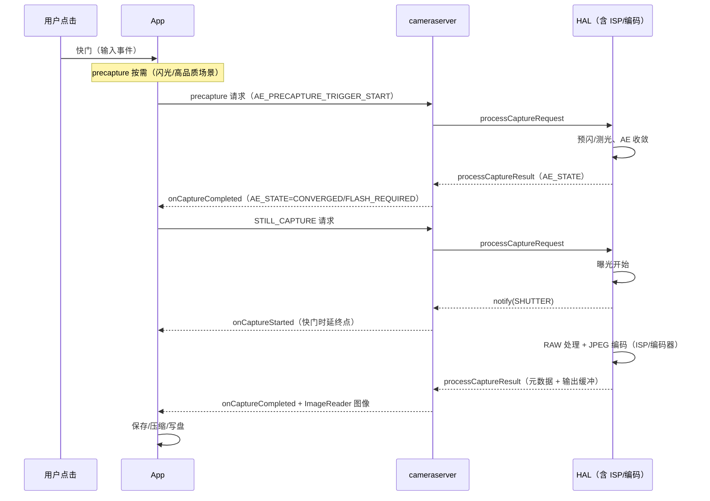
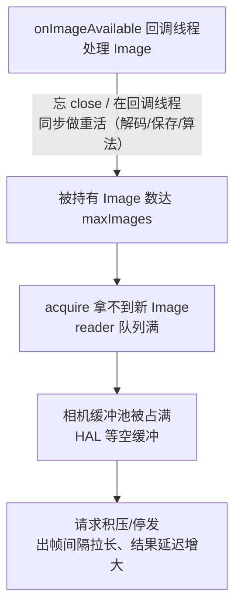

# 第 4 章 拍照延迟的 trace 分析

> 本文为分章源文件，供单章阅读；若与主文档不一致，以主文档最新版为准。
>
> 本章分析"按下快门到拿到照片"的完整链路。延迟定义、阶段拆分、常见瓶颈与 trace 特征。与第 3 章同口径：耗时量级为示意，厂商切片名以实际 trace 为准。

## 4.1 先定义延迟

| 指标 | 定义 | 用户感知 |
|---|---|---|
| 快门延迟（shutter latency） | 点击 → `onCaptureStarted`（曝光开始） | "按下去有没有反应" |
| 拍照延迟（capture latency） | 点击 → `onImageAvailable` / 照片数据就绪 | "多久能拍到" |
| 出图延迟（end-to-end） | 点击 → 写盘完成/缩略图显示 | "多久能发出去" |
| 首张延迟 | 冷启动后第一次拍照 | 首次体验最差 |
| 连拍间隔 | 相邻两次快门可被接受的最短间隔 | "能不能连按" |

分析前先对齐指标，否则"优化了 200ms"可能优化的是用户无感的段。

## 4.2 trace 上的拍照链路

trace 上的关键观察点：

| 环节 | 观察位置 | 说明 |
|---|---|---|
| 快门输入 | 主线程 `InputEventReceiver`/点击回调 slice | 输入延迟是否被主线程长任务拖累 |
| precapture 序列 | App 线程连续多个请求、cameraserver `submitRequestList` | 帧数 × 帧间隔决定收敛等待 |
| AE 收敛 | result 回程节奏、厂商 3A 切片（若有） | 无打点时用"从触发到 STILL_CAPTURE 的帧数"估计 |
| STILL_CAPTURE | 单次请求 slice + 帧号跳变 | 判断是否与预览 repeating 抢占 |
| 结果回程 | `onCaptureStarted`→`onCaptureCompleted`→`onImageAvailable` | 三段之间的空档分别对应 HAL 处理/编码/回调 |
| 编码落盘 | 编码器 track（若抓了 gfx/media）、App 写盘线程 D 状态 | 大图/HEIF 编码与 IO 是常见尾段 |

## 4.3 precapture 与 AE 收敛

- 高品质静帧前，App 通常发 `AE_PRECAPTURE_TRIGGER_START`，等结果里 `AE_STATE` 到达 CONVERGED/FLASH_REQUIRED 后再发拍照请求（APP 题库 Q26）；
- trace 上这段表现为**连续的请求帧 + 结果回程**，帧数不定（场景亮度、闪光决策、厂商调优）；
- 判读技巧：
  - 数"从 precapture 触发到 STILL_CAPTURE 请求"之间经过的帧（看 `onCaptureStarted` 次数或帧号）；
  - 若这段占比大（常见暗光/闪光场景），优化方向是**减少不必要的 precapture**（不需要闪光/光线充足时可跳过）、或复用已收敛的 3A 状态（连拍场景锁 3A）；
  - 暗光下 AE 拉长曝光本身降低帧率（APP 题库 Q36），trace 上表现为请求间隔变大——这是物理约束，不是 bug。

## 4.4 请求/结果与 pipeline depth

- 相机 HAL 是流水线：请求在途（in-flight）数量由 pipeline depth 决定（《源码链路文档》第 3 章）；
- trace 上：同一时刻多个请求的 `submitRequestList` 与结果回程交错；STILL_CAPTURE 请求要等前面的帧排空才能出结果——**拍照延迟的下限 ≈ pipeline depth × 帧间隔**；
- 判读技巧：
  - 若 `onCaptureStarted` 很快但图像回传晚 → 结果在 HAL/ISP 内部等待，非 App 问题；
  - 若请求提交本身被推迟（App 线程 Sleeping/等锁）→ App 侧问题（主线程卡顿、precapture 逻辑串行过重）；
  - ZSL 模板（`TEMPLATE_ZERO_SHUTTER_LAG`）下，快门前的帧已在流水线里，感知延迟显著降低——trace 上表现为结果回程紧随请求。

## 4.5 编码与落盘的尾段

- JPEG 属于 stalling stream：编码占 ISP/编码器资源，可能造成"拍照瞬间预览掉帧"——trace 上表现为拍照请求期间预览 track 出现空档或 SF jank；
- HEIF/高分辨率（48MP）编码更重；若 App 自己做后处理（滤镜/水印），编码前的 GPU/CPU 处理会在 App 线程可见；
- 尾段瓶颈判别：
  - App 线程 Running 且堆栈在编码/压缩 → App 侧处理慢；
  - 线程 D 状态（Uninterruptible Sleep）→ 写盘 IO（尤其低端机/满盘）；
  - 编码器 track 满载 → 硬件编码资源竞争（多摄/录像同开时）。

## 4.6 ImageReader 与缓冲（背压传导链）

ImageReader 是**有界队列**：`newInstance(w, h, format, maxImages)` 的 `maxImages` 限制"同时被应用持有的 Image 数"（接口语义见仓库文档：Android/Android_Camera_接口文档.md 第 1.8 节）；拿走不 `close()`，缓冲就不归还相机。消费慢不是孤立问题，而是沿链条反向传导（第 1 章 1.7 消费端地图的 ImageReader 行）：

trace 判读要点（APP 题库 Q14/Q35）：

- **消费线程状态**：`onImageAvailable` 回调线程（自建 Handler 线程）长期不 Running → 下游线程池排队；单帧长 slice → 在 listener 线程同步做了重活（典型：JPEG 解码、大图保存、算法推理）——处理移出回调线程、消费后立即 `close()`；
- **相机侧旁证**：结果回程间隔异常拉大 + HAL 无异常打点 + 预览 track 空档 + `camera_memory` 事件密集（缓冲池反复分配）——组合出现时优先怀疑 reader 背压，而不是急着怪 HAL；
- **`maxImages` 取值**：过大占内存（YUV/RAW 大帧尤甚）且**掩盖消费慢**（积压到深处才暴露）；过小直接丢帧。通行做法：最小够用 + 消费端异步化。

## 4.7 常见问题模式速查

| 现象 | trace 特征 | 根因方向 | 处理 |
|---|---|---|---|
| 按快门无反应 | 主线程点击回调前有长 slice；输入事件排队 | 主线程卡顿 | 相机回调移子线程、减少主线程工作 |
| 出图忽快忽慢 | precapture 帧数波动大；暗光帧间隔大 | AE 收敛/曝光物理约束 | 分场景统计、非闪光场景跳 precapture |
| 照片到了但预览卡一下 | 拍照请求期间预览空档；JPEG stalling | 编码资源竞争 | 降 JPEG 尺寸/延后编码；ZSL 路线 |
| 图像延迟固定偏大 | STILL_CAPTURE 结果总在 N 帧后 | pipeline depth 下限 | 接受预算或换 ZSL 模板 |
| 尾段慢且线程 D 状态 | 写盘 IO 等待、文件系统忙 | 存储 IO | 异步写、缓存目录、降低编码尺寸 |
| 连拍间隔大 | 每张都有完整 precapture+编码 | 串行链路 | 锁 3A 连拍、队列化拍照请求 |
| 越拍越慢、相机侧无异常 | 回调线程 Sleeping/长 slice；结果间隔同步拉大 | ImageReader 背压（忘 close/同步重活，见 4.6） | 消费后立即 close、处理异步化 |

## 4.8 本章小结

- 拍照延迟要拆成"快门→曝光→结果→编码→落盘"五段，每段在 trace 上有独立证据；
- precapture 与 pipeline depth 是**协议决定的下限**，优化空间在于跳过不必要环节与并行化；
- 编码/落盘尾段常被忽视，但用户感知的是"出图"，必须纳入预算；
- 消费端（ImageReader）背压会伪装成"相机侧异常"——先查消费线程、再查 HAL（1.7 消费端地图 + 4.6 传导链）；
- 相机 HAL 内部无打点时，用帧号节奏、结果回程间隔与线程状态推断，结论标注置信度。

下一章：把方法沉淀成可复用的分析流程。
