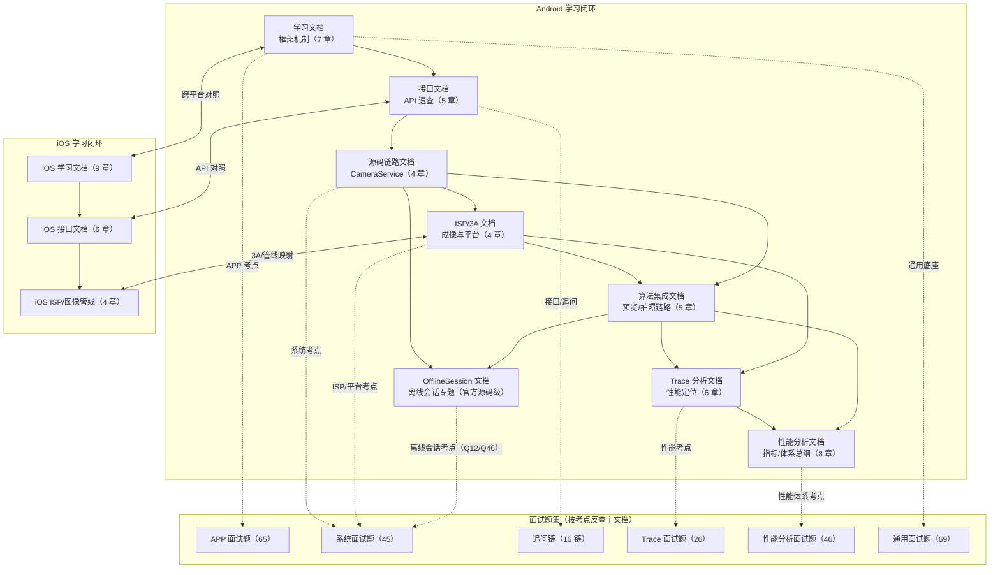

# camera-learning 📷

[](LICENSE)

个人相机开发学习仓库，覆盖 **Android 与 iOS 两大平台的相机框架**：Android 部分以 AOSP 官方文档与源码为基（可逐行溯源），iOS 部分以 Apple 官方文档/WWDC 为基（全栈闭源，采用可信度分层标注）。

## 文档关系图谱



读图方式：

- **Android 主线**（实线）：框架机制 → API 速查 → 源码链路 → ISP/3A → 算法集成 → Trace 性能分析，前一份是后一份的基础；OfflineSession 文档是从源码链路与算法集成延伸出的**专题深潜**；
- **面试题集**（虚线）：按考点反查对应主文档，答案可逐层溯源；
- **iOS 三份**（双向箭头）：与 Android 体系平行，章节按"架构/接口/ISP"一一对照阅读。

## 目录结构

```
camera-learning/
├── Android/                          # Android 相机学习资料
│   ├── Android_Camera_学习文档.md     # ★ 主文档：AOSP Camera 框架与机制（7 章）
│   ├── Android_Camera_接口文档.md     # ★ 主文档：应用层 + HAL 层接口速查（5 章）
│   ├── Android_Camera_源码链路文档.md # ★ 主文档：framework/CameraService 源码实现（4 章）
│   ├── Android_Camera_ISP_3A文档.md  # ★ 主文档：sensor/ISP 管线 + 3A 算法 + 高通/MTK 平台 HAL（4 章）
│   ├── Android_Camera_Trace分析文档.md # ★ 性能分析：Perfetto trace 基础 + 相机启动/拍照实战（6 章）
│   ├── Android_Camera_性能分析文档.md # ★ 性能总纲：指标/度量/分域优化/线上体系，含官方与业界实践（8 章）
│   ├── Android_Camera_算法集成文档.md # ★ 算法工程：预览/拍照两条链路的算法集成与选型（5 章）
│   ├── Android_Camera_OfflineSession文档.md # ★ 专题：离线会话三层官方语义（App/Service/HAL，API 30+，全链路时序与约束清单）
│   ├── interview/                    # 面试题集（6 份）
│   │   ├── Android_Camera_APP_面试题.md  # APP 层综合（65 题，★~★★★ 分级）
│   │   ├── Android_Camera_系统面试题.md  # framework/HAL/ISP 系统向进阶（45 题）
│   │   ├── Android_Camera_追问链面试题.md # 面试官追问链模拟（16 条链，逐层下潜）
│   │   ├── Android_Camera_Trace面试题.md # Camera 性能分析 trace 专项（26 题）
│   │   ├── Android_Camera_性能分析面试题.md # Camera 性能工程专项（46 题：指标/启动/预览/拍照/内存/功耗热/监控体系/案例 + 公开资料扩展专题）
│   │   └── Android_通用面试题.md         # Android 通用八股（69 题，12 大板块）
│   ├── aosp_camera_docs/             # 学习文档的分章源文件（chapter01~07）
│   ├── api_docs/                     # 接口文档的分章源文件（ch1~ch5）
│   ├── src_docs/                     # 源码链路文档的分章源文件（ch1~ch4）
│   ├── isp_docs/                     # ISP/3A 文档的分章源文件（ch1~ch4）
│   ├── trace_docs/                   # Trace 分析文档的分章源文件（ch1~ch6）
│   ├── perf_docs/                    # 性能分析文档的分章源文件（ch1~ch8）
│   ├── algo_docs/                    # 算法集成文档的分章源文件（ch1~ch5）
│   └── images/                       # 文档配图（44 张，已本地化，可离线阅读）
└── IOS/                              # iOS 相机学习资料
    ├── iOS_Camera_学习文档.md         # ★ 主文档：AVFoundation 架构与机制（9 章）
    ├── iOS_Camera_接口文档.md         # ★ 主文档：AVFoundation 接口速查 + PhotoKit/导出 + 两平台对照（6 章）
    ├── iOS_Camera_ISP_图像管线文档.md # ★ 主文档：Apple 计算摄影 + 应用侧处理栈 + 3A 映射（4 章）
    ├── ios_camera_docs/              # 学习文档的分章源文件（chapter01~09）
    ├── api_docs/                     # 接口文档的分章源文件（ch1~ch6）
    └── pipeline_docs/                # 图像管线文档的分章源文件（ch1~ch4）
```

## Android 四份主文档

| 文档                                                                  | 内容                                                                                                               | 适用场景                            |
| ------------------------------------------------------------------- | ---------------------------------------------------------------------------------------------------------------- | ------------------------------- |
| [Android\_Camera\_学习文档.md](Android/Android_Camera_学习文档.md)          | 依据 AOSP 官方文档"摄像头"板块全部 31 个页面整理：概览与架构、核心概念（3A/元数据/流配置）、性能优化、版本控制、18 个相机功能专题                                       | 系统学习 Camera 框架机制                |
| [Android\_Camera\_接口文档.md](Android/Android_Camera_接口文档.md)          | Camera2 / CameraX / Camera1 / NDK 应用层接口速查 + HAL 层（camera3.h、AIDL HAL、camera\_metadata）接口与元数据体系                   | 写代码时查方法、查接口                     |
| [Android\_Camera\_源码链路文档.md](Android/Android_Camera_源码链路文档.md)      | framework/CameraService 源码实现：三进程模型、openCamera 全链、会话与请求下发、结果回程与错误恢复（AOSP main 分支源码逐段核对，Mermaid 流程图/时序图）           | 框架开发、面试准备、问题排查                  |
| [Android\_Camera\_ISP\_3A文档.md](Android/Android_Camera_ISP_3A文档.md) | Sensor 成像原理、ISP 处理管线与统计模块、3A 算法（含 libcamera 开源实现逐函数分析）、高通 CAMX/Chi-CDK 与 MTK mtkcam 平台 HAL 架构（材料按 A/B/C 可信度分层标注） | ISP/3A 入门、平台 HAL 调研、tuning 团队衔接 |

建议阅读顺序：先读学习文档第 1 章建立整体图景 → 第 2 章核心机制 → 接口文档第 1/4 章对照应用层与 HAL 层的方法表 → 源码链路文档打通三层调用链 → ISP/3A 文档下沉到硬件与算法 → 其余章节按需查阅。

三份机制/源码文档共同特性：

* 每节附**官方来源链接**，可溯源到 AOSP 文档 / API 参考 / AOSP 源码（源码链路文档精确到文件与行号）；
* 配图已下载到本地（`images/`），**整仓克隆后可完全离线阅读**；源码链路文档与 ISP/3A 文档的图全部为 Mermaid 语法，可在 GitHub/Gitee/Typora 直接渲染；
* 关键表格（3A 状态机、版本对照、HAL ops、元数据统计、AIDL 接口方法表）以 Markdown 表格保留。

ISP/3A 文档额外特性：厂商闭源内容（CAMX/mtkcam 内部）按 **A（可验证官方资料）/ B（公开通行知识）/ C（社区多源印证）** 三级可信度逐条标注，不可印证的细节一律不写；开源参考实现（libcamera 的 AE/AWB/AF、内核 rkisp1/CAMSS 驱动）均给出可复查的源码来源。

## Camera 性能分析文档（总纲）

| 文档 | 内容 | 适用场景 |
|---|---|---|
| [Android_Camera_性能分析文档.md](Android/Android_Camera_性能分析文档.md) | 指标体系与性能预算（含行业 KPI 术语）、度量方法学（实验室/线上/FrameMetrics/JankStats）、启动/预览/拍照录像/内存带宽/功耗热五大分域优化、稳定性与线上体系（Vitals 红线、CI 门禁、事故复盘、成熟度自检）；**不限于本仓库**，融合 Android 官方文档（Vitals/Thermal/Baseline Profiles/Macrobenchmark/CameraX/前台服务）、androidx 库与公开工程实践 | 建立相机性能体系、指标对齐、优化立项与验收 |

与《Trace分析文档》（工具与判读）、《性能分析面试题》（速查）配套：总纲定口径与体系，Trace 文档给数据采集方法，题集供自测。

## Camera 性能分析文档（Trace）

| 文档                                                                   | 内容                                                                                                   | 适用场景                           |
| -------------------------------------------------------------------- | ---------------------------------------------------------------------------------------------------- | ------------------------------ |
| [Android\_Camera\_Trace分析文档.md](Android/Android_Camera_Trace分析文档.md) | Perfetto/Systrace 基础（数据模型、线程状态、渲染与 FrameTimeline）、抓取配置与自定义打点、Camera 启动与拍照延迟的逐段 trace 分析、归因方法论、常用 SQL | 性能优化、实验室/线上问题定位、面试 Q65/Q40 的深化 |

建议配合《Android\_Camera\_APP\_面试题》Q65（首帧启动优化）与《Android\_Camera\_系统面试题》Q40（perfetto 拆拍照出图慢）使用：面试题给结论清单，本篇给数据采集与证据链。

## Camera 算法集成文档

| 文档                                                             | 内容                                                                                                                                                | 适用场景                          |
| -------------------------------------------------------------- | ------------------------------------------------------------------------------------------------------------------------------------------------- | ----------------------------- |
| [Android\_Camera\_算法集成文档.md](Android/Android_Camera_算法集成文档.md) | 算法集成的分层地图（ISP 固件/HAL Node/Framework/App）、预览实时链路（HAL 内嵌 vs App GL vs 双流）、拍照高质量链路（HAL 多帧/ZSL reprocess/App 后处理/离线会话）、工程细节（数据/同步/线程/内存/热）、选型决策树与五个案例 | 相机算法方案设计、HAL/App 集成选型、性能与画质权衡 |

建议与《Android\_Camera\_ISP\_3A文档》第 2~~4 章（ISP stage/3A/平台 HAL）、《Android\_Camera\_Trace分析文档》第 3~~5 章（定位算法导致的掉帧/延迟）配合阅读。

## Camera OfflineSession 专题文档

| 文档 | 内容 | 适用场景 |
|---|---|---|
| [Android_Camera_OfflineSession文档.md](Android/Android_Camera_OfflineSession文档.md) | 离线会话（Offline Session）官方源码级专题：问题定义与核心思想、版本与能力地图（App API 30 / HIDL 3.6 / AIDL HAL）、App 层 API 语义（switchToOffline、supportsOfflineProcessing、回调与状态机）、完整 App 使用流程图/时序图与 Java 示例（连拍中途切模式全链路）、系统内部全链路切换时序图、Framework 原生层（CameraDeviceClient/Camera3OfflineSession/CameraOfflineSessionClient）、HAL AIDL 协议逐条解析（含 HalStream.supportOffline 规则与离线期间保证流组合）、17 条约束速查表、与 abortCaptures/ZSL/CameraX/iOS 机制对比、面试速记 10 条；全部关键语义附 AOSP/官方出处链接 | 离线会话机制深潜、App 集成参考、系统向面试、HAL 协议核对 |

## iOS 三份主文档

| 文档                                                          | 内容                                                                                                                                                        | 适用场景                        |
| ----------------------------------------------------------- | --------------------------------------------------------------------------------------------------------------------------------------------------------- | --------------------------- |
| [iOS\_Camera\_学习文档.md](IOS/iOS_Camera_学习文档.md)              | iOS 相机软件栈分层（与 Android 三进程模型对照）、AVFoundation 会话—输入—输出模型、3A 接口面、拍照/录像管线、多摄与深度、版本演进（iOS 8→26），照片库与 HDR 交付（PhotoKit/Adaptive HDR）、音频会话、性能与导出，全程与 Android 系列对照 | 有 Android 背景系统学习 iOS 相机     |
| [iOS\_Camera\_接口文档.md](IOS/iOS_Camera_接口文档.md)              | Session/Device/Photo/Video/高级能力接口字段与方法速查，PhotoKit/音频会话/导出编辑接口，第 5 章为两平台 3A 元数据与流语义总对照表 + 迁移检查清单                                                           | 写代码时查方法、跨平台迁移               |
| [iOS\_Camera\_ISP\_图像管线文档.md](IOS/iOS_Camera_ISP_图像管线文档.md) | Apple 传感器/ISP 公开口径与可观测边界、计算摄影体系（Smart HDR/Photonic Engine/ProRAW/Log）、应用侧处理栈（Core Image/Metal/VideoToolbox）、3A 控制面两平台完整映射                                 | 理解 Apple 成像行为、跨平台图像架构、3A 对齐 |

建议阅读顺序：学习文档第 1 章（三个结构差异：没有 HAL、没有逐帧元数据、计算摄影默认在场）→ 第 2 章会话模型 → 第 3 章 3A 对照 → 第 4 章拍照/录像管线 → 第 7/8 章照片库与音频闭环 → 接口文档第 5 章总对照表 → 图像管线文档按需深入。

iOS 系列文档特性：

* iOS 全栈闭源，**不设源码链路文档**；以 Apple 官方文档 / WWDC / AVCam 官方示例为 A 层来源，逐节附链接，延续 A/B/C 可信度分层；
* 章节组织与 Android 系列同位对照（学习/接口/ISP 三份 ↔ Android 四份），每个 3A 与能力主题均给出 Android 元数据/接口的映射表；
* 全部流程图/时序图为 Mermaid 语法；iOS 26（2025）与 WWDC26 的新 API（Cinematic 捕获、Capture Controls、ProRes RAW/Genlock、高分辨率拍照）已纳入版本演进与能力章节。

## 面试题集（6 份）

| 文档                                                                           | 定位                                                                                     | 题量          |
| ---------------------------------------------------------------------------- | -------------------------------------------------------------------------------------- | ----------- |
| [Android\_Camera\_APP\_面试题.md](Android/interview/Android_Camera_APP_面试题.md)  | APP 层综合：架构/API/3A/数据流/性能 + 进阶三板块与实战题，★\~★★★ 分级                                         | 65 题        |
| [Android\_Camera\_系统面试题.md](Android/interview/Android_Camera_系统面试题.md)       | 系统向进阶：CameraService 深挖、HAL3 协议工程、ISP/3A 算法工程、平台架构与调试实战（CAMX/mtkcam/perfetto/tuning）    | 45 题        |
| [Android\_Camera\_追问链面试题.md](Android/interview/Android_Camera_追问链面试题.md)     | 模拟真实面试节奏：16 条追问链逐层下潜（APP → 框架 → HAL/驱动），标注答断点与链底 ⏹                                     | 16 链 \~80 问 |
| [Android\_Camera\_Trace面试题.md](Android/interview/Android_Camera_Trace面试题.md) | Camera 性能分析 trace 专项：trace 基础/抓取、启动与拍照延迟分析、方法论与实战案例，答案可回溯到《Android\_Camera\_Trace分析文档》 | 26 题        |
| [Android\_Camera\_性能分析面试题.md](Android/interview/Android_Camera_性能分析面试题.md) | Camera 性能工程专项：指标体系与度量、启动/预览/拍照优化、内存与多路流带宽、功耗热与降级矩阵、线上监控与 CI 回归、实战案例；板块九为公开资料扩展（JankStats/Thermal API/功耗工具链/CameraX 性能/Vitals/Macrobenchmark/行业 KPI） | 46 题        |
| [Android\_通用面试题.md](Android/interview/Android_通用面试题.md)                      | 通用八股：组件/Handler/View（含自定义 View 专题）/IPC/协程/性能/Jetpack/Kotlin/Compose/网络/ART，含相机场景交叉引用   | 69 题        |

建议用法：按目标岗位选题集（APP 岗 → APP 综合 + 通用 + 追问链；系统/framework 岗 → 系统 + APP 综合；性能优化岗 → 性能分析 + Trace 专项 + 系统题 Q40/Q41）；六份题集互为索引，答案可回溯到对应主文档章节。

## 资料来源与致谢

* [AOSP 官方文档 - 摄像头](https://source.android.google.cn/docs/core/camera?hl=zh-cn)（CC BY 4.0）
* [Android API 参考](https://developer.android.google.cn/reference)（Camera2 / CameraX / Camera1 / NDK）
* [Apple 开发者文档](https://developer.apple.com/documentation/avfoundation)（AVFoundation / CoreImage / VideoToolbox / DriverKit）、[WWDC 视频](https://developer.apple.com/videos/)、[AVCam 官方示例](https://developer.apple.com/documentation/avfoundation/capture_setup/avcam_building_a_camera_app)
* AOSP 源码（main 分支）：[frameworks/av/services/camera/libcameraservice](https://android.googlesource.com/platform/frameworks/av/+/refs/heads/main/services/camera/libcameraservice/)、[hardware/interfaces/camera](https://android.googlesource.com/platform/hardware/interfaces/+/refs/heads/main/camera/)、[camera3.h](https://android.googlesource.com/platform/hardware/libhardware/+/refs/heads/main/include_all/hardware/camera3.h)、[system/media/camera](https://android.googlesource.com/platform/system/media/+/refs/heads/main/camera/docs/)

本文档为个人学习笔记，内容为对官方资料与开源代码的整理与转述，如有侵权或谬误请联系更正。

## 许可证

本仓库原创整理内容以 [MIT](LICENSE) 许可发布（Copyright © 2026 chiangyang）。

其中衍生自 AOSP 官方文档的部分，依据上游许可 [CC BY 4.0](https://creativecommons.org/licenses/by/4.0/) 保留署名再分发（来源见上文"资料来源与致谢"）；Apple 官方文档/WWDC 材料的引用为学习性整理，版权归 Apple 所有。

## 更新日志

* 2026-09-05：首次整理，完成 Android 相机学习文档与接口文档，配图本地化。
* 2026-09-06：新增《Android\_Camera\_源码链路文档》（framework/CameraService 源码链路 4 章，21 张 Mermaid 图，全部结论出自 AOSP main 分支源码并附行号）。
* 2026-09-06：新增《Android\_Camera\_ISP\_3A文档》（sensor/ISP 管线、3A 算法与平台 HAL 4 章，24 张 Mermaid 图；含 libcamera 开源算法分析、Qualcomm 官方文档引用，内容按 A/B/C 可信度分层标注）。
* 2026-09-19：ISP/3A 文档第 3 章扩充：新增闪光灯 3A 与 precapture 时序（3.2.7）、AWB Bayes 色温估计算法逐函数分析（3.3.5）、多摄 3A 同步元数据与变焦切换（3.5.5）；全部分章源文件加入与主文档的同步声明。
* 2026-09-19：新增 iOS 系列三份主文档（《iOS\_Camera\_学习文档》6 章、《iOS\_Camera\_接口文档》5 章、《iOS\_Camera\_ISP\_图像管线文档》4 章）及对应分章源文件：以 Apple 官方文档/WWDC 为 A 层来源，延续 A/B/C 可信度分层，全程与 Android 系列对照（3A/元数据/能力映射表），不设源码链路文档（iOS 闭源）。
* 2026-09-19：iOS 系列补全闭环：学习文档扩至 9 章（新增第 7 章照片库与 HDR 交付/PhotoKit/Adaptive HDR Gain Map、第 8 章音频会话 AVAudioSession、第 9 章性能/导出/空间视频；第 1 章增补"无 CameraX 等价物"定位、第 5 章扩充 Continuity Camera）；接口文档扩至 6 章（新增第 6 章 PhotoKit/音频/导出接口速查）。
* 2026-10-18：新增面试题集 3 份：《Android\_Camera\_系统面试题》（framework/HAL/ISP 系统向进阶 45 题）、《Android\_Camera\_追问链面试题》（16 条追问链模拟面试节奏）、《Android\_通用面试题》（12 板块 69 题）；与既有《Android\_Camera\_APP\_面试题》构成 4 份题集；同日补充自定义 View 专题、Q16 Handler 泄漏 Java demo、Q30 AIDL 详解与 demo、Q41 Baseline Profile 实操流程、Q65 首帧启动扩写。
* 2026-10-18：新增《Android\_Camera\_Trace分析文档》（6 章：trace 基础、抓取与工具链、Camera 启动/拍照延迟分析、归因方法论、Perfetto SQL）+ trace\_docs/ 分章源文件；与首帧优化（Q65）、perfetto 排查（系统题 Q40）交叉引用。
* 2026-10-18：新增面试题集《Android\_Camera\_Trace面试题》（26 题：trace 基础/抓取/启动/拍照/方法论实战），面试题集增至 5 份；修正 Trace 文档 ch3/ch4 时序图与 ch1 数据来源图。
* 2026-10-18：新增《Android\_Camera\_算法集成文档》（5 章：分层地图、预览算法集成、拍照算法集成、工程细节、选型与案例）+ algo\_docs/ 分章源文件；涵盖 HAL/ISP 内嵌、App GL、ZSL reprocess、多帧融合、离线会话与相机算法选型决策树。
* 2026-10-18：README 新增“文档关系图谱”（Mermaid）：Android 主线（学习→接口→源码→ISP/3A→算法→Trace）、5 份面试题集反查关系、iOS 三份对照关系；徽章改为本地 SVG（解决 shields.io 外链加载失败）。
* 2026-10-25：新增面试题集《Android\_Camera\_性能分析面试题》（46 题：指标体系与度量/启动/预览流畅性/拍照延迟/内存与带宽/功耗热与稳定性/线上监控与 CI 回归/实战案例 + 板块九公开资料扩展——JankStats/FrameMetrics、Thermal API、功耗测量工具链、CameraX 性能配置、Android Vitals、Macrobenchmark、行业 KPI 术语），面试题集增至 6 份；同日完成 interview 目录 5 份题集的事实审校（Camera Extensions API 31、Binder 线程池 15、fence 语义、SENSOR_TIMESTAMP 定义等 12 处修正）。
* 2026-10-25：新增《Android\_Camera\_性能分析文档》（8 章 + perf\_docs/ 分章源文件）：指标体系与预算、度量方法学（FrameMetrics/JankStats/三环境分工）、启动/预览/拍照录像/内存带宽/功耗热分域优化、稳定性与线上体系（Vitals/CI 门禁/复盘模板/成熟度）；内容融合仓库文档与官方公开资料（Vitals、Thermal API、Baseline Profiles、Macrobenchmark、CameraX、Battery Historian）与业界实践，README 关系图谱同步更新。
* 2026-10-25：《Android\_Camera\_性能分析文档》全 8 章扩写为详解版（593 → 1207 行）：各章补充机制推导、代码骨架（FrameMetrics/JankStats/Thermal 监听/两段式会话/栅栏模式/消费纪律/退避重试/Macrobenchmark）、算例（帧预算分账、曝光-帧率数学、内存峰值、带宽、高速摄像延迟换算）与实践纪律（滞回设计、基线管理、复盘模板、成熟度自检）。
* 2026-10-25：新增《Android\_Camera\_OfflineSession文档》（离线会话官方源码级专题，单文件 9 章）：App API（API 30：switchToOffline/supportsOfflineProcessing/回调状态机/Java 示例）、Framework 原生层（CameraDeviceClient/Camera3OfflineSession/CameraOfflineSessionClient）、HAL AIDL 协议逐条解析（三个 parcelable、HalStream.supportOffline、离线期间保证流组合）、全链路时序图与 17 条约束速查表，关键语义全部附 AOSP/官方链接；修正《算法集成文档》3.5 节"App 侧无直接 API"的错误表述（聚合文档与 algo\_docs/ch3 同步），系统题 Q12、APP 题 Q46 补充交叉引用，README 关系图谱新增 A8 节点。
* 2026-10-25：《Android\_Camera\_OfflineSession文档》第 3 章扩充完整 App 使用示例：新增 3.6 App 视角流程图（能力检查→配流→流级查询→连拍→切换决策→离线收尾/降级路径）、3.7 App 级时序图、3.8 两种连拍形态与离线会话兼容性说明（非重复 `capture()` 可迁移 / `setRepeatingRequest` 会被 abort）与完整 Java 示例（OfflineBurstCamera：打开相机→配流→预览→连拍→switchToOffline→离线回调→ImageReader 持续消费→资源收尾，minSdk 30）。
